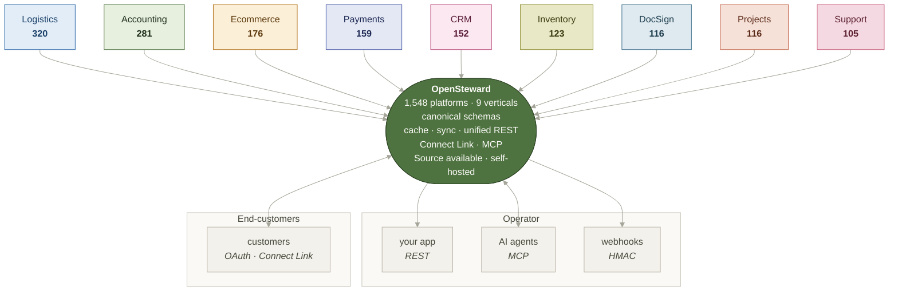
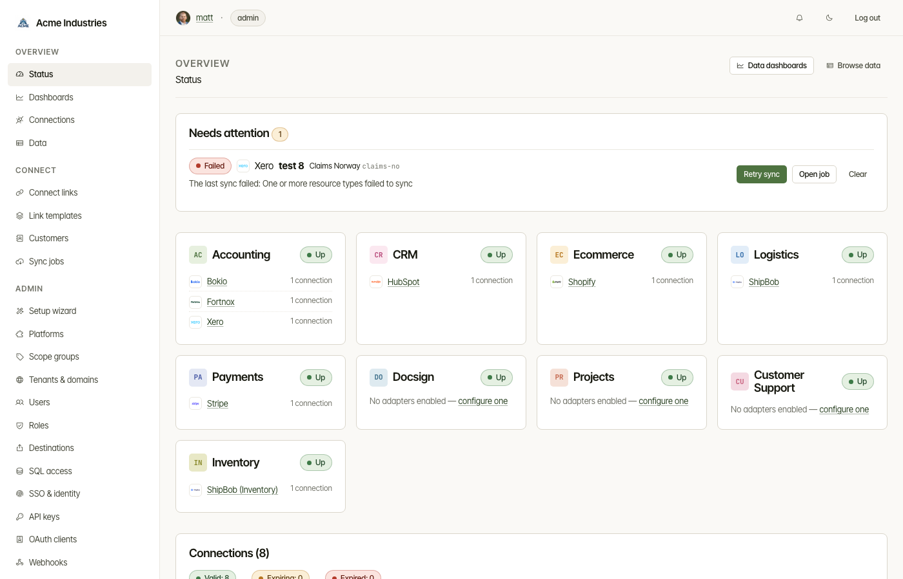
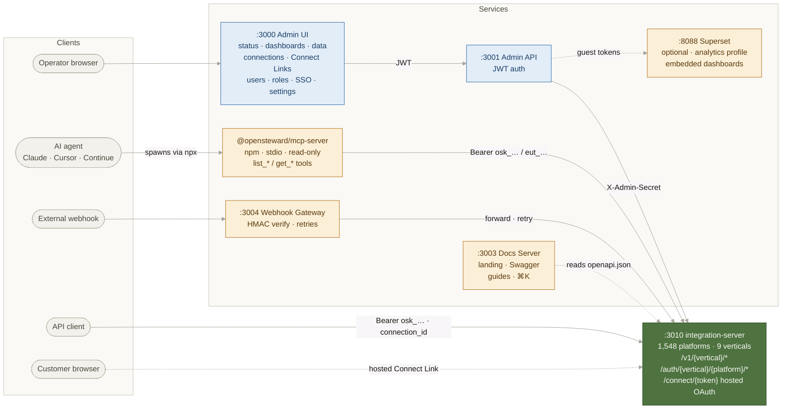

<p align="center">
  <picture>
    <source media="(prefers-color-scheme: dark)" srcset="packages/design-system/logo/wordmark-dark.svg">
    
  </picture>
</p>

> **Your customers' data. On your servers.**



A self-hosted integration aggregator which maps every platform in a vertical to a unified REST API. No sign-up, no gateway lock-in — `git clone`, configure, run. Support for AI Agents via a built-in MCP server.

## Why OpenSteward?

- **[Data sovereignty & compliance](./docs/why-opensteward.md#data-sovereignty--compliance)** — HIPAA, PCI-DSS, SOC 2, GDPR, data residency
- **[No per-call pricing](./docs/why-opensteward.md#no-per-call-pricing)** — flat infra cost, scales with your servers, not your customers
- **[No vendor lock-in](./docs/why-opensteward.md#no-vendor-lock-in)** — integration logic lives in your codebase
- **[Full observability](./docs/why-opensteward.md#full-observability)** — own the logs, metrics, tracing
- **[Source-available freedoms](./docs/why-opensteward.md#source-available-freedoms)** — commercial use, fork, embed in what you sell, patent grant; one restriction, and it probably isn't you
- **[Auditable source](./docs/why-opensteward.md#auditable-source)** — inspect every line, verify claims, security-review friendly
- **[Extensibility](./docs/why-opensteward.md#extensibility)** — custom adapters and new verticals via scaffold CLI
- **[Adapter breadth](./docs/why-opensteward.md#adapter-breadth)** — 1,548 platforms across accounting, CRM, e-commerce, logistics, payments, docsign, projects, customer-support, inventory
- **[Adapter verification](./docs/platforms/platforms.md#verification)** — breadth is not depth, so the catalog says which is which: **9 of 1,548** adapters have been exercised beyond scaffolding (1 unit tested, 8 verified). Every other one ships an adapter that has never been run against its real API. `pnpm check:adapter-verification` keeps this number honest
- **[Connect Link](./docs/architecture/connect-links.md)** — tokenised hosted-OAuth flow for customers. Console-minted links ask for the platform's configured scopes by default, and developer-API links ask for read-only scopes by default. Also: per-link read-only or scope-group overrides, reusable templates, one-time read-only mode, and a starting sync schedule per link
- **[MCP server](./apps/mcp-server/README.md)** — `@opensteward/mcp-server` exposes read-only customer data to AI agents (Claude Desktop, Cursor, Continue, Cline, gemini-cli) via the Model Context Protocol
- **[TypeScript SDK](./docs/sdk/getting-started.md)** — `@opensteward/sdk` ships typed public and operator clients generated from the OpenAPI specs; one `pnpm add` + `createPublicClient` / `createOperatorClient` for tenant developers and CI scripts
- **[Unified schema](./docs/why-opensteward.md#unified-schema)** — one canonical shape per resource regardless of platform
- **[Type-safe & Zod-validated](./docs/why-opensteward.md#type-safe--zod-validated)** — TypeScript strict + runtime validation at every boundary
- **[Default-on data store](./docs/dev-api.md#7-data-store-is_livetrue-and-sync)** — read-through cache on SQLite, or on Postgres when `DATABASE_URL` is set. A per-connection sync schedule keeps it fresh: the default interval, a custom one, trigger only, or one-time. `?is_live=true` opts out per request, and `external` mode fans out signed `resource.*` events for your own DB
- **[Data access](./docs/architecture/data-access.md)** — browse synced records in the admin console with personal data masked by default (reveals and exports are audited), 22 built-in dashboards plus your own, scheduled [exports to your lake or warehouse](./docs/integrate/destinations.md), and [read-only SQL logins](./docs/integrate/sql-access.md) for BI tools (Postgres). All of it is limited to the tenants each user may see
- **[Hardened security posture](./docs/security/README.md)** — non-root containers, SSRF-resistant outbound fetch, OAuth redirect-URI allow-list, per-platform webhook signature registry (fail-closed), constant-time secret compares, entropy-gated secrets, per-username login lockout, credential-redacting error logs, fail-closed first-run setup (empty-user-table gate plus an optional `BOOTSTRAP_TOKEN` / `X-Bootstrap-Token` gate), Redis-backed rate limit. See [`docker-compose.hardening.yml`](./docker-compose.hardening.yml) for the production overlay.
- **[Cloud-ready](#deploy-to-your-cloud-kubernetes)** — `helm install` into your own AWS/Azure/GCP VPC; SQLite trial or HA Postgres from one chart; signed + SBOM'd images, External-Secrets-Operator secret management, per-cloud overlays, reference Terraform/Bicep, and BYOL marketplace listings

See [when a managed platform is the better choice](./docs/why-opensteward.md#when-a-managed-platform-is-the-better-choice) for the honest trade-off.

## Admin console

<p align="center">
  <picture>
    <source media="(prefers-color-scheme: dark)" srcset="docs/assets/screenshots/admin/status-dark.png">
    
  </picture>
</p>

A web console at `http://localhost:3000` for running the whole deployment. Each
page shows only what the signed-in user's role and tenant scope allow:

**Overview**
- **[Status](./docs/admin/status.md)** — the health of every vertical, plus a **Needs attention** list where each problem comes with the action that fixes it
- **[Dashboards](./docs/admin/dashboards.md)** — 22 built-in dashboards and a no-code builder over synced data, shareable by tenant; optional embedded Superset
- **[Connections](./docs/admin/connections.md)** — every authorized account, with health, **Sync now**, and a per-connection sync schedule
- **[Data](./docs/admin/data.md)** — browse synced records, masked by default; audited reveal and CSV/NDJSON export

**Connect**
- **[Connect links and templates](./docs/admin/connect-links.md)** — send customers a link to authorize a platform; reusable presets
- **[Customers](./docs/admin/customers.md)** — end-customers, their connections and links, and per-customer MCP tokens
- **[Sync jobs](./docs/admin/sync-jobs.md)** — what synced, why (scheduled, Sync now, API, after connecting), and per-resource progress

**Admin**
- **[Setup wizard](./docs/admin/setup-wizard.md)** — eight first-run steps from data store to webhooks
- **[Platforms and scope groups](./docs/admin/platforms.md)** — enable adapters, enter OAuth credentials, build read-only scope bundles
- **[Users, roles and tenant scope](./docs/admin/users-and-roles.md)** — built-in and custom roles, and per-user tenant restrictions
- **[SSO & identity](./docs/admin/sso.md)** — OIDC, SAML and LDAP sign-in, group-to-role and group-to-tenant mapping, SCIM
- **[Destinations](./docs/admin/destinations.md)** — scheduled exports to S3, GCS, Azure, Postgres, Snowflake, BigQuery, Databricks or Iceberg
- **[SQL access and Superset](./docs/admin/sql-access-and-superset.md)** — read-only Postgres logins for BI tools, and embedded Superset (Postgres only)
- **[API keys, OAuth clients and webhooks](./docs/admin/api-keys-oauth-and-webhooks.md)** — developer API credentials and signed outbound events
- **[Tenants, company and settings](./docs/admin/tenants-company-and-settings.md)** — tenants and custom domains, branding and white-label, runtime settings, system versions
- **[Audit log](./docs/admin/audit-and-profile.md)** — every change, filterable and exportable

**Header**
- **[Notifications](./docs/admin/tenants-company-and-settings.md#notifications)** behind the bell, **[My profile](./docs/admin/audit-and-profile.md#my-profile)**, and a light/dark theme toggle

**[Full guide →](./docs/admin/README.md)**

---

## Quick start (Docker)

```bash
# 1. Clone
git clone https://github.com/open-steward/opensteward.git
cd opensteward

# 2. Create config files from examples (one per aux app)
for app in admin admin-api webhook-gateway integration-server; do
  cp apps/$app/config/config.example.yml apps/$app/config/config.yml 2>/dev/null || true
done

# 3. Set secrets — required, including for a local `docker compose up`.
#    The images set NODE_ENV=production, so a service started on one of the
#    `change-me-…` placeholders that compose falls back to refuses to boot,
#    and names the offending variable. Generate every value in one shot:
./scripts/generate-secrets.sh > .env && chmod 600 .env

# 4. Start everything
docker compose up --build

# Production: layer the container-hardening overlay on top:
#   docker compose -f docker-compose.yml -f docker-compose.hardening.yml up -d
```

All services start with health checks and dependency ordering. Once healthy:

| Service | URL | Description |
|---------|-----|-------------|
| Admin UI | http://localhost:3000 | The [admin console](./docs/admin/README.md): status, dashboards, data viewer, connections and sync schedules, Connect Links, customers, platforms, users, roles and SSO, destinations, SQL access, settings and the audit log |
| Admin API | http://localhost:3001 | Headless JSON REST API (JWT auth) |
| Docs Server | http://localhost:3003 | Marketing landing, Unified API and Operator API in Swagger UI (`/unified-api`, `/operator-api`), markdown guides (`/guides`), platform catalog (`/platforms`), Postman bundle (`/postman`), ⌘K palette |
| Webhook Gateway | http://localhost:3004 | Central webhook receiver with retries |
| **integration-server** | **http://localhost:3010** | **Unified integration API — 1,548 platforms across 9 verticals** |
| MCP server *(npm only)* | `npx @opensteward/mcp-server` | Read-only AI-agent surface; stdio transport, mounted in Claude Desktop / Cursor / Continue / Cline / gemini-cli config. Not in `docker-compose.yml` — runs per-agent. See [`apps/mcp-server/README.md`](./apps/mcp-server/README.md). |
| Superset *(optional, `analytics` profile)* | http://localhost:8088 | Apache Superset for [embedded dashboards](./docs/deployment/superset.md). The profile also starts a Postgres that holds OpenSteward's database and Superset's metadata. Superset needs OpenSteward on that Postgres (`DATABASE_URL`), so start the profile with `docker-compose.analytics.example.yml` layered on top. |

Every published port binds to `127.0.0.1` only. Optional services sit behind
compose profiles and stay off unless you ask for them with
`docker compose --profile <name> up -d`:

| Profile | Adds | For |
|---|---|---|
| `sso-dev` | a mock OIDC identity provider on `127.0.0.1:9400` | rehearsing admin SSO locally — [operations/sso-testing.md](./docs/operations/sso-testing.md) |
| `https` | Caddy on `127.0.0.1:443` with a local CA | OAuth providers that refuse `http://` redirect URIs — [operations/local-https.md](./docs/operations/local-https.md) |
| `scale` | Redis on `127.0.0.1:6379` | shared rate-limit buckets across integration-server replicas (set `REDIS_URL`) |
| `analytics` | Postgres on `127.0.0.1:5432`, plus Superset on `127.0.0.1:8088` | read-only SQL access and embedded Superset — [deployment/superset.md](./docs/deployment/superset.md) |

On first visit to `http://localhost:3000` you create the first admin account, and then the
[setup wizard](./docs/admin/setup-wizard.md) walks through the rest. When `BOOTSTRAP_TOKEN` is
set, the first-run page asks for it before it will create that account, so a published
deployment cannot be claimed by whoever reaches it first.

## Quick start (local)

```bash
# Prerequisites: Node.js 24+, pnpm 9+
pnpm install
# Build the workspace packages the apps import (shared, destinations,
# design-system, platforms-ui, codegen, …) in dependency order — turbo, 14 tasks:
pnpm run build

# Copy config files
for app in admin admin-api webhook-gateway integration-server; do
  cp apps/$app/config/config.example.yml apps/$app/config/config.yml 2>/dev/null || true
done

# Start the unified integration service
pnpm --filter integration-server run dev    # :3010

# Start auxiliary services
pnpm --filter admin-api run dev           # :3001
pnpm --filter admin run dev               # :3000 (admin)
```

## Deploy to your cloud (Kubernetes)

Beyond `docker compose`, OpenSteward installs into any Kubernetes cluster — your own
**AWS / Azure / GCP VPC** or on-prem — from a single Helm chart. The *same* chart runs on
**SQLite** for a single-node trial or **external Postgres** for HA, switched by one value.

```bash
# Trial — SQLite, secrets generated on first boot, one command.
helm install os deploy/helm/opensteward \
  --set database.mode=sqlite --set secrets.source=generate

# Production HA — external Postgres + your cloud's secret store, via a per-cloud overlay.
helm install os deploy/helm/opensteward \
  -f deploy/helm/overlays/aws-values.yaml -f my-values.yaml
```

| | what you get |
|---|---|
| **Both DB modes** | `database.mode=sqlite` (PVC, single writer — trials) or `postgres` (stateless, HPA + PDB, rolling/zero-downtime). One chart, no rework. |
| **Secret management** | `secrets.source` = existing K8s Secret · **External Secrets Operator** (AWS Secrets Manager / Azure Key Vault / GCP Secret Manager) · first-boot **generate** Job · plain (dev). Plus a `STORE_SECRET` rotation Job + runbook. |
| **Per-cloud overlays** | `deploy/helm/overlays/{aws,azure,gcp}-values.yaml` wire each cloud's ingress + TLS, managed Postgres/Redis, and workload identity (IRSA / Azure WI / GKE WI). |
| **Reference IaC** | `deploy/iac/{aws,azure,gcp}` — Terraform / Bicep provisioning the cluster, managed Postgres, secret store, and the identity trust the chart needs. |
| **Signed supply chain** | Five per-service images on GHCR — multi-arch (amd64 + arm64), digest-pinned, **cosign-signed (keyless)**, SBOM-attested, Trivy-gated. |
| **Hardened by default** | every pod non-root + read-only rootfs + dropped caps + seccomp; `NODE_ENV=production` fail-closes on a weak/missing secret; default-deny NetworkPolicy; admin-api is ClusterIP-only and never exposed. |
| **Marketplace (BYOL)** | listing artifacts for the AWS / Azure / GCP marketplaces in `deploy/marketplace/` — bring-your-own-license, no metering, all on your infra. |

Full guides: the [chart README](./deploy/helm/opensteward/README.md), the
[per-cloud overlays](./deploy/helm/overlays/README.md), the
[reference IaC](./deploy/iac/README.md), and the
[marketplace artifacts](./deploy/marketplace/README.md).

## Architecture

> Full diagrams in **[docs/architecture/](./docs/architecture/)** — mermaid charts covering services, data flows, persistence, the operator's end-user journey, the setup wizard, adapter lifecycle, auth/tenancy, and webhook delivery. Start with [the overview](./docs/architecture/README.md) or jump straight into [the operator journey](./docs/architecture/end-user-journey.md).



Every `/v1/*` request carries `?connection_id=<uuid>` — the connection row in the credential store tells the server which vertical, platform, and tenant to dispatch to. No `X-Platform` or `X-Tenant` headers. No per-vertical URLs to juggle.

Behind the API, integration-server caches each connection's records in its data store: SQLite by default, or Postgres when `DATABASE_URL` is set. Move an existing deployment between the two with `scripts/switch-db.sh` ([switching databases](./docs/operations/switching-databases.md)). A sync scheduler re-reads each connection on its own [sync schedule](./docs/admin/connections.md#sync-schedules), which is the deployment interval (6 hours by default), a custom interval, trigger only, or one-time. The admin console's data viewer and dashboards read that store through admin-api, which sends each user's tenant scope with every request, and integration-server checks it again ([data access](./docs/architecture/data-access.md)).

## Monorepo layout

```
apps/
  admin/                  — Admin frontend (:3000) — Fastify + EJS
  admin-api/              — Admin REST API (:3001) — JWT auth
  docs-server/            — Marketing + Swagger UI + guides + ⌘K palette (:3003)
  webhook-gateway/        — Inbound webhook receiver (:3004)
  integration-server/     — Unified integration service (:3010)
    └─ src/verticals/
       ├─ accounting/     — 281 adapters
       ├─ crm/            — 152 adapters
       ├─ ecommerce/      — 176 adapters
       ├─ logistics/      — 320 adapters
       ├─ payments/       — 159 adapters
       ├─ docsign/        — 116 adapters
       ├─ projects/       — 116 adapters
       ├─ customer-support/ — 105 adapters
       └─ inventory/      — 123 adapters
  mcp-server/             — @opensteward/mcp-server — read-only MCP surface
                            for AI agents (stdio · npm-distributed)
packages/
  shared/                 — Shared runtime: stores, routers, auth, schemas, server factory
  design-system/          — Design tokens, base + components CSS, Swagger @layer theme, logos
  platforms-ui/           — Shared platform-browse UI used by docs-server `/platforms`
  codegen/                — Doc generation + logo-fetch utilities
  sdk/                    — @opensteward/sdk — typed public + operator clients (generated)
  license-token/          — @opensteward/license-token — license token contract (PASETO v4.public; npm, ELv2)
  cli/                    — @opensteward/cli — the `os` binary (generated from the specs)
  destinations/           — @opensteward/destinations — export engine for destinations:
                            Parquet to S3/GCS/Azure, Postgres, Snowflake, BigQuery,
                            Databricks, Iceberg (used by integration-server)
docs/                     — Generated API docs + hand-written guides
  ├─ admin/               — the admin console guide, page by page
  ├─ architecture/        — Mermaid diagrams: services, runtime flows, persistence,
  │                          adapter lifecycle, auth/tenancy, Connect Links, data access, etc.
  ├─ integrate/           — per-platform integration walkthroughs, destinations, SQL access
  ├─ openapi/             — unified openapi.{json,yaml}
  ├─ api-reference/       — auto-generated markdown reference
  ├─ postman/             — Postman collection + environments
  ├─ platforms/           — platforms.{md,json} (fetched logos land here, gitignored)
  ├─ environment/         — env-var reference (generated)
  ├─ deployment/          — custom domain + TLS, SSO and OIDC setup, Postgres analytics,
  │                          Superset, backup/restore, upgrading, key rotation
  ├─ operations/          — cli.md (generated) + runbooks: SSO testing, local HTTPS,
  │                          data erasure, switching databases, platform logos
  ├─ sdk/                 — @opensteward/sdk getting-started guide
  ├─ security/            — threat model + hardening guide + operator checklist
  ├─ business-cases/      — regulatory and commercial framing
  ├─ assets/              — screenshots and images used by the guides
  ├─ dev-api.md           — end-to-end developer-API walkthrough
  ├─ mcp.md               — connecting AI agents
  └─ GLOSSARY.md          — canonical term definitions
deploy/                   — Cloud deployment
  ├─ helm/opensteward/    — umbrella Helm chart (both DB modes, ESO, rotation)
  ├─ helm/overlays/       — per-cloud values: aws / azure / gcp
  ├─ iac/                 — reference Terraform (aws, gcp) + Bicep (azure)
  └─ marketplace/         — BYOL listing artifacts: aws / azure / gcp
e2e/                      — @opensteward/e2e — Playwright browser journeys (pnpm test:e2e)
scripts/                  — Release, CI checks, build-search-index for ⌘K
```

## Development

```bash
pnpm install                                        # install all deps
# Build every workspace package the apps import (required before anything
# else — turbo orders all 14 tasks via ^build, so no package is missed):
pnpm run build
pnpm -r test                                        # run all tests (~110k)
pnpm run test:e2e                                   # Playwright browser journeys — needs a running stack, not in -r test (see e2e/README.md)
pnpm -r run typecheck                               # typecheck everything
pnpm -r run lint                                    # lint everything
```

### Per-app commands

```bash
pnpm --filter integration-server run dev              # dev server with hot reload
pnpm --filter integration-server test                 # run unit tests (~105k across ~8,900 files)
pnpm --filter integration-server run build            # compile TypeScript

# Live OAuth integration suites (opt-in)
EASYPOST_TEST_API_KEY=... pnpm --filter integration-server test easypost
# Drop a .tokens.json in apps/integration-server/tests/integration/fortnox/
# to enable the Fortnox sandbox suite (gitignored; see setup.ts for the shape).
pnpm --filter integration-server test fortnox
```

### Generating docs

```bash
pnpm run docs:all        # regenerate openapi.json + api-reference + postman + platforms + env vars
pnpm run check:docs      # CI — fail if any generated doc is stale
```

Outputs:
- `docs/openapi/openapi.{json,yaml}` — unified spec across all nine verticals
- `docs/api-reference/api-reference.md` — markdown Unified API reference
- `docs/postman/openapi.postman_collection.json` + `openapi-{local,production,test}.postman_environment.json`, plus `admin-api.postman_collection.json` + `admin-api-local.postman_environment.json`
- `docs/platforms/platforms.md` — 1,548 platforms, one table
- `docs/environment/environment-variables.md` — every `*_CLIENT_ID` / `*_SECRET` the service recognises
- `apps/docs-server/dist/search-index.json` — ⌘K search index (run `pnpm docs:search-index` or `pnpm docs:all`)

### AI context exclusions

`.aiignore` at the repo root lists tracked paths AI tooling should skip when
building context — brand logos, generated openapi.json (dup of yaml), postman
collection, fonts, lockfiles — about 2.13M tokens of noise (40% of the raw
repo size). Cursor honors it via `.cursorignore` (symlink), Continue.dev via
`.continueignore` (symlink). Claude Code and GitHub Copilot have no file
ignore today; agents should consult `.aiignore` manually when sizing context.

Re-measure after adding patterns:

```bash
git ls-files | grep -vFf <(grep -vE '^\s*(#|$)' .aiignore | sed 's:^/::; s:/$::') | xargs wc -c | tail -1
```

### Adding a new adapter

See [CONTRIBUTING.md](./CONTRIBUTING.md) for the full guide. Adapter modules live under `apps/integration-server/src/verticals/<vertical>/adapters/<slug>/`.

### Platform logos

**OpenSteward ships no platform logos.** Brandfetch's terms prohibit caching their CDN without an agreement, and the logos are 1,474 other companies' trademarks. The catalog renders brand-tinted monogram tiles by default, and operators opt in to real logos via `LOGO_SOURCE`:

| mode | logos | external calls | needs |
|---|---|---|---|
| `none` *(default)* | monogram tiles | none | nothing |
| `cdn` | hotlinked from Brandfetch — the mode they sanction | one per logo | `BRANDFETCH_CLIENT_ID` |
| `local` | served from your own disk | none at runtime | client ID + one fetch |

```bash
# cdn — no files, no volume
LOGO_SOURCE=cdn BRANDFETCH_CLIENT_ID=<id> pnpm --filter docs-server dev

# local — fetch once, then serve
BRANDFETCH_CLIENT_ID=<id> pnpm --filter integration-server run fetch:logos
pnpm --filter integration-server run fetch:logos -- --slug=shopify --force
LOGO_SOURCE=local pnpm --filter docs-server dev
```

Fetched logos land in `docs/platforms/logos/<slug>.{svg,png}` — **gitignored**, and never baked into an image — and surface at `http://localhost:3003/platforms`. Maintainers can put the ID in `.env.scripts` (copy `.env.scripts.example`) instead of the environment.

Full walkthrough including Compose and Kubernetes: [`docs/operations/platform-logos.md`](./docs/operations/platform-logos.md).

### Sending Connect Links to customers

Need data from a customer outside a product flow? Mint a tokenised link in admin → **Connect links → New**, email it, and the customer authorises in their browser. The connection lands under the host's tenant.

- **Customer-facing UI**: `http://integration-server:3010/connect/{token}` (branded with the host's company info)
- **Admin UI**: list, create, revoke at `http://localhost:3000/connect-links`; manage end-customers at `http://localhost:3000/customers`
- **Templates**: reusable mint presets at `http://localhost:3000/connect-link-templates` — pre-pick vertical / platform / scopes / expiry / one-time mode and one-click mint
- **Per-link scope override**: pick a scope group at mint time to override the adapter's default scopes (207 platforms ship a scope catalogue to pick from; 121 of those a curated read-only set)
- **One-time read-only mode**: link self-disposes after first successful sync; emits a `connect_link.disposed` webhook event
- **Custom domain + TLS recipes**: [docs/deployment/custom-domain.md](./docs/deployment/custom-domain.md)
- **Architecture overview**: [docs/architecture/connect-links.md](./docs/architecture/connect-links.md)

OAuth and `oauth2_cc` (client-credentials) adapters — including those with dynamic upstream hosts — support Connect Link out of the box. Non-OAuth adapters (api_key / basic / session) support it only where the adapter implements `credentialFields()` + `exchangeCredentials()`; a handful of reference adapters do.

### Developer Guide

A single tenant-scoped Bearer key authorises customer management, hosted Connect Link creation, every `/v1/{vertical}/*` resource call, and receives outbound webhook events. Mint via admin → **API keys → Mint key** (or `pnpm --filter integration-server mint-api-key --tenant <id>`). Subscribe to `customer.*`, `connect_link.*` (incl. `connect_link.disposed`), and `resource.*` events — self-service via `POST /v1/webhook-subscriptions` with the same key (scope `webhooks:write`), or under admin → **Webhooks**.

See [docs/dev-api.md](./docs/dev-api.md) for the end-to-end walkthrough (auth, scopes, rate limits, signature verification).

### Connect AI agents (MCP)

`@opensteward/mcp-server` exposes the unified API to AI agents as a flat, **read-only** set of [Model Context Protocol](https://modelcontextprotocol.io) tools (`list_invoices`, `get_contact`, `list_my_connections`, …) — no write tools, no admin surface, ever. The package runs via `npx` directly from the AI agent's MCP config:

```jsonc
// ~/Library/Application Support/Claude/claude_desktop_config.json   (macOS)
{
  "mcpServers": {
    "opensteward": {
      "command": "npx",
      "args": ["-y", "@opensteward/mcp-server"],
      "env": {
        "OPENSTEWARD_BASE_URL": "https://os.your-domain.example.com",
        "OPENSTEWARD_MCP_KEY":  "osk_…"
      }
    }
  }
}
```

The token prefix selects the scope:

- **Tenant mode** (`osk_…`) — agent sees every customer the tenant owns. Internal analytics, ops, product engineering.
- **End-user mode** (`eut_…`) — agent sees only one customer's connections. Customer-facing AI assistants.

Same binary, two scopes, picked from the token at boot. Compatible with Claude Desktop, Cursor, Continue, Cline, and gemini-cli. Full install + tool reference: [`apps/mcp-server/README.md`](./apps/mcp-server/README.md).

## Tech stack

- **Runtime**: Node.js 24 LTS + TypeScript (strict)
- **Compilers**: two, on purpose — `tsc` is TypeScript 7 (the native Go port) and compiles/typechecks
  everything; `tsc6` is TypeScript 6, kept because TypeScript 7.0 ships no programmatic JS API and
  `typescript-eslint` + `openapi-typescript` need one. See [CONTRIBUTING.md](./CONTRIBUTING.md#10-code-style).
- **Framework**: Fastify
- **Validation**: Zod
- **Store**: dual-backend — better-sqlite3 (SQLite, single-node) or Postgres via `pg` + Kysely (HA); AES-256-GCM credential encryption on both
- **Testing**: Vitest (~110,000 tests across ~9,000 test files)
- **Containerisation**: Docker + Compose
- **Monorepo**: pnpm workspaces + Turborepo

## Shared package

`@opensteward/shared` exports primitives used by every app:

- **Auth** — `CredentialStore` (AES-256-GCM, SQLite or Postgres), OAuth state helpers, connection-id-only lookups
- **Adapter** — `AdapterRegistry` (keyed on `(vertical, slug)`), `UnifiedAdapterRegistry` facade
- **Control plane routers** — unified `auth`, `connections`, `health`, `platforms`, `admin-adapters`, `webhooks`
- **Schemas** — shared Zod primitives (`IsoDatetime`, `toIsoDatetime`, `toSlug`, `Iso4217Currency`, …) and per-vertical canonical schemas
- **Webhook** — HMAC-SHA256 verification + helpers
- **CircuitBreaker** — per-connection circuit breaker (closed/open/half-open)
- **Server** — `createBaseServer()` factory with security headers, CORS, rate limiting

## Docker details

The shared `Dockerfile` builds any app via the `APP` build arg:

```bash
# Build the unified integration service
docker build --build-arg APP=integration-server -t ghcr.io/open-steward/integration-server .

# Run it
docker run -p 3010:3010 \
  -e STORE_SECRET=$(openssl rand -hex 32) \
  -v $(pwd)/apps/integration-server/config/config.example.yml:/app/apps/integration-server/config/config.yml:ro \
  ghcr.io/open-steward/integration-server
```

### Volumes

Docker Compose uses named volumes for persistent data:

| Volume | Used by |
|--------|---------|
| `admin-data` | Admin API (users, audit, notifications) |
| `webhook-data` | Webhook Gateway (delivery log, DLQ) |
| `integration-server-data` | Unified service — `credentials.db` (connections, adapter settings, end-users, connect-link sessions, dev API keys, webhook subscriptions + deliveries) **and** `resources.db` (cached resource rows + sync_jobs, sibling file when `dataStore.mode != passthrough`) |
| `caddy-data` | Caddy in the `https` profile — its local CA and certificates. Drop it and the CA must be trusted again |
| `postgres-data` | Postgres in the `analytics` profile — the `opensteward` database (when `DATABASE_URL` points at it) and Superset's metadata |

On the default SQLite backend the first three hold the databases. Once services run on Postgres (`DATABASE_URL`), their data lives in Postgres instead — see [switching databases](./docs/operations/switching-databases.md).

### Environment variables

| Variable | Service | Description |
|----------|---------|-------------|
| `SESSION_SECRET` | Admin | Cookie signing secret (32+ chars) |
| `JWT_SECRET` | Admin API | JWT signing secret (32+ chars) |
| `ADMIN_API_URL` | Admin | Admin API base URL (set automatically in Compose) |
| `STORE_SECRET` | integration-server | Credential encryption key (32+ chars) |
| `ADMIN_SECRET` | integration-server | Guards `/admin/*` routes. Unset + `NODE_ENV != production` = unrestricted (dev only) |
| `BOOTSTRAP_TOKEN` | Admin API | Optional. When set, `POST /api/auth/setup` requires a matching `X-Bootstrap-Token` header — gates first-run admin creation on a fresh/wiped deployment (the setup wizard prompts for it). Keep it set to keep setup gated. |
| `SERVICE_SECRET` | Admin API + integration-server | Shared secret sibling services present as `X-Service-Secret` to read runtime settings from admin-api (the opposite direction to `ADMIN_SECRET`). Unset means services fall back to their own defaults. |
| `PUBLIC_BASE_URL` | integration-server | Canonical public URL of the unified service. Connect Links and OAuth `redirect_uri`s are built from it; without it a Connect Link falls back to the tenant's custom domain, then company-info `baseUrl`, then the inbound `Host` (an OAuth `redirect_uri` skips the tenant domain so providers need only one allow-listed callback) — and that `Host` on a compose network is not browser-reachable. |
| `CORS_ORIGIN` | integration-server | Optional, comma-separated. Origins allowed to call the API from a browser. Unset sends no CORS headers at all; Compose defaults it to `http://localhost:3003` so the docs-server Swagger console's Try-it-out, which is cross-origin, works out of the box. `/admin/*` is excluded from CORS whatever this is set to. |
| `RATE_LIMIT_MAX` / `RATE_LIMIT_WINDOW_MS` | integration-server | Optional. Per-IP request budget, overriding `config.yml`. |
| `REDIS_URL` | integration-server | Optional. Switches per-IP and per-API-key rate-limit buckets to Redis so multiple replicas share one budget. |
| `OST_DISABLE_LOCKOUT` | Admin API | Optional dev escape — disables per-username login lockout. |
| `OST_ALLOW_PRIVATE_HOSTS` | integration-server | Optional dev escape — disables SSRF blocking so outbound HTTP can hit `localhost`. |
| `INTEGRATION_SERVER_URL` | Admin API | URL of the unified backend (set automatically in Compose) |
| `DATA_STORE_MODE` | integration-server | `database` (default), `passthrough`, or `external`. See [`dev-api.md §7`](./docs/dev-api.md#7-data-store-is_livetrue-and-sync) for the request-path semantics and [`architecture/persistence.md`](./docs/architecture/persistence.md#operating-the-resources-cache) for ops. |
| `DATABASE_URL` | Admin API + integration-server (webhook-gateway too, if given one) | Optional. A `postgres://` URL moves the service from SQLite to Postgres. Admin API and integration-server can share one database. Read-only SQL access and Superset need it. Move an existing deployment and its data with `scripts/switch-db.sh` — see [switching databases](./docs/operations/switching-databases.md). |
| `ANALYTICS_ADMIN_DATABASE_URL` | integration-server | Optional, Postgres only. A role with `CREATEROLE` that lets OpenSteward create the read-only SQL access views and logins itself (managed mode). Unset, the SQL access page shows a script to run instead. See [postgres-analytics.md](./docs/deployment/postgres-analytics.md). |
| `SUPERSET_URL` | Admin API | Optional. How admin-api reaches Apache Superset; setting it turns embedded Superset dashboards on. See [superset.md](./docs/deployment/superset.md). |
| `SYNC_SCHEDULER_INTERVAL_MS` | integration-server | Optional. How often the sync scheduler checks for connections that are due to sync. Default `60000`, minimum `5000`. How often each connection syncs is its own sync schedule plus the `data_store.sync.default_interval_minutes` runtime setting. |

The full list is generated from adapter metadata — see [docs/environment/environment-variables.md](./docs/environment/environment-variables.md).

## Support

- **Questions, bugs, feature and platform requests:** [open an issue](https://github.com/open-steward/opensteward/issues/new/choose). There is a form for each.
- **Security vulnerabilities:** report them privately through [GitHub Security Advisories](https://github.com/open-steward/opensteward/security/advisories/new), never in a public issue. See [`SECURITY.md`](./SECURITY.md).
- **Commercial licensing and trademarks:** email **support@opensteward.dev**.

[`SUPPORT.md`](./SUPPORT.md) has the details, including what to remove from logs before you post them.

## License

OpenSteward is source-available under a split license. Most of it — the integration server, admin, admin API, webhook gateway, docs server, and the libraries they depend on — is under the [Elastic License 2.0 plus an Additional Use Grant](./LICENSE). The client packages you build against (`@opensteward/sdk`, `@opensteward/cli`, `@opensteward/mcp-server`) are [Apache-2.0](./licenses/Apache-2.0.txt), so depending on them needs no legal review at all.

**What you can do, for free, without asking anyone:**
- Run it in production, with no usage reporting and no revenue share. A license file is for one install only and sets how many connections and tenants that install may have. License files, including a free one, are available at [opensteward.dev/license](https://opensteward.dev/license), which lists the current plans. The file is verified offline, so nothing phones home. Without one, OpenSteward runs in community mode (one connection, one tenant). See [`COMMERCIAL-LICENSE.md`](./COMMERCIAL-LICENSE.md#license-files) and [Installing and renewing your license](./docs/deployment/license.md).
- Modify it, fork it, and maintain your own branch indefinitely — as long as the license checks stay intact. They are the Elastic License 2.0's "license key functionality", which no fork may remove, disable, or work around.
- **Embed it in a product you sell — including a SaaS product** — and let your customers connect their own platforms through Connect Link and read their data through the unified API.
- Redistribute it inside commercial and closed-source software, including on-premises deployments you sell to your own customers.
- Offer consulting, deployment, hosting, and support around an instance run for a single customer's own use.

**The one thing you can't do:** operate OpenSteward as a multi-tenant hosted unified-API service offered to third parties, where integration access itself is what they're buying. That's the product this project's maintainer sells. If that's what you want to build, see [`COMMERCIAL-LICENSE.md`](./COMMERCIAL-LICENSE.md) — it's a conversation, not a refusal.

You must preserve the copyright notice and the `LICENSE` / `NOTICE` files in any redistribution. Contributing requires a CLA — see [`CLA.md`](./CLA.md) and [`CONTRIBUTING.md`](./CONTRIBUTING.md); you keep your copyright.

Bundled third-party fonts and browser assets carry their own licenses — see [`THIRD-PARTY-NOTICES.md`](./THIRD-PARTY-NOTICES.md).

© 2026 Falco Consulting AB. The license does not grant rights to the "OpenSteward" name, logo, or trademarks — see [`TRADEMARKS.md`](./TRADEMARKS.md).
