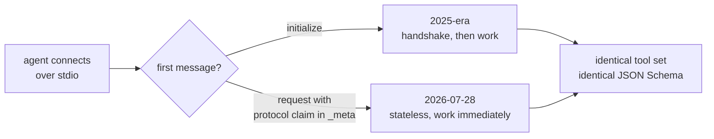

# @opensteward/mcp-server

Read-only [Model Context Protocol](https://modelcontextprotocol.io)
server that exposes [OpenSteward](https://github.com/open-steward/opensteward)
customer data to AI agents (Claude Desktop, Cursor, Continue, Cline,
gemini-cli, …).

The agent gets a flat, schema-driven set of tools — `list_invoices`,
`get_crm_contacts`, `list_my_connections`, etc. — backed by your
self-hosted OpenSteward deployment. No write tools, ever. No
admin surface.

## What gets exposed

Tools are keyed on canonical resource type, not on adapter. Adding a
new adapter (a new accounting platform, a new CRM, a new ecommerce
storefront) requires zero changes here — the new adapter just
becomes a valid `connection_id` for the existing tools.

All nine verticals are in the catalogue — **76 canonical resources**,
one `list_*` and one `get_*` tool each.

| Vertical | Resources |
|---|---|
| accounting | invoices · bills · contacts · accounts · journals · transactions · tax rates · expenses · credit memos · orders · sales orders · purchase orders · organization |
| crm | contacts · companies · deals · pipelines · activities · notes |
| ecommerce | products · variants · collections · locations · inventory levels · customers · orders · fulfillments · refunds · transactions · discounts |
| logistics | carriers · shipments · tracking events · orders · rates · labels · manifests · warehouses · pickups |
| payments | charges · refunds · customers · payouts · disputes · balance transactions · invoices · subscriptions · plans · prices · products · payment methods |
| docsign | envelopes · documents · signers · templates · audit trail entries |
| projects | projects · tasks · comments · tags · users · workspaces |
| customer-support | tickets · messages · contacts · users · teams · tags · macros |
| inventory | products · stock levels · stock adjustments · stock transfers · purchase orders · suppliers · locations |

`organization` is a singleton — the upstream API has no
`/organizations/:id`, so it gets `get_organization` and no `list_`.
That makes **151 resource tools**, plus the customer-level tools below:
**154 in tenant mode, 153 in end-user mode** (with every vertical
enabled — see [Which tools are registered](#which-tools-are-registered)).

Names that collide across verticals (`contacts`, `orders`,
`transactions`, `refunds`, `customers`) get a vertical prefix —
`list_accounting_contacts`, `list_crm_contacts`. Resources whose
canonical name is already unambiguous keep the clean form
(`list_invoices`, `list_tickets`). Note that `get_*` names stay plural,
matching their `list_*` twin: it is `get_invoices`, not `get_invoice`.

Customer-level tools differ by mode: tenant gets `list_customers`,
`get_customer` and `list_customer_connections`; end-user gets `get_me`
and `list_my_connections`.

## Modes

The server supports two scopes, picked from the supplied token:

- **Tenant mode** (developer / operator). Token starts with `osk_`.
  The agent sees every customer the tenant has connected. Use this
  for internal analytics, ops queries, and product engineering.
  Reads `/v1/{vertical}/*`; all nine verticals are reachable.
- **End-user mode**. Token starts with `eut_`.
  The agent sees only one customer's connections — the customer
  asked for the token from their host. Reads `/v1/me/{vertical}/*`.

Both share the same tool registry; only the URL space differs.
`/v1/me/{vertical}` is mounted for **accounting, crm, ecommerce, logistics and payments only**,
and a current deployment reports exactly those (narrowed to what its license enables) at
`GET /v1/me/capabilities`, so an end-user agent is offered only their tools. Against an older
deployment without that endpoint every tool is registered, and the docsign, projects,
customer-support and inventory tools answer 404. Tenant mode reaches all nine.

## Which tools are registered

At boot, after the token probe, the server asks the deployment which verticals it serves this
token: `GET /v1/capabilities` in tenant mode, `GET /v1/me/capabilities` in end-user mode. Only
those verticals' resource tools are registered; the customer-level tools always are. Tool names
never depend on the answer — a license that drops a vertical removes its tools and renames none.

- The list is read once. After the deployment's license changes, restart the MCP server.
- If the deployment cannot say (an older release answers 404, a proxy answers with some other
  page, the request fails, or it takes longer than 5 seconds), every tool is registered and a
  warning goes to stderr. Nothing is lost: the deployment itself refuses calls to a vertical it
  does not serve. A vertical the license does not include answers 403
  `LICENSE_FEATURE_NOT_ENTITLED` (see [License refusals](../../docs/dev-api.md#license-refusals)).
  In end-user mode, a vertical that `/v1/me` does not mount answers 404.
- The ready line on stderr says how many verticals got tools, or "all verticals".
- The agent never sees license details, only which tools exist.

## Install

The server runs via `npx` directly out of the AI agent's MCP config.
Operators need only:

1. Mint a tenant API key with **`mcp:read`** plus the read scopes the
   agent actually needs (`vertical:read` + `customers:read` for a
   typical setup). `mcp:read` cannot coexist with any `*:write` scope
   on the same key — the mint flow refuses. The integration-server's
   auth middleware independently refuses any non-GET method on
   this key, whatever tools the MCP server advertises, and an
   operator can cut all agent access at once by setting
   `features.mcp_enabled = false` (403 `MCP_DISABLED`, no
   redeploy). See
   [`docs/architecture/auth-and-tenancy.md` — `mcp:read`](https://github.com/open-steward/opensteward/blob/main/docs/architecture/auth-and-tenancy.md#common-confusions)
   for the full security rationale.
2. Hand the agent operator the deployment's `BASE_URL` and the key.

### Claude Desktop

`~/Library/Application Support/Claude/claude_desktop_config.json` (macOS)
or `%APPDATA%\Claude\claude_desktop_config.json` (Windows):

```json
{
  "mcpServers": {
    "OpenSteward": {
      "command": "npx",
      "args": ["-y", "@opensteward/mcp-server"],
      "env": {
        "OPENSTEWARD_BASE_URL": "https://oi.acme.example.com",
        "OPENSTEWARD_MCP_KEY": "osk_..."
      }
    }
  }
}
```

Restart Claude Desktop. The new tools appear in the tool picker.

### Cursor

`~/.cursor/mcp.json` (or **Settings → MCP**):

```json
{
  "mcpServers": {
    "OpenSteward": {
      "command": "npx",
      "args": ["-y", "@opensteward/mcp-server"],
      "env": {
        "OPENSTEWARD_BASE_URL": "https://oi.acme.example.com",
        "OPENSTEWARD_MCP_KEY": "osk_..."
      }
    }
  }
}
```

### Continue (VS Code / JetBrains)

`~/.continue/config.json`:

```json
{
  "mcpServers": [{
    "name": "OpenSteward",
    "command": "npx",
    "args": ["-y", "@opensteward/mcp-server"],
    "env": {
      "OPENSTEWARD_BASE_URL": "https://oi.acme.example.com",
      "OPENSTEWARD_MCP_KEY": "osk_..."
    }
  }]
}
```

### Cline (VS Code)

In the Cline settings UI, add an MCP server with:

- **Command**: `npx`
- **Args**: `-y @opensteward/mcp-server`
- **Env**: `OPENSTEWARD_BASE_URL`, `OPENSTEWARD_MCP_KEY`

### gemini-cli

`~/.gemini/mcp.json`:

```json
{
  "mcpServers": {
    "OpenSteward": {
      "command": "npx",
      "args": ["-y", "@opensteward/mcp-server"],
      "env": {
        "OPENSTEWARD_BASE_URL": "https://oi.acme.example.com",
        "OPENSTEWARD_MCP_KEY": "osk_..."
      }
    }
  }
}
```

## Environment variables

| Variable | Required? | Purpose |
|---|---|---|
| `OPENSTEWARD_BASE_URL` | yes | The deployment's public URL (e.g. `https://oi.acme.example.com`) |
| `OPENSTEWARD_MCP_KEY` | one of | Tenant key. Starts with `osk_`, and **must carry the `mcp:read` scope** — without it the deployment refuses this client at boot. Selects tenant mode. |
| `OPENSTEWARD_API_KEY` | — | Alias for `OPENSTEWARD_MCP_KEY`. Accepted, with a warning on stderr — prefer `OPENSTEWARD_MCP_KEY`. |
| `OPENSTEWARD_USER_TOKEN` | one of | End-user token. Starts with `eut_`. Selects end-user mode — the agent sees only one customer's connections. |
| `OPENSTEWARD_TOKEN` | one of | Single env var; mode is picked from the token's prefix. Convenient for local dev. |
| `MCP_DISARM` | no | `strict` enables regex-stripping of common prompt-injection lead-ins on returned strings. Off by default to avoid mangling legitimate data. |
| `MCP_TRANSPORT` | no | `stdio` (the default) is the only supported value. `http` is rejected at boot with a clear message rather than silently falling back. |

The server probes the API at boot; an invalid / unreachable base URL
or a write-only key produces a clear error before the agent connects.

## Trust model

- **End-users** trust their AI client. (Anthropic / Cursor / Google /
  whoever ships the agent.) That trust boundary is set when they
  install the client.
- **Operators** trust the developers they hand API keys to. Mint
  read-only keys for agents — `vertical:read` only.
- **OpenSteward** never short-circuits operator policy: every
  tool call lands as a single HTTPS request authenticated by the
  same key and gated by the same tenant-isolation middleware that
  already protects `/v1/*`.
- **Operators keep a kill switch.** `features.mcp_enabled = false`
  (Admin → Settings) refuses every `mcp:read` token with 403
  `MCP_DISABLED` on the next settings poll — no redeploy, and ordinary
  developer keys are unaffected.
- **Returned strings are wrapped** in `<os_data>...</os_data>`
  markers with a leading note instructing the model to treat the
  contents as data, not instructions. This is best-effort prompt-
  injection mitigation; it doesn't replace operator judgment about
  what data to expose.

## Protocol support

Built on `@modelcontextprotocol/server` v2, serving **MCP 2026-07-28** — the
revision that removed the session: no `initialize`/`initialized` handshake, no
`Mcp-Session-Id`, and each request carrying its own protocol version and client
identity in `_meta`.

**Older agents keep working.** Claude Desktop, Cursor, Continue and Cline still
open with a 2025-era `initialize`, so the server runs with `legacy: 'serve'` and
answers both eras from one tool registry. The opening message decides which era
a connection is pinned to — there is nothing to configure.



The tool contract does not vary by era: same names, same schemas, same
`<os_data>` wrapper on every response. Only the framing differs — the 2025 path
spends three round trips before the first useful answer, the 2026 path spends
none.

Two details worth knowing if you are writing a client:

- `list_*` tools accept parameters beyond their declared schema and forward
  them to the REST API as filters. `get_*` tools are strict and reject unknown
  keys.
- Cacheable list results (`ttlMs` / `cacheScope`, new in 2026-07-28) are not
  advertised — do not assume a TTL on `tools/list`.

Full request/response transcripts for both eras are in
[`docs/mcp.md`](../../docs/mcp.md#protocol-versions--the-server-speaks-two).

## What it isn't

- Not a write surface. No `create_*`, `update_*`, `delete_*` tools
  ship here, ever.
- Not an admin surface. No company info, users, API keys, webhooks,
  scope groups, templates, connect-links, docs-server access.
- Not a multi-tenant gateway. One MCP process ↔ one token. Spawn a
  process per token (or per agent install) when you need to fan out.

## Develop

```bash
pnpm install
pnpm --filter @opensteward/mcp-server build
pnpm --filter @opensteward/mcp-server test
```

`pnpm --filter @opensteward/mcp-server dev` runs the server from
source via `tsx`, against env-supplied credentials. It is a plain
run, not a watch — restart it after an edit.

## License

Apache-2.0. See [LICENSE](./LICENSE).

This package is one of OpenSteward's Apache-2.0 client artifacts, alongside `@opensteward/sdk` and `@opensteward/cli` — you can depend on it and ship it with no restrictions beyond Apache-2.0. The OpenSteward server stack it talks to is source-available under the Elastic License 2.0 plus an Additional Use Grant; see the [repository LICENSE](../../LICENSE).
