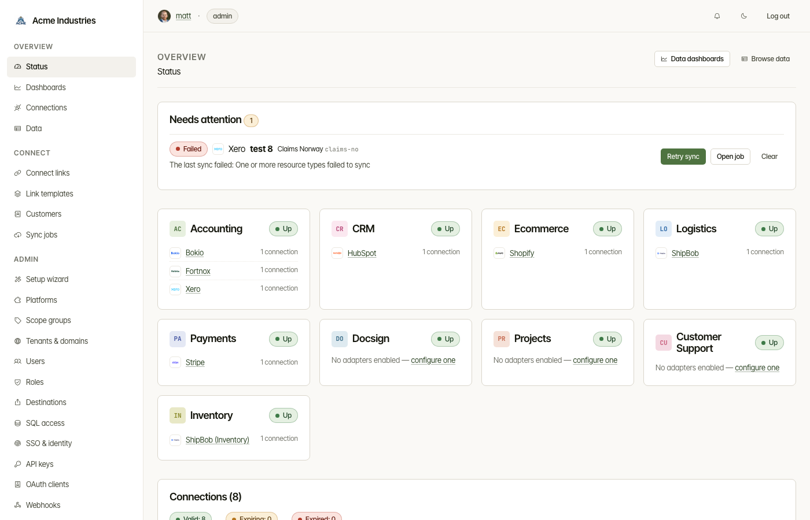

> [← Documentation](../README.md)

# Admin console

The admin console is OpenSteward's web UI for the people who run it. It is the
`admin` service on port 3000 (`http://localhost:3000` in the Docker quick
start). Every action goes through admin-api, which checks your role and
permissions again on each call, so the console only shows what you are allowed
to do.

Use it to:

- set up platforms;
- send Connect Links to customers;
- watch connections and syncs;
- browse synced records;
- build dashboards;
- manage who can do what.

This guide goes through the console page by page. For a route-by-route map
with access levels, see
[architecture/admin-page-map.md](../architecture/admin-page-map.md).

## Signing in

- **First run.** On a fresh deployment every page redirects to `/setup/init`.
  Create the first admin account there with a username and password. If the
  deployment sets `BOOTSTRAP_TOKEN`, the form also asks for that token, so
  nobody else can claim a published deployment before you do. Then sign in,
  and the [setup wizard](./setup-wizard.md) walks you through the rest.
- **Password.** `/login` takes a username and password.
- **SSO and LDAP.** Once an admin adds an identity provider, the login page
  shows **Sign in with &lt;provider&gt;** for each OIDC or SAML provider, and
  an expandable username and password form for each LDAP directory. If an
  admin turns password login off in **Settings**, the password form moves
  under **Use a local account** for the break-glass admin. See
  [SSO & identity](./sso.md).

## The sidebar

The sidebar has three groups. Entries you can't use are hidden.

| Group | Entries |
|---|---|
| **Overview** | [Status](./status.md) · [Dashboards](./dashboards.md) · [Connections](./connections.md) · [Data](./data.md) |
| **Connect** | [Connect links](./connect-links.md) · [Link templates](./connect-links.md#link-templates) · [Customers](./customers.md) · [Sync jobs](./sync-jobs.md) |
| **Admin** | [Setup wizard](./setup-wizard.md) · [Platforms](./platforms.md) · [Scope groups](./platforms.md#scope-groups) · [Tenants & domains](./tenants-company-and-settings.md#tenants-and-domains) · [Users](./users-and-roles.md) · [Roles](./users-and-roles.md#roles) · [Destinations](./destinations.md) · [SQL access](./sql-access-and-superset.md) · [SSO & identity](./sso.md) · [API keys](./api-keys-oauth-and-webhooks.md) · [OAuth clients](./api-keys-oauth-and-webhooks.md#oauth-clients) · [Webhooks](./api-keys-oauth-and-webhooks.md#webhooks) · [Audit log](./audit-and-profile.md) · [Company](./tenants-company-and-settings.md#company) · [Settings](./tenants-company-and-settings.md#settings) · [System](./tenants-company-and-settings.md#system) |

The header across the top holds:

- your picture and username, which link to [My profile](./audit-and-profile.md#my-profile);
- your role, plus a **scoped** badge if you only see some tenants;
- the **notifications bell**, with an unread count, which opens
  [Notifications](./tenants-company-and-settings.md#notifications);
- the light/dark theme toggle;
- **Log out**.

The sidebar footer shows the build each service is running. The brand link at
the top shows your company logo once one is set under **Company**.

## Who sees what

Every console user has a **role**. There are three built-in roles:

- **viewer** looks.
- **operator** runs the day-to-day work.
- **admin** configures the deployment.

An admin can also define **custom roles**. Each custom role has a base role
and its own set of permissions (see [Users, roles and tenant scope](./users-and-roles.md)).
Some pages check the base role and others check a single permission.

| Page | viewer | operator | admin | Decided by |
|---|---|---|---|---|
| [Status](./status.md) | View | Also clears connection and sync rows under **Needs attention** (not when restricted to some tenants) | Also sees the setup card and acts on platform and vertical rows | Any signed-in user |
| [Dashboards](./dashboards.md) | View | Also creates and edits dashboards | Also shares with everyone and decides who sees Superset dashboards | `dashboards:view`, `dashboards:edit`, `dashboards:share_all` |
| [Connections](./connections.md) | View | Also renames, syncs, sets the sync schedule and deletes | Same as operator | Any signed-in user. Changes need the operator role |
| [Data](./data.md) | — | Browses masked records and exports them | Also reveals personal data | `data:read`, `data:export`, `data:read_pii` |
| [Connect links, templates](./connect-links.md), [Customers](./customers.md) | View | Also creates, edits and revokes, and mints customer MCP tokens | Also reveals a customer's personal data and deletes customers | Any signed-in user. Changes need the operator role |
| [Sync jobs](./sync-jobs.md) | View | Also cancels jobs | Same as operator | Any signed-in user. Cancel needs the operator role |
| [Notifications](./tenants-company-and-settings.md#notifications) | Read | Also dismisses | Also dismisses | Any signed-in user |
| [My profile](./audit-and-profile.md#my-profile) | Own picture | Own picture | Own picture | Any signed-in user |
| [Roles](./users-and-roles.md#roles) | — | — | Yes | `roles:manage` |
| [Destinations](./destinations.md) | — | — | Yes | `destinations:manage` |
| [SQL access](./sql-access-and-superset.md) | — | — | Yes | `sql_access:manage` |
| Setup wizard, Platforms, Scope groups, Tenants & domains, Users, SSO & identity, API keys, OAuth clients, Webhooks, Audit log, Company, Settings, System | — | Some by URL (below) | Yes | The admin base role |

Some things the table doesn't show:

- **The Admin group** appears for admins, and for anyone holding
  `roles:manage`, `destinations:manage` or `sql_access:manage`. They see only
  those entries.
- **Operators can open some admin pages by typing the URL.** `/api-keys`,
  `/webhooks` and `/oauth-clients` are read-only for them. On `/tenants` they
  can also create and delete tenants, and on `/scope-groups` create and edit
  scope groups. Viewers can open `/tenants`, `/scope-groups` and
  `/setup/wizard` read-only.
- **Tenant scope narrows what a user sees.** A user restricted to some tenants
  sees only those tenants' connections, sync jobs, records and dashboard
  numbers.
  - Pages that aren't tenant-scoped yet refuse them: customers, Connect Links,
    link templates, API keys, webhooks, OAuth clients and the audit log.
  - So do deployment-wide changes, such as platform configuration and scope
    groups.
  - An admin always sees every tenant.
- **Hidden doesn't mean unprotected.** The console hides what you can't use,
  but admin-api makes the real decision on every request.

The full permission catalog and the escalation guards are in
[architecture/permissions-and-roles.md](../architecture/permissions-and-roles.md).

## Pages in this guide

In reading order:

1. [Setup wizard](./setup-wizard.md): the eight first-run steps.
2. [Status](./status.md): health and the **Needs attention** list.
3. [Dashboards](./dashboards.md): built-in and custom charts over synced data,
   plus embedded Superset.
4. [Connections](./connections.md): every authorized platform account, and its
   sync schedule.
5. [Data](./data.md): browse, reveal and export synced records.
6. [Connect links and templates](./connect-links.md): send customers a link
   to connect a platform.
7. [Customers](./customers.md): the end-customers behind your connections, and
   their MCP tokens.
8. [Sync jobs](./sync-jobs.md): what synced, when, why and how far it got.
9. [Platforms and scope groups](./platforms.md): the adapter catalog, OAuth
   credentials and scope bundles.
10. [Users, roles and tenant scope](./users-and-roles.md): console accounts and
    what they may do and see.
11. [SSO & identity](./sso.md): OIDC, SAML and LDAP sign-in, role and scope
    mapping, and SCIM.
12. [Destinations](./destinations.md): scheduled exports to your lake or
    warehouse.
13. [SQL access and Superset](./sql-access-and-superset.md): read-only Postgres
    logins for BI tools, and embedded Superset.
14. [API keys, OAuth clients and webhooks](./api-keys-oauth-and-webhooks.md):
    the developer API's credentials and outbound events.
15. [Tenants, company, settings and notifications](./tenants-company-and-settings.md):
    deployment-wide configuration.
16. [Audit log and My profile](./audit-and-profile.md).

## Related docs

- [Architecture: admin page map](../architecture/admin-page-map.md): every
  route, grouped by access level.
- [Architecture: permissions, roles and tenant scope](../architecture/permissions-and-roles.md).
- [Architecture: auth and tenancy](../architecture/auth-and-tenancy.md): the
  five-layer auth model and first-run bootstrap.
- [Developer Guide](../dev-api.md): the API your applications call.
