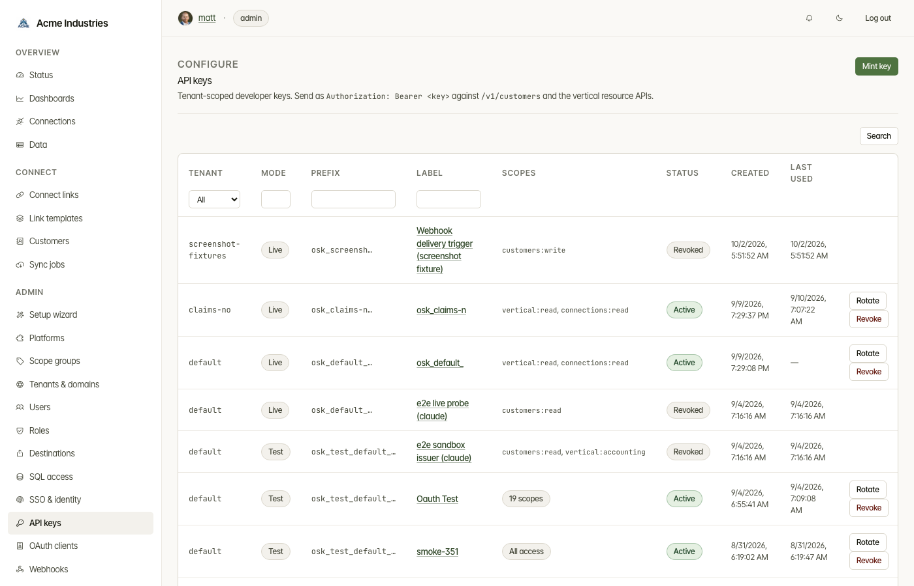
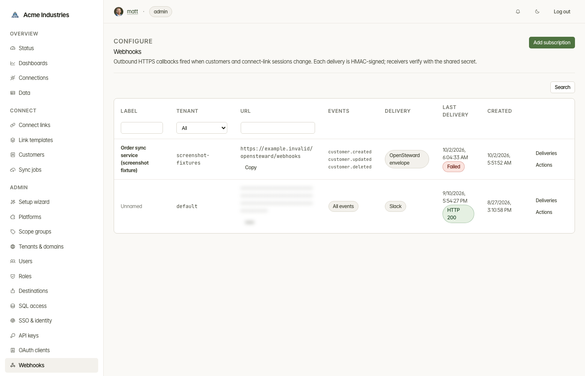
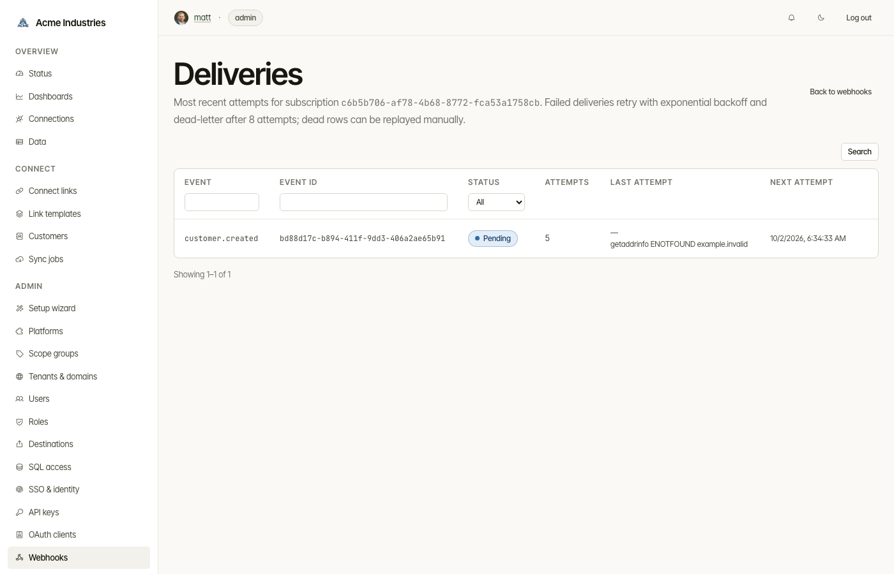

> [← Admin console](./README.md)

# API keys, OAuth clients and webhooks

These pages manage how your applications authenticate to the developer API,
and where OpenSteward sends events. The pages are `/api-keys`,
`/oauth-clients` and `/webhooks`.

## What it's for

- **API keys** are tenant-scoped `osk_…` bearer keys. A key can manage
  customers, create Connect Links, call every `/v1/{vertical}/*` resource, and
  manage webhook subscriptions, depending on its scopes.
- **OAuth clients** let the developer API accept OIDC tokens from your own
  identity provider instead of API keys. OpenSteward only verifies those
  tokens. It never mints them and holds no client secret.
- **Webhooks** are outbound HTTPS callbacks when customers, Connect Links,
  connections or resources change. Each delivery is signed with HMAC-SHA256.

## Who can use it

- **Admins** create, change and delete on all three pages. All three are in
  the Admin group.
- **Operators** can open the three lists by URL and read them, including
  webhook deliveries, but can't change anything.
- Tenant-restricted users are refused, because these pages aren't
  tenant-scoped yet.

## What you can do

### API keys

- **Mint key.** Choose:
  - the **tenant** whose customers and connections the key can reach;
  - a **label**;
  - a **mode**:
    - **Live** authenticates `/v1/*` against real connections.
    - **Test** authenticates only the `/test/v1/*` sandbox, which has
      synthetic data and makes no upstream calls.

    The mode is fixed when the key is minted.
  - an **expiry**: never, 30 days, 90 days or 1 year;
  - **scopes**:
    - **Safe default** (recommended) reads every vertical and manages
      customers, Connect Links and connections, but can't write vertical data.
    - **All access** (`*`).
    - **Custom**: you pick each scope.
- **Save the key immediately.** It is shown once.
- **Rotate** a key. A replacement is minted at once, and the old key keeps
  working for 24 hours before it revokes itself.
- **Revoke** a key, effective immediately.
- **Open a key** in a dialog for its details.

### OAuth clients

- **Register issuer.** Give its name, vendor, issuer URL, JWKS URI, audience,
  and subject and scope claims. **Test** discovers the JWKS URI from the
  issuer.
- **Choose where authority comes from:**
  - **Registry** (recommended): you register each service account with a
    tenant and scopes, and deleting one cuts off its tokens at once.
  - **Registry, narrowed by the token**: the registered scopes are a ceiling,
    and a token can ask for less.
  - **The token decides**: tenant and scopes come from claims. Set the tenant
    claim and the allowed tenants.
- **Set a maximum token lifetime.**
- **On an issuer's page,** add **service accounts** (subject, tenant, label)
  and **scope mapping** rules (token value → scope). You can also delete the
  issuer there.

### Webhooks

- **Add subscription.** Fill in:
  - a label and the endpoint URL;
  - the events: **All events** (`customer.*`, `connect_link.*`,
    `connection.*`, `resource.*`, `platform.event`) or a **Custom** set;
  - the payload format:
    - **OpenSteward envelope** (signed JSON, the default);
    - **Slack**;
    - **Microsoft Teams**;
    - **Flat JSON**, one level of dotted keys;
  - optional **custom headers** for receivers that authenticate by header.
    They are stored encrypted and never shown again.
- **Copy the signing secret** straight away. It is shown once, when you create
  the subscription or rotate its secret.
- **Use the Actions menu** on a subscription:
  - **Pause** and **Resume**;
  - **Rotate secret**;
  - **Send test** sends one synthetic event;
  - **Delivery settings** changes the label, format and headers;
  - **Delete**.
- **Read the deliveries.** **Deliveries** lists each attempt for a
  subscription. You can filter by event, and **Replay** a delivery.

Developers can also manage their own subscriptions with
`POST /v1/webhook-subscriptions`, using a key with `webhooks:write`.

## Related docs

- [Developer Guide](../dev-api.md): authentication, scopes, rate
  limits, the sandbox and signature verification.
- [OIDC setup for the developer API](../deployment/oauth-clients-setup.md).
- [Architecture: webhook delivery](../architecture/webhook-delivery.md).
- [Setup wizard](./setup-wizard.md): steps 7 and 8 mint your first key and
  subscription.
