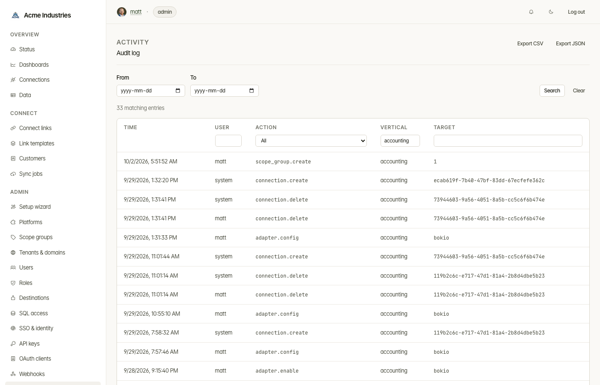

> [← Admin console](./README.md)

# Audit log and My profile

The record of every console change (`/audit`), and your own account
(`/profile`).

## What it's for

- **The audit log** answers "who changed what, and when?". Every admin
  change, sign-in, personal-data reveal, export and sharing change is written
  to it, with a timestamp and the user who did it. It records what changed,
  not secret values: destination credentials and SQL passwords, for example,
  never reach it.
- **My profile** is where you see your own account and set your picture.

## Who can use it

- **Audit log:** admins only. Tenant-restricted users are refused, because the
  log isn't tenant-scoped yet.
- **My profile:** every signed-in user. Open it from your picture and username
  in the header.

## What you can do

### Audit log

- **Filter** by user, action, vertical, target, or a date range, and sort by
  any of those columns.
- **Export CSV** or **Export JSON**. The export contains the filtered view you
  are looking at, not the whole log.
- **Follow links from other pages.** Some pages link straight to a filtered
  view. For example, after you reveal a user's identity, their page links to
  `user.pii_reveal` entries.

How long entries are kept is set by `audit_log.retention_days` in
[Settings](./tenants-company-and-settings.md#settings).

### My profile

- See your username and email. Your email is set by an admin or by your
  identity provider, so you can't change it here.
- **Upload picture**: PNG, JPEG or WebP, up to 512 KB. An uploaded picture
  replaces one from your identity provider.
- **Remove picture**. The console then shows your initials.

Admins set other users' email and pictures from the
[Users](./users-and-roles.md) page.

## Related docs

- [Architecture: permissions and roles, audit](../architecture/permissions-and-roles.md#audit):
  the audited actions and what each records.
- [Data-erasure runbook](../operations/data-erasure.md).
- [Architecture: auth and tenancy, console-user profile](../architecture/auth-and-tenancy.md#console-user-profile-email-and-picture).
