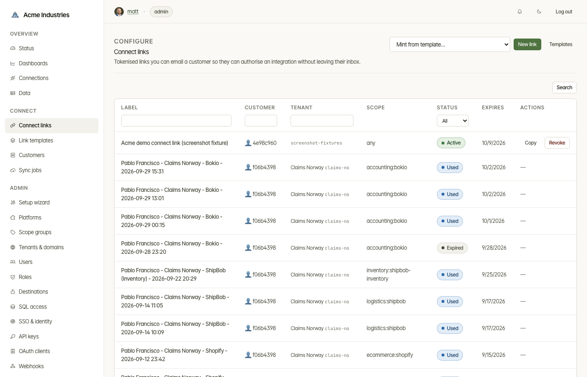
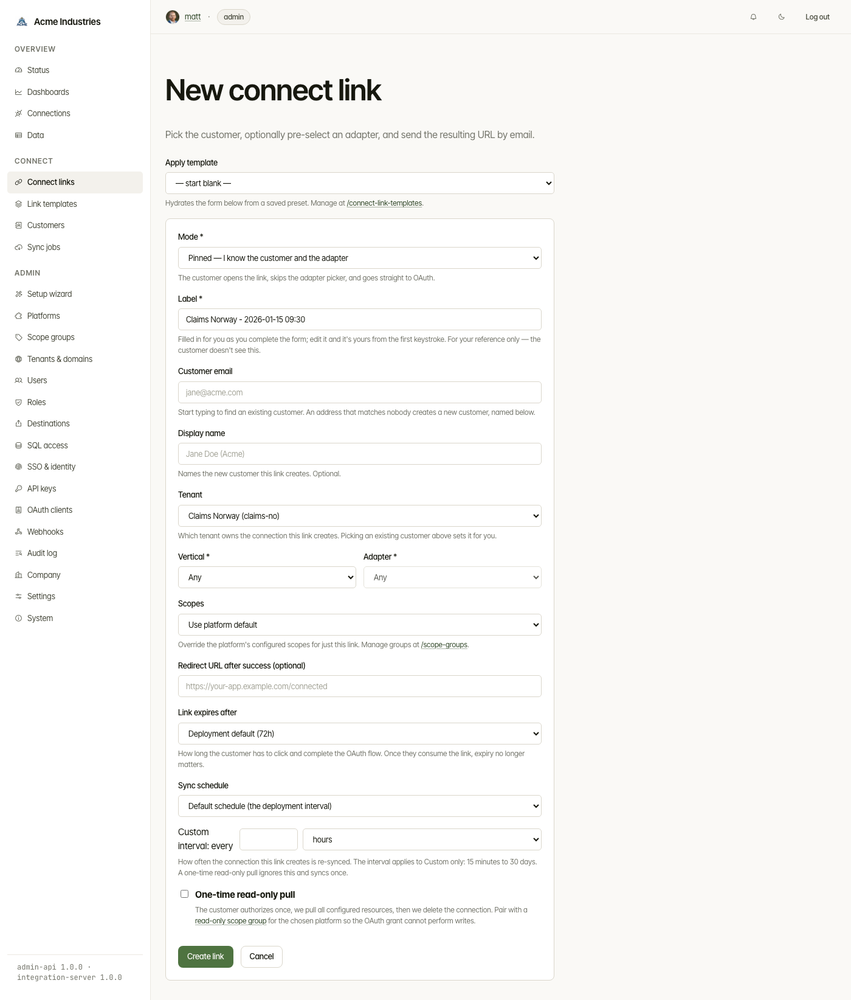
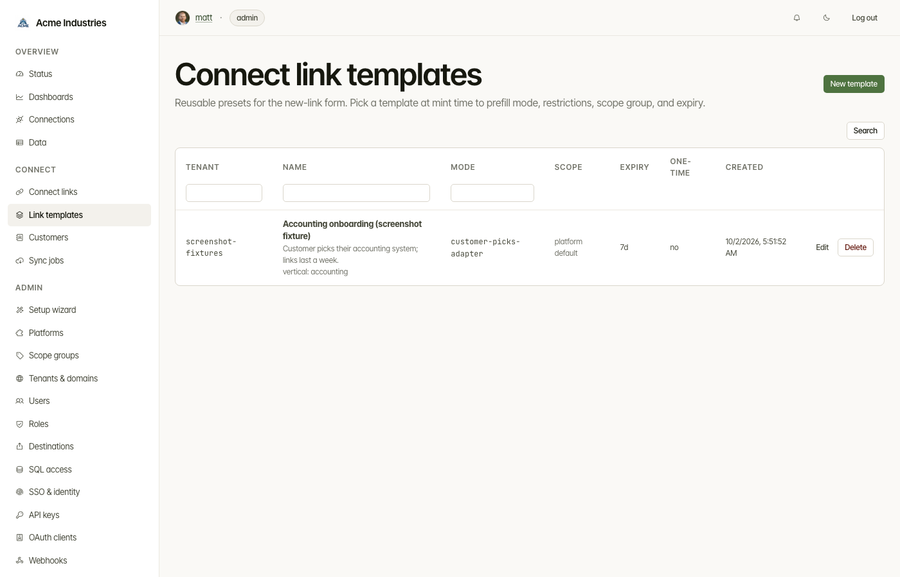

> [← Admin console](./README.md)

# Connect links and templates

Tokenised links you send to a customer so they can authorize a platform in
their own browser. The pages are `/connect-links` and
`/connect-link-templates`.

## What it's for

A Connect Link is the way to get a customer's data when you're outside a
product flow.

1. You create a link and email it.
2. The customer opens it and signs in to their platform. The page is branded
   with your company details.
3. A connection appears under the tenant you chose.

**Link templates** save the form's settings, so links you send often take one
click.

## Who can use it

- **Every signed-in user** can see the link and template lists.
- **Operators and admins** can create and revoke links, and create, edit and
  delete templates.
- Tenant-restricted users are refused on these pages, which aren't
  tenant-scoped yet.

## What you can do

**On the links list:**

- Filter by label, customer, tenant or status (**Active**, **Used**,
  **Expired**). Sort by any column, including the allowed platforms and the
  expiry date.
- **Copy** an active link's URL, or **Revoke** it (operator).
- Start from a template with **Mint from template…**, or press **New link**.
- If the deployment has no public URL, a banner says what to set: **Company →
  Base URL**, or `PUBLIC_BASE_URL` on integration-server. Without one, a link
  has no address a customer can reach.

**On the new-link form:**

- **Mode.**
  - **Pinned**: you know the customer and the adapter. The customer goes
    straight to the platform's sign-in.
  - **Customer picks adapter**: the customer chooses from the allowed
    adapters.
  - **Self-register**: the customer types their own email on the connect page.
- **Label.** Filled in for you as you complete the form, and only you see it.
- **Customer email.** Start typing to pick an existing customer. A new address
  creates a customer, named by **Display name**.
- **Tenant.** The tenant that owns the resulting connection. It comes from the
  customer when there is one; otherwise you choose it.
- **Vertical** and **Adapter.** Both are required in pinned mode.
- **Scopes.**
  - **Use platform default** is the default. It asks for the scopes
    configured on the platform's OAuth app.
  - **Read-only** asks for only the platform's read scopes, where they are
    catalogued.
  - A [scope group](./platforms.md#scope-groups) asks for exactly its scopes.
    Scope groups are offered in pinned mode only.
- **Redirect URL** after success, optional.
- **Link expires after.** The deployment default, or 1, 3, 7, 14 or 30 days.
- **Sync schedule.** How often the new connection is re-synced:
  - the default schedule;
  - a custom interval from 15 minutes to 30 days;
  - trigger only;
  - one-time.

  You can change it later on the [connection's page](./connections.md#sync-schedules).
- **One-time read-only pull.** The customer authorizes once, every configured
  resource is pulled, and then the connection is deleted. A
  `connect_link.disposed` webhook event fires. Pair it with a read-only scope
  group.

After **Create link**, a banner shows the URL with a **Copy** button. **Treat
the URL like a password:** anyone who has it can use the link until it is used,
expires or is revoked.

### Link templates

A template is a saved preset for the new-link form. It holds:

- a name and description;
- the tenant;
- the mode;
- the vertical and adapter;
- a scope group;
- the default expiry (1, 3, 7, 14 or 30 days);
- a redirect URL;
- the one-time read-only setting.

Pick one under **Apply template** on the new-link form, or under **Mint from
template…** on the list. A template doesn't carry a sync schedule; you set
that on each link.

## Related docs

- [Architecture: Connect Links](../architecture/connect-links.md): modes, the
  flow, scope policy and adapter coverage. Links minted through the developer
  API stay read-only by default, while the console form defaults to the
  platform's scopes.
- [Custom domain + TLS](../deployment/custom-domain.md): give links a branded
  host.
- [Customers](./customers.md): who the links are for.
- [Developer Guide §5: Connect Link](../dev-api.md#5-connect-link): minting links
  from your app.
