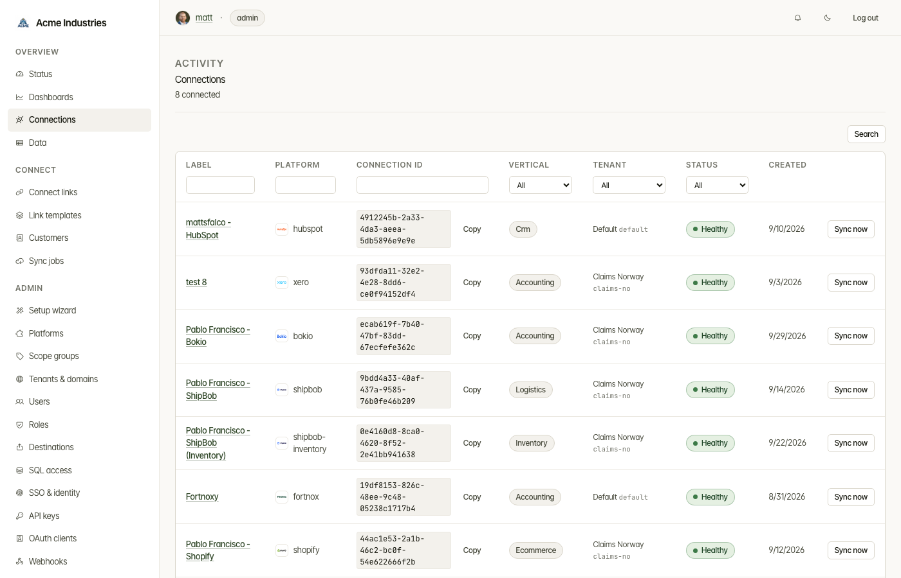
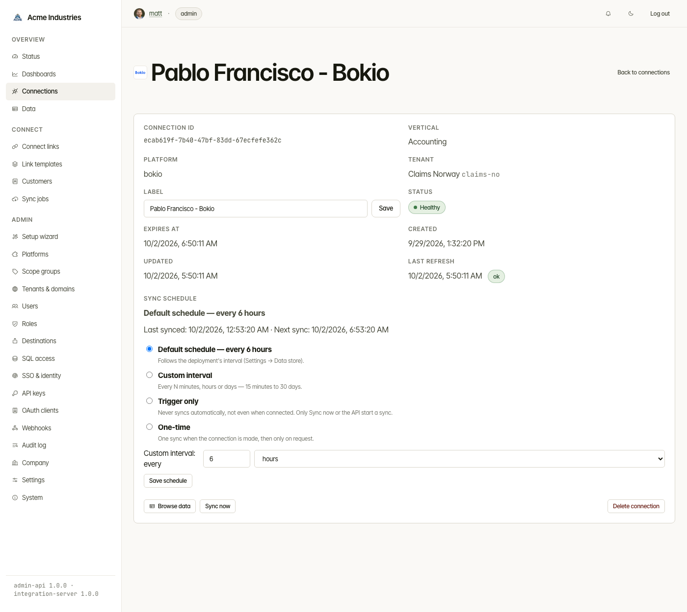

> [← Admin console](./README.md)

# Connections

Every platform account a customer has authorized, at `/connections`. Each
connection's page also sets its **sync schedule**.

## What it's for

A connection is one authorized account on one platform, for example a
customer's Xero organisation or Shopify store. Your application passes its id
as `?connection_id=` on every `/v1` call. This page is where you find
connections, check their health, and decide how often their data is re-read
from the platform.

## Who can use it

- **Every signed-in user** can view connections.
- **Operators and admins** can rename, sync, delete and set the sync schedule.
  This is decided by the base role (operator or admin), not by a permission.
- **Browse data** needs `data:read` (operator, admin).
- A tenant-restricted user sees only their tenants' connections.

## What you can do

**On the list:**

- Filter and sort by label, platform, connection id, vertical, tenant, status
  or created date. Part of an id is enough; the first block of the UUID will
  do.
- Copy a connection's full id with **Copy**.
- See each status: **Healthy**, **Expiring soon**, **Expired** or
  **Platform creds** (the platform's credentials were rejected). A
  **Refresh failing** badge means the token still works but its last refresh
  failed.
- **Sync now** (operator) queues a background sync for that connection.
- Open a connection. It opens in a dialog, or as a page without JavaScript.

**On a connection's page:**

- See its id, vertical, platform, owning tenant, status, expiry, and when it
  was created and updated.
- See the last token refresh and, if it failed, the reason.
- **Rename** it (operator). The label is what the list shows and searches.
- **Set the sync schedule** (operator). See the next section.
- **Browse data** opens its records in the [data viewer](./data.md).
- **Sync now** (operator).
- **Mint Connect Link** appears when the authorization has expired. Only the
  customer can re-authorize, so you send them a new
  [Connect Link](./connect-links.md).
- **Delete connection** (operator). This removes the stored credentials,
  cached data and sync history. Only the customer can restore the connection,
  through a new Connect Link.

If the provider rejects the platform's own OAuth **client** credentials, the
page says so. Re-authorizing won't help. An admin fixes it on the
[platform page](./platforms.md), and the fix covers every connection on that
platform.

### Sync schedules

Each connection has a schedule that says how often its data is re-read from
the platform. The section shows the current schedule, when it last synced,
and when it syncs next. The next sync can read as:

- a time;
- **Due now** or **Syncing now**;
- **Paused until the customer re-authorizes**;
- **Paused until the platform credentials are fixed**.

The section also reports the last failure, if there was one.

| Schedule | What happens |
|---|---|
| **Default schedule** | Syncs every deployment interval. This is 6 hours unless an admin changed it under [Settings → Data store](./tenants-company-and-settings.md#settings) (`data_store.sync.default_interval_minutes`). |
| **Custom interval** | Syncs every N minutes, hours or days, from 15 minutes to 30 days. |
| **Trigger only** | Never syncs automatically, not even after connecting. Only **Sync now** or the API starts a sync. |
| **One-time** | Syncs once when the connection is made, then only on request. |

- A failed scheduled sync is retried after 15 minutes, then less often after
  each further failure, but never later than the interval.
- A Connect Link can set the starting schedule when you
  [create the link](./connect-links.md).
- Admins can stop all scheduled syncing with `data_store.sync.scheduler_enabled`
  in Settings. **Sync now** and API syncs still run.
- In `passthrough` mode nothing is cached, so nothing is synced on a schedule.

## Related docs

- [Developer Guide §7: data store and sync schedules](../dev-api.md#sync-schedules):
  `syncMode`, job origins and retries, as the API sees them.
- [Sync jobs](./sync-jobs.md): the jobs that schedules and **Sync now** create.
- [Architecture: persistence](../architecture/persistence.md): the read-through
  cache and sync store.
