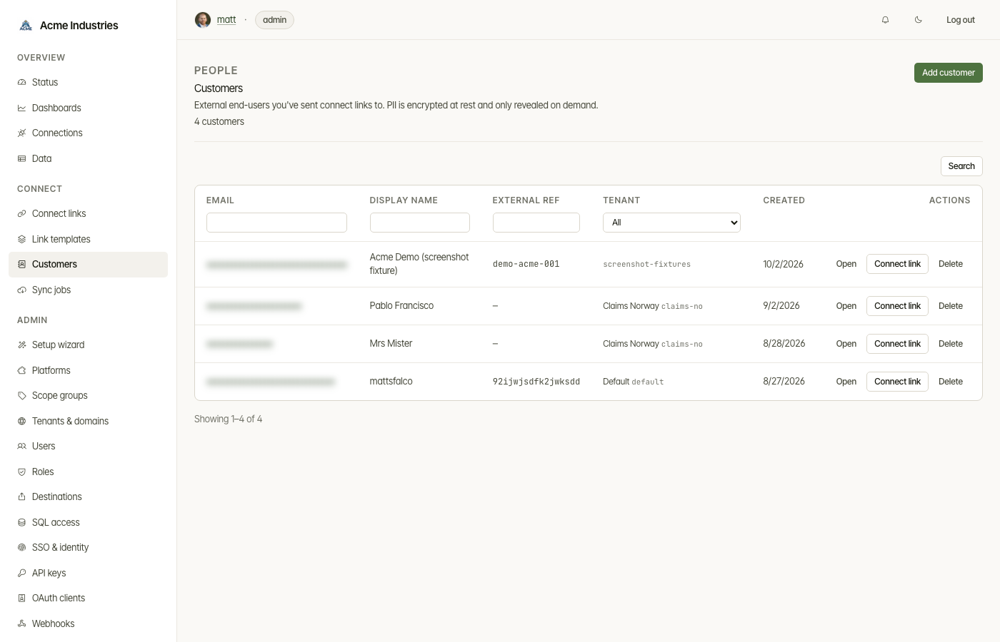
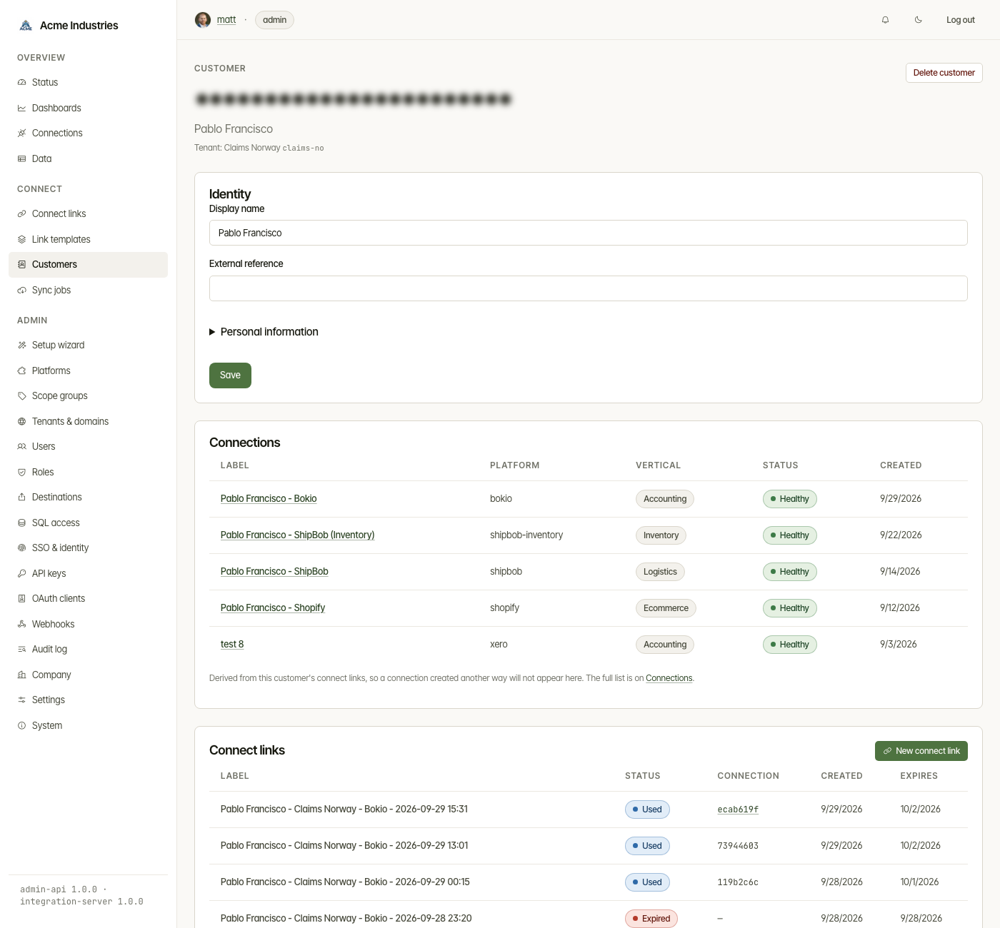

> [← Admin console](./README.md)

# Customers

The end-customers you send Connect Links to, at `/customers`.

## What it's for

A customer (an "end-user" in the API) is the person or company behind one or
more connections. This page keeps their details, shows their connections and
links, and mints the **MCP tokens** that let an AI agent read only that
customer's data. Personal details are encrypted at rest and shown only when you
ask for them.

## Who can use it

- **Every signed-in user** can see the list and a customer's page.
- **Operators and admins** can add and edit customers, send them Connect
  Links, and mint and revoke MCP tokens. Viewers don't see the token list.
- **Admins** can reveal a customer's personal details and delete customers.
- Tenant-restricted users are refused, because customers aren't tenant-scoped
  yet.

## What you can do

- **Find a customer.** Search and filter by email, display name, external
  reference, tenant or created date.
- **Act on a row.** Each row has **Open** and **Connect link**, which starts a
  link pre-filled for that customer. Admins also get **Delete**: the customer's
  Connect Links stay for audit, detached from them.
- **Add a customer** (operator). Fill in:
  - the tenant, which is fixed once set;
  - email, display name and an external reference back to your own system;
  - personal information: name, phone, personal ID number and address.
- **Edit identity** (operator). Personal information is masked. An admin can
  press **Reveal** to load it, which writes an audit entry. If you save while
  it is masked, the stored values are overwritten.
- **See their connections and Connect Links.** A customer's page lists both,
  with **New link** to send another.
- **Mint an MCP token** (operator).
  - Give it an optional label and press **Mint new token**.
  - The token is shown **once**, with a ready-to-paste Claude Desktop config.
  - In that config the agent sees only this customer's connections.
  - The list shows each token's label, prefix, created and last-used times and
    status, with **Revoke**.

## Related docs

- [Connect links and templates](./connect-links.md).
- [MCP: connect AI agents](../mcp.md) and the
  [MCP server README](../../apps/mcp-server/README.md): what a token unlocks.
- [Developer Guide §4: Customers](../dev-api.md#4-customers): managing customers
  from your app.
- [Data-erasure runbook](../operations/data-erasure.md): removing a customer's
  data everywhere.
