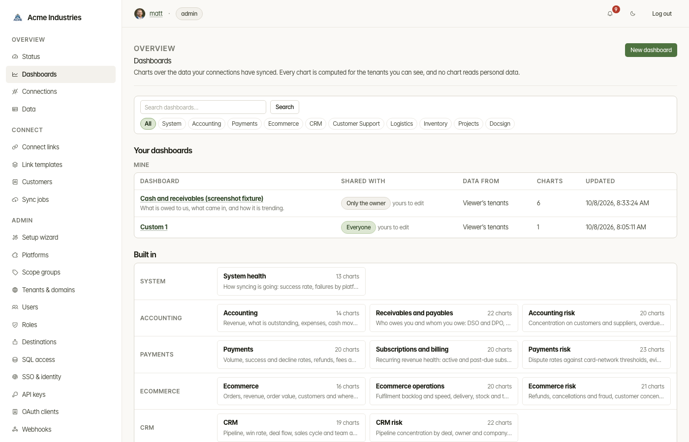
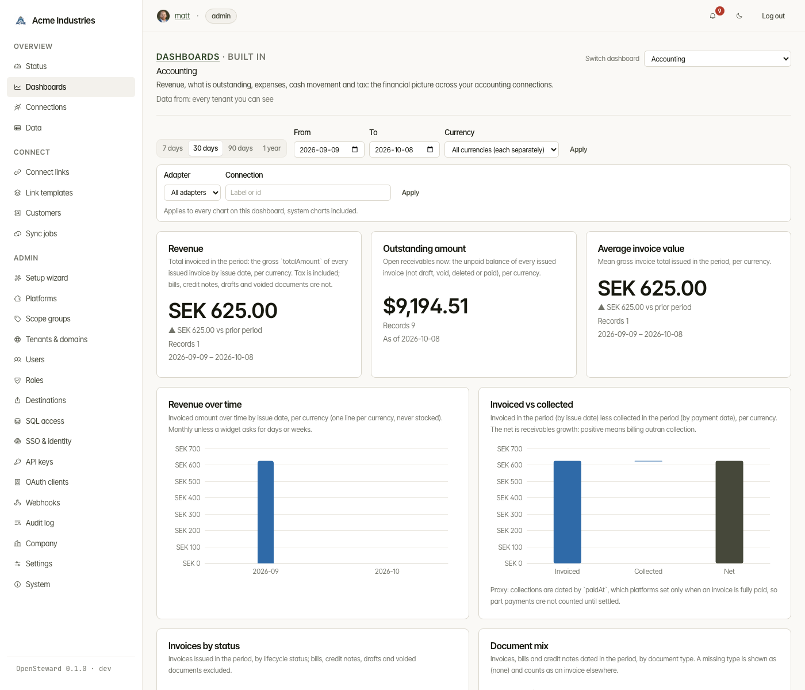
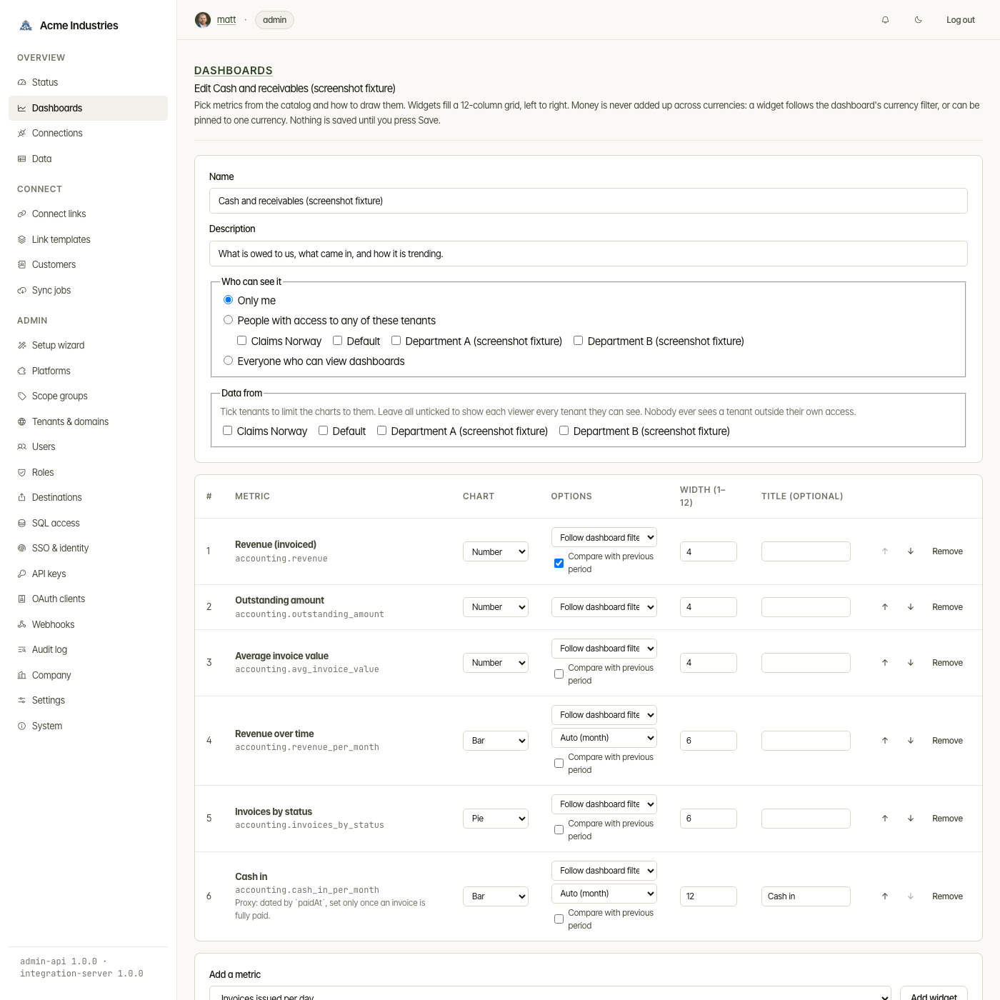

> [← Admin console](./README.md)

# Dashboards

Charts over the data your connections have synced, at `/dashboards`.

## What it's for

Dashboards show the numbers behind your customers' platforms without anyone
writing a query: revenue, receivables aging, order volume, pipeline, ticket
backlog, shipment exceptions and more.

- Every chart is computed only over the tenants you can see.
- No chart reads personal data.

## Who can use it

- **`dashboards:view`** (viewer, operator, admin) opens dashboards.
- **`dashboards:edit`** (operator, admin) creates, edits and deletes custom
  dashboards. You can edit only your own; admins can edit any.
- **`dashboards:share_all`** (admin) shares a dashboard with everyone and
  decides who sees each embedded Superset dashboard.
- The **Adapter** and **Connection** filters on a single-vertical dashboard
  also need `connections:read`.

## What you can do

- **Open a built-in dashboard.** OpenSteward ships 22, grouped by vertical:
  - **System health**;
  - an **overview** and a **risk** dashboard for each of the nine verticals;
  - **Receivables and payables** (accounting), **Subscriptions and billing**
    (payments) and **Ecommerce operations**.

  Built-ins are read-only.
- **Filter what a dashboard shows.**
  - **Date range.** Pick 7 days, 30 days, 90 days or 1 year, or set custom
    **From** and **To** dates.
  - **Currency.** Show all currencies or one. Money is never added up across
    currencies: with no currency chosen, each money chart draws every currency
    separately.
  - **Adapter and connection.** On a single-vertical dashboard you can narrow
    every chart to one adapter, or to one connection. Search for the
    connection by label or by part of its id.
- **Build your own** with **New dashboard**. There's no code involved.
  - Give it a name and a description.
  - Choose **who can see it**:
    - only you;
    - people with access to any of the tenants you tick;
    - everyone who can view dashboards (needs `dashboards:share_all`).
  - Optionally use **Data from** to limit the charts to some tenants. If you
    tick none, each viewer sees every tenant they can access. Nobody ever sees
    a tenant outside their own access.
  - Add up to 24 widgets from the metric catalog. For each widget you pick:
    - a chart type, from 22 kinds (number, gauge, line, bar, pie, funnel,
      heatmap, calendar and more), limited to the ones that suit the metric;
    - a width from 1 to 12, on a 12-column grid;
    - an optional title.

    Some metrics offer more:
    - a currency pin;
    - time buckets (auto, day, week, month);
    - **Compare with previous period**.

    Move widgets with ↑ and ↓. Nothing is saved until you press **Save**.
- **Find a dashboard.**
  - The index lists **Your dashboards** first: **Mine**, **Shared with your
    tenants** and **Shared with everyone**. Admins who can see every tenant
    also see **Other users' private dashboards**.
  - **Built in** follows, one row per vertical with its dashboards side by
    side. Each shows its chart count and the first line of its description;
    hover for the rest.
  - **Search** matches names and descriptions. A **vertical chip** narrows the
    list to one vertical. Your own dashboards appear under a chip when any of
    their charts comes from that vertical. The URL keeps the filter, so you
    can bookmark or share it.
- **Switch dashboards** from any dashboard with the **Switch dashboard** menu
  at the top right. It lists every dashboard you can open, grouped the same
  way, so you don't need to go back to the index.
- **Open embedded Superset dashboards.** These appear only when the deployment
  runs [Superset](./sql-access-and-superset.md#embedded-superset-dashboards).
  They are listed under **Custom dashboards (Superset)** and filtered to your
  tenants.

## Related docs

- [Architecture: data access](../architecture/data-access.md#native-dashboards):
  the metric catalog, currencies, scope and caching.
- [Superset setup](../deployment/superset.md): optional embedded Superset,
  Postgres only.
- [Permissions, roles and tenant scope](../architecture/permissions-and-roles.md).
