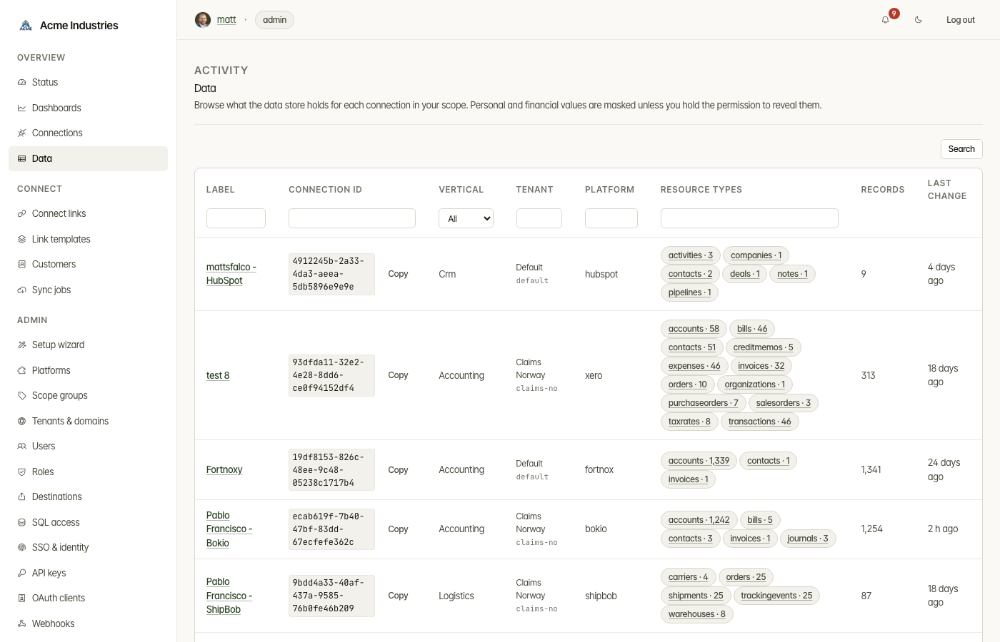
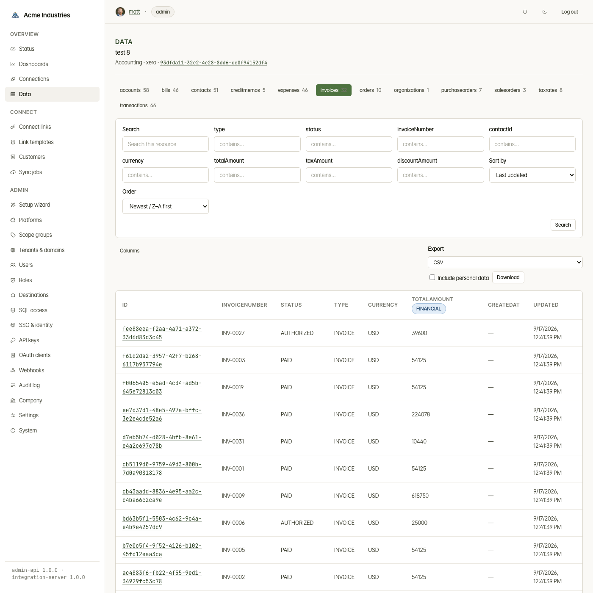
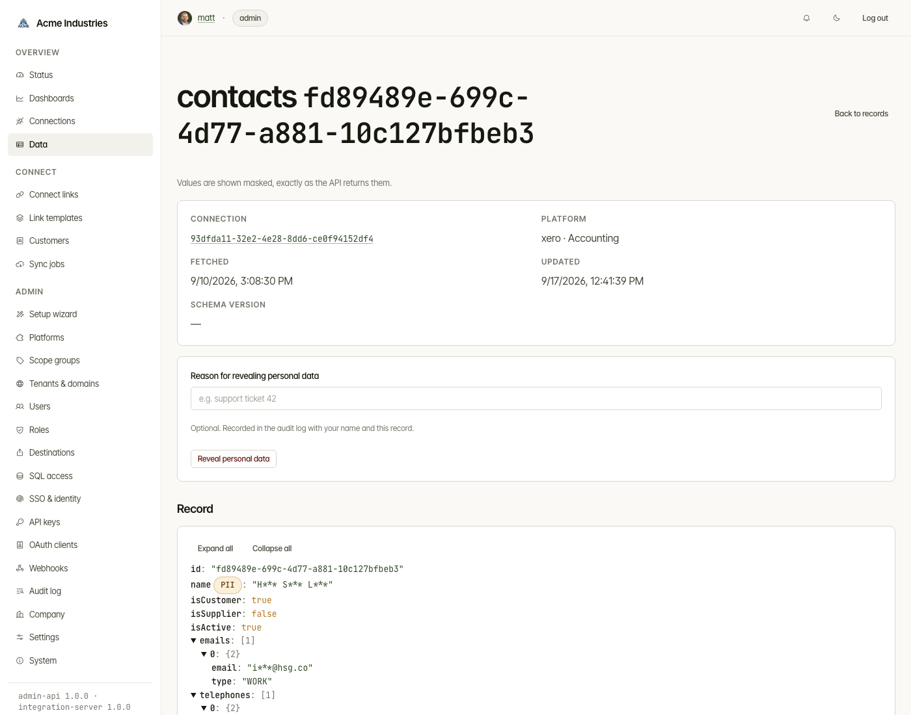

> [← Admin console](./README.md)

# Data

The data viewer, at `/data`. It lets you browse the records OpenSteward has
synced, with personal data masked by default.

## What it's for

The data viewer shows what the data store actually holds for each connection,
without database access and without exposing personal data by accident. Use it
to:

- check that a sync brought back what you expected;
- answer a support question;
- export a slice of records.

## Who can use it

- **`data:read`** (operator, admin) opens the viewer. Records are always
  masked.
- **`data:export`** (operator, admin) downloads CSV or NDJSON.
- **`data:read_pii`** (admin) reveals one record's personal data. It also
  allows **Include personal data** on an export.
- A tenant-restricted user sees only their tenants' connections. Another
  tenant's connection answers "not found".

## What you can do

- **See what's stored.** The index lists every connection in your scope with:
  - its label and full connection id, with a **Copy** button;
  - its vertical, tenant and platform;
  - one badge per resource type, with a record count;
  - the total number of records;
  - when the data last changed. Hover the time to see the exact date.

  If the deployment runs in `passthrough` mode, nothing is stored and the page
  says so.
- **Find a connection.** The index works like the other admin tables:
  - The row under the headers filters by **Label**, **Connection id**,
    **Vertical**, **Tenant**, **Platform** and **Resource types**. Text boxes
    match part of what the column shows, ignoring case. An id prefix is
    enough, and typing `invoices` under Resource types keeps only connections
    that hold invoices. Press Enter or **Search** to apply, and **Clear** to
    reset.
  - Click any column header to sort by it. Click again to reverse the order.
    **Records** sorts by count, and **Last change** by the time behind
    "17 h ago".
  - Filters and sort order live in the URL, so a filtered view can be
    bookmarked or shared.
- **Browse a connection.**
  - Each resource type has its own tab. The table is cursor-paginated.
  - **Search** the resource, filter on the fields that allow it, sort by last
    updated or record id, and pick columns with **Columns**.
  - Column headers carry **PII**, **Financial** and **Secret** badges.
- **Open a record.** Click its id to open it in a dialog. You see:
  - its connection, platform, fetch and update times and schema version;
  - the record as a JSON tree with classification badges;
  - a field-classification table showing how each field is masked.
- **Reveal personal data** (`data:read_pii`).
  - Give an optional reason and press **Reveal personal data**.
  - The unmasked record is shown once and the reveal is written to the
    [audit log](./audit-and-profile.md), with your name and the reason.
  - Reload the page to go back to the masked view.
- **Export** (`data:export`). Download the current resource as CSV or NDJSON.
  - The export is masked the same way as the table.
  - Holders of `data:read_pii` can tick **Include personal data**.
  - Every export is audited.

### How masking works

- Personal-data fields are masked, and secrets are removed.
- Financial fields are masked too when an admin turns on
  `data_access.mask_financial` in [Settings](./tenants-company-and-settings.md#settings).
- A resource type with no field classification yet is masked by default, and
  the page warns you about it.

## Related docs

- [Architecture: data access](../architecture/data-access.md): the viewer, the
  scope header, masking and audit.
- [Security: data classification and masking](../security/data-classification.md):
  field classes and masks.
- [Destinations](./destinations.md) and
  [SQL access](./sql-access-and-superset.md): other ways to take data out.
