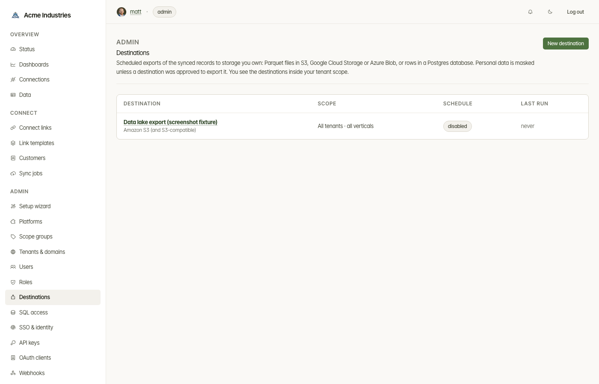

> [← Admin console](./README.md)

# Destinations

Scheduled exports of synced records to storage you own, at `/destinations`.

## What it's for

A destination copies the data store's records to your lake or warehouse on a
schedule, so your analysts can use their own tools. Exports are masked the way
the data viewer masks them, unless an approver allows personal data.
Incremental runs send only what changed, and deletions are exported as
tombstones.

There are eight types:

- Amazon S3 (and S3-compatible), Google Cloud Storage and Azure Blob Storage,
  which receive Parquet files;
- PostgreSQL, which receives rows;
- Snowflake, Google BigQuery and Databricks (Delta), which are loaded
  warehouse-side;
- Apache Iceberg (REST catalog), which is marked **experimental**.

## Who can use it

- You need **`destinations:manage`** (admins by default).
- You see and change only destinations whose tenants are inside your own
  scope.
- **Export personal data unmasked** also needs `data:read_pii`. You are then
  recorded as the approver.
- In `passthrough` mode nothing is stored, so there is nothing to export and
  the page says so.

## What you can do

- **List destinations.** Each row shows its scope, its schedule (or
  **disabled**) and its last run.
- **Create a destination.** Pick a type and fill in a form generated from the
  type catalog:
  - a name and **Run every (minutes)**, from 1 minute to 7 days;
  - the type's settings;
  - its credentials. These are stored encrypted, are write-only, and are never
    shown again.
  - **What to export**: tenants (or every tenant, if you may grant it) and
    verticals. With no vertical ticked, every vertical is exported.
  - Optionally **mask financial fields** too, or **export personal data
    unmasked** (with `data:read_pii`). Exported files can't be retracted.
  - Whether it should **run on schedule**.
- **Work with a destination** on its page:
  - **Test connection** and **Run now**.
  - Change the name and schedule.
  - **Backfill** everything, one vertical, or one resource type.
  - **Replace credentials**, or delete the destination.
  - Read the **Run history**: start time, trigger, status, rows, deletes, files
    and duration.

Backfill, replacing credentials and delete ask for confirmation. Every change
is audited, and credential values never reach the audit log.

## Related docs

- [Destinations guide](../integrate/destinations.md): file layout, columns,
  loaders, tombstones, PII, per-type configuration, and a MinIO and DuckDB
  walkthrough.
- [Data](./data.md) and [SQL access](./sql-access-and-superset.md): the other
  ways to take data out.
- [Security: data classification and masking](../security/data-classification.md).
