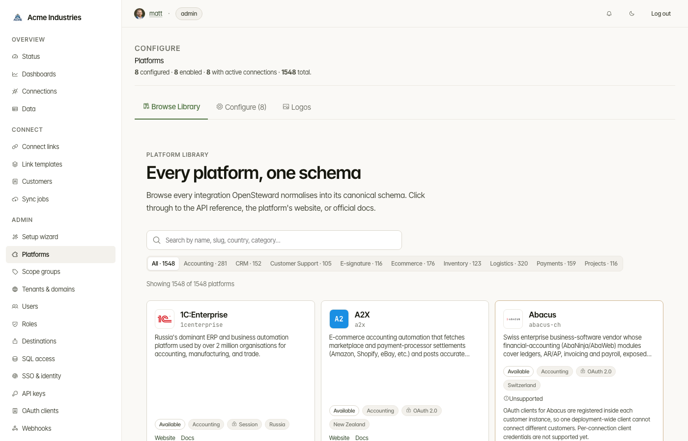
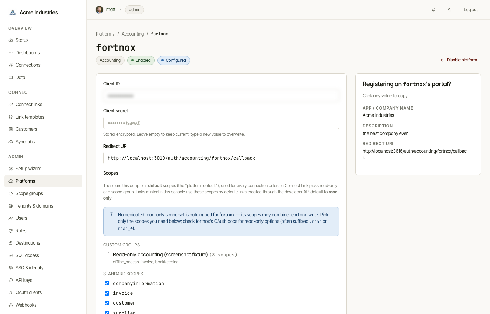
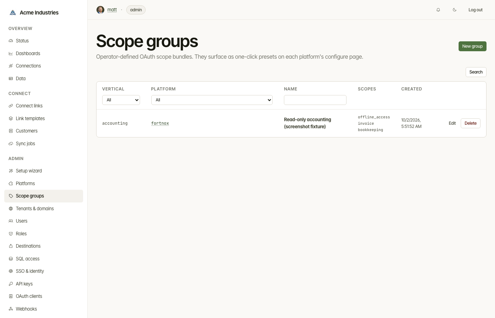

> [← Admin console](./README.md)

# Platforms and scope groups

The adapter catalog, each platform's OAuth credentials, and reusable scope
bundles. The pages are `/platforms` and `/scope-groups`.

## What it's for

Before a customer can connect a platform, an admin has to enable it here.
OAuth platforms also need your OAuth app's client ID and secret. **Scope
groups** are named sets of OAuth scopes for one platform, for example a
read-only set. You pick them on a platform's page and on the new Connect Link
form.

## Who can use it

- **Platforms** is for admins only.
- **Scope groups** shows in the sidebar for admins only. Operators can still
  open `/scope-groups` and create, edit and delete groups there. Viewers get a
  read-only view.
- Tenant-restricted users can't change platform configuration or scope groups,
  because both apply to every tenant.

## What you can do

**On the Platforms page** (`/platforms`):

- **Read the totals.** The header shows how many platforms are configured,
  enabled, have active connections, and exist in total.
- **Use the tabs.**
  - **Browse Library** is the full catalog.
  - **Configure** lists the platforms you have set up, with filters.
  - **Logos** chooses how platform logos are shown, and fetches them when you
    pick local hosting.

**On a platform's page** (`/platforms/<vertical>/<slug>`):

- **Read its badges:** **Enabled** or **Disabled**, **Configured**, and
  **Unsupported**. An unsupported platform can't be enabled or connected; the
  page says why and links the tracking issue.
- **Enter its credentials.**
  - **Client ID** and **Client secret.** The secret is stored encrypted. Leave
    it blank to keep the current one.
  - **Redirect URI.** It is filled in from your company base URL; register it
    with the platform.
  - **Environment.** Tick to use the platform's sandbox, where it has one.
- **Set the scopes.**
  - These are the platform's default scopes. Pick them from the platform's
    catalogue, or add custom ones.
  - Where the platform has a curated read-only set, **Use read-only scopes**
    ticks exactly those.
  - Some platforms fix their scopes in the OAuth app itself. For those, the
    page tells you to choose read-only access in the platform's developer
    portal.
- **Save changes.** Saving stores the configuration and enables the platform.
  **Disable platform** keeps the configuration but stops new connections.
- **See its active connections.**
- **Use the "Registering on <platform>'s portal?" sidebar.** It lists your
  company details as click-to-copy values: name, description, website,
  privacy policy, terms of service, support email and redirect URI. They are
  ready to paste into the platform's developer portal.

### Scope groups

A scope group is a named set of scopes for one vertical and adapter.

- **New group.** Pick the vertical and adapter, then a preset:
  - **Read-only** (recommended) ticks the platform's read scopes;
  - **Read-write** ticks all recommended scopes;
  - **Custom** lets you choose.

  Name the group and adjust the ticks.
- **Where groups appear.** As one-click presets on the platform's page, and as
  choices under **Scopes** on the new Connect Link form, in pinned mode.
- **Coverage.** Of the 1,548 catalogued platforms, 207 ship a scope catalogue
  to pick from, and 121 of those have a curated read-only set.

## Related docs

- [Platform catalog](../platforms/platforms.md): every platform, its auth type
  and verification status.
- [Integration guides](../integrate/README.md): per-platform walkthroughs for
  registering an OAuth app.
- [Platform logos](../operations/platform-logos.md): the three logo modes.
- [Architecture: Connect Links, scope policy](../architecture/connect-links.md#scope-policy-per-link-override-and-adapter-signal).
