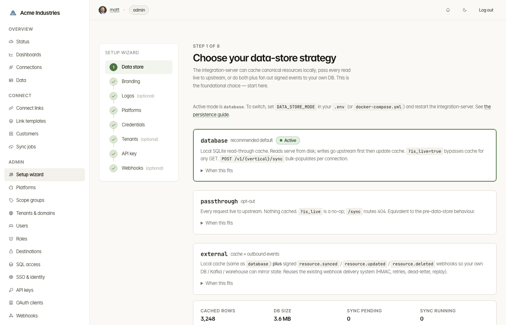
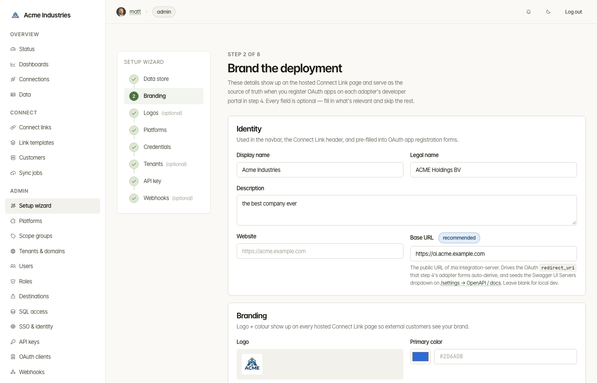
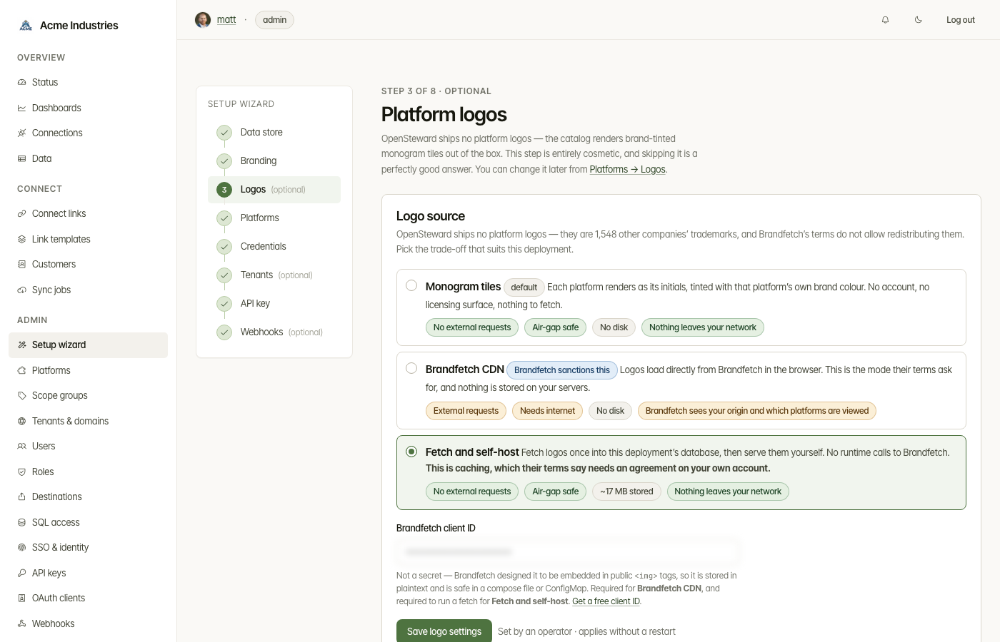
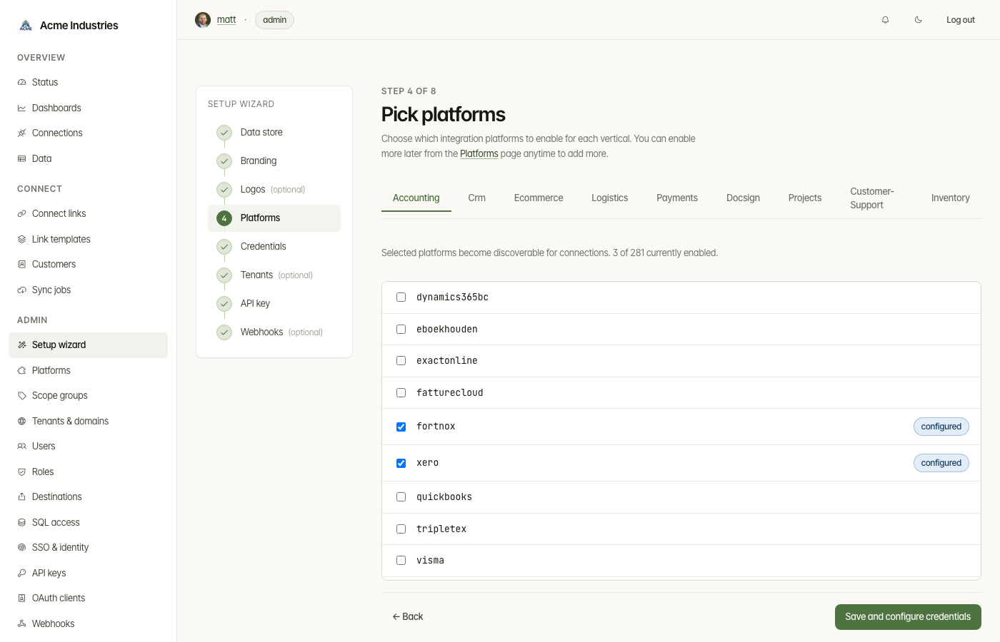
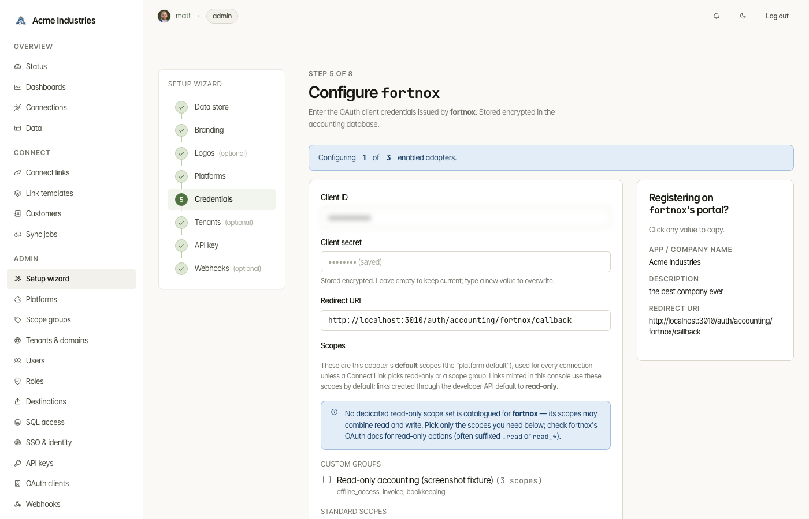
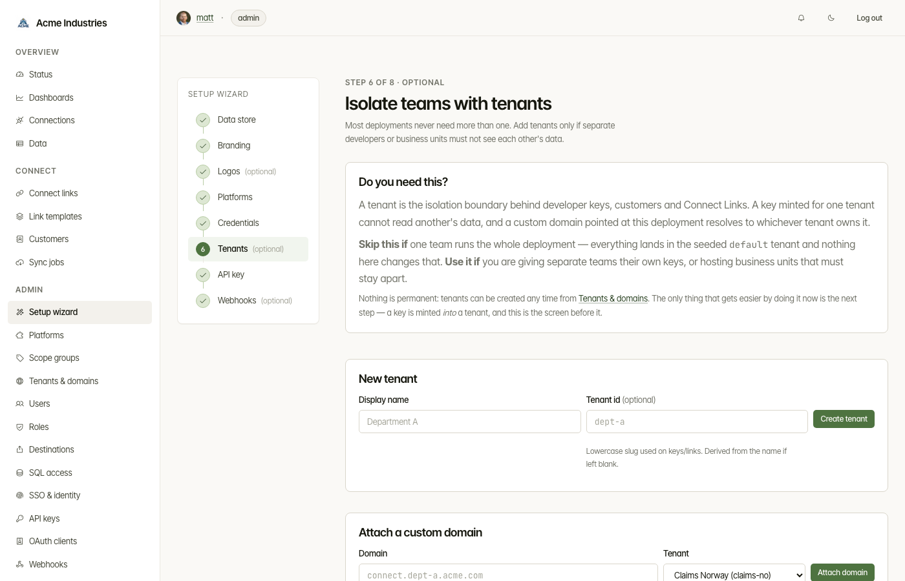
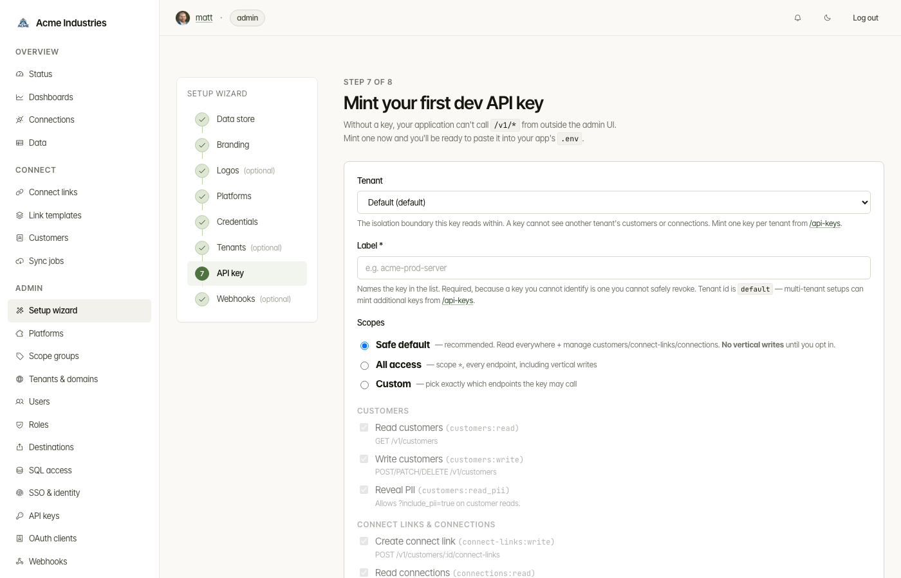
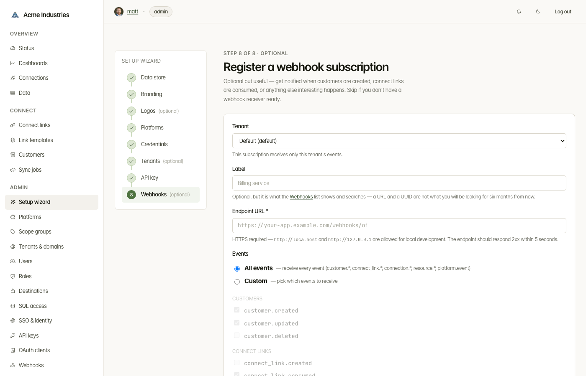

> [← Admin console](./README.md)

# Setup wizard

Eight steps that take a fresh deployment from an empty admin account to a
first API key and webhook subscription, at `/setup/wizard`.

## What it's for

The wizard walks a new admin through the decisions a deployment needs before
customers can connect. Every step is one an admin can finish alone. Several
steps are optional and can be skipped and revisited later.

## Who can use it

The **Setup wizard** sidebar entry is for admins, and steps 7 and 8 need the
admin role.

The wizard follows the first-run sign-up. On a fresh deployment, every page
first redirects to `/setup/init`, where you create the first admin account.
See [signing in](./README.md#signing-in).

## What you can do

The wizard keeps no progress of its own. Each step is marked done from what is
actually saved, so work you do elsewhere counts too: enabling a platform on
[Platforms](./platforms.md) completes step 4. Opening `/setup/wizard` resumes
at the first step that isn't done.

| Step | Page | What you do |
|---|---|---|
| 1. Data store | `/setup/wizard` | See the active data-store mode (`database`, `passthrough` or `external`) and what each means. To change it, set `DATA_STORE_MODE` and restart integration-server. |
| 2. Branding | `/setup/wizard/company-info` | Your company's name, logo, colours, base URL and contact details. You can change them later under [Company](./tenants-company-and-settings.md#company). |
| 3. Logos | `/setup/wizard/logos` | Optional: choose how platform logos are shown. |
| 4. Platforms | `/setup/wizard/platforms` | Pick the adapters to enable, vertical by vertical. |
| 5. Credentials | `/setup/wizard/configure` | Enter each enabled platform's OAuth client credentials, one platform at a time. The sidebar has your company details ready to copy into the platform's developer portal. |
| 6. Tenants | `/setup/wizard/tenants` | Optional: create tenants and attach custom domains. |
| 7. API key | `/setup/wizard/api-key` | Mint your first developer API key, and optionally an MCP key for AI agents. Each key is shown once. |
| 8. Webhooks | `/setup/wizard/webhooks` | Subscribe an endpoint to events. This is optional unless you run in `external` mode. The signing secret is shown once. |

A progress rail beside the steps shows what is done. If you leave part-way, the
[Status](./status.md) page shows admins a **Finish setting up** card with the
next step. **Finish setup** on step 8 takes you to Status, which shows "Setup
complete" once nothing is outstanding.

## Related docs

- [Architecture: setup wizard state machine](../architecture/setup-wizard.md):
  every branch, the resume logic and the setup card.
- [Architecture: auth and tenancy, first-run bootstrap](../architecture/auth-and-tenancy.md#first-run-bootstrap).
- [Platforms](./platforms.md), [API keys and webhooks](./api-keys-oauth-and-webhooks.md):
  where each step's settings live afterwards.
