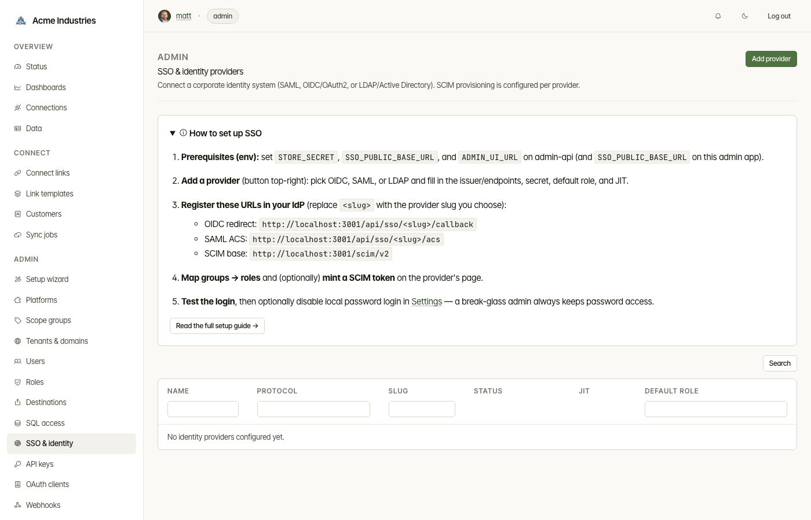

> [← Admin console](./README.md)

# SSO & identity

Corporate sign-in for the console, at `/identity-providers`. It supports OIDC
or OAuth2, SAML 2.0, and LDAP or Active Directory, with SCIM provisioning per
provider.

## What it's for

With SSO, your team signs in to the console with the identity system they
already use. Their console role, and optionally their tenant scope, comes from
their groups. Accounts can be created at first sign-in (just-in-time) or
provisioned ahead of time by your IdP over SCIM 2.0.

## Who can use it

Admins only. Setting tenant-scope rules also needs `users:manage`.

## What you can do

- **Read the setup checklist.** **How to set up SSO** lists:
  - the environment variables admin-api needs;
  - the URLs to register in your IdP: the OIDC redirect
    (`/api/sso/<slug>/callback`), the SAML ACS (`/api/sso/<slug>/acs`) and the
    SCIM base (`/scim/v2`).
- **Add a provider.** Give it a display name and a slug (used in callback
  URLs), then pick a protocol:
  - **OIDC / OAuth2:** issuer URL, client ID and secret, scopes, groups claim.
  - **SAML 2.0:** IdP SSO URL, IdP issuer, SP entity ID, IdP signing
    certificate, groups and email attributes.
  - **LDAP / Active Directory:** LDAP URL, bind DN and password, search base
    and filter, and group, email and display-name attributes.

  OIDC and SAML can also take a picture attribute. Set a **default role**, and
  choose whether to allow **just-in-time provisioning**.
- **Map groups to roles.** Rules match a group with equals, contains or regex.
  They are evaluated by priority, and the first match wins; otherwise the
  default role applies. A rule can grant a custom role. Mapping a group to an
  admin role gives those users every tenant.
- **Map groups to tenant scope.** Unlike role rules, **every** matching scope
  rule applies, and their tenants are combined.
  - A **default scope** covers users that no rule matches.
  - Scope rules only ever narrow non-admins.
  - They are re-applied at each SSO sign-in to users whose scope is managed by
    the IdP.
- **Provision with SCIM.**
  - **Mint SCIM token** creates a bearer token for your IdP. It is shown once.
  - **Revoke** a token when you no longer need it.
- **Delete a provider** under **Danger zone**.

Once a provider is enabled, the login page shows **Sign in with
&lt;provider&gt;**. To make SSO the only way in, turn off password login in
[Settings](./tenants-company-and-settings.md#settings) under Authentication.
A break-glass admin always keeps password access.

## Related docs

- [SSO setup guide](../deployment/sso-setup.md): step-by-step setup for Okta,
  Entra ID, Google, Keycloak, SAML and LDAP, including
  [tenant scope from IdP groups](../deployment/sso-setup.md#tenant-scope-from-idp-groups).
- [Architecture: SSO and identity providers](../architecture/sso-and-identity-providers.md):
  login flows, JIT, scope mapping, SCIM and break-glass.
- [Rehearsing admin SSO locally](../operations/sso-testing.md): the mock IdP in
  the `sso-dev` compose profile.
- [Users, roles and tenant scope](./users-and-roles.md).
