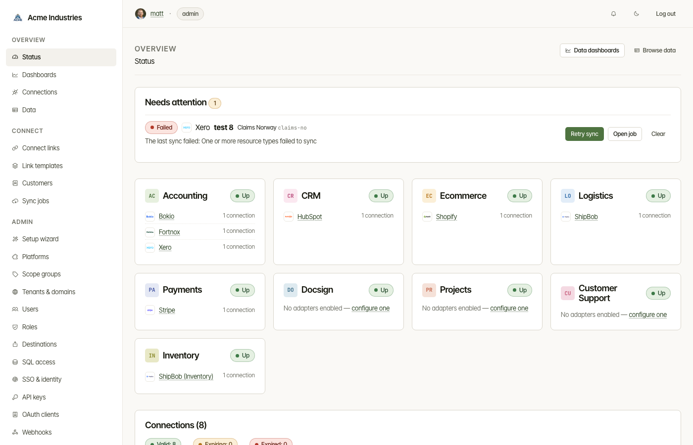

> [← Admin console](./README.md)

# Status

The console's home page, at `/`.

## What it's for

Status answers two questions at a glance: is anything broken, and what should
someone do about it? It shows:

- whether each vertical's backend answers;
- which platforms are set up;
- how healthy the connections are;
- a short to-do list of problems, each with the action that fixes it.

## Who can use it

Every signed-in user sees the page. What you can do from it depends on your
role:

- **Viewers** can read everything, but can't clear rows.
- **Operators** can clear and undo rows about connections and syncs, unless
  they are restricted to some tenants.
- **Admins** can also act on rows about platform credentials and verticals
  that are down, and they see the setup card.

## What you can do

- **Finish setting up** (admins only). Until the
  [setup wizard](./setup-wizard.md) is complete, a card names the next step,
  for example "next: Credentials (step 5 of 8)".
  - **Continue setup** opens that step.
  - **Skip for now** hides the card until the next step changes.
  - **Undo** shows it again.
- **Needs attention.** Each problem gets one row, with the buttons that deal
  with it:

  | Problem | Actions |
  |---|---|
  | A vertical is down | **Open System page** (admin) |
  | A platform's OAuth client credentials were rejected | **Fix credentials**, which opens the platform page (admin) |
  | A connection's authorization expired | **Mint Connect Link** to send the customer a new link, or **Delete** |
  | A connection's token refresh is failing | **Open connection**, **Mint Connect Link** |
  | The last sync failed | **Retry sync**, **Open job** |

  - **Clear** hides a row until the problem comes back. **Clear all** hides
    every row you're allowed to clear.
  - For 15 minutes, a **Cleared recently** strip offers **Undo**.
  - When there are more than eight rows, the rest collapse into a link to the
    full list.
- **Vertical cards.** There is one card per vertical, marked **Up** or
  **Down**. Each lists the enabled adapters with a badge:
  - **Credentials rejected**;
  - **No credentials**;
  - the number of connections;
  - **Ready**.

  Admins also see a link to adapters that are configured but switched off.
- **Connections summary.** Counts of valid, expiring and expired connections,
  plus rejected platform credentials when there are any.
- **Shortcuts.**
  - **Data dashboards** and **Browse data**, if your role allows them.
  - **View all connections**.
  - **Browse platforms**, for admins.

## Related docs

- [Connections](./connections.md) and [Sync jobs](./sync-jobs.md), where most
  rows lead.
- [Platforms](./platforms.md), where rejected OAuth client credentials are
  fixed.
- [Tenants, company, settings and notifications](./tenants-company-and-settings.md#system):
  the System page.
- [Architecture: admin page map](../architecture/admin-page-map.md).
