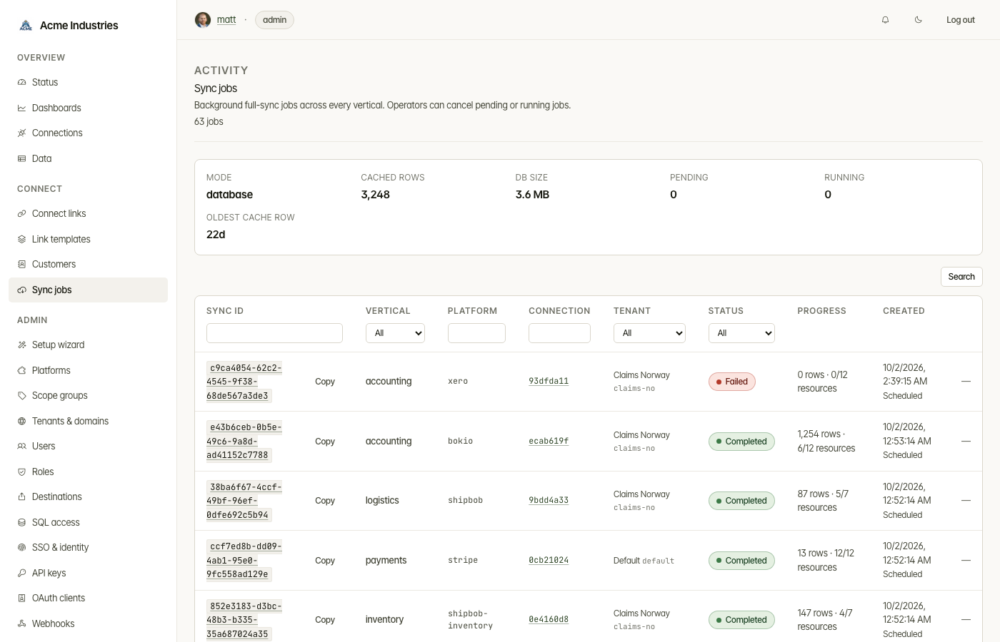

> [← Admin console](./README.md)

# Sync jobs

Background sync jobs across every vertical, at `/sync-jobs`.

## What it's for

A sync job re-reads a connection's resources from the platform into the data
store. This page shows:

- what ran;
- why it ran;
- how far it got;
- why it failed.

## Who can use it

- **Every signed-in user** can view jobs.
- **Operators and admins** can cancel pending or running jobs.
- A tenant-restricted user sees only their tenants' jobs.

## What you can do

- **List and filter jobs** by sync id, vertical, platform, connection, tenant
  or status. You can sort by platform, connection or created time.
- **See why each job ran.** The origin appears under its created time:

  | Origin | What started it |
  |---|---|
  | **Scheduled** | The connection's [sync schedule](./connections.md#sync-schedules) |
  | **Sync now** | Someone pressed **Sync now** |
  | **API** | `POST /v1/{vertical}/sync` |
  | **After connecting** | The first sync after a Connect Link |
  | **On boot** | A warm-up sync queued when integration-server starts. This happens only when `DATA_STORE_AUTO_SYNC_ON_BOOT` is on, and it is off by default |

- **Follow progress.** The list shows each job's per-resource progress.
- **Open a job** in a dialog. It shows:
  - status, vertical, platform, connection and tenant;
  - when it was created, started and finished, and how long it took;
  - its callback URL;
  - the error, if it failed;
  - **Progress by resource**: rows synced and status for each resource type.
- **Cancel** a pending or running job (operator).

A connection has at most one sync queued at a time. Jobs older than 30 days are
cleaned up daily. Each connection keeps its latest successful sync and any
failures since then, because its schedule still reads them.

## Related docs

- [Connections](./connections.md#sync-schedules): setting a connection's
  schedule, and **Sync now**.
- [Developer Guide §7: `/sync`](../dev-api.md#7-data-store-is_livetrue-and-sync):
  job envelopes, statuses, callbacks and rate limits.
- [Architecture: runtime flows](../architecture/runtime-flows.md).
