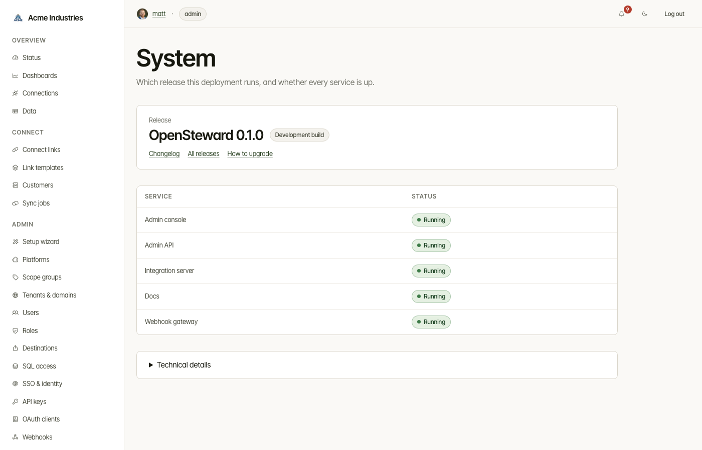
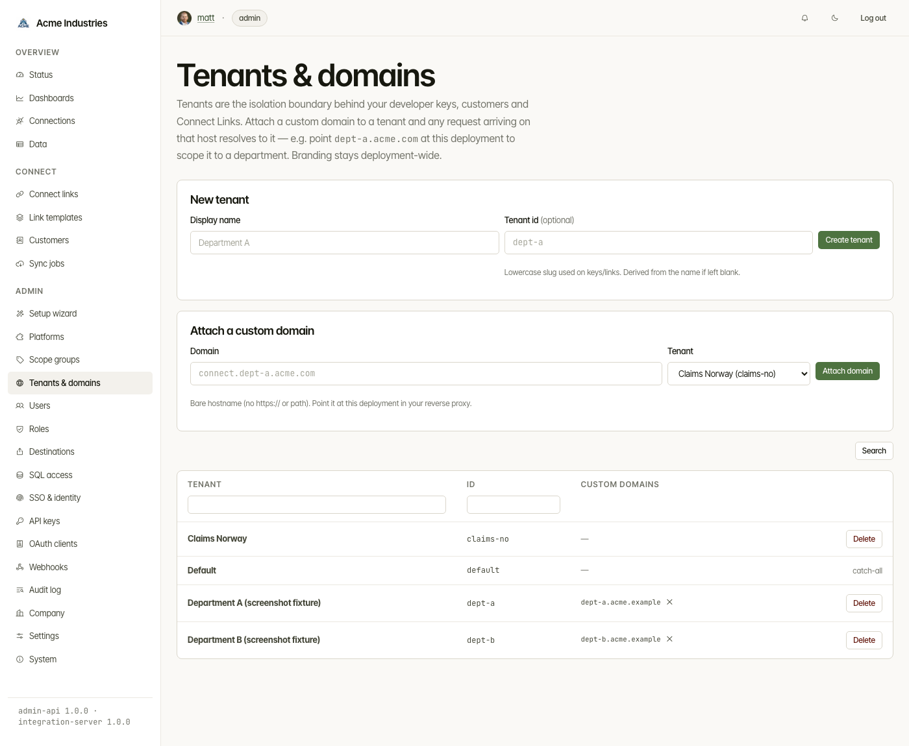
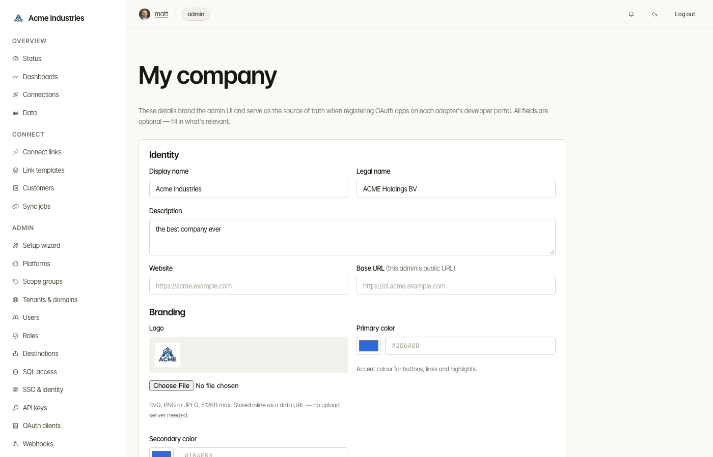
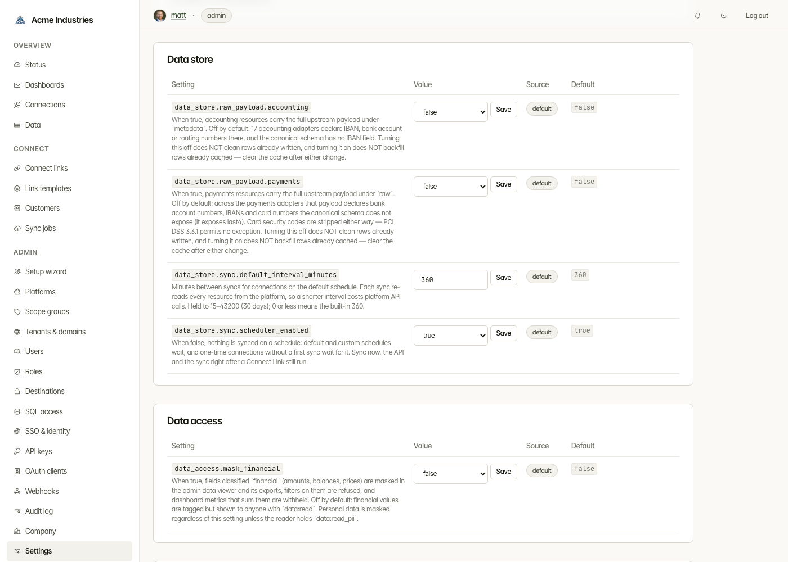
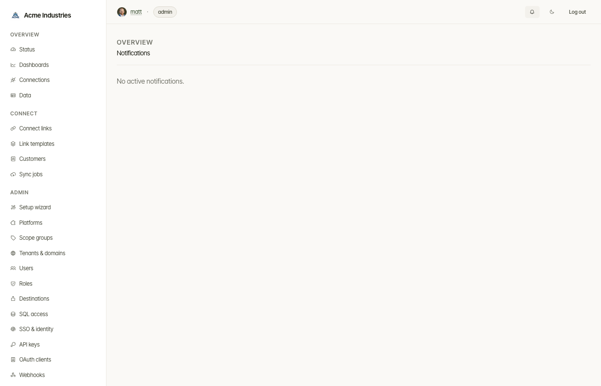

> [← Admin console](./README.md)

# Tenants, company, settings and notifications

Deployment-wide configuration, plus the notification list behind the header
bell:

- tenants and custom domains (`/tenants`);
- your company's branding (`/company-info`);
- runtime settings (`/settings`);
- which release is running, and whether every service is up (`/settings/system`);
- notifications (`/notifications`).

## What it's for

- **Tenants** are the isolation boundary behind developer keys, customers and
  Connect Links. Attaching a custom domain to a tenant scopes every request on
  that host to it.
- **Company** is the branding and contact details shown on the console,
  Connect Links and the developer portal.
- **Settings** are tunables that take effect without a redeploy.
- **System** shows what is running.
- **Notifications** collect alerts about connections, platform credentials
  and verticals.

## Who can use it

- **Company**, **Settings** and **System** are for admins only.
- **Tenants & domains** appears in the sidebar for admins. Operators can open
  `/tenants` by URL and create and delete tenants and domains there. A
  tenant-restricted user sees only their own tenants and can't create one.
- **Notifications** are open to every signed-in user. Dismissing needs the
  operator role.

## What you can do

### Tenants and domains

- **Create a tenant.** Give it a display name and, optionally, an id. The id
  is a lowercase slug used on keys and links, derived from the name if you
  leave it blank.
- **Attach a custom domain** to a tenant. Enter a bare hostname, then point it
  at this deployment in your reverse proxy. Requests that arrive on it resolve
  to that tenant.
- **Detach a domain**, or **delete a tenant**. Detach its domains first.
- **The license limits tenants.** It counts every registered tenant, `default`
  included. At the limit, creating one is refused with the license's message
  (`LICENSE_LIMIT_EXCEEDED`); existing tenants keep working and can still be
  deleted. Community mode allows one tenant; a license file can allow more. See
  [Installing and renewing your license](../deployment/license.md).

Branding stays deployment-wide; it isn't set per tenant.

### Company

The **My company** form has these sections:

- **Identity:** display name, legal name, description, website, and **Base
  URL**. The base URL is the deployment's public URL. Connect Links and
  platform redirect URIs fall back to it when `PUBLIC_BASE_URL` isn't set.
- **Branding:** logo, primary and secondary colours, favicon, and
  **White-label**. White-label hides the OpenSteward mark and wordmark
  wherever you haven't set your own logo or name.
- **Typography:** font family, plus an optional font stylesheet URL or font
  file.
- **Contact & legal:** support email, privacy policy URL, terms of service URL.
- **Address.**

Press **Save changes** to apply them.

**Reset Company Info**, under the form, clears every field, including the
logo, favicon and font, after the browser asks you to confirm. Every branded
page goes back to OpenSteward's own branding, as on a fresh install; Connect
Link pages and the docs portal catch up within a minute. The setup wizard's
Branding step shows as not done until you save again. The reset is recorded
in the audit log as `company_info.reset`, and cannot be undone.

### Settings

Runtime settings are grouped into sections:

| Section | Settings |
|---|---|
| Rate limits | Per-key, MCP and Connect Link request budgets |
| Features | MCP, end-user mode, test mode |
| Connect Links | Default link expiry, one-time default |
| Data store | Raw payload storage per vertical; **sync schedules**: `data_store.sync.default_interval_minutes` (default 360, i.e. 6 hours) and `data_store.sync.scheduler_enabled` |
| Data access | `data_access.mask_financial` |
| Webhooks | Delivery and inbound-event retention |
| Authentication | Local password login, break-glass user, developer API keys and OAuth, self-serve sandbox keys |
| Audit | Audit-log retention |
| OpenAPI / docs | The servers shown in the Unified API reference |
| Platform logos | Logo source and fetch options |

- Each row has **Save** and **Reset**. Reset returns the setting to its
  seeded default.
- Services pick up a change within about a minute.
- Every edit is written to the audit log.

### System

- **Release:** the OpenSteward release this deployment runs, for example
  **OpenSteward 0.1.0**. A build made from source rather than a published
  image is labelled **Development build**. Links lead to that release's notes,
  every release, and the [upgrade guide](../deployment/upgrading.md). The
  console never checks for updates itself.
- **Services:** the admin console, admin API, integration server, docs and
  webhook gateway, each **Running** or **Not responding**.
- **License:** who the license is issued to, the plan, label, license ID,
  expiry and days left, connections and tenants used against the limits, the
  enabled verticals, and where integration-server read it, with links to renew
  it and to [Installing and renewing your license](../deployment/license.md).
  It says **unavailable**, with the reason, when admin-api cannot get the status
  from integration-server, most often because `ADMIN_SECRET` is not set on both.
  When `OPENSTEWARD_LICENSE` is set and a license file also exists, the card
  names that file, which integration-server then ignores: renewing it changes
  nothing until `OPENSTEWARD_LICENSE` is unset. Without a valid license the
  card says **community mode**: one connection and one tenant. Connections
  beyond the first one stay readable and keep syncing; writes through them are
  refused (`LICENSE_LIMIT_EXCEEDED`). Nothing is deleted.
- **Warnings**, only when something is wrong:
  - a service that is not responding, by name: check that its container or
    pod is running, then read its logs;
  - services on different releases, which means an upgrade has not
    finished;
  - the license, when it is expiring, expired, invalid or missing: what still
    works, and a link to renew. Admins see the same warning at the top of every
    console page.
- **Technical details** (closed): each service's package version, Git SHA
  and build time, and **Copy for a bug report**, which copies all of it for
  an issue's Version field.

Database migrations are not listed. Each service applies its own when it
starts, and a failed migration keeps that service from starting, so it shows
as not responding. The sidebar footer shows the same release, for example
`OpenSteward 0.1.0`.

The **Open System page** action on [Status](./status.md) leads here when a
vertical is down.

### Notifications

The header bell opens a list of active alerts:

- connections that have expired or are about to;
- platform credentials that were rejected;
- verticals that are down.

The bell's count leaves out "expiring soon" alerts. The page says how many it
isn't counting.

- **Open** goes to the connection, or to the platform for an admin.
- **Dismiss** and **Dismiss all** (operator) clear an alert for everyone.

## Related docs

- [Custom domain + TLS](../deployment/custom-domain.md): put Connect Links and
  the API on your own hostnames.
- [Architecture: auth and tenancy](../architecture/auth-and-tenancy.md): what a
  tenant scopes.
- [Connections: sync schedules](./connections.md#sync-schedules).
- [Platform logos](../operations/platform-logos.md).
- [Environment variables](../environment/environment-variables.md): the
  bootstrap values behind the settings.
