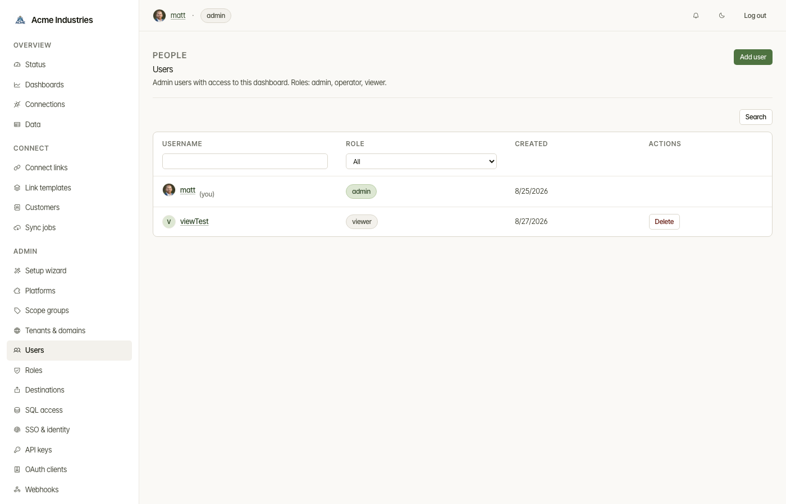
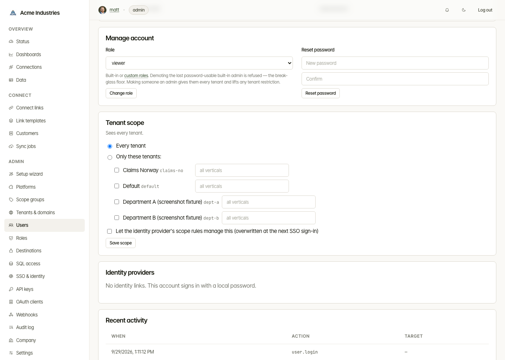
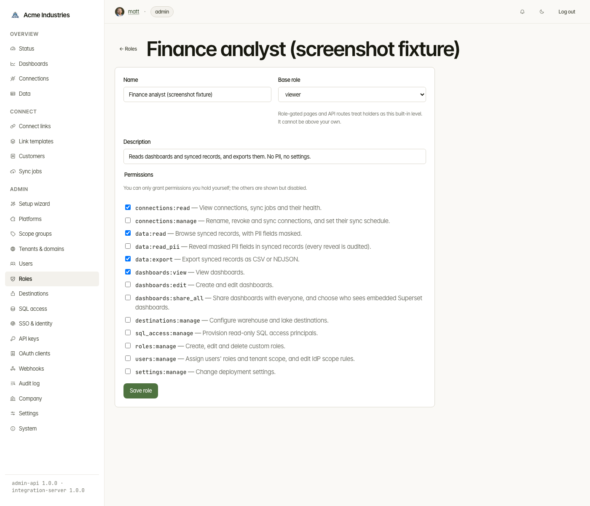

> [← Admin console](./README.md)

# Users, roles and tenant scope

Console accounts (`/users`), custom roles (`/roles`), and the tenant scope that
limits which tenants a user can see.

## What it's for

Access is decided on two separate axes:

- **Role** decides what a user may **do**. There are three built-in roles:
  - **viewer** looks.
  - **operator** runs the day-to-day work.
  - **admin** configures the deployment.

  Custom roles let you hand out a different set of permissions.
- **Tenant scope** decides which tenants' data a user may **see**. A user sees
  every tenant, or is restricted to some, and optionally to some verticals
  within each one.

A change to either applies within seconds, without the user signing in again.

## Who can use it

- **Users** is for admins only.
- **Roles** needs `roles:manage` (admin).
- Editing a user's role or tenant scope needs `users:manage`.
- Nobody can grant more than they hold. You can't give a permission or base
  role you don't have, edit a role above your own, or change your own role.

## What you can do

**On the Users page:**

- Search the users list. Add a user with a username, an optional email,
  a password and a role.
- On a user's page:
  - **Profile.** Set their email and upload or remove their picture.
  - **Manage account.** Change their role (built-in or custom) and reset their
    password.
  - **Tenant scope.** See and edit which tenants they see (see below).
  - **Identity providers.** See the SSO accounts linked to them and whether
    each is just-in-time or SCIM-managed. The subject each provider knows them
    by is hidden until you press **Reveal**, which is audited.
  - **Recent activity.** Their last audit-log entries.
- Delete a user from the list.

The console refuses to demote the last built-in admin who can sign in with a
password. That account is the break-glass floor.

### Tenant scope

On a user's page, choose **Every tenant** or **Only these tenants**. Then tick
tenants, and optionally list the verticals allowed for each one. Leave the
verticals empty to allow them all.

- **Let the identity provider's scope rules manage this.** With this ticked,
  the user's scope is overwritten at each SSO sign-in by the rules on the
  [identity provider](./sso.md).
- **What a restricted user sees.** Only their tenants' connections, sync jobs,
  records, exports and dashboard numbers. They get a **scoped** badge in the
  header.
- **What a restricted user can't do.** Pages that aren't tenant-scoped yet
  refuse them, as do deployment-wide changes such as platform configuration
  and scope groups.
- **Admins always see every tenant.** Making someone an admin lifts any
  restriction. To limit someone, give them a non-admin role first.
- **Per-tenant administration is API-only today.** A custom role on an
  operator base with `users:manage`, restricted to some tenants, can change
  the role and tenant scope of users through admin-api
  (`PUT /api/users/:id/role` and `/scope`) when it knows their ids. The
  console's Users pages, and listing users, need the admin role.

### Roles

The Roles page lists the built-in and custom roles, with the permission
catalog underneath.

- **Built-in roles** are defined in code. You can't change them.
- **New role.** Give it a name, a **base role** and a description, and tick
  its permissions.
  - The base role (viewer, operator or admin) decides the pages and routes
    that check a role rather than a permission. It can't be above your own.
  - Permissions you don't hold are shown but disabled.
- **Deleting a role.** A role in use can't be deleted. That includes a role
  assigned to a user or named by an identity provider's role-mapping rule.

The permissions:

| Permission | Allows | Built-in roles |
|---|---|---|
| `connections:read` | View connections, sync jobs and their health. | viewer, operator, admin |
| `connections:manage` | Rename, revoke and sync connections, and set their sync schedule. | operator, admin |
| `data:read` | Browse synced records, with personal data masked. | operator, admin |
| `data:read_pii` | Reveal masked personal data (every reveal is audited). | admin |
| `data:export` | Export synced records as CSV or NDJSON. | operator, admin |
| `dashboards:view` | View dashboards. | viewer, operator, admin |
| `dashboards:edit` | Create and edit dashboards. | operator, admin |
| `dashboards:share_all` | Share dashboards with everyone, and choose who sees embedded Superset dashboards. | admin |
| `destinations:manage` | Configure warehouse and lake destinations. | admin |
| `sql_access:manage` | Provision read-only SQL access logins. | admin |
| `roles:manage` | Create, edit and delete custom roles. | admin |
| `users:manage` | Assign users' roles and tenant scope, and edit IdP scope rules. | admin |
| `settings:manage` | Change deployment settings. | admin |

## Related docs

- [Architecture: permissions, roles and tenant scope](../architecture/permissions-and-roles.md):
  what each permission unlocks, escalation guards and caching.
- [Architecture: auth and tenancy, admin roles](../architecture/auth-and-tenancy.md#admin-roles).
- [SSO & identity](./sso.md): role and scope mapping from IdP groups.
