# OpenSteward architecture

> A tiered set of mermaid diagrams that document the entire repo. Read top-to-bottom, drill down by clicking nodes.

## Where to start

- **First time here?** Read the [end-user journey →](./end-user-journey.md). It walks through one operator's lived experience from `git clone` to working integrations.
- **Want the technical map?** The diagram below is the entry point. Click any service node to drill into the subsystem that owns it.
- **Writing a new adapter?** Skip to the [adapter walkthrough →](./adapter-walkthrough.md) — Fortnox dissected file-by-file with rationale, plus a table of what varies across adapters.

---

## Chart 1 — Overview

```mermaid
flowchart LR
  classDef ux fill:#dbeafe,stroke:#1e40af,color:#1e3a8a
  classDef ctrl fill:#fef3c7,stroke:#a16207,color:#713f12
  classDef vert fill:#dcfce7,stroke:#15803d,color:#14532d
  classDef ext fill:#fee2e2,stroke:#b91c1c,color:#7f1d1d
  classDef side fill:#e9d5ff,stroke:#7e22ce,color:#581c87

  Op([Operator])
  Dev([Developer backend])
  EndUser([External customer<br/>opens Connect Link])

  subgraph UX["UX layer"]
    Admin[":3000<br/>admin (UI)"]:::ux
  end

  subgraph Ctrl["Control plane"]
    AdminApi[":3001<br/>admin-api"]:::ctrl
  end

  subgraph Unified["Unified service"]
    IS[":3010<br/>integration-server<br/>9 verticals · 1,548 adapters<br/>/v1/customers · /v1/connections · /v1/&#123;vertical&#125;/* · /auth/*"]:::vert
  end

  subgraph Side["Side-cars"]
    WebhookGw[":3004<br/>webhook-gateway"]:::side
    Docs[":3003<br/>docs-server"]:::side
    Redis["redis:7-alpine<br/>(opt-in, --profile scale)"]:::side
  end

  subgraph Ext["External platforms"]
    Platform[Fortnox / Nutshell / Shopify / EasyPost / Stripe / DocuSign / Asana / Zendesk / Cin7 / 1536 more]:::ext
    Receiver[Customer's webhook URL]:::ext
  end

  Op -->|browser| Admin
  Dev -->|Bearer: osk_ key / OIDC JWT| IS
  EndUser -.->|/connect/&lt;token&gt;| IS

  Admin -->|JWT| AdminApi
  AdminApi -->|X-Admin-Secret| IS

  Platform -.->|inbound webhook| WebhookGw
  WebhookGw -->|forwards| IS

  IS -->|OAuth/API| Platform
  IS -.->|HMAC POST retry queue| Receiver
  IS <-->|opt-in REDIS_URL| Redis

  Docs -.->|reads openapi.json| IS

  click Admin href "./admin-page-map.md" "Admin frontend page map"
  click AdminApi href "./services.md" "Service topology"
  click IS href "./vertical-internals.md" "Inside one vertical"
  click WebhookGw href "./webhook-delivery.md" "Webhook delivery state machine"
  click Docs href "./services.md" "Service topology"
```

### Layers at a glance

| Layer | Purpose | Talks to |
|---|---|---|
| **UX** (admin) | EJS-rendered admin frontend, session cookie auth | admin-api over JWT |
| **Control plane** (admin-api) | Single source of truth for users, audit, notifications, company info, adapter management | integration-server over `X-Admin-Secret` |
| **Unified service** (integration-server) | Single backend mapping every vertical (accounting, crm, ecommerce, logistics, payments, docsign, projects, customer-support, inventory) to the canonical REST API. Also serves the developer-facing `/v1/customers` and `/v1/connections` endpoints under tenant-scoped Bearer auth, fires HMAC-signed outbound `customer.*` / `connect_link.*` / `resource.*` webhook events with at-least-once retry, and enforces per-key scopes + rate limits. Owns the encrypted SQLite credential store **and** (when `dataStore.mode != passthrough`) a sibling `resources.db` cache populated by per-vertical SyncWorkers. | External platforms over OAuth / API key; developer backends over Bearer auth (`osk_` API keys, or OIDC bearer tokens from a registered issuer) |
| **Side-cars** | Webhook Gateway (inbound webhook receiver with retries + DLQ), Docs Server (Swagger UI on the unified spec), opt-in Redis (`docker compose --profile scale`) for shared rate-limit budget across replicas | integration-server |
| **External platforms** | Fortnox, QuickBooks, EasyPost, DHL, Shippo, Shopify, Stripe, DocuSign, Asana, Zendesk, Cin7, … (1,548 adapters across 9 verticals); plus the customer-supplied webhook URLs that receive outbound `customer.*` / `connect_link.*` events | integration-server |

---

## Chart index

### Tier 2 — Subsystem views (start here for breadth)

| # | File | What it covers |
|---|---|---|
| 2 | [end-user-journey.md](./end-user-journey.md) | The full operator narrative, from `git clone` to day-2 ops |
| 3 | [services.md](./services.md) | All 5 services plus the opt-in compose profiles (Redis, Postgres + Superset, local HTTPS, dev SSO), ports, depends_on, databases, the sync scheduler |
| 4 | [runtime-flows.md](./runtime-flows.md) | API request • sync job • OAuth connect • webhook ingestion (4 sequence diagrams) |
| 5 | [persistence.md](./persistence.md) | ERD across the four databases + the resources-cache runbook |
| 6 | [build-and-workspace.md](./build-and-workspace.md) | pnpm workspace deps + Dockerfile build args |
| 7 | [testing.md](./testing.md) | The 3-layer test taxonomy (transform unit · journeys · CI guards) + how CI runs |

### Tier 3 — Deep dives (drill in for depth)

| # | File | What it covers |
|---|---|---|
| 8 | [vertical-internals.md](./vertical-internals.md) | Inside one vertical (build chain + middleware chain) |
| 9 | [adapter-lifecycle.md](./adapter-lifecycle.md) | Adapter enable / disable / configure flow |
| 10 | [setup-wizard.md](./setup-wizard.md) | First-run guard + 8-step wizard, and how it resumes where setup stands |
| 11 | [auth-and-tenancy.md](./auth-and-tenancy.md) | Operator vs admin user vs developer key vs tenant vs end-user vs connection |
| 12 | [admin-page-map.md](./admin-page-map.md) | Every admin frontend route grouped by access level (for how to use each page, see the [admin console guide](../admin/README.md)) |
| 13 | [webhook-delivery.md](./webhook-delivery.md) | **Inbound** webhook gateway delivery lifecycle. For **outbound** customer/connect-link events see [../dev-api.md §8](../dev-api.md#8-outbound-webhooks) |
| 14 | [adapter-walkthrough.md](./adapter-walkthrough.md) | Fortnox adapter file-by-file — the worked example for scaffolding a new adapter |
| — | [connect-links.md](./connect-links.md) | Hosted OAuth links — mint modes, session lifecycle, templates, per-link scope override |
| — | [sso-and-identity-providers.md](./sso-and-identity-providers.md) | Corporate SSO (SAML / OIDC / LDAP) + SCIM against the admin-user layer |
| — | [permissions-and-roles.md](./permissions-and-roles.md) | Permission catalog, custom roles, per-user tenant scope and the escalation guards |
| — | [data-access.md](./data-access.md) | Data viewer and native dashboards — admin UI → admin-api → integration-server, the scope header, masking, metrics and audit |
| — | [../dev-api.md](../dev-api.md) | Developer-facing walkthrough — Bearer keys, scopes, customers, connect links, vertical APIs, outbound webhooks |

---

## Maintenance

- **Source of truth.** When the codebase changes, the corresponding chart should be updated in the same PR.
- **No build step.** GitHub renders mermaid natively in `.md` files.
- **Single-tier rule.** Any chart that exceeds ~30 nodes should split into a Tier 3 sub-chart and be replaced with a node-group in the parent.
