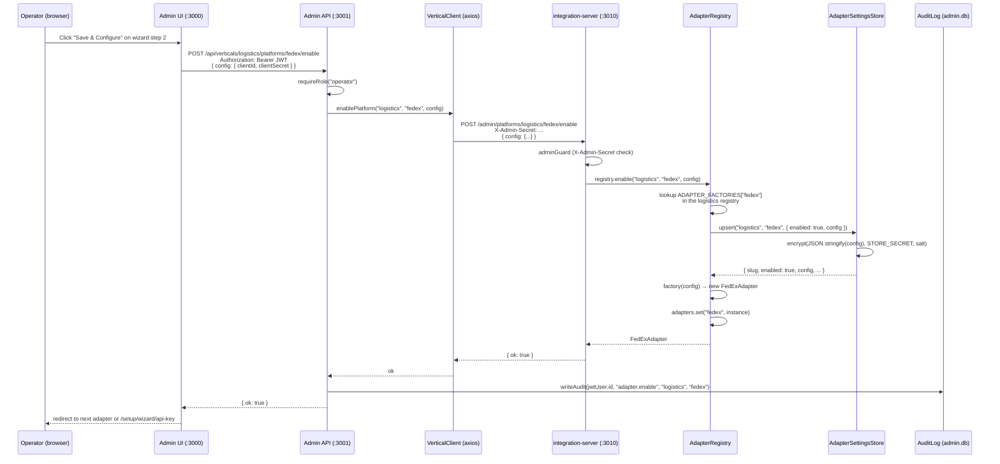
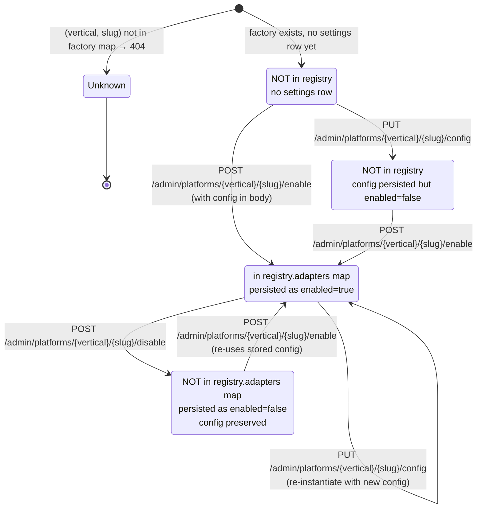

# Adapter lifecycle

> [← back to overview](./README.md)

How runtime adapter management works: an operator clicks "enable fedex" in the wizard and within ~50ms the FedEx adapter is registered, persisted, and ready to serve requests — no container restart, no YAML editing.

---

## Chart 9a — Enable adapter end-to-end

---

## Chart 9b — Adapter state machine

**Critical property:** disabling an adapter does **not** delete the config — re-enabling restores the OAuth credentials without the operator having to re-enter them.

---

## What gets persisted, where

| Layer | Data | Storage |
|---|---|---|
| Provider config (clientId, clientSecret, redirectUri, scopes) | per (vertical, slug) | `adapter_settings` table (encrypted) |
| Operator's intent (enabled/disabled) | per (vertical, slug) | same table, `enabled` column |
| OAuth tokens (accessToken, refreshToken, expiresAt) | per (vertical, platform, tenant, label) | `credentials` table (encrypted) — the connections table, named `credentials` in SQL |
| Refresh health (`last_refresh_at`, `last_refresh_status`, `last_refresh_error`) | per connection | same table, plaintext columns |
| Audit log (who toggled what) | per change | admin-api's `audit_log` table (plaintext) |

The two stores (`adapter_settings` and `credentials`) live in the **same database** — `credentials.db` by default, or the Postgres pointed at by `DATABASE_URL` — but have completely separate schemas, salts, and lifecycles. `AdapterSettingsStore` derives its key with the salt `opensteward-adapter-settings`, so the two never share an encryption key even though they share `STORE_SECRET`.

## API endpoints

### integration-server (all nine verticals)

One router — `createUnifiedAdminPlatformsRouter` in `@opensteward/shared` — serves
every vertical. All routes go through `adminGuard`: `ADMIN_SECRET` set requires a
matching `X-Admin-Secret` header, unset allows the request outside production and
403s inside it.

| Method | Path | Body | Returns |
|---|---|---|---|
| `GET` | `/admin/platforms?vertical=` | — | `{ data: [{ vertical, slug, enabled, hasConfig }] }` for every known adapter, optionally filtered to one vertical |
| `POST` | `/admin/platforms/:vertical/:slug/enable` | `{ config? }` | `{ ok: true }` or 404 (unknown vertical/slug) |
| `POST` | `/admin/platforms/:vertical/:slug/disable` | — | `{ ok: true }` or 404 |
| `GET` | `/admin/platforms/:vertical/:slug/config` | — | `{ data: { clientId, redirectUri, scopes, hasSecret, recommendedScopes, readScopes, supportsScopeOverride } }` — `clientSecret` is never returned |
| `PUT` | `/admin/platforms/:vertical/:slug/config` | `{ config }` | `{ ok: true }`, 400 (no `config` object) or 404 |

### Admin API (proxy)

All require JWT auth. Mutations require `operator` role.

| Method | Path | Returns |
|---|---|---|
| `GET` | `/api/verticals/:vertical/platforms` | proxies to integration-server, JWT auth (any role) |
| `GET` | `/api/verticals/:vertical/platforms/:slug/config` | proxies the redacted config read |
| `POST` | `/api/verticals/:vertical/platforms/:slug/enable` | proxies + writes audit log entry `adapter.enable` |
| `POST` | `/api/verticals/:vertical/platforms/:slug/disable` | proxies + writes audit log entry `adapter.disable` |
| `PUT` | `/api/verticals/:vertical/platforms/:slug/config` | proxies + writes audit log entry `adapter.config` |

### Admin frontend (UI routes)

| Method | Path | What it does |
|---|---|---|
| `GET` | `/setup/wizard/platforms?vertical=...` | Tab-per-vertical checkbox grid (during wizard onboarding) |
| `POST` | `/setup/wizard/platforms` | Reconciles enabled set: enables checked, disables previously-on-but-now-unchecked |
| `GET` | `/setup/wizard/configure?vertical=...&slug=...` | Credentials form for one adapter, with developer-portal sidebar |
| `POST` | `/setup/wizard/configure` | Calls `setPlatformConfig` and either advances to the next adapter or finishes the wizard |
| `GET` | `/platforms` | Standalone admin page — every adapter across all verticals with `enabled` / `configured` / connection-count columns. Reachable from the sidebar after first-run. |
| `GET` | `/platforms/:vertical/:slug` | Per-adapter detail page reusing the wizard's credentials form. Pre-fills non-secret fields via the redacted `getPlatformConfig` endpoint. |
| `POST` | `/platforms/:vertical/:slug` | Save config (merge semantics — empty `clientSecret` keeps stored value). Auto-enables a previously-disabled adapter. |
| `POST` | `/platforms/:vertical/:slug/disable` | Disable without clearing config. |

The wizard routes and the standalone `/platforms` page write through the same `apiClient.setPlatformConfig` → admin-api `PUT /api/verticals/:vertical/platforms/:slug/config` → registry `setConfig` chain. `setConfig` merges with existing config, so a partial submit (e.g. updating only `clientId`) is safe.

## Bootstrap behaviour

`buildServer` opens one `AdapterSettingsStore` over `credentials.db` (salt
`opensteward-adapter-settings`) and hands it to every vertical. For each
vertical, `build<Vertical>Registry({ unifiedRegistry, settingsStore })`:

1. Constructs an `AdapterRegistry` with `{ vertical, factories: ADAPTER_FACTORIES, settingsStore }`
2. Calls `registry.hydrate()`, which loads the `enabled = true` rows for that vertical from `adapter_settings` and re-instantiates each adapter via its factory — an unknown slug in the table is skipped, not fatal
3. Registers itself in the `UnifiedAdapterRegistry` under its vertical name, so `(vertical, slug)` lookups resolve across all nine

The settings table is the only source of enabled state. There is no
config.yml list of adapters to enable — `config.yml` carries ports, store
paths, rate limits, CORS and inbound webhook signing secrets, nothing that
turns an adapter on. **What the admin UI persists is what the next boot
runs.**

---

## `expired` means a human must act

Access tokens are short — Fortnox's live one hour — and are renewed
automatically, by the keep-alive worker ahead of expiry and by the request path
on demand. So a healthy connection that nobody has used for a while routinely
holds a lapsed access token and a perfectly good grant behind it.

`connection.status` therefore reports that as `valid`, not `expired`, provided
the grant has already proven it can renew (`last_refresh_status = 'ok'`).
`expired` is reserved for the cases where somebody has to do something: the
refresh grant is dead, or the token lapsed with no evidence the connection can
renew itself — a connection that has never refreshed, or whose last attempt
failed, is not assumed to be fine.

The practical effect: a dashboard counting `expired` connections counts real
problems, not idle ones.

## Credential failure modes — two distinct causes

When a token refresh fails (on-request or via the keep-alive worker), the OAuth
error code decides which credential is at fault and who must act:

| Refresh error | `connection.status` | `last_refresh_status` | Webhook event | Who fixes it |
|---|---|---|---|---|
| `invalid_grant` / `unauthorized_client` / `invalid_token` | `expired` | `expired` | `connection.authorization_expired` | **Customer** re-authorizes this one connection |
| `invalid_client` | `platform_error` | `platform_error` | `connection.platform_credentials_invalid` | **Operator** fixes the platform's client id/secret in Platforms |
| network / 5xx / rate-limit | unchanged | `failed` | — | nobody (retried next tick) |

The distinction matters because a rotated/expired/wrong **platform** `client_secret`
breaks *every* connection for that platform at once. A per-customer `expired`
status would send operators down a dead end — telling customers to re-authorize
fails again because the client secret is the real cause. The
`platform_error` status routes the operator to **Platforms → {platform}** instead,
and the admin dashboard / connection detail / a deduped notification all say so.
Classification lives in `packages/shared/src/auth/refresh-error.ts`
(`classifyRefreshError`).

Alongside the status, the failure's *reason* is persisted on the connection row
in `last_refresh_error` — `describeRefreshError` builds it from the OAuth error
code, its `error_description` and the HTTP status, and nothing else. Never the
response body, request headers or the axios `config`, since a refresh error
carries the client credentials in `config.headers` and the refresh token in
`config.data`. It is cleared on the next successful refresh and shown on the
admin connection detail page, so a failing connection always shows why.

---

## See also

- [persistence.md](./persistence.md) — the `adapter_settings` table schema
- [setup-wizard.md](./setup-wizard.md) — the wizard state machine that drives this
- [vertical-internals.md](./vertical-internals.md) — where `registry.hydrate()` fits in the boot sequence
