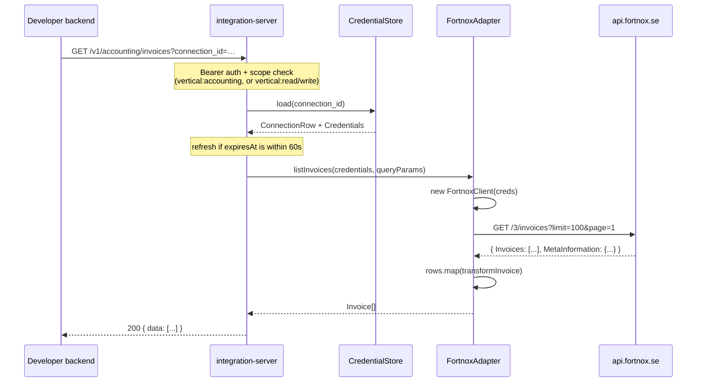

# Anatomy of an adapter — Fortnox walkthrough

> [← back to overview](./README.md)

If you've read the [end-user journey](./end-user-journey.md) and want to see how a single adapter is actually wired, this page walks Fortnox (the accounting reference adapter) line-by-line. Every other accounting adapter follows the same structure; CRM / ecommerce / logistics / payments / docsign / projects / customer-support / inventory adapters keep the same shape with vertical-specific resource methods.

The goal is for you to be able to scaffold a new adapter for any platform after reading this once.

---

## The directory

```
apps/integration-server/src/verticals/accounting/adapters/fortnox/
├── index.ts        — adapter class; the public surface
├── auth.ts         — OAuth flow (authorize, exchange, refresh)
├── client.ts       — thin axios wrapper with 429 retry
├── constants.ts    — pinned upstream URLs + page-size limits
├── transform/      — one file per canonical resource (invoice, bill, contact, …)
└── webhook.ts      — inbound webhook verification + event parsing (optional)
```

Five top-level files plus a `transform/` directory of 13 — 489 LOC outside `transform/`, ~1,400 across the adapter. Every accounting adapter is shaped the same way, so once you can read one you can read all 281. The same per-adapter shape (with vertical-specific resource methods) repeats across all 1,548 adapters in the 9 verticals.

The adapter is registered exactly once in `apps/integration-server/src/verticals/accounting/adapter/factories.ts` — one line that maps `'fortnox'` to a `new FortnoxAdapter(config)` factory. Adapter metadata (display name, country, auth type, logo slug) lives separately in `apps/integration-server/src/verticals/accounting/platforms/metadata.ts`; the platforms catalog and OpenAPI spec are auto-generated from that array.

---

## How it all connects — request lifecycle at a glance

Before diving into each file, here's how those six files cooperate when a developer backend hits `GET /v1/accounting/invoices?connection_id=<uuid>`:



Five participants, each owning exactly one thing:

| Layer | Owns |
|---|---|
| Server (`apps/integration-server/src/server.ts`) | Bearer-key auth, scope check, rate limit, vertical router dispatch |
| `CredentialStore` (`@opensteward/shared`) | Decrypted credentials, on-demand refresh under a per-connection lock (`refreshWithRotationGuard`), and the recorded refresh outcome |
| `FortnoxAdapter.listInvoices` | Build the upstream call shape; consume credentials |
| `FortnoxClient` | HTTP transport + 429 retry |
| `transformInvoice` | Raw → canonical |

No layer reaches across. The adapter never touches the database; the store never touches HTTP; the transform never touches credentials. That separation is what makes 1,548 adapters reviewable — and it's the lens to keep in mind for the rest of this page. The sections below walk each file in the order it would fire across a connection's lifetime.

---

## `constants.ts` — what's pinned

```ts
export const FORTNOX_AUTH_URL  = 'https://apps.fortnox.se/oauth-v1/auth'
export const FORTNOX_TOKEN_URL = 'https://apps.fortnox.se/oauth-v1/token'
export const FORTNOX_API_BASE  = 'https://api.fortnox.se/3/'

export const RATE_LIMIT_RPM    = 300         // documented upstream limit
export const MAX_PAGE_SIZE     = 500         // Fortnox-imposed
export const DEFAULT_PAGE_SIZE = 100         // what we send when caller doesn't ask
```

Adapter constants are kept in one tiny file rather than scattered through the code. New adapters should mirror this — base URL, OAuth endpoints, any rate-limit / page-size numbers documented by the upstream. No magic strings elsewhere in the adapter.

---

## `auth.ts` — the OAuth dance

Three exported functions, in the order they fire across a connection's lifetime:

### `buildAuthUrl(clientId, redirectUri, scopes, state)`

Builds the authorize URL the customer is redirected to. Standard RFC 6749 § 4.1.1 query string — `response_type=code`, `client_id`, `redirect_uri`, `scope`, `state`, plus Fortnox's required `access_type=offline` (so the upstream returns a refresh token, not just an access token).

The adapter doesn't decide *when* this URL is built — that's the control plane's job. The control plane calls `adapter.getAuthUrl(state)` when a Connect Link is opened or `/auth/{vertical}/{platform}/connect` is hit.

### `exchangeCode(code, clientId, clientSecret, redirectUri)`

Trades the authorization `code` (returned to the redirect URI) for tokens. POSTs `grant_type=authorization_code` to the token endpoint using HTTP Basic auth (`Authorization: Basic <base64(clientId:clientSecret)>`).

Two small helpers are in scope here:

```ts
function basicAuth(clientId: string, clientSecret: string): string {
  return Buffer.from(`${clientId}:${clientSecret}`).toString('base64')
}

function parseTokenResponse(data: Record<string, unknown>): Credentials {
  return {
    accessToken: data['access_token'] as string,
    refreshToken: data['refresh_token'] as string | undefined,
    expiresAt: new Date(Date.now() + (data['expires_in'] as number) * 1000),
    scope: data['scope'] as string | undefined,
  }
}
```

Shared versions of these helpers live in `@opensteward/shared`; use those in new adapters. Adapters with bespoke fields (Salesforce `instance_url`, Sage `firmId`) keep their custom variants.

### `refreshAccessToken(refreshToken, clientId, clientSecret)`

Same shape, `grant_type=refresh_token`. One important detail at the bottom:

```ts
const creds = parseTokenResponse(data)
if (!creds.refreshToken) creds.refreshToken = refreshToken   // preserve old token if upstream omits it
return creds
```

Some providers (Fortnox among them) only return `refresh_token` on the first exchange. If we naively wrote whatever the refresh response gave us, we'd lose the refresh token on the second hop and brick the connection. The adapter is responsible for this preservation — the control plane does not know which providers rotate vs. preserve refresh tokens.

---

## `client.ts` — the HTTP wrapper

A tiny class wrapping `axios.create()`:

```ts
export class FortnoxClient {
  private http: AxiosInstance

  constructor(credentials: Credentials) {
    this.http = axios.create({
      baseURL: FORTNOX_API_BASE,
      headers: {
        Authorization: `Bearer ${credentials.accessToken}`,
        'Content-Type': 'application/json',
        Accept: 'application/json',
      },
    })
  }

  async get<T>(path: string, params?: Record<string, unknown>): Promise<T> {
    return withRetry(async () => {
      const { data } = await this.http.get<T>(path, { params })
      return data
    })
  }

  // post / put / delete have the same shape
}
```

Two things to notice:

1. **Per-call instantiation.** Every adapter resource method does `const client = new FortnoxClient(credentials)`. The client is cheap to construct and not cached — each `/v1/*` request brings its own credentials, so the client is too.
2. **`withRetry`.** Retries 429 with exponential backoff. It lives in `@opensteward/shared`; new adapters should `import { withRetry } from '@opensteward/shared'` rather than redefine it locally.

There is no rate-limit *budget* here — `withRetry` is reactive (back off when 429 arrives), not proactive (queue requests against a known limit). That's a deliberate choice: per-adapter accurate budgets are surprisingly hard to maintain (limits drift, vary by plan, vary by endpoint), and an "honest 429" path is more resilient than a stale budget.

---

## `index.ts` — the adapter class

This is the public surface. The control plane only ever sees the methods on `AccountingAdapter`; everything in `auth.ts` / `client.ts` / `transform/` exists to support these methods.

### Constructor + config

```ts
interface FortnoxAdapterConfig {
  clientId: string
  clientSecret: string
  redirectUri: string
  scopes: string[]
}

export class FortnoxAdapter implements AccountingAdapter {
  readonly platform = 'fortnox'
  readonly version = '0.1.0'

  constructor(config: FortnoxAdapterConfig) {
    this.clientId = config.clientId
    this.clientSecret = config.clientSecret
    this.redirectUri = config.redirectUri
    this.scopes = config.scopes
  }
  ...
}
```

The config object is what `adapter/factories.ts` passes when the runtime decides to wire Fortnox up. The `platform` and `version` fields are part of the contract — they show up in audit logs and outbound webhook events.

### Auth wrappers

Three thin methods delegate to `auth.ts`:

```ts
getAuthUrl(state, overrideScopes?) {
  return buildAuthUrl(this.clientId, this.redirectUri, overrideScopes ?? this.scopes, state)
}

async exchangeCode(code, redirectUri) {
  return exchangeCode(code, this.clientId, this.clientSecret, redirectUri)
}

async refreshCredentials(credentials) {
  if (!credentials.refreshToken) throw new Error('No refresh token available')
  return refreshAccessToken(credentials.refreshToken, this.clientId, this.clientSecret)
}
```

`getAuthUrl` accepts an optional `overrideScopes` argument — that's how the Connect Link "per-link scope override" feature works (admin picks a scope group at mint time, the override flows into the auth URL).

### One resource method in detail — `listInvoices`

```ts
async listInvoices(credentials: Credentials, params: QueryParams): Promise<Invoice[]> {
  const client = new FortnoxClient(credentials)
  const res = await client.get<{ Invoices: FortnoxInvoice[]; MetaInformation: MetaInfo }>(
    'invoices',
    this.paginationParams(params),
  )
  return (res.Invoices ?? []).map(transformInvoice)
}
```

Five steps, every list method follows the same shape:

1. Build a client with the request's credentials.
2. GET the upstream endpoint, passing through pagination params.
3. Type the response with the **raw** platform shape (`FortnoxInvoice`, not the canonical `Invoice`).
4. Map each raw row through the transform — converts to canonical shape, preserves `metadata`.
5. Return the canonical array. The router serialises it to JSON.

The transform is where adapter-specific knowledge gets normalised away. Above that line everything is canonical; below it everything is platform-specific.

### The pagination shim

```ts
private paginationParams(params: QueryParams): Record<string, unknown> {
  return {
    limit: Math.min(params.limit ?? DEFAULT_PAGE_SIZE, MAX_PAGE_SIZE),
    page: params.page ?? 1,
    ...(params.updatedAfter && {
      lastmodified: params.updatedAfter.toISOString().split('T')[0],
    }),
  }
}
```

Canonical `QueryParams` uses `limit` / `page` / `updatedAfter`. Fortnox uses `limit` / `page` / `lastmodified` (YYYY-MM-DD). The shim translates between them, clamping `limit` to the upstream max. Other adapters do the same thing with their own field names — `cursor`, `page_info`, `nextToken`, etc.

### A namespacing trick worth noticing

`listContacts` joins two upstream endpoints — Fortnox has separate `/customers` and `/suppliers` and we expose them as one canonical contact list. The transform tags each row, and `getContact(id)` reads a prefix to know which one to call:

```ts
async getContact(credentials: Credentials, id: string): Promise<Contact> {
  const client = new FortnoxClient(credentials)
  if (id.startsWith('cust_')) {
    const num = id.slice(5)
    const res = await client.get<{ Customer: FortnoxCustomer }>(`customers/${num}`)
    return transformCustomer(res.Customer)
  }
  if (id.startsWith('supp_')) {
    ...
  }
  throw new Error(`Invalid contact id format: ${id}. Expected cust_<n> or supp_<n>`)
}
```

A handful of adapters need this `<type>_<n>` id-namespacing trick when the upstream splits one canonical resource into two endpoints. The naming convention (`cust_` / `supp_`) is per-adapter — what matters is that `list…()` and `get…(id)` agree.

---

## `transform/invoice.ts` — the canonical mapping

The transform is the soul of the adapter. Every line here is a decision about how Fortnox's shape becomes the canonical shape.

### Typed raw shape

```ts
export interface FortnoxInvoice {
  DocumentNumber: string
  CustomerNumber: string
  InvoiceDate: string
  DueDate: string
  Total: number
  Balance: number
  Currency: string
  Booked: boolean
  Cancelled: boolean
  InvoiceRows: FortnoxInvoiceRow[]
  [key: string]: unknown   // catch-all so unknown fields don't trip TypeScript
}
```

The raw shape is *narrowed*, not *exhaustive* — we type the fields we care about, then add `[key: string]: unknown` so unknown fields survive into `metadata` without TypeScript complaints. New adapters should do the same: type the fields you transform, let the rest live in the index signature.

### Status mapping

```ts
function mapStatus(inv: FortnoxInvoice): InvoiceStatus {
  if (inv.Cancelled) return 'VOIDED'
  if (inv.Booked && inv.Balance === 0) return 'PAID'
  if (inv.Booked && inv.Balance > 0 && inv.Balance < inv.Total) return 'PARTIALLY_PAID'
  if (inv.Booked) return 'AUTHORIZED'
  return 'DRAFT'
}
```

Fortnox doesn't have an explicit `status` field — it's derived from the booleans `Cancelled` / `Booked` and the `Balance` vs `Total` relationship. The canonical `InvoiceStatus` is one of `DRAFT | AUTHORIZED | PAID | PARTIALLY_PAID | VOIDED`. This derivation is the least obvious part of the mapping ("why is this booked invoice showing AUTHORIZED?") — putting it in a named `mapStatus` function keeps the decision tree readable.

### Line items

```ts
function mapLineitem(row: FortnoxInvoiceRow): Lineitem {
  return {
    id: String(row.RowId),
    accountId: row.AccountNumber || undefined,
    itemId: row.ArticleNumber || undefined,
    unitAmount: row.Price,
    unitQuantity: row.OrderedQuantity,
    totalAmount: row.Total,
    taxAmount: row.VAT,
    discountAmount: row.Discount || undefined,
  }
}
```

Two patterns to absorb:

- **`X || undefined`** instead of `X` for strings. Fortnox returns `""` for empty strings; the canonical schema wants `undefined`. The `|| undefined` collapses both into the same shape.
- **`String(row.RowId)`**. All canonical ids are strings — even when the upstream gives an integer. Cast at the boundary; never let a number-typed id leak into the canonical surface.

### The transform itself

```ts
export function transformInvoice(raw: FortnoxInvoice): Invoice {
  return {
    id: raw.DocumentNumber,
    type: 'INVOICE',
    status: mapStatus(raw),
    invoiceNumber: raw.DocumentNumber,
    contactId: prefixedId('cust', raw.CustomerNumber),
    currency: raw.Currency || undefined,
    totalAmount: toMinorUnits(raw.Total),
    taxAmount: toMinorUnits(raw.TotalVAT),
    balanceAmount: toMinorUnits(raw.Balance),
    lineitems: raw.InvoiceRows ? raw.InvoiceRows.map(mapLineitem) : null,
    postedAt: raw.InvoiceDate ? new Date(raw.InvoiceDate) : undefined,
    metadata: raw as Record<string, unknown>,
  }
}
```

Three lines there are load-bearing, and each was once written the obvious way
and shipped a silent bug:

- **`prefixedId('cust', …)`, not the bare number.** Fortnox merges `/customers`
  and `/suppliers` into one canonical `Contact` list, so ids are prefixed to
  keep customer #1 apart from supplier #1 — and every FK pointing at a contact
  must carry the same prefix or the join resolves to nothing. `untransform*`
  strips it again with `unprefixedId`, because the platform has never heard of
  `cust_`. Guarded by `check:contact-fk-prefix`.
- **`toMinorUnits(…)`, not the raw decimal.** Canonical `Amount` is
  `z.number().int()` in minor units; Fortnox speaks decimal SEK. Passing the
  value through stores it 100x under contract.
- **`raw.InvoiceRows ? … : null`, not `?? []`.** Fortnox's list endpoint omits
  `InvoiceRows` entirely. `[]` is a positive assertion that the document has no
  line items; emitting it for "not reported" is a false statement a consumer
  cannot detect. Return `null` when the key is absent and `[]` only when the
  source really sent an empty collection. The rule is stated in full on
  `nullish` in `packages/shared/src/schemas/zod-helpers.ts` and guarded by
  `check:collection-null-policy`.

The non-negotiable rule: **`metadata: raw as Record<string, unknown>`**. Every canonical object preserves the raw upstream object verbatim. Consumers that need a field the canonical schema doesn't cover read it from `metadata.<field>`. The metadata test (`expect(transformInvoice(raw).metadata).toBe(raw)`) verifies the *same reference* — not a copy, not a filtered subset.

### `untransformInvoice` — the inverse

```ts
export function untransformInvoice(invoice: Partial<Invoice>): Record<string, unknown> {
  return {
    CustomerNumber: invoice.contactId,
    Currency: invoice.currency,
    InvoiceDate: invoice.postedAt?.toISOString().split('T')[0],
    DueDate: invoice.dueAt?.toISOString().split('T')[0],
    ExternalInvoiceReference1: invoice.reference,
    InvoiceRows: invoice.lineitems?.map((li) => ({
      ArticleNumber: li.itemId,
      Description: li.itemDescription,
      Price: li.unitAmount,
      OrderedQuantity: li.unitQuantity,
      AccountNumber: li.accountId,
    })),
  }
}
```

Adapters that support `createX` / `updateX` need an `untransformX` going the other direction. It accepts `Partial<Canonical>` — operators can update three fields without the canonical shape getting in their way. The function returns the upstream's expected body shape.

---

## `webhook.ts` — inbound webhooks

Fortnox uses a bearer-token style verification, not HMAC. Each platform pins its own scheme; the canonical `WebhookHandler` interface is the same shape regardless of how verification is done:

```ts
export const fortnoxWebhook: WebhookHandler = {
  verifyWebhook(_payload, headers, secret) {
    const authHeader = headers['authorization'] ?? ''
    const token = authHeader.startsWith('Bearer ') ? authHeader.slice(7) : authHeader
    if (!token) return false
    const a = Buffer.from(token)
    const b = Buffer.from(secret)
    if (a.length !== b.length) return false
    return timingSafeEqual(a, b)   // constant-time compare!
  },

  parseWebhookEvents(payload) { ... },
}
```

The hard rule for `verifyWebhook`: **constant-time comparison** (`crypto.timingSafeEqual` or one of the shared `verifyHmacSha256` / `verifyStripeStyleSignature` / `verifyGithubStyleSignature` helpers in `@opensteward/shared`). Never `===` on a secret — it leaks bytes on a timing side-channel.

The verification returns boolean, and the caller is integration-server's unified webhooks router (`POST /webhooks/{vertical}/{platform}`, `packages/shared/src/control-plane/webhooks-router.ts`) — not webhook-gateway, which only forwards the body. That router fails *closed*: `false` from every candidate secret means `401 INVALID_WEBHOOK_SIGNATURE`, no events parsed, nothing emitted. It tries each connection's own webhook secret before the static per-platform one, so the secret that verifies is also what identifies the owning connection.

### Event mapping

```ts
function mapResourceType(entityType: string): WebhookResourceType {
  const map: Record<string, WebhookResourceType> = {
    INVOICE: 'invoice',
    SUPPLIER_INVOICE: 'bill',
    CUSTOMER: 'contact',
    SUPPLIER: 'contact',
    ACCOUNT: 'account',
    VOUCHER: 'journal',
    ARTICLE: 'unknown',
    ORDER: 'order',
    OFFER: 'salesorder',
    PURCHASE_ORDER: 'purchaseorder',
  }
  return map[entityType.toUpperCase()] ?? 'unknown'
}

function mapAction(eventType: string): WebhookAction {
  const ev = eventType.toUpperCase()
  if (ev.includes('CREAT')) return 'created'
  if (ev.includes('UPDAT')) return 'updated'
  if (ev.includes('DELET') || ev.includes('REMOV')) return 'deleted'
  return 'unknown'
}
```

The two-table approach (resource map + action map) is the standard. Unknown values fall through to `'unknown'` — that becomes a canonical event with `resourceType: 'unknown'` rather than a thrown error. Webhook handlers must not throw.

### Single event vs batch

Fortnox sends either a single top-level event or a batch in `events[]`. The handler normalises both shapes into the same array, so downstream code doesn't branch:

```ts
const rawEvents: FortnoxWebhookEvent[] =
  Array.isArray(body.events) && body.events.length > 0
    ? body.events
    : body.entityType
      ? [{ eventId: '', entityType: body.entityType, eventType: ..., entityId: ... }]
      : []
```

Most upstreams have one of these two shapes. Whichever yours has, normalise to one array before mapping.

---

## When you scaffold a new adapter

Copy `fortnox/` (or the reference adapter for your vertical — `nutshell/` for CRM, `shopify/` for ecommerce, `easypost/` for logistics, `stripe/` for payments, `docusign/` for docsign, `asana/` for projects, `zendesk/` for customer-support, `cin7-core/` for inventory) and rename. `pnpm run scaffold:adapter` does the copy-and-rename for you. Then change exactly six things:

1. `constants.ts` — pin the new platform's URLs and limits.
2. `auth.ts` — adjust the OAuth body shape if the upstream is non-standard (e.g. no `access_type=offline`).
3. `client.ts` — usually identical; change only the auth header style if the upstream uses something other than `Authorization: Bearer`.
4. `index.ts` — replace `FortnoxAdapter` / `FortnoxClient` / `FortnoxX` references, and implement whichever resource methods the upstream supports. Unimplemented methods auto-return 501.
5. `transform/*.ts` — write the raw shape + status mapping + field mapping for each resource you implement.
6. `webhook.ts` — if the platform signs with HMAC-SHA256, import `verifyHmacSha256` from `@opensteward/shared`. Otherwise write the verifier the way Fortnox does (constant-time bearer compare).

Then add one entry to `adapter/factories.ts` and one row to `platforms/metadata.ts` — `check:adapter-parity` fails the build if metadata gains a slug with no factory, and warns on the reverse. Run `pnpm run docs:all` to refresh every generated artifact (the platforms catalog, the OpenAPI spec, Postman, SDK and CLI); `check:docs` fails the build if any of them is stale.

Then run `pnpm check:paging-contract --only=<vertical>/<slug>`. The clone inherits its reference adapter's list methods, and five of the nine reference adapters still carry baselined paging failures: `easypost` 5, `stripe` 1, `docusign` 5, `asana` 6 and `zendesk` 7 (for example, a list that sends the same request for page 2 as for page 1). The baseline is keyed by slug, so under the new slug those failures count as **new** and fail CI on the first run. Make the new adapter page the way its vendor's API documents, sending the caller's `params.limit` as the page size and moving the position with `params.page`, until the gate is clean. Banking the verdicts with `--update` is the last resort, not the default.

### When one upstream page is not one caller page — `pageByRows` and `pageLocally`

A caller's page N is rows [(N−1)×limit, N×limit). Some upstreams cannot serve that directly:

| The upstream… | Example | Use |
|---|---|---|
| returns the whole collection in one response | Salesforce's single synthesised pipeline | `pageLocally(all, params)` |
| pages in batches that are not the caller's size | Salesforce SOQL: 200–2,000 rows per batch, whatever `limit` is | `pageByRows` |
| yields rows flattened out of pages of a parent | Shopify fulfillments out of pages of orders, variants out of products | `pageByRows` |
| streams several endpoints as one list | Salesforce Tasks then Events; Shopify custom then smart collections | `pageByRows` with a composite cursor |

Returning one upstream page as the caller's page is the bug both helpers exist for. The router truncates a page longer than `limit` and the next page starts after the rows it dropped (Salesforce at `limit=25` served 25 of every 200 rows). A page that is short but not the end ends a sync early, unless `hasMore` says otherwise.

`pageLocally(all, params)` slices the collection and reports the exact `totalCount` and `hasMore`; params with no usable `limit` (absent, or not a finite number ≥ 1: a direct call, never the router's) get every row, since every row is already in hand. `pageByRows` reads the same params differently on purpose, because it would have to walk the whole upstream to serve everything: a missing `limit` is its `defaultLimit` (100 unless set), and an unusable one throws a `RangeError`. `all` must be **every** row matching the query, never one sized page of a paginated endpoint: the total is reported as fact, the cache marks the collection complete on it, and the gate passes the method on the report.

`pageByRows(key, params, fetch, options)` walks the upstream chain, where `fetch(cursor)` returns `{ items, next }` for one upstream page and `fetch(undefined)` returns the first. A cursor must be a replayable position: fetching it again returns that page again. It serves exactly the caller's rows, reports `hasMore` exactly (it peeks one upstream page when a caller page ends on a boundary), and continues the next caller page from the upstream page it already holds, so a walk costs one request per upstream page. Identical calls in flight (a client retrying a slow page 1) share one walk.

Build `key` with `cursorPagerKey(connectionScope(account, credentials), collection, upstreamQuery)`:

- **The scope must identify the connection, not only the account.** The row pager keeps the ROWS it fetched, and serves the next page from them without a request. Keyed by a Salesforce org or a Shopify shop, a second user's page came out of the first user's batch, past their own sharing rules or scopes. `connectionScope` adds a fingerprint of the connection's refresh token (else its access token) to the account; the token itself never enters the key.
- It must include every filter and the **upstream** page size. Leave the caller's `limit` out unless the upstream page is sized from it, since row positions do not depend on it.
- Two lists flattened from the same parent pages need different keys.

Choose `maxUpstreamPages` for sparse rows: filling one page of rare refunds can walk many pages of orders. A page that runs out of budget while only peeking past a complete page is returned with `hasMore: true`; one that runs out short throws, and a retry resumes from where it stopped (page 1 too, within a minute of the failure). A fetch that throws forgets its cursor, so a retry starts from the one before; where the platform names an expired chain (Salesforce's `INVALID_QUERY_LOCATOR`), pass `restartOn` to walk again from the first page in the same call. A caller holding an explicit upstream cursor is at a position, not a row offset, so keep that path as one upstream page. `crm/adapters/salesforce` and `ecommerce/adapters/shopify` are the worked examples.

Both helpers also report `pagedLocally`. Two caller pages inside one upstream page send the same request, which `check:paging-contract` would otherwise read as `page-ignored` or `fixed-size`; with the report on page 1 and page 2 (and neither call throwing) it passes them as `local-page`. It still fails a page 1 that skips rows or over-asks, a position that moves between page 1 and page 2 by more than the caller's limit (or, beside a size that follows the limit, by neither 1 nor the limit), and a page 2 that repeats a request whose size follows the limit (`pageLocally` over one page of `?limit=<limit>`). Requests that pass on their own keep their own verdict, `local-page` is not counted as coverage, and it is never a declared-max violation. A hand-rolled window may report `pagedLocally: true` through `reportUpstreamPage` too, but only when it serves exactly the caller's rows and its own tests prove every row is served once: the gate takes the claim on trust, so list the file in `LOCAL_PAGE_REPORTERS` in `scripts/check-paging-contract.ts` with that test (a full sweep fails on an unlisted reporter). A window that pages at less than `params.limit` (a direct call past its maximum, which the router and the sync never make) reports that size as `pageSize` too, so the page is judged at the size it was cut at. Epos Now's V4 window (fixed 200-row pages that take no size) and Lumin Sign's templates (an upstream size snapped to 10/25/50) are the worked examples.

Tests come next — see [`CONTRIBUTING.md § 6`](../../CONTRIBUTING.md#6-writing-tests) for the test-factory pattern (every transform gets a test file with a `make<Name>()` factory, a happy-path assertion, a `metadata` passthrough assertion, and a missing-optional-fields assertion).

---

## Common variations across adapters

Things that *change* per adapter (so you know what to look for when you scaffold from a different reference):

| Concern | Fortnox does | Common alternatives |
|---|---|---|
| Auth header | `Authorization: Bearer <token>` | `X-Shopify-Access-Token`, `X-Api-Key`, custom session cookies |
| Pagination | `limit` + `page` (page numbers) | `cursor` / `page_info` / `nextToken` (opaque cursor strings) |
| Auth flow | OAuth2 authorization-code with refresh | OAuth2 client-credentials, API-key only, basic auth, signed JWT |
| Webhook verification | Bearer token compare | HMAC-SHA256 hex / base64, Stripe-style `t=…,v1=…`, GitHub-style `sha256=…` |
| Id format | Upstream string id verbatim | `<type>_<n>` namespacing when one canonical resource spans multiple endpoints |
| Refresh-token rotation | Upstream omits → adapter preserves the old one | Upstream rotates → adapter writes whatever it received |

When you scaffold, the file *layout* is identical to Fortnox; the *contents* of each file diverge along these axes. Fortnox is a deliberately simple choice for a first read because it sits in the middle of each axis (standard OAuth, page-number pagination, bearer webhook auth) — no exotic upstream conventions to explain.

---

## See also

- [`CONTRIBUTING.md`](../../CONTRIBUTING.md) — the canonical reference for *what* an adapter must do
- [`auth-and-tenancy.md`](./auth-and-tenancy.md) — what `credentials`, `tenant_id`, and `owner_tenant_id` mean
- [`runtime-flows.md`](./runtime-flows.md) — the request / OAuth / webhook sequence diagrams in chart form
- [`vertical-internals.md`](./vertical-internals.md) — how a single vertical's plugin assembles its router + middleware
- [`adapter-lifecycle.md`](./adapter-lifecycle.md) — the enable / disable / configure state machine
