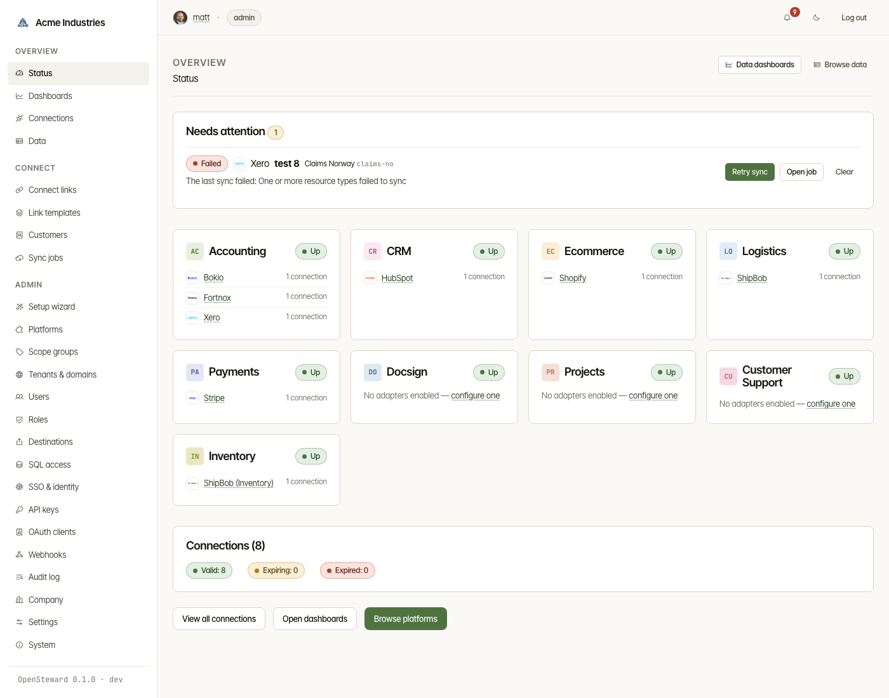

# Admin frontend page map

> [← back to overview](./README.md)

Every route in the admin UI grouped by access level, with the navigation links between them.
For what each page is for and how to use it, see the
[admin console guide](../admin/README.md); this page is the route reference.

_Notifications are not a sidebar entry: `/notifications` is reached from the
bell in the header, and **My profile** (`/profile`) from your name beside it
(see [How the roles are wired](#how-the-roles-are-wired))._

---

## Chart 12 — Admin UI route inventory

```mermaid
flowchart LR
  classDef public fill:#fee2e2,stroke:#b91c1c
  classDef auth fill:#dbeafe,stroke:#1e40af
  classDef admin fill:#dcfce7,stroke:#15803d
  classDef wizard fill:#fef3c7,stroke:#a16207

  subgraph Public["Public (no session required)"]
    direction TB
    Health[GET /health]:::public
    Login[GET /login]:::public
    LoginPost[POST /login]:::public
    SetupInit[GET /setup/init]:::public
    SetupInitPost[POST /setup/init]:::public
  end

  subgraph Auth["Authenticated (requireAuth unless a node says operator+)"]
    direction TB
    Dashboard[Status · GET /<br/>Needs-attention panel + vertical cards]:::auth
    DashboardDismiss[POST /dashboard/tasks/dismiss<br/>operator+; platform rows admin]:::auth
    DashboardUndismiss[POST /dashboard/tasks/undismiss<br/>operator+; platform rows and wizard skips admin]:::auth
    DashboardSetupSkip[POST /dashboard/setup/skip<br/>admin — Skip for now on the setup card]:::auth
    Logout[POST /logout]:::auth
    Profile[GET /profile<br/>my own email and picture]:::auth
    ProfileAvatar[POST /profile/avatar, /profile/avatar/delete<br/>my own picture only]:::auth
    UserAvatar[GET /users/&#58;id/avatar<br/>any signed-in user — proxied picture]:::auth
    OAuthClients[GET /oauth-clients, /oauth-clients/&#58;id<br/>operator+ — OIDC issuers, service accounts, rules]:::auth
    Connections[GET /connections<br/>id column + search]:::auth
    ConnDetail[GET /connections/&#58;vertical/&#58;id]:::auth
    ConnSync[POST /connections/&#58;vertical/&#58;id/sync<br/>operator+]:::auth
    ConnRename[POST /connections/&#58;vertical/&#58;id/rename<br/>operator+]:::auth
    ConnSchedule[POST /connections/&#58;vertical/&#58;id/sync-schedule<br/>operator+]:::auth
    ConnDelete[POST /connections/&#58;vertical/&#58;id/delete<br/>operator+]:::auth
    Notifs[GET /notifications]:::auth
    NotifsAck[POST /notifications/&#58;id/acknowledge<br/>operator+]:::auth
    NotifsAckAll[POST /notifications/acknowledge-all<br/>operator+]:::auth
    Customers[GET /customers]:::auth
    CustomerDetail[GET /customers/&#58;id]:::auth
    ConnectLinks[GET /connect-links]:::auth
    ConnectLinkNew[GET /connect-links/new<br/>operator+]:::auth
    ConnectLinkTemplates[GET /connect-link-templates<br/>operator+ writes]:::auth
    ScopeGroups[GET /scope-groups<br/>operator+ writes]:::auth
    SyncJobs[GET /sync-jobs]:::auth
    SyncJobDetail[GET /sync-jobs/&#58;id<br/>one job in full<br/>opens as a modal from the list]:::auth
    SyncJobCancel[POST /sync-jobs/&#58;id/cancel<br/>operator+]:::auth
    ApiKeysList[GET /api-keys<br/>operator+ list]:::auth
    ApiKeysDetail[GET /api-keys/&#58;id<br/>full scope list + metadata<br/>opens as a modal from the list]:::auth
    WebhooksList[GET /webhooks<br/>operator+ list]:::auth
    Deliveries[GET /webhooks/&#58;id/deliveries<br/>operator+]:::auth
    Tenants[GET /tenants]:::auth
    TenantsCreate[POST /tenants<br/>operator+]:::auth
    Data[GET /data<br/>data:read — connections in scope]:::auth
    DataConn[GET /data/connections/&#58;id<br/>data:read — records per type]:::auth
    DataRecord[GET /data/connections/&#58;id/records/&#58;type/&#58;rid<br/>data:read — masked; opens as a modal]:::auth
    DataReveal[POST …/records/&#58;type/&#58;rid/reveal<br/>data:read_pii — audited]:::auth
    DataExport[GET /data/connections/&#58;id/export<br/>data:export — CSV / NDJSON]:::auth
    Dashboards[GET /dashboards<br/>dashboards:view]:::auth
    DashboardView["GET /dashboards/&#58;id<br/>dashboards:view — charts via /dashboards/metric/&#58;id; ?currency filter; ?platform and ?connection filter on vertical dashboards (connections:read)"]:::auth
    DashboardEdit[GET/POST /dashboards/new, /dashboards/&#58;id/edit<br/>dashboards:edit — owner or admin; sharing fieldset; per-widget chart, currency, granularity, compare]:::auth
    SupersetSharing[GET/POST /dashboards/superset/&#58;id/sharing<br/>dashboards:share_all]:::auth
    Destinations[GET /destinations<br/>destinations:manage — status + last run]:::auth
    DestNew[GET/POST /destinations/new, /destinations<br/>destinations:manage — form from the type catalog]:::auth
    DestDetail[GET /destinations/&#58;id<br/>destinations:manage — test, run, backfill, rotate, delete]:::auth
    SqlAccess[GET /sql-access<br/>sql_access:manage — status, logins, catalog]:::auth
    SqlNew[GET /sql-access/principals/new<br/>sql_access:manage]:::auth
    SqlSecret[POST /sql-access/principals, …/&#58;id/rotate<br/>sql_access:manage — password shown once]:::auth
    TenantsDelete[POST /tenants/&#58;id/delete<br/>operator+]:::auth
    TenantDomainAdd[POST /tenant-domains<br/>operator+ attach domain]:::auth
    TenantDomainRemove[POST /tenant-domains/delete<br/>operator+]:::auth
  end

  subgraph AdminOnly["Admin role only"]
    direction TB
    Users[GET /users]:::admin
    UsersNew[GET /users/new]:::admin
    UsersCreate[POST /users]:::admin
    UsersDelete[POST /users/&#58;id/delete]:::admin
    UsersDetail[GET /users/&#58;id]:::admin
    UsersRole[POST /users/&#58;id/role]:::admin
    UsersPassword[POST /users/&#58;id/password]:::admin
    UsersScope[POST /users/&#58;id/scope<br/>tenant scope editor]:::admin
    UsersEmail[POST /users/&#58;id/email]:::admin
    UsersAvatar[POST /users/&#58;id/avatar, …/avatar/delete<br/>multipart upload]:::admin
    Roles[GET /roles<br/>roles:manage — also shown to non-admins holding it]:::admin
    RolesEdit[GET/POST /roles/new, /roles/&#58;id, /roles/&#58;id/delete<br/>roles:manage]:::admin
    Audit[GET /audit]:::admin
    Company[GET /company-info]:::admin
    CompanyPost[POST /company-info]:::admin
    ApiKeysNew[GET /api-keys/new]:::admin
    ApiKeysMint[POST /api-keys]:::admin
    ApiKeysRotate[POST /api-keys/&#58;id/rotate<br/>grace-window rotation]:::admin
    ApiKeysRevoke[POST /api-keys/&#58;id/revoke]:::admin
    WebhooksNew[GET /webhooks/new]:::admin
    WebhooksCreate[POST /webhooks]:::admin
    WebhooksDelete[POST /webhooks/&#58;id/delete]:::admin
    WebhooksSettingsPage[GET /webhooks/&#58;id/settings<br/>delivery settings editor<br/>opens as a modal from the list]:::admin
    WebhooksSettings[POST /webhooks/&#58;id/settings<br/>format + custom headers]:::admin
    WebhooksTest[POST /webhooks/&#58;id/test<br/>send one synthetic event]:::admin
    DeliveriesReplay[POST /webhooks/&#58;id/deliveries/&#58;deliveryId/replay]:::admin
    AdaptersList[GET /platforms<br/>list every adapter]:::admin
    AdapterDetail[GET /platforms/&#58;v/&#58;s]:::admin
    AdapterSave[POST /platforms/&#58;v/&#58;s<br/>save config + enable]:::admin
    AdapterDisable[POST /platforms/&#58;v/&#58;s/disable]:::admin
    IdPs[GET /identity-providers<br/>SSO + SCIM]:::admin
    OAuthClientsWrite[GET /oauth-clients/new; POST /oauth-clients…<br/>register, update, delete issuers; clients; rules]:::admin
    Settings[GET /settings<br/>runtime settings]:::admin
    SystemInfo[GET /settings/system]:::admin
  end

  subgraph Wizard["Setup wizard (authenticated; steps 7-8 admin only)"]
    direction TB
    WizStep1[GET /setup/wizard<br/>Step 1 — data store strategy]:::wizard
    WizStep2[GET /setup/wizard/company-info<br/>Step 2 — branding]:::wizard
    WizStep2Post[POST /setup/wizard/company-info]:::wizard
    WizStep3[GET /setup/wizard/logos<br/>Step 3 — logo source<br/>optional]:::wizard
    WizStep3Post[POST /setup/wizard/logos]:::wizard
    WizStep4[GET /setup/wizard/platforms<br/>Step 4 — pick adapters]:::wizard
    WizStep4Post[POST /setup/wizard/platforms]:::wizard
    WizStep5[GET /setup/wizard/configure<br/>Step 5 — credentials]:::wizard
    WizStep5Post[POST /setup/wizard/configure]:::wizard
    WizStep6[GET /setup/wizard/tenants<br/>Step 6 — tenants & domains<br/>optional]:::wizard
    WizStep7[GET /setup/wizard/api-key<br/>Step 7 — mint dev API key<br/>admin]:::wizard
    WizStep7Post[POST /setup/wizard/api-key]:::wizard
    WizStep8[GET /setup/wizard/webhooks<br/>Step 8 — webhook subscription<br/>admin]:::wizard
    WizStep8Post[POST /setup/wizard/webhooks]:::wizard
  end

  Login -->|valid creds| Dashboard
  SetupInit -->|first-run| Login
  Dashboard -->|navbar| Connections
  Connections --> ConnDetail
  ConnDetail -->|Browse data| DataConn
  Dashboard -->|navbar / Data dashboards| Dashboards
  Dashboard -->|navbar| Data
  Data --> DataConn
  DataConn --> DataRecord
  DataConn --> DataExport
  DataRecord -->|Reveal personal data| DataReveal
  Dashboards --> DashboardView
  Dashboards --> DashboardEdit
  DashboardView --> DashboardEdit
  Dashboard -->|navbar Admin| Destinations
  Destinations --> DestNew
  Destinations --> DestDetail
  DestNew -->|created| DestDetail
  Dashboard -->|navbar Admin| SqlAccess
  SqlAccess --> SqlNew
  SqlNew -->|create| SqlSecret
  SqlAccess -->|Rotate| SqlSecret
  Connections -->|Sync now| ConnSync
  ConnDetail -->|Sync now| ConnSync
  ConnDetail -->|Save label| ConnRename
  ConnDetail -->|Save schedule| ConnSchedule
  ConnDetail -->|Delete connection| ConnDelete
  ConnDetail -.->|platform creds rejected| AdapterDetail
  Dashboard -->|navbar| Notifs
  Dashboard -->|navbar| Customers
  Customers --> CustomerDetail
  CustomerDetail -->|Connections card| ConnDetail
  Dashboard -->|navbar| ConnectLinks
  ConnectLinks --> ConnectLinkNew
  Dashboard -->|navbar| ConnectLinkTemplates
  Dashboard -->|navbar| ScopeGroups
  Dashboard -->|navbar| SyncJobs
  SyncJobs --> SyncJobDetail
  SyncJobs --> SyncJobCancel
  Dashboard -->|navbar| Users
  Users --> UsersDetail
  UsersDetail --> UsersRole
  UsersDetail --> UsersPassword
  UsersDetail --> UsersEmail
  UsersDetail --> UsersAvatar
  Dashboard -->|header name| Profile
  Profile --> ProfileAvatar
  Dashboard -->|navbar Admin| OAuthClients
  OAuthClients --> OAuthClientsWrite
  Dashboard -->|navbar| ApiKeysList
  Dashboard -->|navbar| WebhooksList
  Dashboard -->|navbar| Audit
  Dashboard -->|navbar| Company
  Dashboard -->|navbar| Tenants
  Tenants --> TenantsCreate
  Tenants --> TenantsDelete
  Tenants --> TenantDomainAdd
  Tenants --> TenantDomainRemove
  Dashboard -->|navbar| AdaptersList
  Dashboard -->|navbar| IdPs
  Dashboard -->|navbar| Settings
  Dashboard -->|navbar| SystemInfo
  AdaptersList --> AdapterDetail
  AdapterDetail --> AdapterSave
  AdapterDetail --> AdapterDisable
  Dashboard -->|button| WizStep1
  ApiKeysList --> ApiKeysDetail
  ApiKeysList --> ApiKeysRotate
  WebhooksList --> Deliveries
  WebhooksList -->|admin only| WebhooksSettingsPage
  Deliveries --> DeliveriesReplay

  WizStep1 -->|next| WizStep2
  WizStep2 --> WizStep2Post
  WizStep2Post -->|save / skip| WizStep3
  WizStep3 --> WizStep3Post
  WizStep3Post -->|save / skip| WizStep4
  WizStep4 --> WizStep4Post
  WizStep4Post -->|reconcile| WizStep5
  WizStep5 --> WizStep5Post
  WizStep5Post -->|next adapter| WizStep5
  WizStep5Post -->|done| WizStep6
  WizStep6 -->|create / attach<br/>returnTo=wizard| Tenants
  WizStep6 -->|continue / skip| WizStep7
  WizStep7 --> WizStep7Post
  WizStep7Post -->|continue / skip| WizStep8
  WizStep8 --> WizStep8Post
  WizStep8Post -->|finish| Dashboard
  WizStep8 -->|skip / finish| Dashboard
```

---

## Routes by middleware chain

| Route | Method | Access | preHandler chain |
|---|---|---|---|
| `/health` | GET | public | (none) |
| `/login` | GET, POST | public | csrf (POST), rate-limit (POST 5/min) |
| `/login/sso/:slug` | GET | public | (none — redirects to admin-api `/api/sso/:slug/login`) |
| `/login/sso/:slug/ldap` | POST | public | rate-limit (5/min) |
| `/login/sso/complete` | GET | public | (none — exchanges the one-time handoff code) |
| `/setup/init` | GET, POST | public, only when no users | csrf (POST), rate-limit (POST 3/min), `X-Bootstrap-Token` forwarded when the deployment sets `BOOTSTRAP_TOKEN` |
| `/logout` | POST | authenticated | (none — exempt from CSRF) |
| `/` | GET | authenticated | requireAuth — the **Status** page (nav: Status; the metric charts live under Dashboards). For an admin, the "Finish setting up" card (next wizard step, derived by the wizard's own scan; gone when nothing is outstanding or skipped), then the "Needs attention" panel (a vertical that is down — never clearable, never behind the cap, one row for the integration server when every vertical is; rejected platform credentials; expired connections; failed syncs; and, as an early warning, still-valid connections whose last token refresh failed; derived per request, `cache-control: no-store`; a down vertical's connections are reported as unchecked, never as none) above the vertical cards |
| `/dashboard/setup/skip` | POST | admin | requireRole('admin'), csrf — "Skip for now" on the setup card; stores `wizard:<step>` in the dismissal table, so the card returns by itself once the next step changes |
| `/dashboard/tasks/dismiss` | POST | operator+ (`platform:creds:*` rows admin) | requireRole('operator'), csrf — one hidden JSON `items` field of `{key, fingerprint}` pairs; the server re-derives the rows and forwards only keys that are live and whose fingerprint still matches, so a stale page cannot clear a condition that changed under it |
| `/dashboard/tasks/undismiss` | POST | operator+ (`platform:creds:*` rows and `wizard:*` skips admin) | requireRole('operator'), csrf — the Undo behind a clear, offered on the panel for 15 minutes; also the Undo behind the setup card's Skip for now (`wizard:<step>`) |
| `/connections` | GET | authenticated | requireAuth |
| `/connections/:vertical/:id` | GET | authenticated | requireAuth |
| `/connections/:vertical/:id/sync` | POST | operator+ | requireRole('operator'), csrf |
| `/connections/:vertical/:id/rename` | POST | operator+ | requireRole('operator'), csrf |
| `/connections/:vertical/:id/sync-schedule` | POST | operator+ | requireRole('operator'), csrf |
| `/connections/:vertical/:id/delete` | POST | operator+ | requireRole('operator'), csrf |
| `/data/platforms/platforms.json` | GET | authenticated | requireAuth |
| `/notifications` | GET | authenticated | requireAuth — reached from the header bell (every signed-in page renders it with the unread count from admin-api's `GET /api/notifications/unread-count` — exact, `credential_expiring` excluded — shown as `99+` past 99), not from the sidebar |
| `/notifications/:id/acknowledge`, `/notifications/acknowledge-all` | POST | operator+ | requireRole('operator'), csrf |
| `/users` | GET, POST | admin | requireRole('admin'), csrf (POST) |
| `/users/new` | GET | admin | requireRole('admin') |
| `/users/:id` | GET | admin | requireRole('admin') — account detail with a recent-audit card; `?reveal=true` shows the identity fields, and the reveal is audited server-side |
| `/users/:id/role`, `/users/:id/password` | POST | admin | requireRole('admin'), csrf — the role picker lists built-in and custom roles and posts `roleId` (admin-api `PUT /api/users/:id/role`, which also needs `users:manage`) |
| `/users/:id/scope` | POST | admin | requireRole('admin'), csrf — the tenant-scope editor on the user page (admin-api `PUT /api/users/:id/scope`, `users:manage`; shown only to holders) |
| `/roles`, `/roles/new`, `/roles/:id` | GET | `roles:manage` | requirePermission('roles:manage') — the Roles nav entry appears for any holder, including a non-admin on a custom role |
| `/roles`, `/roles/:id`, `/roles/:id/delete` | POST | `roles:manage` | requirePermission('roles:manage'), csrf — admin-api refuses built-in edits, in-use deletes and escalation |
| `/users/:id/delete` | POST | admin | requireRole('admin'), csrf |
| `/users/:id/email` | POST | admin | requireRole('admin'), csrf — set or clear a user's email on the user page (blank clears; admin-api validates the address) |
| `/users/:id/avatar`, `/users/:id/avatar/delete` | POST | admin | requireRole('admin'), csrf — upload (multipart) or remove a user's picture on the user page; admin-api also requires `users:manage` for anyone else's picture and sniffs the bytes |
| `/users/:id/avatar` | GET | authenticated | requireAuth — the picture, proxied same-origin from admin-api (PNG, JPEG or WebP only, `nosniff`, `default-src 'none'`, private caching, ETag); `404` when the user has none |
| `/profile` | GET | authenticated | requireAuth — **My profile**, reached from your name in the header: your email and picture |
| `/profile/avatar`, `/profile/avatar/delete` | POST | authenticated | requireAuth, csrf — upload (multipart) or remove your own picture; no id in the path, so it only ever acts on the session's own account |
| `/audit`, `/audit/export` | GET | admin | requireRole('admin') |
| `/company-info` | GET, POST | admin | requireRole('admin'), csrf (POST) |
| `/settings`, `/settings/system` | GET | admin | requireRole('admin') |
| `/settings/update`, `/settings/:key/reset` | POST | admin | requireRole('admin'), csrf |
| `/api/schema-status` | GET | admin | requireRole('admin') |
| `/oauth-clients`, `/oauth-clients/:id` | GET | operator+ | requireRole('operator') — the OIDC issuers whose bearer tokens the developer API accepts, with readiness, each issuer's service accounts and scope-mapping rules. Nothing on these pages is a secret: OpenSteward only verifies tokens against the issuer's public keys |
| `/oauth-clients/new` | GET | admin | requireRole('admin') |
| `/oauth-clients`, `/oauth-clients/discover`, `/oauth-clients/:id`, `/oauth-clients/:id/delete`, `/oauth-clients/:id/clients`, `/oauth-clients/clients/:id/revoke`, `/oauth-clients/:id/rules`, `/oauth-clients/rules/:id/delete` | POST | admin | requireRole('admin'), csrf — register (with a **Test** discovery call), update and delete issuers; register and revoke service accounts; add and remove scope-mapping rules |
| `/identity-providers`, `/identity-providers/new`, `/identity-providers/:id` | GET | admin | requireRole('admin') |
| `/identity-providers…` (create / update / delete / role-mappings / scim-tokens) | POST | admin | requireRole('admin'), csrf |
| `/identity-providers/:id/scope-rules`, `/identity-providers/:id/scope-rules/:ruleId/delete`, `/identity-providers/:id/default-scope` | POST | admin + `users:manage` | requireRole('admin'), csrf — admin-api additionally requires `users:manage` |
| `/tenants` | GET | authenticated | requireAuth |
| `/tenants`, `/tenants/:id/delete` | POST | operator+ | requireRole('operator'), csrf |
| `/tenant-domains`, `/tenant-domains/delete` | POST | operator+ | requireRole('operator'), csrf |
| `/setup/wizard` | GET | authenticated | requireAuth |
| `/setup/wizard/company-info` | GET, POST | authenticated | requireAuth, csrf (POST) |
| `/setup/wizard/logos` | GET, POST | authenticated (POST admin) | requireAuth, requireRole('admin') on POST, csrf |
| `/setup/wizard/platforms` | GET, POST | authenticated | requireAuth, csrf (POST) |
| `/setup/wizard/configure` | GET, POST | authenticated | requireAuth, csrf (POST) |
| `/setup/wizard/tenants` | GET | authenticated | requireAuth |
| `/setup/wizard/api-key` | GET, POST | admin | requireRole('admin'), csrf (POST) |
| `/setup/wizard/api-key/mcp` | POST | admin | requireRole('admin'), csrf |
| `/setup/wizard/webhooks` | GET, POST | admin | requireRole('admin'), csrf (POST) |
| `/customers`, `/customers/:id` | GET | authenticated | requireAuth |
| `/customers/search.json` | GET | authenticated | requireAuth |
| `/customers/new` | GET | operator+ | requireRole('operator') |
| `/customers`, `/customers/:id`, `/customers/:id/delete` | POST | operator+ | requireRole('operator'), csrf |
| `/customers/:id/mcp-tokens`, `/customers/:id/mcp-tokens/:tokenId/revoke` | POST | operator+ | requireRole('operator'), csrf |
| `/connect-links` | GET | authenticated | requireAuth |
| `/connect-links/platform-meta/:vertical/:slug` | GET | authenticated | requireAuth |
| `/connect-links/new` | GET | operator+ | requireRole('operator') |
| `/connect-links` | POST | operator+ | requireRole('operator'), csrf |
| `/connect-links/:id/revoke` | POST | operator+ | requireRole('operator'), csrf |
| `/connect-link-templates`, `/connect-link-templates/:id/edit` | GET | authenticated | requireAuth |
| `/connect-link-templates/new` | GET | operator+ | requireRole('operator') |
| `/connect-link-templates`, `/connect-link-templates/:id`, `/connect-link-templates/:id/delete` | POST | operator+ | requireRole('operator'), csrf |
| `/scope-groups`, `/scope-groups/:id/edit` | GET | authenticated | requireAuth |
| `/scope-groups/new` | GET | operator+ | requireRole('operator') |
| `/scope-groups`, `/scope-groups/:id`, `/scope-groups/:id/delete` | POST | operator+ | requireRole('operator'), csrf |
| `/api-keys` | GET | operator+ | requireRole('operator') |
| `/api-keys/new` | GET | admin | requireRole('admin') |
| `/api-keys/:id` | GET | operator+ | requireRole('operator') — the scope list and metadata the row has no column for; linked from the list with `data-modal` so it also opens in the shared resource dialog. Never renders the plaintext, which is unrecoverable after mint |
| `/api-keys` | POST | admin | requireRole('admin'), csrf |
| `/api-keys/:id/rotate` | POST | admin | requireRole('admin'), csrf — grace-window rotation: the replacement is minted immediately and its plaintext rendered once on the list view, like a mint; the old key keeps verifying for 24h (a "Rotating out" badge on the list) before revoking itself |
| `/api-keys/:id/revoke` | POST | admin | requireRole('admin'), csrf |
| `/webhooks` | GET | operator+ | requireRole('operator') |
| `/webhooks/new` | GET | admin | requireRole('admin') |
| `/webhooks` | POST | admin | requireRole('admin'), csrf |
| `/webhooks/:id/delete`, `/webhooks/:id/pause`, `/webhooks/:id/rotate-secret` | POST | admin | requireRole('admin'), csrf |
| `/webhooks/:id/test` | POST | admin | requireRole('admin'), csrf — sends one synthetic event; result rendered as a banner, nothing queued |
| `/webhooks/:id/settings` | GET | admin | requireRole('admin') — the editor as a page of its own; linked from the list with `data-modal` so it also opens in the shared resource dialog |
| `/webhooks/:id/settings` | POST | admin | requireRole('admin'), csrf — payload format and custom headers; headers are replaced wholesale because their values are never rendered back |
| `/webhooks/:id/deliveries` | GET | operator+ | requireRole('operator') |
| `/webhooks/:id/deliveries/:deliveryId/replay` | POST | admin | requireRole('admin'), csrf |
| `/platforms` | GET | admin | requireRole('admin') |
| `/platforms/:vertical/:slug` | GET | admin | requireRole('admin') |
| `/platforms/:vertical/:slug` | POST | admin | requireRole('admin'), csrf |
| `/platforms/:vertical/:slug/disable` | POST | admin | requireRole('admin'), csrf |
| `/sync-jobs` | GET | authenticated | requireAuth |
| `/data` | GET | `data:read` | requirePermission('data:read') — connections in the caller's scope with per-type record counts and freshness; strict CSP |
| `/data/connections/:id` | GET | `data:read` | requirePermission('data:read') — a tab per stored resource type, cursor-paginated table (`cursor` + `trail` for Previous), filters on searchable fields only, search, column picker; `404` for a connection outside the scope; strict CSP |
| `/data/connections/:id/export` | GET | `data:export` | requirePermission('data:export'); `include_pii=1` also needs `data:read_pii` — streams admin-api's export through untouched (audited there as `data.export`) |
| `/data/connections/:id/records/:type/:rid` | GET | `data:read` | requirePermission('data:read') — one masked record, JSON tree (`public/js/json-view.js`) and classification badges; `Cache-Control: no-store`; opens in the resource modal from the table |
| `/data/connections/:id/records/:type/:rid/reveal` | POST | `data:read_pii` | requirePermission('data:read_pii'), csrf — renders the unmasked record with `Cache-Control: no-store`; admin-api audits `data.pii_reveal` with the typed reason before answering |
| `/dashboards` | GET | `dashboards:view` | requirePermission('dashboards:view') — built-in dashboards, then those shared with you, grouped Mine / Shared with your tenants / Shared with everyone (admins also see other users' private ones); strict CSP |
| `/dashboards/:id` | GET | `dashboards:view` | requirePermission('dashboards:view') — widgets drawn by `public/js/dashboard.js` with ECharts (`/vendor/echarts.min.js`) in any of the 22 chart types; date-range presets, a custom range and a **currency** select (`?currency=`, validated against `/api/dashboards/currencies` for the dashboard's scope; "All currencies (each separately)" draws small multiples, one per currency); each widget carries its pinned currency (else the filter), granularity and compare; strict CSP |
| `/dashboards/:id` (connection filter) | GET | `dashboards:view` + `connections:read` | On a **vertical** dashboard (a built-in's `vertical`, or a user dashboard whose non-system widgets share one), a filter bar: an **Adapter** select (`?platform=`, with counts) and a **Connection** text box over a `<datalist>` of the caller's in-scope connections (value = id, text = label · adapter · id; from `GET /api/dashboards/connections`, narrowed to the dashboard's pins). No script needed: on submit an exact in-scope id applies, anything else is a search — one match applies, several show **Did you mean** links (`?connection=<id>`), none shows a message and applies nothing. A chip shows the applied connection (label · adapter) with a clear link; presets, both forms, every widget and the currency list carry the filter. It applies to every widget, system charts included. Hidden, and the parameters ignored, on the system overview, mixed-vertical dashboards and without `connections:read` |
| `/dashboards/:id/connections` | GET | `connections:read` | requirePermission('connections:read') on top of the plugin's `dashboards:view` — JSON `{ options: [{ value, text }], total }` for `?search&platform`, proxied from `GET /api/dashboards/connections` with the dashboard's own vertical (worked out as the view does; a `vertical` in the query is ignored), scope ∩ pins; `404` for a dashboard you cannot see or one with no single vertical; `public/js/dashboard.js` refreshes the datalist from it as you type, only when more connections matched than the 200 the page listed |
| `/dashboards/metric/:metricId` | GET | `dashboards:view` | requirePermission('dashboards:view') — JSON: one metric for `from`..`to`, with `dashboard`, `currency`, `granularity` (never `auto`), `compare`, and — for a user with `connections:read` only — `connection`, `platform` and `vertical` (well-formed values only), proxied from admin-api so the browser never calls it |
| `/dashboards/new`, `/dashboards/:id/edit` | GET | `dashboards:edit` | requirePermission('dashboards:edit') — no-script editor: Add / ↑ / ↓ / Remove re-render the draft, only Save writes; built-ins and others' dashboards are refused. Each widget row offers only its metric's `charts` (a saved chart that no longer fits is reset to the default), a currency pin for currency-aware metrics, a granularity for series over time and a compare checkbox for comparable ones; the metric picker is grouped by vertical, then section. The form has a sharing fieldset (audience by tenant, **Everyone** only with `dashboards:share_all`) and a **Data from** pin list. |
| `/dashboards`, `/dashboards/:id`, `/dashboards/:id/delete` | POST | `dashboards:edit` | requirePermission('dashboards:edit'), csrf — admin-api enforces owner-or-admin and validates the layout (each chart must be one of its metric's `charts`) |
| `/vendor/echarts.min.js` | GET | public | static — the one vendored file, served same-origin for the dashboards' CSP |
| `/dashboards/superset/:id` | GET | `dashboards:view` | requirePermission('dashboards:view') — one embedded Superset dashboard (only when admin-api has `SUPERSET_URL`), framed by `public/js/superset-embed.js`; strict CSP plus `frame-src` for the Superset origin |
| `/dashboards/superset/:id/guest-token` | POST | `dashboards:view` | requirePermission('dashboards:view'), csrf, 60/min — JSON: a guest token proxied from admin-api, carrying the caller's tenant scope as row-level security |
| `/dashboards/superset/:id/sharing` | GET, POST | `dashboards:share_all` | requirePermission('dashboards:share_all'), csrf on POST — audience (tenants or everyone) and pinned tenants of an embedded Superset dashboard; admin-api enforces the rule and audits `superset.share` |
| `/vendor/superset-embedded-sdk.js` | GET | public | the vendored `@superset-ui/embedded-sdk` UMD bundle — one file, served same-origin |
| `/destinations` | GET | `destinations:manage` | requirePermission('destinations:manage') — destinations inside the caller's scope with schedule, last run status and error; passthrough mode shows an explanation; strict CSP |
| `/destinations/new` | GET | `destinations:manage` | one form per type, generated from `GET /api/destinations/types` (JSON Schema → text / number / checkbox / select inputs; nested objects such as a loader's `stage` as fieldsets with dotted names; secret fields as empty password inputs; `experimental` badge); tenant + vertical picker limited to the caller's scope; include-PII only for `data:read_pii` |
| `/destinations` | POST | `destinations:manage` | csrf — creates through admin-api; a refusal (`SCOPE_EXCEEDS_CALLER`, `PII_NOT_PERMITTED`, `HOST_NOT_ALLOWED`, `INVALID_CONFIG` with its issues) re-renders the form without the secrets |
| `/destinations/:id` | GET | `destinations:manage` | settings, credential names set, run history; `404` outside the scope; strict CSP |
| `/destinations/:id/{settings,test,run,backfill,credentials,delete}` | POST | `destinations:manage` | csrf — each answers with a toast and a redirect; backfill, credential replacement and delete ask first (`data-confirm`) |
| `/sql-access` | GET | `sql_access:manage` | status card (backend, managed/manual mode, catalog version, read host, warnings), provision button (managed) or the provisioning script in a copyable `<pre>` (manual), logins table with rotate / revoke, and the catalog browser for `data:read` holders; on SQLite an explanation that SQL access needs Postgres; strict CSP |
| `/sql-access/provision` | POST | `sql_access:manage` | csrf, `data-confirm` — managed mode only |
| `/sql-access/principals/new` | GET | `sql_access:manage` | label, tenant + vertical picker, expiry, connection limit; the unmasked (PII) option only for `data:read_pii` |
| `/sql-access/principals`, `/sql-access/principals/:id/rotate` | POST | `sql_access:manage` | csrf — renders the one-time password page (`Cache-Control: no-store`) with psql and JDBC snippets on the advertised read host; nothing else ever shows the password |
| `/sql-access/principals/:id/revoke` | POST | `sql_access:manage` | csrf, `data-confirm`; in manual mode shows the SQL to run |
| `/sync-jobs/:id` | GET | authenticated | requireAuth — one job in full, including the fields the row has no column for; linked from the list with `data-modal` so it also opens in the shared resource dialog |
| `/sync-jobs/:id/cancel` | POST | operator+ | requireRole('operator'), csrf |

### How the roles are wired

Six routers — connect-links, connect-link-templates, customers, scope-groups,
sync-jobs, tenants — hook `requireAuth` plugin-wide and put `requireRole('operator')`
on each individual write. A plugin-wide role hook would gate the GETs too — a
viewer would see the Connect group in the sidebar and get a 403 from every link
in it. The per-route form is deliberate: a POST added later is not covered by a
blanket hook, so it has to declare the role it needs.

The creation forms stay operator-only (`/connect-links/new`, `/customers/new`,
`/scope-groups/new`, `/connect-link-templates/new`) — there is nothing to read on a
form whose only purpose is to create something. Detail and edit pages are readable;
their save controls are hidden with a line saying why. A refused write renders
`error.ejs` with the required role named, not a bare JSON body.

Route access and sidebar visibility are separate: the sidebar's Admin group is only
rendered for `admin`, so an operator or viewer reaches `/scope-groups`, `/tenants`
or `/api-keys` by URL rather than by link. The one exception is **Roles**, which
follows the `roles:manage` permission rather than the base role: a non-admin on
a custom role that holds it sees an Admin group containing only that link.
**Destinations** and **SQL access** work the same way in the Admin group, for
`destinations:manage` and `sql_access:manage`.

**Data** and **Dashboards** sit in the Overview group and also follow
permissions, not the base role: Data for `data:read`, Dashboards for
`dashboards:view`. The connection detail page's **Browse data** button and the
home page's **Data dashboards** / **Browse data** buttons follow the same two.
These pages, and the Destinations and SQL access pages, are served with a strict per-route
Content-Security-Policy — `default-src 'self'; script-src 'self'; style-src
'self' 'unsafe-inline'; img-src 'self' data:; frame-ancestors 'none'` plus a
`font-src` for branding fonts (`core/csp.ts`) — which is why the shell's
behaviour lives in `public/js/shell.js` and `theme-init.js` rather than inline
scripts and `onclick` handlers, and why confirmations on these pages use
`data-confirm` instead of `onsubmit`.

Permissions and tenant scope come from admin-api's `GET /api/auth/me` on each
request (cached per session token for 30 seconds, falling back to the built-in
set of the session's role when admin-api cannot answer) and are attached to the
session user. `requirePermission()` in `core/auth/middleware.ts` gates a page on
one; the header shows the effective role name and a **scoped** badge for a
tenant-restricted user. See [permissions-and-roles.md](./permissions-and-roles.md).

Notifications are not a sidebar entry. The header carries a bell linking to
`/notifications` with a server-rendered unread count, set by a layout-level
preHandler in `core/server.ts` on every signed-in GET. The count is best-effort:
when admin-api cannot be asked the bell renders without a number, and the page
still serves. On `/notifications` a viewer sees the list with no Dismiss buttons;
Open links go to the connection (as a modal) or, for an admin, the platform page.

---

## What the Connect pages actually do

**`/connections`** lists label, platform, **connection id**, vertical, status and
created date. The id is rendered in full with a Copy button rather than truncated
— it is the value every `/v1/*` call needs as `?connection_id=`, and the value a
support ticket quotes. The label is the link to the detail page; an unlabelled
connection falls back to the first block of its id.

The table uses the admin's shared per-column filter row (`_table-head.ejs` /
`_table-filters-form.ejs`, GET-submitted on Enter or the Search button) rather
than an above-table search box — one filter box under each of Label,
Platform, Connection id, Vertical, Tenant and Status, plus sort links in the
column headers. `?search=` still works as a bookmarkable legacy alias, matching
connection id or label, case-insensitively, on substrings — the first block
of a UUID is enough — through a hidden filter column that forwards it as
admin-api's own `search` param. Filtering and sorting both run in admin-api
(`GET /api/connections`) upstream of the pagination slice, so `meta.total`
and the pager follow the current filter/sort rather than only the page in
view.

This filter-row convention is not unique to `/connections` — every Tier B
list table in the admin (`/webhooks`, `/scope-groups`, `/api-keys`,
`/tenants`, `/connect-links` and more) renders the same shared partials, so
a filter or sort added to one of them behaves identically everywhere else.

Operators and admins get a **Sync now** button per row, posting to
`/connections/:vertical/:id/sync` with `returnTo=list`. The handler enqueues via
admin-api's `POST /api/sync-jobs` and redirects back carrying the outcome as a
flash message — a refusal such as a sync already running is reported as itself
rather than as a generic 500. Viewers do not see the column.

**`/connections/:vertical/:id`** adds an actions row: the same **Sync now**
(operator+), and **Mint Connect Link** → `/connect-links/new` (operator+), shown
when the connection is `expired` or `platform_error`, or its last refresh
expired. Re-authorisation is the customer's to do through a Connect Link — the
admin origin does not serve `/auth/…/connect`, so the former **Reconnect** link
there went nowhere. The Last refresh field
prints the reason alongside the outcome (`connection.lastRefreshError`); a row with
no recorded reason says so explicitly instead of showing a blank.

The **Label** field is an inline form for operator+ and plain text for a viewer.
Saving it posts to `/connections/:vertical/:id/rename` → admin-api
`PATCH /api/connections/:vertical/:id` → integration-server
`PATCH /admin/connections/:id`, the admin twin of the developer API's
`PATCH /v1/connections/{id}`. Emptying the box clears the label (`label: null`).
Labels are unique per tenant and platform, so a collision answers `409`; the
route reports it as a flash on the same page rather than an error page, because
the operator fixes it by choosing another name.

The **Sync schedule** section states the connection's schedule — Default (every
N), Custom (every N), Trigger only, or One-time — with when it last synced and
when it next will. That is the scheduler's own answer, read from
`connection.sync`. For operator+ it is a form: saving posts to
`/connections/:vertical/:id/sync-schedule` → admin-api
`PUT /api/connections/:vertical/:id/sync-schedule` → integration-server
`PUT /admin/connections/:id/sync-schedule`. A bad interval is a flash on the
same page. In passthrough mode the section says nothing is synced and offers no
form. The new Connect Link form offers the same choice (blank = deployment
default); a one-time link ignores it. The Sync jobs list words each job's
`origin` under its Created time (Scheduled, Sync now, API, After connecting,
On boot).

**Delete connection** (operator+) posts to `/connections/:vertical/:id/delete`
behind a `confirm()` and redirects to `/connections`. The delete cascades in
integration-server — `store.onDelete` drops the connection's cached resource
rows and its sync-job history — and only a new Connect Link restores it. Unlike
the rename, a failed delete is deliberately **not** caught: it renders the error
page carrying the upstream reason, so a redirect and a success banner can never
imply credentials were revoked when they were not.

**`/customers/:id`** carries a **Connections** card above the connect-links table,
listing label, platform, vertical, status and created date, each linking through to
the connection detail page. It is derived from the customer's connect links, so a
connection made another way is not in it — the card says so and points at
`/connections`. The table below it is titled **Connect links** (it lists
connect-link sessions), and its Connection column resolves the vertical from the
Connections card above so the link can be built.

---

## Global hooks (run on every request in order)

1. **Session deserialization** — parse signed `session` cookie into `request.sessionUser`
2. **CSRF protection** — `csrfProtection(secret)` validates `_csrf` form field on POST/PUT/DELETE (skipped for `/logout`, `/health`, and routes with no session cookie)
3. **CSRF token generation** — generates a fresh token from session + secret and exposes it as `request.csrfToken`
4. **First-run guard** — if `hasUsers() === false`, redirect to `/setup/init` (skipped for anything under `/setup`, `/public`, `/design`, and for `/health`, `/version`, `/api/version-info`)
5. **Company info loader** — fetches `companyInfo` from admin-api and stores it on `request.companyInfo` (skipped for unauthenticated routes)
6. **`reply.locals` injection** — mutates `reply.locals.companyInfo` so every EJS render sees it without per-route plumbing, and pre-renders `reply.locals.brandingHead` so the operator's favicon / font / accent overrides apply to the admin UI itself, not only the Connect Link pages
7. **Unread-notification count** — reads admin-api's `GET /api/notifications/unread-count` and sets `reply.locals.unreadNotifications` for the header bell (GET only; `null`, never `0`, when admin-api does not answer)
8. **License banner** (admins only) — reads admin-api's `GET /api/license` and sets `reply.locals.licenseBanner` for EXPIRING, GRACE, DEGRADED, INVALID and MISSING, which `layout.ejs` renders above every page as `[data-license-banner]`. One deployment-wide answer, cached 60 s (15 s after an outage; a 401/403 is never cached, since it belongs to one session). Skipped for non-GET requests, routes without the shell, `/api/*`, and `/settings/system`, which shows its own alert. A failure, or an answer the alert cannot be built from, costs the banner, never the page

The order matters: session must be deserialized before CSRF (CSRF validates against the session cookie); company info must load after the session (it needs the JWT); `reply.locals` injection runs after the company info loader so the company info is in place by the time any route handler calls `reply.view()`. The unread-count and license-banner hooks run after it and only add their own `reply.locals` keys, so their order relative to it does not matter.

---

## See also

- [setup-wizard.md](./setup-wizard.md) — wizard state machine in detail
- [auth-and-tenancy.md](./auth-and-tenancy.md) — what "authenticated" and "admin role" mean
