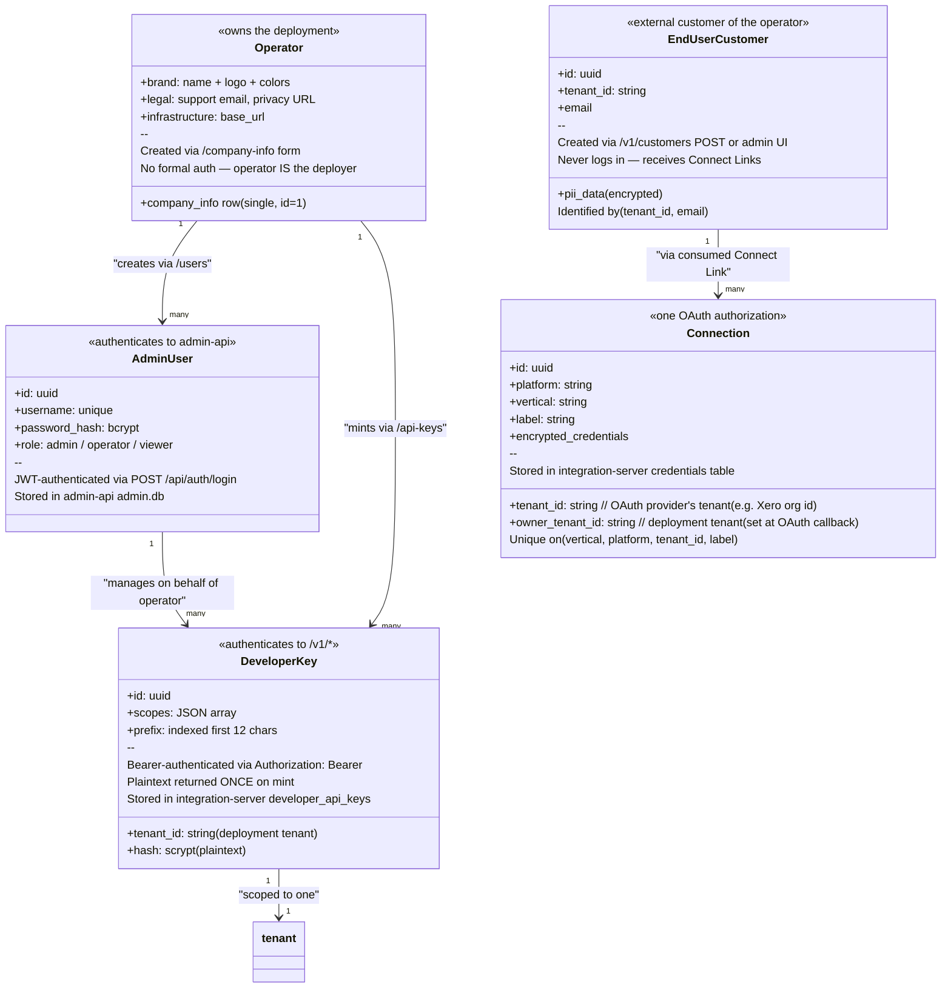

# Auth & tenancy hierarchy

> [← back to overview](./README.md)

The codebase mixes **five** distinct auth concepts — six once end-user tokens are in play. They look similar from the outside but live in different layers and tables. This chart is the canonical reference whenever someone asks "wait, who is the user here?".

---

## Chart 11 — Five-layer auth model



---

## Concrete example

Imagine a SaaS company called **Acme Inc.** running OpenSteward as their integration backend, with a customer-facing app at `app.acme.com`.

| Concept | Concrete value | Where it lives |
|---|---|---|
| **Operator** | "Acme Inc." (runs `git clone` + `docker compose up`) | `company_info` row in admin-api |
| **Admin user** | `alice@acme.com` (human who logs into `:3000`, role=`admin`) | `users` row in admin-api |
| **Developer key** | `osk_acme-prod_8f4c…` (Acme's backend mints it once via the admin UI) | `developer_api_keys` row in integration-server |
| **Tenant** | `acme-prod` (deployment tenant id baked into the key) | Free-form string; same value used in every related row |
| **End-user / customer** | `customer-42` represented as `cust_uuid_…` with email `jane@bigco.com` | `end_users` row in integration-server |
| **Connection** | `cust_uuid`'s Fortnox token labelled `"main"`, `owner_tenant_id="acme-prod"` | `credentials` row in integration-server |

When Acme's backend wants to pull invoices for `jane@bigco.com`, the request looks like:

```http
GET /v1/accounting/contacts?connection_id=<conn-uuid>
Authorization: Bearer osk_acme-prod_8f4c…
```

Flow:

1. Integration-server's auth middleware verifies the Bearer token: an `osk_` key against `developer_api_keys`, or — when it is a JWT and `auth.dev_oauth_enabled` is on — an OIDC token from a registered issuer. Either way it resolves `tenantId="acme-prod"` and the principal's `scopes`.
2. Per-key rate-limit consume (Redis or in-memory) — 429 if exceeded.
3. Vertical middleware loads the connection by `connection_id`. Verifies `connect_sessions(connection_id, tenant_id="acme-prod")` exists — i.e. this connection was spawned by Acme. Cross-tenant access → 403 `CONNECTION_FORBIDDEN`.
4. Asserts the key satisfies the **two-axis vertical scope** check:
   - **Touch axis** (always required): one of `*`, `vertical:accounting`, `vertical:read`, `vertical:write`. Missing → 403 `INSUFFICIENT_SCOPE`.
   - **Verb axis** (on any method `requiresWriteScope()` calls a write): one of `*`, `vertical:write`. Missing on a `POST` / `PATCH` / `PUT` / `DELETE` → 403 `INSUFFICIENT_SCOPE` with `requiredScope: 'vertical:write'`.
5. Decrypts credentials, refreshes if expired, calls Fortnox.

The verb rule is the method, with one declared exemption: a route may set
`config: { readSafe: true }`, and `POST /v1/{vertical}/sync` is the only route
that does. A sync enqueues a job that lists upstream and upserts locally — it
mutates nothing on the platform, and gating it behind `vertical:write` would
mean the safe-default preset (which omits that scope by design) could read a
vertical but never refresh it. The flag must be exactly `true`; a truthy
string from config plumbing must not quietly turn a write route into a read
one. Passing a
`callback_url` on that sync **does** still require `vertical:write`, because it
makes the deployment issue an outbound request of its own.

`alice@acme.com` is **not involved at all** in this request path. She only logs in to the admin UI to mint / revoke keys, manage subscriptions, and inspect deliveries.

---

## Admin roles

`users.role` is one of `viewer`, `operator`, `admin`, ranked in that order
(`ROLE_LEVELS = { viewer: 0, operator: 1, admin: 2 }`). Both the admin UI
(`apps/admin/src/core/auth/middleware.ts`) and admin-api
(`apps/admin-api/src/core/auth/jwt-auth.ts`) hold their own copy of the ladder;
`requireRole(min)` refuses anything below `min`.

| Role | Can |
|---|---|
| `viewer` | Read every page it can reach, including the Connect section — connect links and their templates, customers, sync jobs, scope groups, tenants and domains. Change nothing. |
| `operator` | Everything a viewer can, plus every write route that is not gated at `admin`, plus the two routers still gated whole at `operator` — the API-keys and outbound-webhook-subscription pages, whose list views a viewer cannot reach at all. |
| `admin` | Everything an operator can, plus the six routers gated whole at `admin` — users, audit log, company info, settings, platforms, identity providers — and the `admin`-only routes inside otherwise-operator routers: minting/rotating/revoking API keys, creating/editing/deleting outbound webhook subscriptions and replaying their deliveries, and the setup wizard's API-key and webhook steps. |

Two rules make that split work in practice:

- **The gate is per write route, not per router.** The six page routers hook
  `requireAuth` plugin-wide, and each write route declares its own
  `requireRole('operator')`. A plugin-wide role `preHandler` would gate the
  `GET`s as well — a viewer would see the Connect group in the nav and be
  refused by every link in it, even though admin-api's data endpoints are
  `authenticate`-only and would answer. Per-route declaration also means a
  `POST` added later is not silently covered by a blanket hook: it must name
  its own role.
- **Creation forms stay operator-only** (`/connect-links/new`,
  `/customers/new`, `/scope-groups/new`, `/connect-link-templates/new`). There
  is nothing to read on a form whose only purpose is to create something.
  Detail and edit pages *are* readable — that is how a record gets inspected —
  with their save controls hidden and a line saying why.

[admin-page-map.md](./admin-page-map.md) lists every route by access level.

### Custom roles, permissions and tenant scope

The three roles above are the **base roles**, and they still decide every
role-gated route. On top of them:

- **Custom roles.** An admin can define a role with a base role and its own
  subset of a fine-grained permission catalog (`connections:read`,
  `data:read_pii`, `roles:manage`, `users:manage`, and so on). `users.role`
  keeps holding the base role, so `operatorOnly`/`adminOnly` are unchanged
  (they read it from the database, not the JWT). `users.role_id` names the custom role.
- **Tenant scope.** A user can be restricted to some tenants, and optionally
  some verticals within them. A restricted user sees only those tenants'
  connections, sync jobs and tenants. Out-of-scope ids answer 404. Surfaces
  that are not tenant-scoped yet, and deployment-wide settings (platform
  config, scope groups, role writes, dashboard-task dismissals, notification
  acknowledgement), refuse the user with `403 SCOPE_RESTRICTED`. **Admins are
  always unrestricted** and cannot be restricted; per-tenant administration is
  a custom role (base `operator` plus `users:manage`) with a scope. Role gates
  read the current role from the database, not the sign-in token.
- **Defaults.** Every existing user keeps its built-in role and scope `all`.

See [permissions-and-roles.md](./permissions-and-roles.md) for the catalog,
the escalation guards, and IdP-driven scope.

Acknowledging a notification is a write: it clears the notice for everyone, so
it needs `operator`. A refusal renders the error page naming the role required,
rather than a bare JSON body — `requireRole` uses `reply.view()`, because
`reply.send()` bypasses `setErrorHandler`.

Clearing a row on the Status page's "Needs attention" panel follows the same
rule. A clear is deployment-wide and clear-once — it is an action, not a
per-user preference — so `POST /dashboard/tasks/dismiss` and its Undo,
`POST /dashboard/tasks/undismiss`, are `operator+` on the UI hop and
`operatorOnly` on admin-api. The floor is per row kind, in one table
(`KIND_MIN_ROLE` in `apps/admin/src/core/routes/dashboard-tasks.ts`): expired
connections, failed syncs and failing refreshes (still valid, last token
refresh failed) need `operator`; a platform whose OAuth client credentials
were rejected needs `admin` on both hops, because the fix lives under
`/platforms`, which is admin-only in its entirety; a vertical that is down
has no clear floor at all — nobody clears it, admin-api refuses the key, and
its only action (`/settings/system`) is admin-only. Every role sees every
row — a viewer reads the panel with its actions withheld and a line saying
why; an operator sees "Needs an admin" on a platform row. The UI never
forwards a key it did not derive itself: the form carries keys, the server
re-derives the tasks and sends admin-api only the live ones, with the
fingerprint it computed. Clearing on the Status page also acknowledges the
matching notification (admin-api does that), so one clear settles both
surfaces.

One thing worth stating plainly: a viewer can see Connect Link **tokens**, and a
token is a bearer credential — holding one is enough to complete an OAuth
connection as the pending customer. `GET /api/connect-sessions` returns tokens
to any authenticated user, regardless of what the UI renders.

### Console-user profile: email and picture

Each console user can carry an **email address** and a **profile picture**
(`admin_store` v7). Both are optional and both can come from two places — an
admin, or the identity provider — with one precedence rule: **what a person
set in the console wins.**

| Attribute | Stored in | Owner column | Set by an admin / the user | Set by the IdP |
|---|---|---|---|---|
| Email | `users.email` (≤ 254 chars, validated) | `users.email_source`: `manual` or `idp` | `POST /api/users`, `PATCH /api/users/:id` (`null` clears) — admin only | OIDC `email`, SAML email attribute, LDAP mail, SCIM `emails` |
| Picture | `user_avatars` (one row per user, bytes as uploaded) | `user_avatars.source`: `upload` or `idp` | `PUT` / `DELETE /api/users/:id/avatar` | OIDC `picture`, SAML picture attribute, SCIM `photos` |

- A `manual` email is never overwritten by SSO or SCIM; an `idp` email is
  refreshed at every SSO sign-in and SCIM update. Clearing an email hands
  ownership back to the IdP. See
  [sso-and-identity-providers.md](./sso-and-identity-providers.md#profile-email-and-picture).
- An `upload`ed picture is never replaced by the IdP. Removing a picture shows
  initials; an IdP picture comes back at the next sign-in if the IdP still
  sends one.
- **Who may change a picture:** any signed-in user their **own**; someone
  else's needs `users:manage` and passes the same escalation guards as a role
  change (the account must not hold more than the caller, nor see tenants
  outside the caller's scope). Email changes stay on the admin-only users
  routes, behind the same target guard as any other change there (the
  account must not hold more than the caller). See
  [permissions-and-roles.md](./permissions-and-roles.md#profile-pictures).
- **Pictures** are PNG, JPEG or WebP identified by magic bytes (SVG is
  refused), at most 512 KB, never resized. `GET /api/users/:id/avatar` is open
  to any signed-in console user and answers with the sniffed `Content-Type`,
  `X-Content-Type-Options: nosniff`, `Content-Security-Policy: default-src
  'none'`, `Cache-Control: private, max-age=300` and a sha256 `ETag` (`304` on
  a match). It is left out of the OpenAPI spec, like the logo bytes.
- Every user view — `GET /api/users`, `GET /api/users/:id`,
  `GET /api/auth/me` — carries `email`, `avatarUrl` (versioned with `?v=`) and
  `avatarVersion`; the detail view adds `emailSource` and `avatarSource`.
- The admin UI never links a browser to admin-api: it serves pictures itself
  at `/users/:id/avatar?v=…` (a proxy that relays only the three image types),
  so the strict pages' `img-src 'self'` holds. Uploads are a plain
  `multipart/form-data` form — no JavaScript — on the admin-only user detail
  page, and on **My profile** (`/profile`, linked from the header user menu),
  where any signed-in user sees their email and sets or removes their own
  picture. The `/profile` routes take no id: they act on the session's own
  account.
- **Email is PII.** The audit log records `emailSet` / `emailChanged` flags,
  never the address, and `LOG_REDACT_PATHS` redacts `email` and `*.email` in
  every service's logs.

## First-run bootstrap

`POST /api/auth/setup` creates the first `admin` account and returns a JWT for
it. Two gates:

1. It only succeeds while the user table is empty — `409` once any user exists.
2. When admin-api is started with `BOOTSTRAP_TOKEN` set, the request must carry
   a matching `X-Bootstrap-Token` header (constant-time compare) or it is
   `401`. The admin UI's `/setup/init` screen prompts for the token and
   forwards it as that header.

Unset means no token gate, so on a fresh or wiped deployment whoever reaches
published `:3001` first becomes the admin. Set it before the first
`docker compose up` on anything reachable by someone else, and **keep it set**
so a later DB wipe stays gated — there is no `.setup-complete` marker on disk.

`scripts/generate-secrets.sh` mints one, and `docker-compose.yml` forwards it
to admin-api. `pnpm check:secret-passthrough` fails the build if any minted
secret stops reaching the service that reads it.

The created admin is auto-pinned as the break-glass account, so SSO can be
locked down later without losing password access.

---

## Common confusions

**"Is the admin user the same as a developer key?"** — No. Admin users authenticate via JWT to the admin UI; they're humans. Developer keys authenticate via Bearer to the integration-server API; they're machine credentials. One operator typically has many admin users AND many developer keys (one per backend service, environment, etc.).

**"Why two `tenant_id`s on a connection?"** — They mean different things. `connections.tenant_id` is the **OAuth provider's** tenant — for Xero this is the org id Xero hands back. `connections.owner_tenant_id` is the **deployment** tenant — the Acme-side identifier that owns the connection. The latter is set at OAuth callback from the connect-link session and is what `/v1/connections` filters on.

**"Can a tenant log in?"** — No. Tenants don't have credentials of their own. They're scoping labels carried by developer keys, end-user records, and connections. Different tenants on the same deployment can't see each other's data.

**"How does a custom domain scope a request to a tenant?"** — A tenant can have one or more custom domains mapped to it (admin → Tenants & domains). Integration-server reads the incoming `Host` header and resolves it to that tenant; on a tenant's domain, a developer key from another tenant — or a connection owned by another tenant — is rejected with `TENANT_MISMATCH` (403). An unmapped host (or a deployment with no domains configured) resolves to `default` and imposes no host constraint, so single-domain deployments are unchanged. See [`deployment/custom-domain.md` § Custom domains per tenant](../deployment/custom-domain.md#custom-domains-per-tenant).

**"How far does tenancy go?"** — Tenancy is a data-scoping label, not whole-deployment isolation. Per-tenant: developer keys, end-users and end-user tokens, connections (`owner_tenant_id`), connect sessions and link templates, custom domains. Deployment-global: branding (`company_info` is a single row — the schema enforces `CHECK (id = 1)` — so tenants share one brand and differ only by domain), admin users (`admin.users` carries no `tenant_id`: an admin account always administers every tenant; a non-admin account can be [restricted to some tenants](./permissions-and-roles.md#tenant-scope) — a per-user access scope, not a tenant-owned account), the adapter registry and `adapter_settings` (keyed on `(vertical, slug)`, so one OAuth-client configuration per platform serves all tenants), runtime settings, and the audit log and notifications.

**"Can an end-user log in?"** — Not directly. End-users receive Connect Link URLs via email. They authorise once via OAuth on the upstream platform, the link consumes, a connection lands, and the end-user never authenticates again.

**"What's the relationship between scopes and tenants?"** — A scope grants a key access to a class of endpoints (`customers:read`, `vertical:accounting`, …); the tenant scope **isolates** the data the key can see. Both checks fire on every request: scope first, then tenant. Missing scope → 403 `INSUFFICIENT_SCOPE`. Wrong tenant → 404 (cross-tenant lookups return not-found to avoid leaking other tenants' resource ids).

**"Why is `vertical:write` separate from `vertical:<v>`?"** — Because operators of self-hosted deployments are liable for what gets written upstream (financial records, GDPR, etc.). The verb axis lets the safe-default mint flow grant a key read access to every vertical without also granting write capability — a developer building a dashboard that reads accounting ledgers can't accidentally push back malformed updates. On boot the integration-server normalises the key table once: any key holding a vertical touch scope but no verb-axis scope gets `vertical:write` appended (idempotent; the boot log records `api-keys: added missing 'vertical:write' scope to N key(s)`).

**"Is every non-GET a write?"** — Almost. `requiresWriteScope(method, routeConfig)` in `control-plane/auth-middleware.ts` is the single place that decides, and it answers "yes" for anything but `GET` / `HEAD` unless the route declared `config: { readSafe: true }`. Today `POST /v1/{vertical}/sync` is the only route that declares it. Anything added later is write-gated until it says otherwise, which is the direction the default should fail in.

**"What is `mcp:read` and why does it need its own scope?"** — An MCP (Model Context Protocol) token belongs to an AI agent — Claude Desktop, Cursor, Continue, Cline, gemini-cli — that an attacker can influence via prompt injection inside the data the agent reads. Threat model differs from a human-controlled backend: same `vertical:read` grant, very different risk profile — the deciding question is whether the bearer is operated by a deterministic system the operator trusts, or by an LLM whose behaviour is shaped by attacker-controllable inputs. The `mcp:read` scope is a *category marker* layered on top of fine-grained scopes: it grants nothing by itself (an agent key still carries `vertical:read` etc.), and no scope implies another, so the scope list on the key stays the complete audit signal. Four things change when it is present on a key:

1. **The auth middleware refuses any non-GET method** at request time, regardless of what other scopes the key carries (response code `MCP_READ_ONLY`). Defence in depth: even if a future MCP client accidentally adds a write tool, the server still says no. This check is purely the method and does **not** honour `readSafe` — an `mcp:read` key cannot `POST /v1/{vertical}/sync` either, even though a plain read-only key can.
2. **The mint guard rejects** any key combining `mcp:read` with `*`, `*:write`, or any `<resource>:*` scope (error `IncompatibleMcpScopesError`). The operator must mint a separate key for write traffic — which is also what makes agent access independently revocable: killing a misbehaving agent's key never touches the keys powering human-controlled backends.
3. **The kill switch can reach it.** `features.mcp_enabled = false` refuses every principal carrying `mcp:read` with a 403 `MCP_DISABLED`, whatever else it is scoped for, and leaves ordinary developer keys untouched — the blast radius closed without a deploy. **And the deployment refuses an MCP client that presents a key lacking the scope** (403 `MCP_KEY_REQUIRED`, matched on the `@opensteward/mcp-server` User-Agent), because such a key is invisible to this switch and to guard 1. That refusal is a guard rail against a misconfiguration, not a boundary: it is the scope, not the User-Agent, that enforces anything.
4. **Rate limiting moves to the `mcp_tenant` budget** (`rate_limit.mcp_tenant.per_minute`) rather than the general `rate_limit.api_key.per_minute`, so agent traffic can be throttled independently of developer traffic.

> There is **no** `mcp=true` audit flag. The integration-server data plane writes no per-request audit rows at all — the audit log is an admin-plane concept in `admin.db`, written by admin-api for admin actions such as `api_key.mint`. Isolating agent traffic in a SIEM means correlating on the key id.

A typical tenant-mode MCP key carries `["mcp:read", "vertical:read", "customers:read"]`. Operators who legitimately need PII reveal add `mcp:read_pii` (every reveal is audit-logged).

**"What is an `eut_…` token?"** — A sixth principal, sitting beside the five in the chart: an **end-user token** minted on behalf of one customer rather than a whole tenant, for that customer's own AI-agent installs. Same shape as a developer key (`eut_<endUserSuffix>_<random>`, prefix-then-scrypt-verify, stored in `end_user_tokens`), but it authenticates the `/v1/me/*` surface — `/v1/me/connections` and `/v1/me/{vertical}/*`, where five of the nine vertical plugins (accounting, crm, ecommerce, logistics, payments) are mounted a second time behind the end-user middleware. Default scopes on mint are `["mcp:read", "eut:read"]`, read-only by construction, and the same mint guard rejects any write-granting scope alongside `mcp:read`.

**"Is an OIDC bearer token a seventh principal?"** — No — a second credential for the DeveloperKey layer. When the operator registers an issuer (Keycloak, Auth0, Okta, Entra ID, or any compliant IdP), `/v1/*` accepts that IdP's short-lived JWTs alongside `osk_` keys. Both resolve to the same `(tenantId, principalId, scopes)` triple, so the two-axis scope check, tenant linkage, and the MCP guards downstream are identical either way. Each credential has its own kill switch, read per request (`auth.dev_api_keys_enabled`, on by default; `auth.dev_oauth_enabled`, off until the operator enables it); `X-Admin-Secret` is deliberately ungated by both — it is the operator path back into a deployment whose developer auth has been misconfigured. Setup lives in [`deployment/oauth-clients-setup.md`](../deployment/oauth-clients-setup.md).

---

## Where each layer's data lives

| Layer | Database | Table | Authenticated? |
|---|---|---|---|
| Operator | admin-api `admin.db` | `company_info` (single row) | No — owner of the deployment |
| Admin user | admin-api `admin.db` | `users` | Yes — JWT (cookie-session in the admin UI) |
| Developer key | integration-server `credentials.db` | `developer_api_keys` | Yes — Bearer; scrypt-hashed |
| OIDC trust store | integration-server `credentials.db` | `oauth_issuers` / `oauth_clients` / `oauth_scope_rules` | No secrets — resource-server config, public keys only |
| End-user token | integration-server `credentials.db` | `end_user_tokens` | Yes — Bearer `eut_…`; scrypt-hashed. Scoped to one end-user, not a whole tenant |
| Tenant | — | — (string carried by every other table) | No — implicit scope |
| End-user / customer | integration-server `credentials.db` | `end_users` (PII encrypted) | No — receives links |
| Connection | integration-server `credentials.db` | `credentials` (creds encrypted) | No — credentials encrypted at rest |
| Webhook subscription | integration-server `credentials.db` | `webhook_subscriptions` (secret encrypted) | Receivers verify HMAC-SHA256 |
| Webhook delivery | integration-server `credentials.db` | `webhook_deliveries` | — durable queue with replay |
| Cached resource | integration-server `resources.db` | `resources` (canonical JSON, partitioned by `connection_id`) | No — derived from upstream; cleared on connection delete |
| Sync job | integration-server `resources.db` | `sync_jobs` | No — bookkeeping only; partitioned by `vertical` + `connection_id` |

---

## See also

- [sso-and-identity-providers.md](./sso-and-identity-providers.md) — connecting corporate SSO (SAML/OIDC/LDAP) + SCIM to the AdminUser layer
- [permissions-and-roles.md](./permissions-and-roles.md) — the permission catalog, custom roles and per-user tenant scope
- [persistence.md](./persistence.md) — full ERD of every table mentioned above
- [end-user-journey.md](./end-user-journey.md) — when each layer comes into play during setup
- [runtime-flows.md](./runtime-flows.md) — sequence diagrams showing tenant resolution at request time
- [../deployment/oauth-clients-setup.md](../deployment/oauth-clients-setup.md) — registering IdP issuers and service accounts for OIDC bearer tokens on `/v1/*`
- [../dev-api.md](../dev-api.md) — developer-facing walkthrough of the Bearer + scope model
