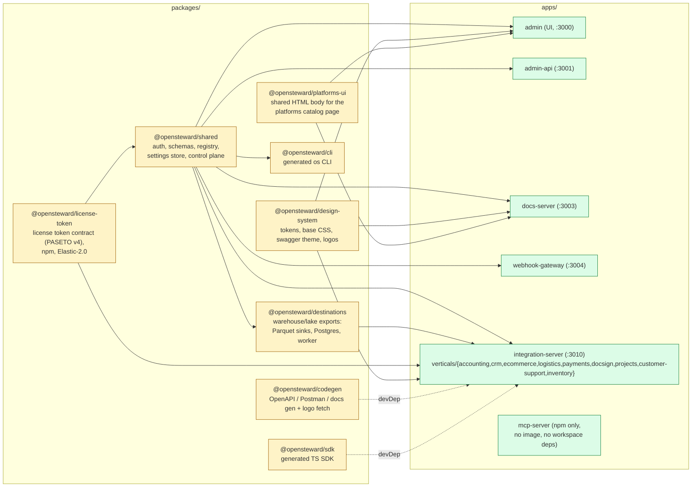
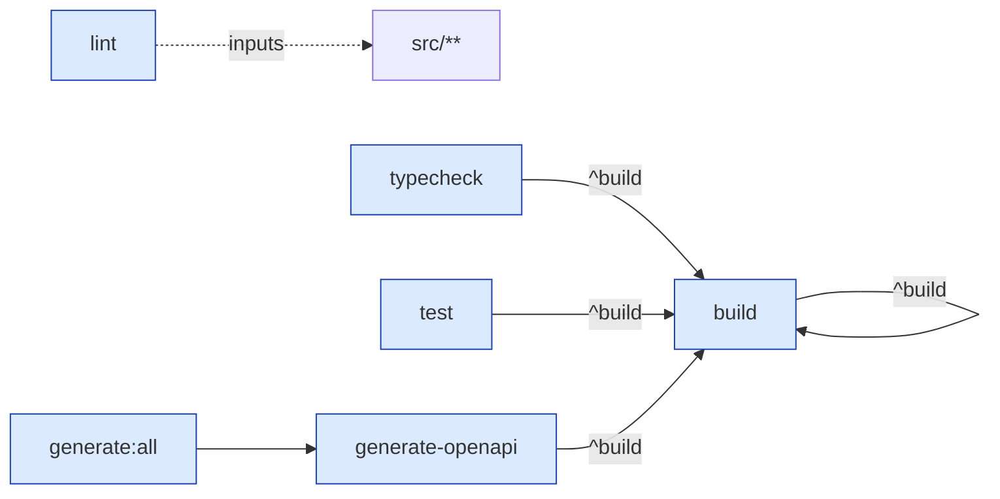

# Build & workspace dependencies

> [← back to overview](./README.md)

How the monorepo is wired with pnpm workspaces, what depends on what,
and how the shared `Dockerfile` builds any of the five images via the
`APP` build arg.

---

## Chart 6 — Workspace dependencies



**Solid arrows** = runtime dependency. **Dashed arrows** = devDependency or one-shot generator.

`sdk` and `mcp-server` have no workspace dependencies at all: the SDK's client is generated from the OpenAPI specs, and `mcp-server` ships to npm on its own and runs per-agent rather than in compose. The arrow points the other way for the SDK, though: integration-server dev-depends on the built `sdk` for its `sdk-wire` integration test.

`license-token` has no workspace dependencies either. It holds the license token contract (payload schema, signing input, verification) and is published to npm under Elastic-2.0, so the OpenSteward license service signs tokens with the same code that verifies them. shared depends on it at runtime, and so does integration-server, directly, so its stale-build guard sees it.

---

## Bootstrap order

`@opensteward/license-token` builds first, then `@opensteward/shared`; every other workspace imports from shared's compiled `dist/`. The Dockerfile and `pnpm install` both handle this in the correct order:

```bash
pnpm install                                          # installs everything (workspace links)
pnpm --filter "@opensteward/shared..." run build      # license-token, then shared — MUST run first
pnpm --filter @opensteward/destinations run build     # integration-server imports its dist too
pnpm --filter integration-server run dev              # now this can resolve @opensteward/shared
```

If you forget the build step, you'll see `Cannot find module '@opensteward/shared'` when trying to start an app.

Running the **full** test suite needs three more built packages: docs-server
and admin import `design-system` and `platforms-ui` at typecheck time, and
integration-server's `tests/integration/sdk-wire.test.ts` imports
`@opensteward/sdk` at test-collection time:

```bash
pnpm --filter @opensteward/license-token \
     --filter @opensteward/shared \
     --filter @opensteward/design-system \
     --filter @opensteward/platforms-ui \
     --filter @opensteward/sdk run build
```

Without them a clean worktree fails docs-server's typecheck on
`Cannot find module '@opensteward/design-system'`, and a handful of test files
silently no-op. The sdk failure is loud and confined to one file:
`sdk-wire.test.ts` fails to collect with `Failed to resolve entry for package
"@opensteward/sdk"` — and because the exports map resolves only the built
`dist`, editing `packages/sdk/src` without rebuilding tests the old output.

A `dist/` that exists but is out of date is worse than a missing one, because
nothing fails loudly. Each library integration-server imports (license-token,
shared, destinations, design-system, codegen, sdk) ends its `build` with
`node ../../scripts/build-stamp.mts`. That writes `dist/.build-stamp.json`, a
hash of the package's `src/`. Before any test file starts,
`apps/integration-server/vitest.global-setup.ts` compares each stamp with the
`src/` on disk. If one differs, it names the package and stops the run; the fix
is `pnpm run build`. `packages/shared/vitest.global-setup.ts` does the same for
shared's own suite, whose licensing tests verify tokens through license-token's
`dist/`. The guard exists because of 2026-09-29: two full-suite runs
in a checkout that had been fast-forwarded without a rebuild ran against a
three-day-old `packages/shared/dist`. They failed 172 tests across 8 files (the
Odoo JSON-2 suites, the zoho-desk webhook, sync-worker wiring), and the failures
were taken for flakiness.

Separately, `pnpm install --ignore-scripts` skips the
better-sqlite3 native build, after which every store-backed test fails with
`Could not locate the bindings file` — an artifact of the flag, not a regression.

## Two TypeScript compilers, on purpose

`node_modules/.bin` contains both `tsc` (TypeScript **7**) and `tsc6` (TypeScript **6**). This is deliberate, not leftover state.

TypeScript 7 is the native Go port of the compiler — a port, not a redesign, so its type-checking semantics match 6.0 exactly. On this repo it typechecks every workspace with identical diagnostics at roughly 5x the speed (full-repo typecheck ~14.0s → ~3.0s), which is why every workspace's `build` and `typecheck` script calls plain `tsc`.

But TypeScript 7.0 ships **no programmatic JS API** — it is a CLI and a language server only. The API is expected in 7.1. Three things in this repo load the compiler as a library and would break on 7:

| Consumer | Why it needs the API |
| --- | --- |
| `typescript-eslint` | Type-aware linting. Its peer range is `typescript >=4.8.4 <6.1.0`, which excludes 7 outright. |
| `openapi-typescript` | Builds the SDK's generated types via the TS AST — `pnpm sdk:generate` → `pnpm docs:all` → the `pnpm check:docs` gate. |
| `scripts/backfill-schema-assertions.ts` | Parses transform tests with `ts.createSourceFile` to place schema assertions. |

The two are installed side by side through npm aliases, repeated in every workspace `package.json`:

```json
"@typescript/native": "npm:typescript@^7.0.2",
"typescript": "npm:@typescript/typescript6@^6.0.2"
```

The direction matters. The *name* `typescript` resolves to the 6.x package, so the three consumers above find the API they expect and peer resolution stays satisfied. `@typescript/native` is only a local alias label — it installs `typescript@7`, whose `tsc` binary lands in `node_modules/.bin`. `@typescript/typescript6` contributes `tsc6` and no `tsc`, so the two never collide; every build and typecheck script calls plain `tsc`. (Its package version reads 6.0.2 while `ts.version` reports 6.0.3 — the npm package and the compiler are versioned separately.)

Do not collapse this back to a single `typescript` dependency. Revisit once 7.1 ships the new API and those three consumers support it.

Practical consequences:

- `tsc --noEmit` runs as a Go process. `NODE_OPTIONS=--max-old-space-size=…` has no effect on it, so no heap flags are set in `.github/workflows/test.yml`, in the builder stage of the root `Dockerfile`, or in the `typecheck-tests` gate in `scripts/check-warning-gates.ts` — even for the ~27,400-file test program.
- A Go binary killed by the OOM killer prints nothing — no `FATAL ERROR:`, no `JavaScript heap out of memory`. `CRASH_SIGNATURES` in `scripts/check-warning-gates.ts` therefore also matches signal-shaped deaths, so a half-finished typecheck can't be mistaken for a real (lower) error count and ratcheted in.
- TypeScript 7 forces `stableTypeOrdering` on. Emitted `.js` is byte-identical to 6, but some `.d.ts` files differ in member order and string-quote style. Type identity is unaffected — object member order carries no meaning — and `dist/` is gitignored, so no committed artifact and no `check:docs` output moves.
- `--checkers N` controls type-checking parallelism (default 4); `--singleThreaded` disables it when debugging.

## Building the images

`docker compose build` builds all five services **concurrently**, and each one runs the full toolchain independently: `pnpm install`, then `tsc` over `@opensteward/license-token`, `@opensteward/shared`, `@opensteward/design-system`, `@opensteward/platforms-ui`, and finally the target app.

The integration-server build is the outlier: its 1,500+ adapter program is by far the largest thing the compiler sees here. What dominates peak memory is **emit**, not type-checking. Measured under TypeScript 7 (`/usr/bin/time -l`, this project):

| what `tsc` was asked to do | peak RSS |
| --- | --- |
| `--noEmit` (typecheck only) | 4.33 GB |
| full emit — `declaration` + `declarationMap` + `sourceMap` | 5.64 GB |
| emit without `declaration` / `declarationMap` | 4.83 GB |
| emit without `sourceMap` | 5.09 GB |
| emit without any of the three — **what the Dockerfile does** | 4.36 GB |

Against a Docker VM of ~5.8 GB, the full-emit figure does not reliably fit. This is not a threshold you cross cleanly: the same commit built once and then OOM-killed twice with nothing changed in between, because it sits right at the edge and the outcome depends on transient memory state. The failure looks like this, and the kill is silent — a Go binary killed by the OOM killer prints nothing:

```
 ERR_PNPM_RECURSIVE_RUN_FIRST_FAIL  integration-server@1.0.0 build: `tsc`
Command failed with signal "SIGKILL"
target integration-server: failed to solve: ResourceExhausted:
  ... did not complete successfully: cannot allocate memory
```

The builder stage therefore compiles the **app** with `--declaration false --declarationMap false --sourceMap false --composite false`, which restores roughly 640 MB of margin and shrinks the image. This is safe because an app is a leaf: nothing imports it, the runtime stage copies only `dist/` and runs `node dist/index.js`, and no entrypoint passes `--enable-source-maps` (nor is `source-map-support` installed), so those artifacts were consumed by nobody. The three shared packages keep their full emit — apps import their `.d.ts`, so declarations are load-bearing there. To get TypeScript-mapped stack traces in a container, add `--enable-source-maps` to the runtime `CMD` and drop `--sourceMap false` from the Dockerfile.

Even so, building all five at once on a ~6 GB VM is tight. If a build is OOM-killed, build the heavy one alone:

```bash
docker compose build integration-server        # the heavy one, alone (~100s)
docker compose build admin admin-api docs-server webhook-gateway
```

Three traps worth knowing:

- **`NODE_OPTIONS=--max-old-space-size` is no protection here.** It caps V8's heap, and TypeScript 7 is compiled Go with no V8.
- **Do not reach for `--checkers 1` or `--singleThreaded`.** Lowering TypeScript 7's checker count *increases* peak memory on this project (measured: 4.77 GB at `--checkers 1` and 4.43 GB at `--singleThreaded`, versus 4.22 GB at the default of 4). It buys nothing and costs wall-clock.
- **Don't measure with `--noEmit` and assume it describes the build.** `--noEmit` understates the real build by over a gigabyte, because emit is the expensive half.

Each image rebuilds the three shared packages independently; there is no common builder base stage.

## Shared Dockerfile

A single `Dockerfile` at the repo root builds any app via the `APP` build arg:

```dockerfile
ARG APP

# Build stage
FROM node:24-alpine AS builder
# python3/make/g++ for node-gyp — better-sqlite3 compiles from source on musl
RUN apk add --no-cache python3 make g++
RUN corepack enable && corepack prepare pnpm@9 --activate
WORKDIR /app
COPY pnpm-workspace.yaml pnpm-lock.yaml package.json tsconfig.base.json ./
COPY packages/ packages/                   # all workspace packages
ARG APP
COPY apps/${APP}/ apps/${APP}/
RUN pnpm install --frozen-lockfile
RUN pnpm --filter @opensteward/license-token run build
RUN pnpm --filter @opensteward/shared run build \
 && pnpm --filter @opensteward/destinations run build \
 && pnpm --filter @opensteward/design-system run build \
 && pnpm --filter @opensteward/platforms-ui run build \
 && pnpm --filter ${APP} exec tsc \
      --declaration false --declarationMap false --sourceMap false --composite false

# Runtime stage
FROM node:24-alpine
ENV NODE_ENV=production
# ... copy built shared/design-system/platforms-ui + app dist + config + views/public if present
```

Two lines there are load-bearing beyond "it builds":

- The app is compiled with `exec tsc` and the emit flags rather than its own
  `build` script — that is the OOM fix described above, not a stylistic choice.
- `ENV NODE_ENV=production` is set in the **image**, not in `docker-compose.yml`,
  so every consumer of these images gets the same posture: `adminGuard` and the
  `/v1/*` `devOpen` fallthrough fail closed rather than serving open when
  `ADMIN_SECRET` is unset, and `assertSecret` throws instead of warning on a
  weak `JWT_SECRET` / `STORE_SECRET`. A service run outside a container
  (`pnpm --filter <app> dev`) has `NODE_ENV` unset, so local development keeps
  the fallthrough.

Where `docs/` goes: the builder stage of every image copies it (after
`pnpm install`, so a doc edit does not invalidate the install layer),
because docs-server's build generates its search index from it. Only the
docs-server runtime image keeps a copy, at `/app/docs` — the guides, OpenAPI
specs and platform catalog it serves, so a docs-server deployed without the
repo (Helm, for one) still has them. The admin image keeps one file,
`docs/platforms/platforms.json`, the platform catalog it reads
(`apps/admin/src/core/routes/platform-catalog.ts`). The other three runtime
images ship no `docs/`. Compose bind-mounts `./docs:/app/docs:ro` over
docs-server's copy for live editing, and `./docs/platforms` over admin's
catalog.

`docker-compose.yml` invokes it once per service:

```yaml
integration-server:
  build:
    context: .
    dockerfile: Dockerfile
    args:
      APP: integration-server
```

## Build pipeline (Turborepo)

`turbo.json` declares task dependencies so `pnpm run build` (`turbo run build`) runs in the correct order with caching. `pnpm -r run build` does not: it ignores Turbo's `^build` graph and starts apps before their workspace dependencies are built.



The `^build` syntax means "depends on the build of all upstream workspace packages", so when you `pnpm --filter integration-server run test`, turbo first builds `@opensteward/license-token`, then `@opensteward/shared`.

## What gets rebuilt when you touch X

| Edit | Triggers rebuild of |
|---|---|
| `packages/license-token/src/**` | license-token, then shared, then **all 5 image apps** + the CLI |
| `packages/shared/src/**` | shared, then **all 5 image apps** + the CLI |
| `packages/design-system/**` | design-system + admin + docs-server + integration-server |
| `packages/platforms-ui/src/**` | platforms-ui + admin + docs-server |
| `packages/codegen/src/**` | codegen + integration-server (uses devDep) |
| `apps/integration-server/src/**` | integration-server only |
| `apps/admin/src/**` | admin only |
| `apps/admin-api/src/**` | admin-api only |
| `apps/webhook-gateway/src/**` | webhook-gateway only |
| `apps/docs-server/src/**` | docs-server only |
| `Dockerfile` | every Docker image (no shared layer caching) |

---

## See also

- [services.md](./services.md) — what each app does at runtime
