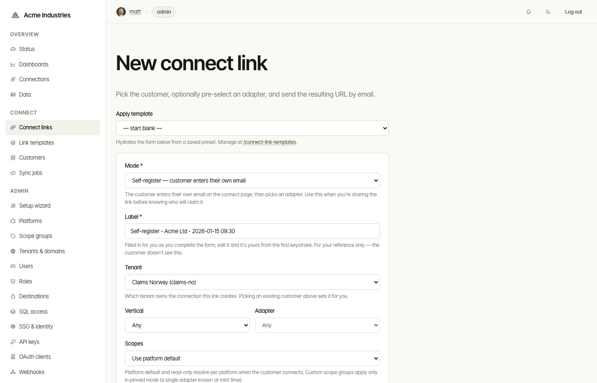
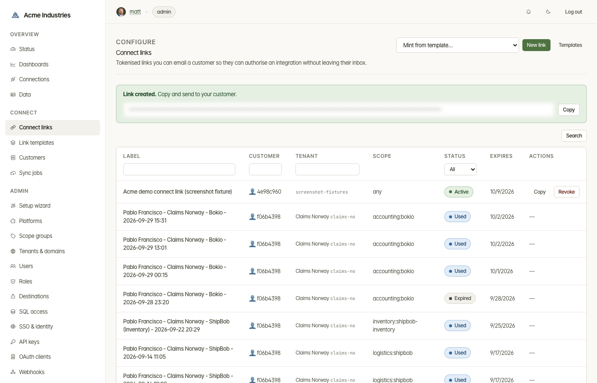
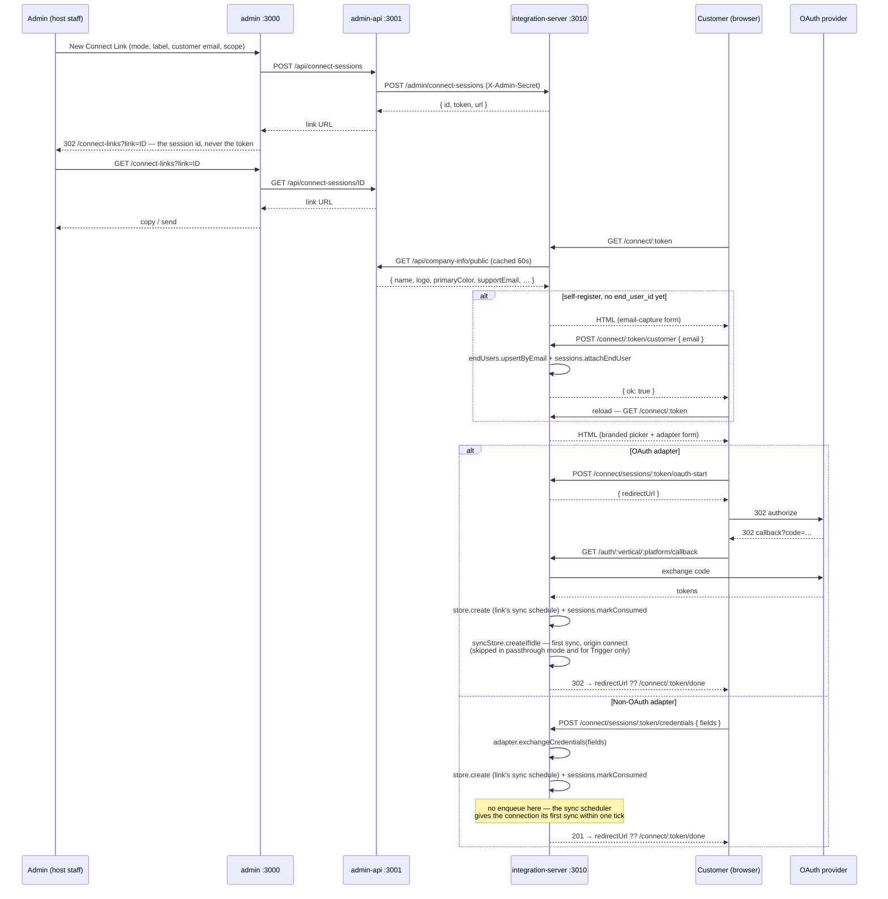
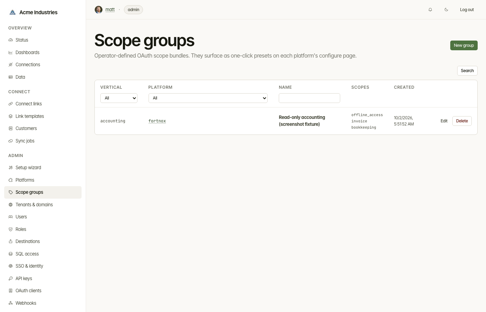

# Connect Links

> [← back to overview](./README.md)

A Connect Link is a tokenised, single-use URL that an admin emails to an
end-customer. The customer opens it, picks an integration, completes
OAuth (or fills in a credential form for non-OAuth adapters), and lands
on a thank-you page. The resulting connection row is owned by the
business tenant — credentials never leave the deployment.

This unlocks the "ask for QuickBooks access over email" workflow without
forcing the host to embed OpenSteward into their own product.

## Three mint modes



Connect Links support three explicit creation modes, surfaced as the
**Mode** field on the new-link form. Mode is a UX abstraction — the
server stores the underlying field combination on `connect_sessions`
and never persists the mode label.

| Mode                       | `end_user_id` at mint | `allowed_platforms`         | `allow_self_register` |
|----------------------------|-----------------------|-----------------------------|-----------------------|
| `pinned`                   | expected              | exactly one (vertical+slug) | 0                     |
| `customer-picks-adapter`   | expected              | empty or filtered           | 0                     |
| `self-register`            | NULL                  | empty or filtered           | 1                     |

Only two of those cells are enforced. `self-register` strips `endUserId` /
`customerEmail` / `customerDisplayName` at the route boundary, so the link cannot
arrive pre-bound; and `pinned` is rejected unless it names both a vertical and an
adapter. The customer field is *expected* in the other two rows but never
required — nothing in the form or the route refuses a mint without it.

Pick by use case:

- **Pinned** — admin knows the customer and the adapter; customer skips
  the picker and goes straight to OAuth. Because the link *is* the adapter
  choice, both fields are required in this mode: the form's `applyMode()` sets
  `required` on the two selects from the same lines that write the `*` into
  their labels, and `POST /connect-links` re-renders with a reason if either is
  missing. Both selects still lead with an "Any" option, so the server-side
  re-check matters — a pinned submit that keeps them is rejected rather than
  minting an adapter-unrestricted link from a form that had just said the
  fields were required.
- **Customer picks adapter** — admin knows the customer; customer
  chooses any allowed adapter at connect time. A *custom* scope group
  cannot apply here (it is written against one platform, and the platform
  isn't known until the customer picks), so the selector offers only
  **Use platform default** and **Read-only**, both of which resolve
  per-platform at OAuth-start. Same for self-register.
- **Self-register** — admin doesn't know the customer. The landing page
  renders an email-capture form first; on submit the public
  `POST /connect/:token/customer` endpoint upserts an end-user via
  `EndUserStore.upsertByEmail` and atomically attaches it via
  `ConnectSessionStore.attachEndUser`. The attach refuses to overwrite
  an existing binding (idempotent on race).

## Flow

The operator-facing mint succeeds with a copy-ready URL the operator emails to the customer:





## Sync schedule and the first sync

A link carries the **sync schedule** the connection it creates starts with —
the **Sync schedule** field on the new-link form: blank for the deployment
default, **Custom interval** (15 minutes to 30 days), **Trigger only** or
**One-time**. It is stored on the session (`sync_mode`,
`sync_interval_minutes`) and copied onto the connection when the customer
connects, by both the OAuth callback and the credential form. A one-time link
(`oneTimeOnly`) always gives its connection `once`, because the connection is
deleted after its first sync; minting one with any other schedule is refused
(`400 SYNC_SCHEDULE_CONFLICT`). The developer API's
`POST /v1/customers/:id/connect-links` sets no schedule, so its connections
start on the default. Operators change a connection's schedule later on its
admin page; what each mode does is in
[`dev-api.md` §7](../dev-api.md#sync-schedules).

The first sync, when `dataStore.mode != passthrough`:

- **OAuth branch** — the callback enqueues a sync for the new connection
  right after `store.create` (origin `connect`), unless the link's schedule
  is **Trigger only**. The enqueue is wrapped in try/catch, so a failed
  enqueue (e.g. a job already active) never breaks the redirect to the
  thank-you page.
- **Credential-form branch** — enqueues nothing itself. The sync scheduler
  picks a never-synced connection up first, within one tick (60 s by
  default), unless it is **Trigger only**.

See [`runtime-flows.md` §4d](./runtime-flows.md#chart-4d--syncworker-job-lifecycle) for the worker side.

## Data model

Two tables on integration-server's encrypted store (separate from
`admin.users`, which is for host operators):

- **`end_users`** — external customers receiving links. Plaintext columns
  for search (`email`, `display_name`, `external_reference`); encrypted
  blob `pii_data` for the rest (first/last name, phone, address,
  personal-ID number). PII is decrypted only on the detail page; reveals
  of `personalIdNumber` write an audit row.
- **`connect_sessions`** — the link itself. Carries `token`, `tenant_id`,
  optional `end_user_id`, allowed verticals/platforms, expiry, redirect
  override, the starting sync schedule (`sync_mode`,
  `sync_interval_minutes`; NULL = the deployment default), and (after
  consumption) `connection_id`. Three feature flags:
  `one_time_only` (delete the connection after the first sync),
  `scopes` (JSON array — per-link OAuth scope override applied via
  `adapter.getAuthUrl(state, overrideScopes)`), `allow_self_register`
  (gate the public self-register endpoint). Plus `scope_policy`
  (`read_only` | `platform_default` | `custom`), which decides how `scopes`
  is read — see below. A NULL `scope_policy` normalises to `custom` when the
  row carries an explicit `scopes` array and to `platform_default` otherwise.
- **`connect_link_templates`** (admin-api SQLite, *not* on
  integration-server) — reusable presets for the new-link form.
  Tenant-scoped (`UNIQUE(tenant_id, name)`), FKs `scope_groups`.
  Templates **prefill, do not bind** — there is no `template_id` FK on
  `connect_sessions`, so editing a template is non-destructive to
  historical links.

The `credentials` table carries no connect-link-specific columns; the
customer ↔ connection association is derived via `connect_sessions`.

## Status lifecycle

`active` → (`expired` at `expires_at`) or (`consumed` once a connection
lands). Consumed sessions retain their `connection_id` for audit.
Revoking a session backdates `expires_at` so the same code path that
handles natural expiry handles revocation too.

## Branding

The hosted page renders the host's logo, name, primary colour, and
support email from `company_info` via admin-api's unauthenticated
`GET /api/company-info/public` endpoint. integration-server caches the
response for 60s. If admin-api is unreachable, the page falls back to
the OpenSteward default branding — never throws.

## Custom domain

The link URL is built with this precedence:

1. `PUBLIC_BASE_URL` env on integration-server
2. `companyInfo.baseUrl` from the Company info form
3. `request.protocol` + `request.hostname` (honours `X-Forwarded-*`
   when behind a reverse proxy with `trustProxy: true`)

See [`deployment/custom-domain.md`](../deployment/custom-domain.md) for
Caddy / nginx / Traefik recipes. TLS + ACME stay in the proxy.

## Connect Link templates

Operators define reusable presets at `/connect-link-templates` (admin
sidebar → Connect → Link templates). CRUD endpoints:

```
GET    /api/connect-link-templates?tenantId=…
POST   /api/connect-link-templates
GET    /api/connect-link-templates/:id
PUT    /api/connect-link-templates/:id
DELETE /api/connect-link-templates/:id
```

A template carries every field the new-link form needs: `linkMode`,
`allowedVerticals`, `allowedPlatforms`, `scopeGroupId`, `expiryDays`,
`oneTimeOnly`, `redirectUrl`, plus `name` / `description`. The new-link
form has an "Apply template" dropdown, and the `/connect-links` list
page has a "Mint from template…" select that navigates to
`/connect-links/new?template=<id>` so the form arrives prefilled. The
in-form template-apply handler is reused for both client-side picks
and server-side `?template=<id>` prefill — single source of truth.

## Scope policy, per-link override, and adapter signal




The two ways of minting a link default differently:

- **Admin console.** The scope selector on the new-link form leads with
  "Use platform default", and `POST /connect-links` treats an absent
  selector the same way, so the link asks for the scopes configured on
  the platform's OAuth app. The one exception is a scope group that can
  no longer be found: that falls back to read-only, the least a
  deliberate choice could have meant. "Read-only" is offered in every
  link mode; scope groups only in pinned mode, where the adapter is known.
- **Developer API.** `POST /v1/customers/:id/connect-links` stays
  **read-only by default**: no `scopePolicy` and no `scopes` in the body
  resolves to `read_only`.

`connect_sessions.scope_policy` records which of three things the link
means, and `resolveOverrideScopesFor`
(`packages/shared/src/control-plane/connect-router.ts`) turns it into the
`overrideScopes` argument at OAuth-start:

| `scope_policy` | Selector option | `overrideScopes` at OAuth-start |
|---|---|---|
| `platform_default` | Use platform default (the form's default) | none — the OAuth app's own scopes apply |
| `read_only` | Read-only | that platform's curated `readScopes`, or none when it has no catalogue |
| `custom` | a named scope group | the group's `scopes` array |

The policy is stored, not the resolved scope list. That is what lets a
link whose adapter is not yet known still mean "read-only": the router
builds a `(vertical:slug) → readScopes` map from platform metadata at
boot and looks the chosen platform up once the customer picks it. A
platform with no curated `readScopes` yields no override rather than an
empty scope request, so read-only degrades to the platform default
instead of to nothing. `check:read-scopes` keeps every `readScopes`
entry inside that platform's `recommendedScopes` catalogue, which is the
net against a write scope landing in a "read-only" set.

`connect_sessions.scopes` is the JSON array passed to
`adapter.getAuthUrl(state, overrideScopes)` when the policy is `custom`.
Ten OAuth platforms configure scopes at the OAuth-app level (not
per-request) and ignore `?scope=` on the authorize URL; their platform
metadata sets `supportsScopeOverride: false` and the new-link form
disables the scope-group dropdown for them with a hint pointing at the
platform configure page. No error UX. The flag is exposed at
`/admin/platforms/:vertical/:slug/config` (passthrough to admin-api),
consumed by the form via the helper route
`/connect-links/platform-meta/:vertical/:slug`.

The `scope-override.test.ts` parity suite (929 cases) verifies every
OAuth adapter either honours the override (the override marker shows
up in the URL) or emits no scope param at all.

## Adapter coverage

OAuth2 adapters are link-ready by default. Non-OAuth adapters must
implement two optional `BaseAdapter` methods:

```ts
credentialFields(): CredentialField[]
exchangeCredentials(fields: Record<string, string>): Promise<Credentials>
```

Adapters that don't implement both are hidden from the Connect Link
catalog.

### Templates (in `@opensteward/shared`)

- **`simpleApiKey()`** — single `apiKey` password field; returns
  `{ accessToken: fields.apiKey }`. Covers most `api_key` / `session` /
  `local` adapters.
- **`oauth2ClientCredentials({ tokenUrl, scopes? })`** — `clientId` +
  `clientSecret` form that POSTs `grant_type=client_credentials` to the
  token endpoint and parses the response.
- **`customForm({ fields, exchange })`** — escape hatch for bespoke
  multi-field shapes (e.g. AbraFlexi's `instanceUrl` + basic auth).

### Auto-retrofit script

`apps/integration-server/scripts/retrofit-credential-forms.ts` walks
every adapter directory, reads its `auth_type` from the vertical's
metadata, and idempotently patches the adapter's `index.ts`:

- `api_key` / `session` / `local` → spreads `simpleApiKey()` into
  `credentialFields` + `exchangeCredentials`.
- `oauth2_cc` → flagged `oauth-cc-manual`, no patch (each one has
  bespoke extra fields — see below).
- `oauth2` → no-op (already link-ready via the OAuth flow).

Run it with:

```bash
pnpm --filter integration-server tsx scripts/retrofit-credential-forms.ts [--vertical=accounting] [--dry-run]
```

### OAuth adapters with a per-customer host (`oauthFields`)

Some OAuth providers put the authorize and token endpoints on a host that
belongs to the customer, not to the deployment: Shopify's
`{shop}.myshopify.com`, Zendesk's `{subdomain}.zendesk.com`. Deployment
config cannot know that value, and the admin platform form only writes
`clientId / clientSecret / redirectUri / scopes / sandbox`. Before this
mechanism existed the Shopify adapter read `shop` from config, found
`undefined`, and every OAuth start died with `Cannot read properties of
undefined (reading 'endsWith')` — a 500 on a page already in the customer's
inbox.

An OAuth adapter declares the non-secret inputs it needs **before** the
redirect:

```ts
oauthFields(): CredentialField[] {
  return [{ name: 'shop', label: 'Shopify store', type: 'text', required: true,
            placeholder: 'my-store', helpText: '… my-store for my-store.myshopify.com.' }]
}
getAuthUrl(state, overrideScopes?, codeChallenge?, inputs?) { /* inputs.shop */ }
exchangeCodeWithInputs(code, redirectUri, inputs, codeVerifier?) { /* same host */ }
```

The flow, for an adapter that declares them:

1. The catalog entry carries `oauthFields`; the hosted page renders them for
   the OAuth tile with the same markup `credentialFields` use.
2. `POST /connect/sessions/:token/oauth-start` (and the direct
   `GET /auth/:vertical/:platform/connect?shop=…`) runs the body through
   `collectOAuthInputs`: undeclared keys are dropped, values trimmed, and a
   blank required one is a `400 MISSING_OAUTH_FIELDS` naming the field —
   the adapter is never reached with a half-filled form.
3. The inputs go to `getAuthUrl(…, inputs)` and are parked in pending
   state next to the PKCE verifier, keyed by the OAuth `state`. They never
   travel through the customer's browser.
4. The callback prefers `exchangeCodeWithInputs` when inputs are in flight
   (it also receives the verifier, so an adapter needing both implements
   one method), then persists the inputs under `credentials.extra` — the
   adapter's own `extra` wins, so it can store a normalised value. The API
   client reads the host from there afterwards.

Adapters that declare no `oauthFields` see no change: `inputs` is `null`,
`getAuthUrl` is called exactly as before, and the exchange path is
untouched. The values are non-secret by design (they land in the credential
blob as plain identifiers), so `type: 'password'` is not appropriate here.

Reference implementation: `ecommerce/shopify` (`oauthFields`,
`normaliseShop`, `exchangeCodeWithInputs`, client host from
`credentials.extra.shop`, with a deployment-wide `shop` config key kept as
a fallback).

### Unsupported platforms

A platform can be **listed but not connectable**. Its entry in the vertical's
`platforms/metadata.ts` carries:

```ts
unsupported: {
  reason: 'Why it cannot be connected today, shown to operators and in API errors.',
  issueUrl: 'https://github.com/open-steward/opensteward/issues/<n>',
}
```

Behaviour:

- It stays in `GET /v1/platforms`, the admin catalog and the generated
  platform docs, with the reason and issue link.
- Enabling it (`POST /admin/platforms/:vertical/:slug/enable`), starting OAuth
  (`POST /connect/sessions/:token/oauth-start`, `GET /auth/:vertical/:platform/connect`),
  submitting credentials (`POST /connect/sessions/:token/credentials`,
  `POST /auth/:vertical/:platform/connect`) all answer `400` with
  `{ "error": { "code": "PLATFORM_UNSUPPORTED", "message", "reason", "issueUrl" } }`.
- The Connect Link catalog never offers it.
- Connections created before it was marked keep working (reads, sync, refresh,
  an in-flight OAuth callback); only new connections and enabling are refused.

Reasons in use today:

- **Per-instance OAuth clients**. On self-hosted or
  instance-scoped platforms the OAuth client must be registered inside each
  customer's own instance (Acumatica, Abacus, Accelo, Carerix, Corteza, OroCRM,
  Pega, 1CRM, Creatio, eGain, Genesys Cloud, Agiloft, Icertis, Ironclad, ONES,
  OpenProject, SuiteProjects Pro, Workfront). One deployment-wide
  `clientId`/`clientSecret` can only authorize the instance it was registered
  in, so collecting the customer's host (`oauthFields`) is necessary but not
  sufficient. Supporting them needs per-connection client credentials: a
  secret-capable pre-OAuth input held server-side with the OAuth state, used
  for authorize, exchange and refresh. Zendesk, Talkdesk and Fatture in Cloud
  remain supported but need a vendor-approved global client before they can
  serve arbitrary customers.
- **Client targets an API the platform does not have**.
- **No usable public API or discontinued product**.

### `oauth2_cc` adapters — dynamic-host token URLs

Client-credentials adapters split into two patterns. **Fixed token
URL** adapters (most common) use `oauth2ClientCredentials({ tokenUrl })`
with a literal string. **Dynamic-host** adapters resolve the token URL
from a customer-supplied input (region, baseUrl, host, slug), so
`tokenUrl` accepts a function form:

```ts
const CREDENTIAL_FORM = oauth2ClientCredentials({
  tokenUrl: (input) => `https://auth.${input.region}.commercetools.com/oauth/token`,
  additionalFields: [
    { name: 'region', label: 'Region', type: 'select', options: [...], required: true },
  ],
})
```

The function resolves at exchange time from the form fields the customer
fills out. Two adapters (`shopware`, `shopware-b2b`) need a JSON
token-body shape rather than form-urlencoded; they wire `customForm`
around the existing `fetchAccessToken` helper.

`retrofit-credential-forms.ts --dry-run` reports, by name, the
`oauth2_cc` adapters that lack a `credentialFields` /
`exchangeCredentials` pair (`oauth-cc-manual`), alongside the non-OAuth
adapters the codegen would still patch. The Connect Link picker hides
any adapter missing the pair.
