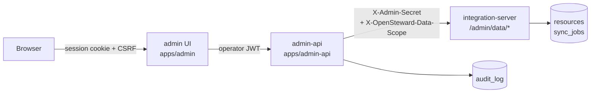
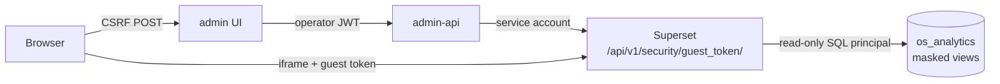

# Data access: the data viewer and native dashboards

> [← back to overview](./README.md)

How operators look at the records OpenSteward has synced: the **data viewer**
(browse, search, export, reveal) and **native dashboards** (charts over those
records). Both work on SQLite and Postgres deployments, and both need
`DATA_STORE_MODE=database` — in passthrough mode nothing is stored, and every
route answers `409 DATA_STORE_DISABLED`.

Who may do what is decided by the [permission model](./permissions-and-roles.md);
how each field is shown is decided by its
[field classification](../security/data-classification.md).

---

## The three hops and what each one trusts



| Hop | Authenticates | Decides |
|---|---|---|
| Browser → admin UI | Signed session cookie; CSRF on every POST | What to *offer*: nav items and buttons follow the permissions from `GET /api/auth/me`. A convenience, never the enforcement. |
| admin UI → admin-api | The operator's JWT | **Permissions** (`data:read`, `data:read_pii`, `data:export`, `dashboards:view`, `dashboards:edit`, `dashboards:share_all`), the **audit** rows, and the **scope** it forwards. |
| admin-api → integration-server | The deployment admin secret (`X-Admin-Secret`, `adminGuard`) | Re-checks every connection's **owner tenant** against the forwarded scope and applies **masking** by classification. |

The browser never talks to admin-api or integration-server. Dashboard charts
fetch the admin UI's own `/dashboards/metric/:id`, which proxies admin-api
with the session.

integration-server is the only service that can read the stored records (on
SQLite, `resources.db` is its file), so it enforces scope and masking itself —
defence in depth: a bug in admin-api's permission checks cannot turn into a
read of another tenant's data or of unmasked PII, because the scope header it
must send cannot claim more than the operator holds, and integration-server
masks whatever arrives without `revealPii`.

## The scope header

admin-api builds the scope from the caller's resolved access
(`buildDataScope` in `apps/admin-api/src/core/routes/data.ts`) and sends it as
JSON in `X-OpenSteward-Data-Scope`:

```json
{
  "tenants": ["acme", "globex"],
  "tenantVerticals": { "acme": ["crm"], "globex": "*" },
  "revealPii": true,
  "maskFinancial": false
}
```

| Field | Source | Effect in integration-server (`src/data-access/scope.ts`) |
|---|---|---|
| `tenants` | `'*'` for an unrestricted user; otherwise the granted tenants | A connection is visible only when its `credentials.owner_tenant_id` is listed. A connection with no owner is visible only to `'*'`. |
| `tenantVerticals` | The verticals granted within each tenant | A connection must also be in a vertical granted for its tenant. |
| `revealPii` | Set **only** on a reveal or a PII export, and only when the caller holds `data:read_pii` | PII is unmasked only when this is true **and** the request says `?reveal=pii`. Also lets PII fields be filtered. |
| `maskFinancial` | Runtime setting `data_access.mask_financial` (default off) | Masks `financial` fields, refuses filters on them, and withholds every metric that reads one (see [Native dashboards](#native-dashboards)). |

Anything outside the scope answers `404`, never `403`, so a scope cannot probe
for ids it may not see. admin-api passes integration-server's `404`,
`409 DATA_STORE_DISABLED` and `400 FIELD_NOT_SEARCHABLE` through with their
codes.

## Masking

Every record passes through `stripRawPayload` (in the store) and then
`applyMasking` with its vertical's classification before it leaves
integration-server:

- `secret` fields are removed for everyone;
- `pii` fields are masked (`j***@example.com`, `[REDACTED]`, …) unless revealed;
- `financial` fields are masked only when `data_access.mask_financial` is on;
- `metadata` / `raw` (the upstream payload) count as PII unless classified.

Filters and free-text search are limited to fields the caller could see
unmasked: a filter on a masked field would answer the question the mask
refuses. A resource type with no classification is treated as all-PII.

admin-api sends records as a pre-serialised body so that its response-wide
timestamp rewrite never alters a value inside a stored record.

## The data viewer

| Admin UI | admin-api | integration-server |
|---|---|---|
| `/data` | `GET /api/data/summary` | `GET /admin/data/summary` |
| `/data/connections/:id` | `GET /api/data/schema/:vertical/:type`, `GET /api/data/connections/:id/resources/:type` | `/admin/data/schema/…`, `/admin/data/connections/:id/resources/:type` (keyset `page()`) |
| record view | `GET …/resources/:type/:rid` | `…/:rid` |
| Reveal | `POST …/resources/:type/:rid/reveal` `{reason?}` | `…/:rid?reveal=pii` with `revealPii: true` |
| Export | `GET …/resources/:type/export?format=csv\|ndjson&include_pii=` | `…/export` (streamed, ≤ 100,000 rows) |

- The table is **cursor-paginated** (keyset on `(updated_at, pk)`); the page
  carries a `trail` of earlier cursors so Previous needs no server state.
- Columns come from the schema's top-level fields (a column picker overrides
  the default six); filter boxes are offered only for searchable fields.
- The record view draws a JSON tree (`public/js/json-view.js`) with PII /
  financial badges, and a field-classification table.
- **Reveal** is a CSRF-protected POST that renders the unmasked record with
  `Cache-Control: no-store`. It is never a GET, so it cannot be prefetched,
  bookmarked or replayed from history.
- **Export** streams admin-api's response through the admin UI without
  buffering. `include_pii` needs `data:read_pii` at both the UI and admin-api.

## Native dashboards

A dashboard is a list of widgets, each naming a **metric** from
integration-server's catalog (`src/data-access/metrics/catalog/`) plus a
chart type and a width. A dashboard stores no query text: what it can show is
bounded by the catalog.

### The metric catalog

A metric is a reviewed definition in `catalog/<vertical>.ts` (one file per
vertical, plus `system.ts`; `catalog/index.ts` only concatenates). Types live
in `metrics/types.ts`; the shared vocabulary — the 22 chart types, units,
sections, granularities and kinds — in `@opensteward/shared`
(`src/dashboards/charts.ts`), so admin-api validates widgets against the same
lists.

Every definition names a `vertical`, a `resourceType`, a `section` (where it
sits in the editor: `receivables`, `risk`, `workload`, …) and a `kind`, plus:

| Field | Meaning |
|---|---|
| `dateField` | The range anchor. Required unless `snapshot`. |
| `snapshot` | Ignore the dashboard range; evaluate as of now (open AR, open tickets). The result's range is today. |
| `filters` | Row predicates: `eq ne in not_in in_ci is_null not_null gt gte lt lte` and the now-relative `before_now after_now older_than_days within_last_days within_next_days`. `ne` / `not_in` keep records without the field. |
| `compare` | Row-level `left op right` over two fields of one record — numbers as numbers, dates by day (`paidAt <= dueAt`). |
| `currencyField` | For a count whose records carry a currency: makes the `currency` parameter apply. Must be a currency-code field (see Guards). |
| `granularity` | Default bucket of a series over time (`day` / `week` / `month`), used for `auto` or no parameter; an explicit request still wins. |
| `coverage` | Fields whose presence is reported as `coverage: { eligible, total }`. |
| `thresholds` | `{ warn, crit, direction }` for number / gauge colouring. |
| `charts` | Overrides the default chart list; the first entry is the default. |
| `note` | A caveat shown under the widget. |

A **measure** is `count`, `sum` (money: needs its `currencyField`), `avg`
(money when it has a `currencyField`) or `sum_quantity` (units). Amounts are
integer minor units unless `amountUnit: 'major'` (CRM). A **group** is a
field with optional `labels`, a fixed `order` (zero-filled; unknown values
after), numeric `bands`, `unnest` (count each element of a string array) and
`lookup` (below). A ratio **part**, composition **component** or DSO/DPO
**input** may read another resource type of the vertical, and may name its
own `currencyField` (for a count part; a money measure carries one).

**`in_ci` differs by dialect for non-ASCII text.** It compares `LOWER()` of
the field with lower-cased values: SQLite's `LOWER()` folds ASCII only
(`'ÉTÉ'` → `'ÉtÉ'`), Postgres folds per the database's collation (Unicode in
the usual UTF-8 locales: `'ÉTÉ'` → `'été'`). So `'ÉTÉ'` matches `'été'` on
Postgres but not on SQLite. Keep `in_ci` values to ASCII vocabularies, as
CRM's `won` / `closed won` lists are.

### Kinds

| Kind | Computes | How |
|---|---|---|
| `value` | One number (count, avg, quantity) or one total per currency | SQL |
| `timeseries` | A series per day / ISO week / month, zero-filled; optional `splitBy` (top 8 + Other) | SQL |
| `breakdown` | Top-N groups (default 12) + Other, with share % | SQL |
| `ratio` | `numerator ÷ denominator` as a percent (0–100), optionally over time; parts may read another resource type | SQL per part |
| `duration` | `to − from` in days or hours (`to` may be `now`): mean, p25/p50/p75/p90, min/max, a histogram and per-group stats (boxplot) | `fetchValues` + TypeScript |
| `aging` | Records by whole days since (`past`) or until (`future`) a date: `Current`, `1–30`, … | SQL (day bands against today) |
| `concentration` | Top-k shares, HHI (0–10 000), effective N (1/Σs²), a ranked table with cumulative share | SQL groups + TypeScript |
| `matrix` | A heatmap of `weekday` / `hour` (UTC) / `month` / a group × another. Counts and sums fill every cell (zeros included); an average omits cells with no values | SQL |
| `histogram` | Records by value band; money bands are major units per currency | SQL, one query per currency |
| `composition` | Signed components and a net (waterfall), per currency | SQL per component |
| `dso` / `dpo` | Open balance ÷ sales in the trailing `windowDays` × `windowDays`, per currency | SQL per part |
| `ccc` | Cash conversion cycle without inventory: DSO − DPO per currency over one window; null for a currency with only one side | SQL per part |
| `table` | System metrics only | — |

Each kind has default charts (`definition.ts` `defaultCharts`): `value` →
number, table (a money value also bar: one per currency); `timeseries` → line,
area, bar, calendar (counts), table, number, and stacked bar / area only with
a `splitBy`; `breakdown` → bar, hbar, donut, pie, rose, treemap, pareto,
funnel (with an `order`), radar (≤ 8 groups), table, number; `ratio` → gauge,
number, line (over time), table; `duration` → number, histogram, boxplot
(with a group), table; `aging` → bar, hbar, donut, table; `concentration` →
gauge, pareto, treemap, hbar, donut, table, number; `matrix` → heatmap,
table; `histogram` → histogram, table; `composition` → waterfall, table;
`dso` / `dpo` / `ccc` → number, gauge, table. Every chart a v1 widget of a
migrated metric could store is still offered (a test pins the pairs).

**The store side.** Kinds compile to `ResourceStore` primitives,
parameterised SQL on SQLite and Postgres alike: `aggregateV2` (filters,
comparisons, up to three grouping keys — field, unnested array element,
day / week / month / UTC weekday / UTC hour bucket, numeric band, age band —
with count, sum and average), `fetchValues` (raw values for durations and
percentiles, capped at 50 000 rows; above it a deterministic every-k-th pk
sample chosen before any value is extracted, and a `note` saying so),
`lookupLabels` and `distinctValues`. Paths are validated dotted paths bound
as parameters. Day, week and month buckets use the stored text's own date (as
the range filter does); weekday and hour are converted to UTC, and a duration
reads an offset-less datetime as UTC too, whatever the host zone.

**Impossible dates are NULL, never an error.** Postgres casts ISO text only
after a regex admits it: a real calendar day in years 0001–9999 and an offset
of at most ±14:00. SQLite reaches the same verdict with a `date()` round trip
and a measured offset. So year 0000, `2026-02-30` or `+23:59` yield a NULL
weekday / hour / week on both dialects instead of failing the whole metric.

Shaping a result is linear in the rows the store returns (60 000 groups take
tens of milliseconds), and only the groups a result shows — top-N plus
"Other" — are sent for label lookup.

### Currencies

There is no FX data, so money is **never** summed, stacked, compared,
charted on a shared axis or turned into a share across currencies. Shares,
ratios, HHI and DSO are computed within one currency.

- Every money series, total, KPI and table row carries its `currency`. A
  record with none is grouped as `currency: null` ("Unknown currency") and
  never merges with a real code. A record with no amount adds no group.
- Codes are normalised as they leave the engine (`normaliseCurrency` in
  `kinds.ts`): a stored value that trims and upper-cases to three letters is
  that code (`usd`, ` Usd ` → `USD`, one group), and anything else — a
  spelled-out name, markup — is the unknown currency. The `?currency=` match,
  the SQL-level filters (duration values, histogram bands, coverage) and
  `/currencies` all use the normalised code, so a raw stored string never
  reaches the dashboard, which puts codes into HTML. admin-api and the admin
  UI filter their currency lists to ISO codes again at each hop.
- `currencies` in each result lists every code present in scope and range
  **before** the currency filter.
- `?currency=EUR` keeps only that currency for money kinds; a count with a
  `currencyField` counts only records in it — and so does every part or
  component that names one, whatever resource type it reads; other metrics
  ignore it (`currency: null` in the result).
- A multi-currency result has no single headline: `value` is null and each
  currency's number is a KPI; a money `matrix` needs one currency and says so
  in `note` otherwise.

### Parameters and results

`GET /admin/data/metrics/:id` takes `from` / `to` (days, inclusive; default
the last 30, at most 366), `currency` (three upper-case letters, else `400
INVALID_QUERY`), `granularity` (`auto | day | week | month`; `auto` is the definition's
default if it has one, else day up to 62 days, week up to 182, month beyond)
and `compare=1` (adds `previous`: the same metric over the prior equal-length
range, for value, timeseries, breakdown, ratio and duration kinds that are
not snapshots).

Two more parameters narrow the connections a metric reads, for a
dashboard's connection and adapter filter: `connection` (one connection id,
`^[A-Za-z0-9_-]{1,100}$`) and `platform` (an adapter slug,
`^[a-z0-9][a-z0-9-]{0,63}$`); anything else is `400 INVALID_QUERY`, a repeated
parameter included. Both only **narrow**: they filter the list
`connectionsInScope` already returned for the scope, so together they mean
AND, and a connection outside the scope (another tenant's, or one that does
not exist) contributes nothing — the result is empty, never a `404` that would
confirm the id exists. They apply wherever the engine takes its connection
list: the metric's own records, every ratio part, composition component and
DSO/DPO input, lookup labels (read from the narrowed connections only), the
`currencies` in the result, and system metrics too, which are per connection
(a filtered sync metric reads jobs per connection, as a restricted scope
does, rather than in one unrestricted pass). A third, `vertical`
(`^[a-z][a-z-]{1,40}$`), keeps a `connection` or `platform` filter inside one
vertical's connections: one slug can be an adapter in several verticals
(bexio, bitrix24, dolibarr, …), and system metrics and the currency list read
every vertical, so the dashboards always send it with a filter. Alone it
filters nothing. All three are part of the cache key. The result then carries
`filter: { connection, platform, vertical }`; with neither `connection` nor
`platform` set it has no `filter`.

The result carries `metric` (the catalog entry: `unit`, `section`, `charts`,
`money`, `currencyAware`, `snapshot`, `granular`, `comparable`,
`defaultGranularity`), `range`,
`granularity`, `currency`, `currencies`, `value`, `series`, and as the kind
calls for them `totals`, `kpis`, `table`, `matrix`, `stats`, `previous`,
`coverage`, `thresholds` and `note`.

`GET /admin/data/currencies` returns `{ data: string[] }`: the distinct
currencies across every in-scope money or currency field the catalog reads,
sorted, without null — one `UNION ALL` + `DISTINCT` query over all of them.
Same scope rules, and the same `connection` / `platform` narrowing; cached
60 s per scope and filter.

### Guards

- **No PII.** `validate.ts` checks at boot (and a unit test in CI) every field
  a definition references — date field, filters, comparisons, currency fields,
  coverage, measures, groups, split and matrix axes, `from` / `to`, aging and
  histogram fields, every ratio part, composition component and DSO input on
  the resource type it reads, and each lookup label on the lookup's type. Each
  must exist on the schema and be neither `pii` nor `secret` by
  `effectiveFieldClass`. It also rejects what the engine could not answer
  honestly: a money sum without a currency field, `unnest` with a sum, stacked
  charts without a `splitBy`, unsorted buckets, a ratio of money over counts,
  a `granularity` on a kind with no time axis.
- **Currency rules (design §2), in the validator.** Money is only aggregated
  where its currency comes with it:
  - every `currencyField` (metric, measure, histogram, part, component) must
    be a currency-code field — its Zod type descends from `Iso4217Currency`,
    or it is a string whose name ends in `currency` / `currencyCode`
    (`metrics/fields.ts`);
  - `avg` of a `financial` field needs a `currencyField`;
  - `sum_quantity` of a `financial` field is refused (use `sum` with its
    `currencyField`);
  - a histogram of a `financial` field needs a `currencyField`;
  - a group, split or matrix axis over a `financial` field (bands or raw
    values) is refused, unless the field is itself a currency code;
  - in a currency-aware metric, a count (non-money) part or component on
    another resource type must name its own `currencyField`, so the
    `currency` filter reaches it.
- **Scope.** A metric aggregates only the connections `connectionsInScope`
  returns for the caller, and exists only when every resource type it reads is
  in scope. A `lookup` label (`tags.name` for `tagIds`) is read in one batched
  query from the caller's own in-scope connections; an id without one falls
  back to the id, so another tenant's label can never appear. A
  `connection` / `platform` filter narrows that list and never widens it.
- **Financial masking.** With `data_access.mask_financial` on, a metric that
  reads any `financial` field — a measure, filter, comparison, group,
  histogram field, part or component — returns `masked: true` with no value,
  series, totals, KPIs, stats, table, coverage or `previous` (also under
  `compare=1`). A verified currency-code field in a `currencyField` slot is
  exempt — a count keyed by `totalPrice.currency` stays visible — but an
  amount named there is masked like any amount (and refused by the validator).
- **Caching.** Results are cached for 60 s per (metric, scope, connection
  and adapter filter, range, currency, granularity, compare, today);
  operators with different scopes never share an entry, and now-relative
  filters move with the day.

**System metrics:** stored records per vertical, sync job outcomes over time
(`sync_jobs`, any granularity), and data freshness per connection.

**Adding a metric:** add an entry to its vertical's `catalog/<vertical>.ts`,
run `pnpm --filter integration-server test -- metrics`, and pin its numbers
in `tests/data-access/metrics.test.ts`. `createMetricsEngine({
resourceMetrics })` runs a definition that is not in the catalog yet (it is
validated the same way); `valuesCap` lowers the raw-value cap to exercise
sampling. A Postgres run of the data-access suite needs
`--no-file-parallelism`: each file drops `public` per test.

### Follow-ups

Out of scope for the engine today, and the metrics they would unlock:

- **FX rates / a base currency** — any cross-currency total or share.
- **Schema or sync gaps:** a payments `Payment` resource; CRM a normalised
  `outcome`, `closed_at`, `lost_reason`, stage history and owner names;
  support `firstResponseAt`, SLA fields, message sync and a reopen count;
  logistics `shippedAt`, a non-PII `destinationCountry` and exception codes;
  inventory a demand / movement ledger (DIO, turnover, dead stock) and a stock
  snapshot store; projects `tasks` with `completedAt`; docsign `signers` and
  audit-trail sync; ecommerce `lineItems` product metrics, a channel field and
  abandoned checkouts.
- **Engine:** joins across resources beyond lookup labels (MRR, inventory
  value, time to ship), daily snapshots (history of balances and stock), and a
  permission-gated PII label resolver for customer names in top-N tables.
- **Webhook metrics** — the delivery store is not wired to the engine.
- **Cost of the connection filter.** `GET /api/dashboards/connections` lists
  every connection from integration-server on each call and filters in
  memory, and a filtered system sync metric reads jobs one connection at a
  time (up to 500 passes). Both are fine at today's connection counts; a
  scoped, paged connection query in the credential store and a
  `connectionIds` filter on the sync-job read would remove them.

### Dashboards and rendering

**Built-in dashboards** live in code (`apps/admin-api/src/core/dashboards/builtin/`):
22 dashboards, in display order:
System health; Accounting, Receivables and payables, Accounting risk; Payments,
Subscriptions and billing, Payments risk; Ecommerce, Ecommerce operations,
Ecommerce risk; CRM, CRM risk; Support, Support risk; Logistics, Logistics risk;
Inventory, Inventory risk; Projects, Projects risk; Document signing, Document
signing risk (ids `builtin:overview`, `builtin:accounting`,
`builtin:accounting-ar-ap`, … `builtin:docsign-risk`). Each risk dashboard opens
with a strip of number and gauge tiles for its headline risks (concentration,
overdue exposure, DSO and DPO, dispute rate, stuck items) and follows with the
supporting charts. `/dashboards` groups the cards by vertical.
**User dashboards** are
rows in `admin_store` v4's `dashboards` table; only the owner or an admin may
edit or delete one.

**Widgets.** A widget is a metric id, a chart, a width (1–12 of a 12-column
grid), an optional title, and three options:

| Option | Values | Applies to |
|---|---|---|
| `currency` | an ISO 4217 code; absent or null follows the view's currency filter | metrics marked `currencyAware` (money, or a count with a `currencyField`) |
| `granularity` | `auto` (or absent), `day`, `week`, `month` | metrics marked `granular` (a series over time) |
| `compare` | boolean | metrics marked `comparable`: number and gauge show the change against the prior equal-length period; other charts name it under the chart |

`layout_json` is free-form, so the options needed no migration, and
`normaliseWidgets` keeps them (a null currency is stored as absent: both mean
"follow the filter"). The UI never sends `auto` to the engine, so a metric's
own default granularity applies; an explicit one wins.

**Chart validation.** The chart vocabulary is `CHART_TYPES` in
`@opensteward/shared` (`dashboards/charts.ts`); admin-api's `DASHBOARD_CHARTS`
is that list, so admin-api and the engine cannot disagree on what a chart is.
Create and edit refuse a layout (`400`) with more than 24 widgets, a metric
outside the caller's catalog (`Unknown metric: …`), or a chart that is not one
of its metric's `charts` (`Chart <chart> does not fit <metric>`), checked
against the caller's own catalog. A stored widget whose chart its metric no
longer lists (the catalog changed after it was saved) is drawn with the
metric's default chart, and the editor resets it to that default, so a save
never fails on a legacy widget.

**The 22 chart types**, and what each reads from a result:

| Chart | Reads | Fits |
|---|---|---|
| `number` | the headline (`value`, or the one currency's total), `previous`, `thresholds`, secondary `kpis` | value, timeseries, breakdown, dso / dpo |
| `gauge` | the headline on a dial with threshold bands | ratio, concentration, dso / dpo |
| `table` | `table`, else the series by bucket | every kind |
| `line`, `area`, `bar` | series over buckets | timeseries, ratio over time |
| `stacked_area`, `stacked_bar` | `splitBy` series, stacked within one currency | timeseries with a `splitBy` |
| `hbar` | one series of categories | breakdown, aging, concentration |
| `combo` | bars and lines per each series' `kind`, one axis | series sharing a unit |
| `pareto` | each group's share (bars) and the cumulative share (line) on one 0–100 % axis; a concentration's table supplies both | breakdown, concentration |
| `pie`, `donut`, `rose` | one series of parts; past six, the rest fold into Other | breakdown, aging |
| `treemap` | one series of parts, in one hue | breakdown, concentration |
| `funnel` | ordered stages, on the sequential ramp | breakdown whose group has an `order` |
| `radar` | one series over at most 8 groups, one scale | breakdown |
| `histogram` | the band series | histogram, duration |
| `boxplot` | `stats`: `All` first, then one box per group | duration with a `group` |
| `waterfall` | a composition series: components float on the running total, `Net` (last) stands on zero | composition |
| `heatmap` | `matrix` cells on the sequential ramp | matrix |
| `calendar` | a day series as a calendar grid (the widget always asks for `day`) | count timeseries |

**Currencies in the UI.** The view page has a currency select beside the
range: "All currencies (each separately)" plus the codes from `GET
/api/dashboards/currencies?dashboard=<id>` (which proxies
`/admin/data/currencies` with the caller's scope narrowed to the dashboard's
pins). It is the GET parameter `currency`, carried by the range presets. An
unknown code falls back to every currency; when the list cannot be loaded the
page says so and keeps a well-formed code rather than silently widening the
view. Each widget's request carries, in order of precedence, its own pinned
currency, else the view's filter, else none. The edit form offers, per
widget, only the options its metric takes (a currency select "Follow
dashboard filter" / "Only EUR", a granularity select, a compare checkbox) and
groups the metric picker by vertical, then section ("Accounting ·
Receivables").

**Small multiples.** With no currency chosen, a money result may hold several
currencies. `dashboard.js` then splits it (`splitByCurrency`) into one part
per currency, with its own series, totals, KPIs, table rows and prior totals,
and its own headline (the ratio, days outstanding, top-1 share or banded
records of that currency). Each part is drawn as a mini chart, number tile or
table section titled with its code, alphabetically, with "Unknown currency"
last. Every part has its own axis: nothing is stacked, shared, summed or
turned into a share across currencies, and a pie, donut, treemap or funnel of
money over several currencies becomes one per currency. A money heatmap is
the one result the engine will not split (one currency per matrix), so the
renderer fetches it once per currency. At most eight parts are drawn; the
footnote names the rest. Counts are not split: a count with a `currencyField`
adds up across currencies, and the filter narrows it.

**Audiences.** A user dashboard is `private` (only the owner), shared with
`tenants` (anyone whose access includes **any** listed tenant; an unrestricted
scope matches every list) or shared with `everyone` (every `dashboards:view`
holder; setting it needs `dashboards:share_all`). The owner always sees their
own, and an admin with access to every tenant sees all. The rule lives in one
module, `core/dashboards/audience.ts`. A caller outside the audience gets
`404`, never `403`, on list, get, edit and metric reads. A restricted editor
may share with, and pin, only tenants in their own access. Tenant ids outside
a non-editor's access are removed from the `audience` and `pinnedTenants` the
API returns. Migration v6 turns an existing `shared` dashboard into
`everyone` when its owner is unrestricted, and into the owner's tenants when
the owner is restricted (none: `private`), so an upgrade never widens who sees
one. A change to the audience or pins is audited as `dashboard.share`.

**Connection and adapter filter.** A dashboard about one vertical — a
built-in, which carries its `vertical`, or a user dashboard whose non-system
widgets' metrics all share one — has a filter bar under the range and
currency row, for viewers who hold `connections:read` as well as
`dashboards:view`; elsewhere (the system overview, a mixed dashboard) and
without that permission the bar is absent and `connection` / `platform` in
the URL are ignored.

| Layer | What it does |
|---|---|
| admin-api `GET /api/dashboards/connections` | `?vertical&platform&search&dashboard&limit`, guarded by **both** `dashboards:view` and `connections:read`. Lists the caller's in-scope connections (`tenantAllowed`, intersected with a stored dashboard's pins via `narrowAccessScope`; `404` for a dashboard the caller cannot see) as `{ connections: [{ id, label, platform, vertical }], platforms: [{ slug, name, count }], total }`. Scope is applied before any filter or count. `search` is a case-insensitive substring of the id or label (an exact id sorts first); `limit` defaults to 50, at most 200; `platforms` counts the vertical's visible connections per adapter, ignoring `search` and `platform`, named from the platform catalog (cached 10 min; the slug when it is unavailable). Never a tenant id, status or credential. |
| admin-api metric and currency routes | Take `connection`, `platform` and `vertical` with the engine's patterns and forward them only when set; the `dashboard` pins narrow the scope header first, the engine narrows further. The routes guard `dashboards:view`, and a request carrying `connection` or `platform` also needs `connections:read` (`403` otherwise), so the filter is never reachable with `dashboards:view` alone. |
| Admin UI `/dashboards/:id` | An **Adapter** select ("All adapters" plus each adapter with its count) and a **Connection** text box with a `<datalist>` of up to 200 connections, each option's value the id and its text `label · adapter · id`, so typing a label or an id fragment narrows the browser's own suggestions with no script. |

**Resolving what was typed** (server side, on submit): an exact in-scope id
applies; anything else is a search over ids and labels (within the chosen
adapter) — exactly one match applies that connection, several render a short
**Did you mean** list of links that set `connection=<id>`, and none renders a
message and applies nothing. Only the resolved id is carried onward: in the
range presets, the range and currency form (hidden fields), the filter form
(which carries the range and currency back), each widget's
`data-connection` / `data-platform` / `data-vertical` (the dashboard's
vertical, sent with any applied filter), `dashboard.js`'s metric URL and the
same-origin `/dashboards/metric/:id` route, which drops all three for a user
without `connections:read`. A chip shows the applied
connection as label · adapter with a link that clears it, and the currency
select lists the filtered connections' currencies. An adapter the list does
not offer falls back to every adapter; when admin-api cannot list
connections at all, a well-formed adapter and id are kept as given (no data
rather than silently every connection's) and the page says so.

**System widgets are filtered too.** The engine narrows system metrics by
the same connection list, so on a vertical dashboard that holds system
widgets the filter applies to every widget, and the bar says "Applies to
every chart on this dashboard, system charts included."

When more connections match than the 200 listed, `dashboard.js` refreshes
the datalist as the user types (debounced, from the same-origin
`GET /dashboards/:id/connections`, which needs `connections:read` and works
out the vertical from the dashboard as the view does, ignoring one in the
query; `404` for a dashboard with no single vertical); without script the
first 200 and the server-side search still work.

**Pinning.** A dashboard may be pinned to tenants. The page passes
`?dashboard=<id>` to `/api/dashboards/metrics/:id`, and admin-api narrows the
`X-OpenSteward-Data-Scope` header to the viewer's scope ∩ the pins (for an
unrestricted viewer, exactly the pins, which also drops connections with no
owner tenant). Pins only narrow: they are a presentation choice, not a
security boundary, because the viewer's own scope stays the limit. A pinned
dashboard is hidden from a restricted viewer who holds none of its pins.

**Rendering.** `public/js/dashboard.js` (plain ES5, same origin, under the
strict CSP) draws with ECharts, vendored at `/vendor/echarts.min.js`, in the
design system's colours. Series take `--chart-1…6` in fixed order (a
categorical order validated for colour-vision deficiency, with separate
dark-theme steps; a count's seventh series folds into Other). Magnitudes
(heatmap, calendar, funnel) take the one-hue sequential ramp
`--chart-seq-1…5`, whose dark steps flip so the least sits nearest the
surface. Threshold levels take the status tokens, always with a label. There
is never a second value axis. `coverage` ("based on N of M records") and
`note` render as a muted footnote, and a masked result says its values are
withheld. Charts resize with their container (`ResizeObserver`) and redraw
when the theme changes. Tooltip labels are HTML-escaped, because group labels
are synced third-party data. The pure helpers (the currency split, headlines,
pareto, waterfall and calendar data, the fetch URL) are pinned without a DOM
in `apps/admin/tests/unit/dashboard-charts.test.ts`.

## Embedded Superset (optional, Postgres only)

Deployments on the Postgres backend can add [Apache Superset](https://superset.apache.org/)
for dashboards the native catalog cannot express. Setup and the full security
model are in [deployment/superset.md](../deployment/superset.md); this is how it
fits the hops above.



- **No Superset login for operators.** The page `/dashboards/superset/:id`
  frames Superset's `/embedded/<uuid>` through the vendored
  `@superset-ui/embedded-sdk`. The SDK asks the admin UI for a guest token
  (`POST /dashboards/superset/:id/guest-token`, CSRF-protected), which proxies
  admin-api's `POST /api/analytics/superset/guest-token` with the session.
- **Scope travels as row-level security.** admin-api builds the token's RLS
  clause from the operator's scope, narrowed to the dashboard's pinned tenants
  when it has any (`core/analytics/superset-rls.ts`, `core/dashboards/audience.ts`):
  none for an unrestricted operator on an unpinned dashboard; `owner_tenant_id IN (…)` plus
  `(owner_tenant_id = … AND vertical IN (…))` for tenants granted only some
  verticals; no token at all (`403` `SCOPE_EMPTY`) for an empty scope. Tenant
  ids and verticals are validated against strict patterns and quoted; a value
  that cannot be expressed safely is dropped, which only narrows the result.
- **Only masked data.** Superset connects as a read-only SQL principal onto
  the `os_analytics` views, so personal data is masked there exactly as in
  [SQL access](../integrate/sql-access.md), and Postgres enforces the principal's
  own scope underneath. Every dataset has `owner_tenant_id` and `vertical`, the
  columns the RLS clause filters.
- **Guests cannot write SQL.** The guest role (`OpenStewardGuest`) holds no SQL
  Lab or dataset permission; guests reach data only through the charts on the
  dashboard their token names.
- **Tokens are short.** Guest tokens last 5 minutes and are minted per page
  view; the SDK refreshes them. Each mint is audited as `superset.guest_token`,
  at most once per user and dashboard every 10 minutes.

The registry of embeddable dashboards (`superset_dashboards`, admin_store v5)
is written by the idempotent superset-bootstrap job through
`PUT /api/internal/superset/dashboards` (service secret). It registers every
Superset dashboard whose slug starts with `opensteward-`; `opensteward-<vertical>-…`
lists it only for operators whose scope reaches that vertical.

Each registry entry also carries an **audience** (`tenants` or `everyone`, the
default) and optional **pinned tenants**, chosen in the admin UI by a
`dashboards:share_all` holder and never written by the bootstrap job, so a
re-sync keeps them. The same rule as native dashboards filters the list and
the guest-token route (`404` outside the audience). Superset *authors*, who
sign in to Superset directly, still see every tenant's masked data; that is
unchanged.

## Content-Security-Policy

The data and dashboard pages are served with a strict per-route policy
(`apps/admin/src/core/csp.ts`):

```
default-src 'self'; script-src 'self'; style-src 'self' 'unsafe-inline';
img-src 'self' data:; frame-ancestors 'none'; font-src 'self' data:
```

No inline script and no inline event handler runs on these pages. The layout's
shell behaviour (theme, sidebar, toasts, copy, version footer, `data-confirm`)
lives in `public/js/theme-init.js` and `public/js/shell.js` for that reason.
When Company info configures an external font stylesheet, its origin is added
to `style-src` and `https:` to `font-src`.
The embedded Superset page adds `frame-src <Superset origin>` (the origin of
`SUPERSET_PUBLIC_URL`, validated as http(s)); no other page frames anything.
Superset's own CSP allows only the admin UI origin in `frame-ancestors`.

## Audit

| Action | Written by | Detail |
|---|---|---|
| `data.pii_reveal` | admin-api, **before** the unmasked record is returned (a failed write fails the request) | `{connectionId, resourceType, resourceId, reason}`; `vertical` and `target_id` columns set |
| `data.export` | admin-api, once the upstream export has started | `{connectionId, resourceType, format, includePii}` |
| `dashboard.create` / `.update` / `.delete` | admin-api | `{name}` |
| `dashboard.share` | admin-api, when a dashboard's audience or pinned tenants change (also on create) | `{name, from, to, pinnedFrom, pinnedTo}`, audiences as `{kind, tenants?}` |
| `superset.guest_token` | admin-api, after Superset issued the token; at most once per user and dashboard every 10 minutes | `{title, restricted}`; `target_id` is the registry id |
| `superset.share` | admin-api, when a Superset dashboard's audience or pinned tenants change | `{title, from, to, pinnedFrom, pinnedTo}` |
| `superset.registry_sync` | admin-api, as `system`, when the bootstrap job registers dashboards | `{created, updated, removed}` |

## See also

- [permissions-and-roles.md](./permissions-and-roles.md) — what each permission unlocks
- [../security/data-classification.md](../security/data-classification.md) — classes and masks
- [persistence.md](./persistence.md) — the `resources` table, `changed_at`, tombstones
- [admin-page-map.md](./admin-page-map.md) — every admin route
- [../deployment/superset.md](../deployment/superset.md) — embedded Superset setup and security model
