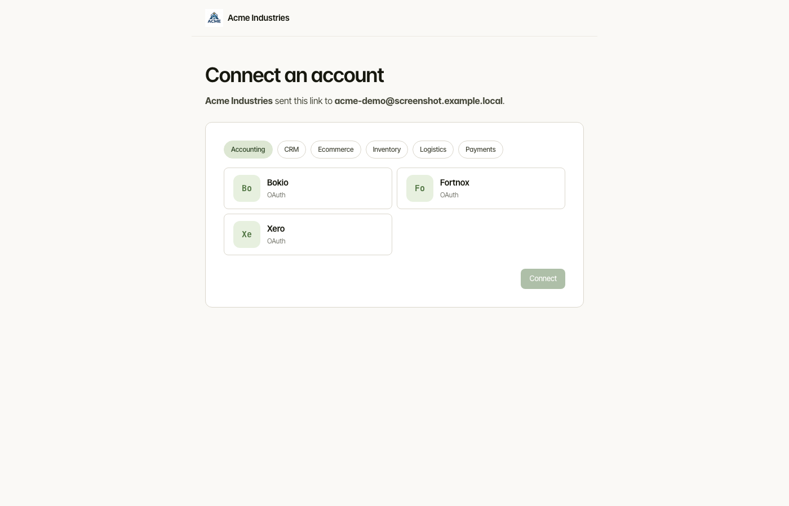
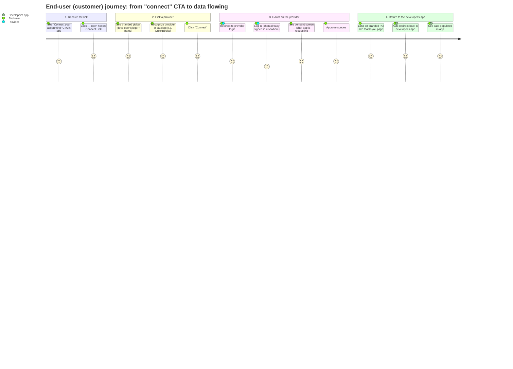
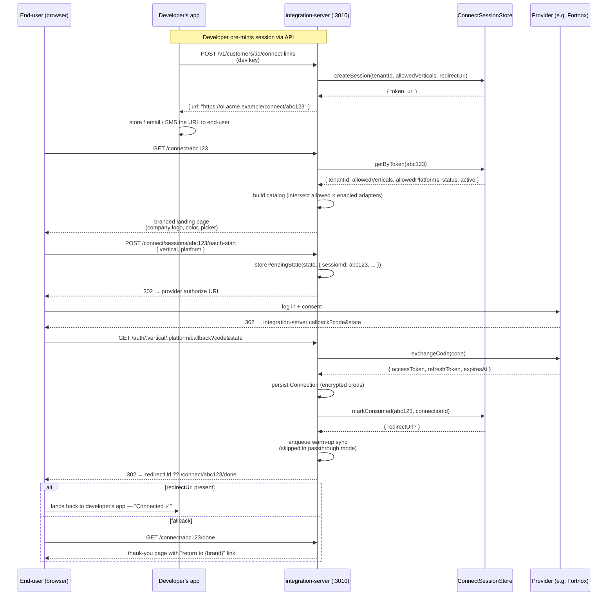
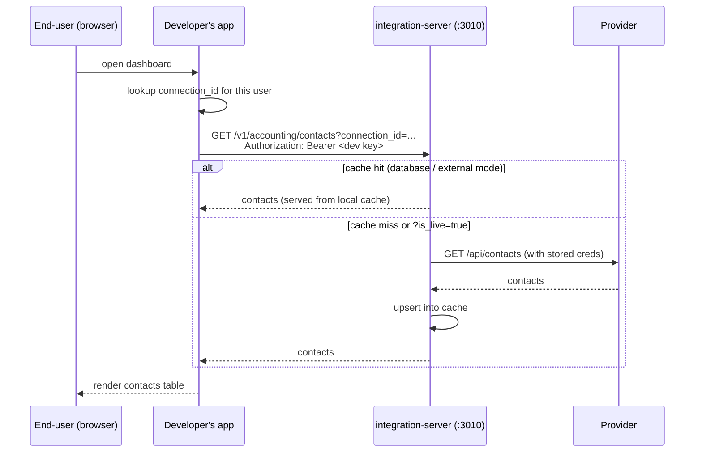

# End-user journey

> [← back to overview](./README.md)

What an **end-user** experiences. In OpenSteward's model, the end-user is a *customer of the developer's app* — a person whose data in one of the nine verticals (accounting, CRM, ecommerce, logistics, payments, docsign, projects, customer-support, inventory) the developer wants to read or write on their behalf.

The end-user is **not** the developer, **not** the operator who runs the integration-server, and **not** an admin. They never see the admin UI, never see API keys, and rarely see an OpenSteward URL at all.

There are two flows depending on how the developer integrated OpenSteward:

1. **Hosted Connect Link** — the developer mints a one-time link and sends it to the end-user (in-app, by email, etc.). The end-user clicks it, lands on a branded `/connect/:token` page, picks a provider, runs the OAuth dance, and is returned to the developer's app. This is the default flow and the one most end-users will see.
2. **Headless / API-mediated** — the developer already holds a `connection_id` for that customer (e.g. authorized once during onboarding) and reads/writes via `/v1/*` directly. The end-user never sees an OpenSteward page; they only see the developer's app surfacing data that came through the integration-server.

---

## Flow A — Hosted Connect Link (default)

The customer lands on the host-branded picker shown below (here with the empty-state copy that surfaces when no platforms are configured yet):

### Chart 11a — End-user UX journey

The two dips at **3/5** are inherent to OAuth: the end-user has to remember credentials for the provider (not us), and consent screens are written by the provider (not us). Everything inside the OpenSteward boundary scores 4–5.

### Chart 11b — Connect Link sequence (what actually happens)

What the end-user actually sees:
- Landing page at `/connect/:token` — picker styled with the operator's company logo / primary colour from `/company-info`
- Provider's own OAuth screens (OpenSteward has no control over these)
- Either an auto-redirect back to the developer's app, or a thank-you page with a button to return

### Variant: self-register links (admin doesn't know the customer yet)

When the admin mints in **self-register** mode (no customer email at
mint time, `allow_self_register = 1`), the end-user lands on the same
`/connect/:token` page but sees an email-capture form *before* the
picker. On submit the page POSTs `/connect/:token/customer` with
`{ email, displayName? }`; integration-server upserts an end-user row
(`EndUserStore.upsertByEmail`) and atomically attaches it to the
session (`ConnectSessionStore.attachEndUser`). The page reloads into
the normal picker view.

The attach is idempotent — a second tab racing the same POST gets
`409 ALREADY_REGISTERED` instead of overwriting the binding. From the
customer's perspective: enter email, the picker appears, OAuth
proceeds as in the main flow above. Re-opening the same URL after
binding skips the email form.

The other two modes — **pinned** (admin set the customer + adapter
upfront) and **customer-picks-adapter** (admin set the customer but
left the platform open) — produce the same UX as the chart above.
Mode is a server-side combination of `end_user_id` /
`allowed_platforms` / `allow_self_register`; the customer never sees
the mode label.

What the end-user **never** sees:
- Tokens, refresh tokens, scopes, encrypted credentials
- Adapter slugs (they see "QuickBooks" not `quickbooks-online`)
- Anything resembling admin UI, API keys, dashboards

### Friction points specific to the end-user

| Step | Score | What can dip it | What we control |
|---|---|---|---|
| Provider login | 3 | End-user forgot their provider password / can't find their account | Nothing — provider's auth is out of scope |
| Consent screen wording | 4 | "Why does this app want access to my invoices?" | Operator pre-fills *App name* + *privacy URL* in step 2 of the wizard, which lands on the consent screen |
| Provider scope list | 4 | Some providers list 20+ scopes verbosely | A read-only link asks only for that platform's curated `readScopes` rather than everything the OAuth app could ask for. Links from the developer API are read-only by default; links minted in the admin console default to the platform's configured scopes, so pick **Read-only** there for the shorter list. How the provider renders them is theirs |
| Branded landing page | 5 | Looks unfamiliar / off-brand | Operator's logo + colour appear; if they're missing, end-user sees the OpenSteward default and may bounce |

The single biggest UX investment the operator makes for end-users is **filling in step 2 of the setup wizard** (display name, logo, primary colour, privacy URL). That data flows directly into the landing page, the OAuth consent screen branding, and the thank-you page.

---

## Flow B — Headless / API-mediated

Sometimes the end-user never visits an OpenSteward URL. The developer's app already holds a `connection_id` for that customer (often created once at onboarding and stored in the developer's own DB) and uses it to call `/v1/*` directly.

In this flow the end-user only ever sees the developer's app UI. From their perspective, "the integration just works" — there is no separate provider login, no Connect Link, no consent screen. The connection was authorized once (via Flow A above) and is reused indefinitely until tokens revoke or the operator deletes the connection.

---

## When does an end-user re-enter Flow A?

Most end-users do Flow A exactly once. Re-entry happens when:

- **Tokens revoked at the provider.** The provider invalidates the refresh token (user changed password, the OAuth grant was rotated, etc.). The next API call fails with a 401, the connection is marked `expired`, and the developer's app shows a "Reconnect" button that mints a fresh Connect Link.
- **Scopes need to widen.** The developer's app starts using a new endpoint that requires a scope the original consent didn't include. A new Connect Link with the wider scope set re-prompts the end-user. It is common for links minted through the developer API, which are read-only by default: unless the caller passes `scopePolicy: 'platform_default'` or explicit `scopes`, the link asks only for that platform's curated `readScopes`. Links minted in the admin console default to the platform's configured scopes instead. See [`connect-links.md`](./connect-links.md#scope-policy-per-link-override-and-adapter-signal).
- **End-user voluntarily disconnects.** The developer's app exposes a "Disconnect from QuickBooks" option which deletes the connection and (next time) mints a new Connect Link.

Each re-entry is a fresh Connect Link with a one-time token — never a reused URL. The `ConnectSessionStore` enforces this.

---

## See also

- [`runtime-flows.md`](./runtime-flows.md) — the full OAuth + webhook + sync sequence diagrams (operator-facing detail behind the same flow)
- [`setup-wizard.md`](./setup-wizard.md) — the operator/developer journey that gets the deployment to the point where end-users can show up
- [`persistence.md`](./persistence.md) — the `connect_sessions`, `end_users` and `credentials` tables that track an end-user's link, identity and resulting connection
- [`vertical-internals.md`](./vertical-internals.md) — what happens inside a vertical when `/v1/*` serves an end-user request
