# Persistence — data model

> [← back to overview](./README.md)

The core persistent tables across the four databases. Each service owns its own
DB; tables don't span databases. The diagram covers the tables on the hot paths
— see [Tables not in the diagram](#tables-not-in-the-diagram) for the rest.

Storage is SQLite by default and Postgres when `DATABASE_URL` is set: every
store sits behind a single `DbHandle` (`packages/shared/src/db/`) and every
migration is written for both dialects as a `DualMigration`. The shipped
`docker-compose.yml` sets no `DATABASE_URL`, so the paths below are the default.

---

## Chart 5 — Entity-relationship diagram

```mermaid
erDiagram
  %% ────────── admin-api DB (admin.db) ──────────
  USERS ||--o{ AUDIT_LOG : "writes (user_id)"
  USERS ||--o| COMPANY_INFO : "updated_by"
  USERS ||--o| USER_AVATARS : "profile picture (user_id)"
  %% NOTIFICATIONS are deployment-wide (no user_id); nothing links them to USERS.

  USERS {
    text id PK "uuid"
    text username UK
    text password_hash "bcrypt"
    text role "admin/operator/viewer"
    text email "nullable, v7"
    text email_source "manual/idp, nullable, v7"
    integer created_at
    integer updated_at
  }
  USER_AVATARS {
    text user_id PK "users.id, no FK"
    text content_type "png, jpeg or webp"
    blob bytes "max 512 KB, as uploaded"
    integer byte_size
    text sha256 "ETag + ?v= version"
    text source "upload/idp"
    text source_url_hash "sha256 of IdP URL, nullable"
    integer updated_at
    text updated_by "nullable"
  }
  AUDIT_LOG {
    integer id PK "autoincrement"
    text user_id FK
    text action "user.create / adapter.enable / company_info.update / ..."
    text vertical "nullable"
    text target_id "nullable"
    text detail "JSON, nullable"
    integer created_at
  }
  NOTIFICATIONS {
    integer id PK "autoincrement"
    text type "vertical_down / credential_expired / ..."
    text vertical "nullable"
    text connection_id "nullable"
    text platform "nullable"
    text message
    integer acknowledged "0 or 1"
    integer created_at
  }
  COMPANY_INFO {
    integer id PK "always 1 (single row)"
    text name "nullable"
    text legal_name "nullable"
    text description "nullable"
    text website "nullable"
    text logo_data_url "nullable, base64 image"
    text primary_color "nullable, #RRGGBB"
    text support_email "nullable"
    text privacy_policy_url "nullable"
    text terms_of_service_url "nullable"
    text address_line1 "nullable"
    text address_line2 "nullable"
    text city "nullable"
    text region "nullable"
    text postal_code "nullable"
    text country "nullable, ISO alpha-2"
    text base_url "nullable"
    integer updated_at
    text updated_by FK
  }

  %% ────────── integration-server DB (credentials.db) ──────────
  CONNECTIONS {
    text id PK "uuid"
    text data "AES-256-GCM (Credentials); table is named credentials, column data"
    integer created_at
    integer updated_at
    text vertical "accounting / crm / ecommerce / logistics / payments / docsign / projects / customer-support / inventory"
    text platform "fortnox / fedex / shopify / hubspot / ..."
    text tenant_id "OAuth provider's tenant (e.g. Xero org id), nullable"
    text owner_tenant_id "deployment tenant; populated at OAuth callback"
    integer expires_at "nullable"
    text label "nullable, unique within (vertical,platform,tenant,label)"
    integer last_refresh_at "nullable, epoch ms of the last refresh attempt"
    text last_refresh_status "nullable: ok / failed / expired / platform_error"
    text last_refresh_error "nullable, migration v2 — short reason, cleared on ok"
  }
  ADAPTER_SETTINGS {
    text vertical "accounting / crm / ecommerce / logistics / payments / docsign / projects / customer-support / inventory"
    text slug "fortnox / bexio / shopify / fedex / ..."
    integer enabled "0 or 1"
    text encrypted_config "AES-256-GCM (clientId/Secret/scopes/...)"
    integer created_at
    integer updated_at
    %% PRIMARY KEY (vertical, slug) — colliding slugs across verticals get distinct rows
  }
  END_USERS {
    text id PK "uuid"
    text tenant_id "deployment tenant"
    text email "indexed lower(email)"
    text display_name "nullable"
    text external_reference "nullable, free-form pointer to caller's CRM"
    text pii_data "AES-256-GCM (firstName / lastName / phone / address / personalIdNumber)"
    integer created_at
    integer updated_at
  }
  CONNECT_SESSIONS {
    text id PK "uuid"
    text token UK "URL-safe secret"
    text tenant_id "deployment tenant"
    text end_user_id FK "nullable"
    text label
    text allowed_verticals "JSON array"
    text allowed_platforms "JSON array"
    text redirect_url "nullable"
    integer expires_at
    integer consumed_at "nullable"
    text connection_id "nullable, set when consumed"
    integer created_at
    text created_by "nullable"
    integer one_time_only "0 or 1 — connection deleted after a successful sync"
    text scopes "nullable JSON array, used when scope_policy = custom"
    text scope_policy "read_only / platform_default / custom (migration v2)"
    integer allow_self_register "0 or 1"
  }
  DEVELOPER_API_KEYS {
    text id PK "uuid"
    text tenant_id "deployment tenant"
    text prefix "first 12 chars of plaintext, indexed"
    text hash "scrypt(plaintext)"
    text label "nullable"
    text scopes "JSON array of scope tokens"
    text mode "live / test — which surface the key addresses, /v1 vs /test/v1 (migration v2)"
    integer created_at
    integer last_used_at "nullable, updated on verify hit"
    integer revoked_at "nullable"
    integer expires_at "nullable — hard expiry checked at verify (migration v3)"
    integer revoke_at "nullable — a rotation's grace-window end; verify stamps revoked_at lazily once past it (migration v3)"
    text rotated_from "nullable — id of the key this one replaced, when minted by rotate (migration v3)"
  }
  WEBHOOK_SUBSCRIPTIONS {
    text id PK "uuid"
    text tenant_id "deployment tenant"
    text url
    text secret_encrypted "AES-256-GCM (HMAC shared secret)"
    text events "JSON array (* / exact / prefix*)"
    integer paused "0 or 1 — retained but receives no deliveries (migration v2)"
    text format "opensteward / slack / teams / flat (migration v3)"
    text headers_encrypted "AES-256-GCM (custom delivery headers) — nullable (migration v3)"
    text label "nullable (migration v4)"
    integer created_at
    integer last_fired_at "nullable"
    integer last_status "nullable"
    text last_error "nullable"
  }
  WEBHOOK_DELIVERIES {
    text id PK "uuid"
    text subscription_id FK
    text event_id "mirrored in X-OI-Event-Id"
    text event_type
    text url
    text body "JSON envelope"
    text signature "sha256=..."
    text status "pending / delivered / dead"
    integer attempts
    integer next_attempt_at
    integer delivered_at "nullable"
    integer last_status "nullable"
    text last_error "nullable"
    integer created_at
  }

  END_USERS ||--o{ CONNECT_SESSIONS : "receives links"
  CONNECT_SESSIONS ||--o| CONNECTIONS : "spawns when consumed"
  DEVELOPER_API_KEYS ||--o{ END_USERS : "tenant-scopes"
  WEBHOOK_SUBSCRIPTIONS ||--o{ WEBHOOK_DELIVERIES : "queues"

  %% ────────── integration-server data-store DB (resources.db) ──────────
  RESOURCES {
    text cache_pk PK "raw column name pk; format vertical:platform:tenantId:resourceType:resourceId"
    text vertical "accounting / crm / ecommerce / logistics / payments / docsign / projects / customer-support / inventory"
    text platform "fortnox / hubspot / shopify / fedex / ..."
    text tenant_id "raw column name is tenant_id but it stores the connection_id; cache partition key"
    text resource_type "invoices / contacts / orders / shipments / ..."
    text resource_id "platform-native id"
    text data "canonical JSON (vertical Zod schema)"
    integer fetched_at
    integer updated_at "stamped on EVERY write, changed or not"
    integer changed_at "moves only when data_hash changes (v4); NULL on pre-v4 rows = updated_at"
    text data_hash "sha256 of the stored JSON (v4)"
    text norm_version "normalizer that wrote the row (v3); reads filter on it"
  }
  COLLECTION_SYNC {
    text pk_ PK "column pk: vertical:platform:tenantId:resourceType"
    text vertical
    text platform
    text tenant_id "the connection_id"
    text resource_type
    integer synced_at "when the WHOLE collection was last written"
    text norm_version
  }
  RESOURCE_TOMBSTONES {
    integer id PK "autoincrement / BIGSERIAL; the deletion feed cursor"
    text vertical "NULL = every vertical"
    text platform "NULL = every platform"
    text connection_id "NULL = every connection"
    text resource_type "NULL = the whole scope above"
    text resource_id "NULL = the whole scope above"
    integer deleted_at
  }
  SYNC_JOBS {
    text id PK "uuid"
    text vertical "accounting / crm / ecommerce / logistics / payments / docsign / projects / customer-support / inventory"
    text connection_id "FK to credentials.id"
    text platform
    text tenant_id "deployment tenant (nullable)"
    text status "pending / running / completed / failed"
    text progress "JSON: { resource_type: { synced, status, error? } }"
    text error "nullable"
    text callback_url "optional URL to POST sync.completed/failed events to"
    integer created_at
    integer started_at "nullable"
    integer completed_at "nullable"
  }
  DESTINATIONS {
    text id PK "uuid"
    text name
    text type "s3 / gcs / azure_blob / postgres / snowflake / bigquery / databricks / iceberg (experimental)"
    text config_json "non-secret config (bucket, prefix, endpoint, host, …)"
    text encrypted_secrets "AES-256-GCM JSON of the credentials; NULL when none"
    text secret_fields_json "names of the secret fields that are set (never values)"
    integer include_pii "1 = export PII unmasked"
    text pii_approved_by "admin user id that turned include_pii on"
    text scope_json "{ tenants, verticals?, maskFinancial? }"
    integer interval_sec
    integer enabled
    text created_by
    integer last_run_at
    text last_status "success / failed"
    text lease_owner "worker holding the run lease"
    integer lease_expires_at
  }
  DESTINATION_CURSORS {
    text destination_id PK
    text vertical PK "'*' on the tombstone-watermark row"
    text resource_type PK "'*' on the tombstone-watermark row"
    integer changed_at "row watermark: last exported (changed_at, pk)"
    text pk_ "column pk: the row watermark's pk"
    integer tombstone_id "tombstone watermark"
  }
  DESTINATION_RUNS {
    text id PK "run id — also in every exported file name"
    text destination_id
    text trigger "schedule / manual / backfill"
    text status "running / success / failed"
    integer rows_written
    integer deletes_written
    text files_json "files (or tables) written"
    text error
  }
  DESTINATION_CONNECTIONS {
    text destination_id PK
    text connection_id PK
    text owner_tenant_id "attributes later tombstones after the connection is gone"
  }
  DESTINATIONS ||--o{ DESTINATION_CURSORS : "export watermarks"
  DESTINATIONS ||--o{ DESTINATION_RUNS : "run history"
  DESTINATIONS ||--o{ DESTINATION_CONNECTIONS : "connections exported"
  DESTINATIONS }o--o{ RESOURCES : "exports the change feed (changesSince)"
  DESTINATIONS }o--o{ RESOURCE_TOMBSTONES : "exports the delete feed (tombstonesSince)"
  CONNECTIONS ||--o{ RESOURCES : "cache write-through (cascade on delete)"
  CONNECTIONS ||--o{ COLLECTION_SYNC : "completeness markers (cascade on delete)"
  CONNECTIONS ||--o{ RESOURCE_TOMBSTONES : "deletions, for change feeds"
  CONNECTIONS ||--o{ SYNC_JOBS : "background full-sync target"

  %% ────────── webhook-gateway DB (webhook-gateway.db) ──────────
  DELIVERIES {
    text id PK "uuid"
    text platform "fortnox / fedex / ..."
    text vertical
    text payload_hash "sha256 prefix"
    text payload "raw body"
    text target_url
    text status "delivered / failed / dlq"
    integer status_code "nullable"
    integer attempts
    integer next_retry_at "nullable"
    text error "nullable"
    integer created_at
    integer updated_at
  }
```

---

## Database ownership

Each service owns its own database. Files do **not** share schemas or rows. The
paths below are the SQLite default; when `DATABASE_URL` is set, `resolveDbConfig`
selects the Postgres backend instead and the file path and volume are unused.
To move an existing deployment's data between the two, see
[switching databases](../operations/switching-databases.md).

| Database | Owned by | File path inside container | Volume |
|---|---|---|---|
| `admin.db` | admin-api | `/app/apps/admin-api/data/admin.db` | `admin-data` |
| `credentials.db` | integration-server | `/app/apps/integration-server/data/credentials.db` | `integration-server-data` |
| `resources.db` | integration-server | `/app/apps/integration-server/data/resources.db` | `integration-server-data` |
| `webhook-gateway.db` | webhook-gateway | `/app/apps/webhook-gateway/data/webhook-gateway.db` (`db.path` in its `config.yml`) | `webhook-data` |

The unified `credentials.db` holds connections + adapter settings for **every vertical** in one file. The `vertical` column on each row keeps cross-vertical look-ups isolated; bexio in accounting and bexio in crm are distinct rows with distinct credentials.

`resources.db` is the **opt-out-able read-through cache** active when `dataStore.mode != passthrough`. Holds `resources` (canonical rows fetched from upstream), `collection_sync` (completeness markers), `resource_tombstones` (deletions), `sync_jobs` (background full-sync state; `origin` says why each was queued, and a partial unique index allows one active job per connection) and the four `destination*` tables (warehouse/lake exports — see [below](#the-destinations-namespace-exports)). Sibling of `credentials.db` on the same volume; created lazily on first boot, removed by `docker compose down -v` along with everything else. See [`dev-api.md §7`](../dev-api.md#7-data-store-is_livetrue-and-sync) for the request-path semantics (modes, `?is_live=true`, `/sync`, cold-start warm-up).

Since `credentials` v3, every connection carries its sync schedule: `sync_mode` (`default` / `custom` / `trigger_only` / `once`, default `default`) and `sync_interval_minutes` (custom only). `connect_sessions` carries the same pair since its v3, as the starting schedule of the connection a link creates (a one-time link always reads `once`). See [`dev-api.md §7`](../dev-api.md#7-data-store-is_livetrue-and-sync).

## Tables not in the diagram

Chart 5 covers the hot paths. These tables also exist; find their DDL by
grepping for `handle.migrate(` in the owning package.

| Table | Database | Purpose |
|---|---|---|
| `analytics_principals` | `credentials.db` (Postgres only) | Metadata for read-only SQL logins: role name, label, PII flag, scope, connection limit, expiry, revocation and rotation times. Never a password or verifier: the login itself is a Postgres role. Migration namespace `analytics`. The views, roles and scope tables it describes live in the `os_analytics*` schemas — see [deployment/postgres-analytics.md](../deployment/postgres-analytics.md). |
| `connection_external_accounts` | `credentials.db` | Maps a platform's external account id (Stripe `acct_…`, a Shopify shop domain, a Xero tenant id) to exactly one connection, so an inbound webhook resolves to one row instead of fanning out across every connection on that platform. PK `(platform, external_account_id)`; that PK **is** the multi-tenant isolation guard, and a second connection claiming the same account raises `DuplicateExternalAccountError`. |
| `end_user_tokens` | `credentials.db` | `eut_*` tokens minted for one end-user's AI-agent installs. Same prefix-then-scrypt-verify shape as `developer_api_keys`; default scopes `["mcp:read","eut:read"]`. |
| `inbound_events` | `credentials.db` | Durable, ordered log of verified inbound platform webhooks. Doubles as the idempotency ledger — `UNIQUE(dedup_key)` means a replayed delivery appends once — and as the cursor source for `GET /v1/events?after_seq=`. |
| `license_state` | `credentials.db` | The license's clock-rollback guard: one row, `id='singleton'`, holding `max_seen_at`, the latest wall-clock time integration-server has seen (epoch ms; BIGINT on Postgres). The license is evaluated at `max(now, max_seen_at − 24 h)`. Migration namespace `license_state`; in the credentials db-copy profile. After a forward clock jump, fix the clock, then delete the row (`DELETE FROM license_state`) and restart. See [deployment/license.md](../deployment/license.md#the-clock). |
| `oauth_issuers`, `oauth_clients`, `oauth_scope_rules` | `credentials.db` | The OIDC bearer-token trust store: trusted external IdPs, registered service accounts (unique `(issuer_id, subject)` → tenant + scopes), and priority-ordered scope-mapping rules for bearer auth on `/v1/*`. All three migrate under the single `oauth_issuers` namespace. |
| `sandbox_resources` | `credentials.db` | Per-tenant `/test/v1` fixture rows keyed `(tenant_id, vertical, resource_type, resource_id)`. Sandbox sync jobs are ordinary rows under the reserved `_sync_jobs` resource type; `DELETE /test/v1/reset` wipes the tenant's rows. |
| `settings`, `runtime_settings` | `admin.db` | Operator-tunable values (including the live rate-limit budgets siblings poll for over `X-Service-Secret`). `settings` is a plain key/value table; today its only rows are the Status page's cleared tasks — `dashboard.dismissed:<taskKey>` → `{fp, by, at}` — written by `POST /api/dashboard-tasks/dismissals`, honoured by the health poller, and pruned by it after 90 days once the condition is gone (a clear on a still-live condition is kept; `wizard:*` skips are never pruned; `sync:failed:*` and `refresh:failing:*` rows are age-only, since the poller sees neither sync jobs nor refresh attempts). |
| `scope_groups`, `connect_link_templates` | `admin.db` | Reusable API-key scope presets and pinned Connect Link definitions. |
| `tenants`, `tenant_domains` | `admin.db` | Deployment tenants and the custom domains mapped to them (`TENANT_MISMATCH` resolution). |
| `users` (`email`, `email_source`), `user_avatars` | `admin.db` | Console-user profile (`admin_store` v7). `users.email` is optional, and `email_source` says who owns it: `manual` (an admin; SSO never overwrites it) or `idp` (refreshed at every SSO sign-in or SCIM update). `user_avatars` holds one picture per user, apart from the `users` row the access resolver reads on every request: the bytes exactly as uploaded or fetched (PNG, JPEG or WebP by magic bytes, ≤ 512 KB), their sha256 (the ETag and `?v=` version), `source` `upload`/`idp`, and the sha256 of the IdP picture URL so an unchanged sign-in does not refetch. No foreign key: `deleteUser` removes the row in its transaction. See [auth-and-tenancy.md](./auth-and-tenancy.md#console-user-profile-email-and-picture). |
| `dashboards` | `admin.db` | Operator-made native dashboards (`admin_store` v4): name, `private`/`shared` visibility, owner, and the widget list as JSON (metric ids and chart choices — never a query). Since v6, `audience_tenants_json` says who a `shared` dashboard is shared with — NULL is everyone, otherwise a JSON array of tenants (anyone whose scope holds any of them) — and `pinned_tenants_json` limits its data to the viewer's scope ∩ those tenants. v6 narrowed a restricted owner's existing shared dashboards to that owner's tenants (private when there were none). Rules in `core/dashboards/audience.ts`. Built-in dashboards live in code. See [data-access.md](./data-access.md#native-dashboards). |
| `superset_dashboards` | `admin.db` | Registry of embedded Apache Superset dashboards (`admin_store` v5; optional, Postgres deployments): title, Superset's own dashboard uuid, the uuid of its embedded configuration (what the guest token and iframe name), verticals and an optional required permission. Written by the `superset-bootstrap` job through `PUT /api/internal/superset/dashboards`, read by the admin UI to list and embed them. v6 added the same `audience_tenants_json` / `pinned_tenants_json` pair, set in the admin UI; the bootstrap job never writes them. See [deployment/superset.md](../deployment/superset.md). |
| `identity_providers`, `identity_links`, `role_mapping_rules`, `scim_tokens`, `scim_groups`, `sso_transactions`, `sso_handoff`, `saml_replay`, `saml_request_cache` | `admin.db` | The SSO/SCIM surface — see [sso-and-identity-providers.md](./sso-and-identity-providers.md). Migrated under their own `identity_store` namespace so they version independently of `admin_store`. |

## The `resources` namespace: change tracking

`ResourceStore` (`packages/shared/src/data-store/resource-store.ts`) migrates the `resources` namespace forward. Five versions exist so far:

| Version | Adds | Why |
|---|---|---|
| 1 | `resources` + `idx_resources_lookup (vertical, platform, tenant_id, resource_type)` | The cache itself. |
| 2 | `collection_sync` | Records that a whole collection was written. The fact that rows exist doesn't prove the collection is complete: one `cachedGet` stores one record. Only an unfiltered fetch that reached the last page, or a completed sync, may set a marker. Every mutation clears it. |
| 3 | `norm_version` on both tables | Rows are stored normalized. A deploy that changes a transform invalidates exactly the rows the old normalizer wrote, because reads filter on the version. |
| 4 | `changed_at`, `data_hash`; `idx_resources_browse (tenant_id, resource_type, updated_at, pk)`, `idx_resources_changes (vertical, resource_type, changed_at, pk)` | A change watermark (see below). |
| 5 | `resource_tombstones` + index on `deleted_at` | Deletions a change feed can see. |

**`updated_at` vs `changed_at`.** `upsert` and `upsertMany` stamp `updated_at` on every write, including a re-write of unchanged data. `sweepCollection` depends on that: after a full sync, anything older than the sync's start is a row the platform no longer returns. That also means `updated_at` can't say what *changed*. `changed_at` moves only when the sha256 of the stored JSON (`data_hash`) differs from the previous write. A pre-v4 row with a NULL hash is compared by its JSON instead. Every read treats NULL `changed_at` as `updated_at` (`COALESCE`), and `backfillChangedAt()` fills pre-v4 rows 5,000 at a time. integration-server starts the backfill at boot and doesn't wait for it.

**Tombstones.** `delete`, `sweepCollection`, `deleteConnection` and `deleteAll` write a row to `resource_tombstones` in the same transaction as the delete, and only when something was actually deleted. NULL columns widen the scope: `(vertical, platform, connection, NULL, NULL)` means the whole connection, `(vertical, NULL, …)` means a whole vertical, and all NULL means everything. `tombstonesSince(afterId)` reads them in order.

**Read APIs for browsing and destinations.**

- `page()` returns one page for a set of connections. It uses keyset pagination on `(updated_at | resource_id, pk)` with an opaque base64url cursor, so it stays O(page) at any depth. Filters (`eq`, `contains`, `gt`, `lt`, `is_null`) and free-text `q` use dialect-aware JSON paths: `json_extract(data, '$.a.b')` on SQLite, `data::jsonb #>> '{a,b}'` on Postgres. Paths are validated against `^[A-Za-z0-9_]+(\.[A-Za-z0-9_]+)*$` and bound as parameters, and `LIKE` wildcards in values are escaped. `total` counts at most 10,001 rows, and `totalCapped` says when that cap was hit. Which paths a reader may filter on is the caller's decision; see [data classification](../security/data-classification.md).
- `changesSince()` returns rows whose data changed after a `(changed_at, pk)` watermark, oldest first. Rows changed within the last `lagMs` (default 120 s) are held back, because a write stamped at T can commit after a reader has already moved past T.
- `countsByConnection()` returns the row count and newest `changed_at` per (connection, vertical, platform, type), which backs `/admin/data/summary`.
- `getRecord()` returns one row with its metadata.

`stripRawPayload` applies to every one of these reads, as it does to `get` and `list`.

## The `destinations` namespace: exports

`DestinationStore` (`packages/destinations/src/store.ts`) migrates the `destinations` namespace on the **data-store** handle, next to `resources` — the export worker reads the change feed and writes its cursors in the same database. See [integrate/destinations.md](../integrate/destinations.md) for the operator view.

| Table | Purpose |
|---|---|
| `destinations` | One row per configured destination: type, non-secret `config_json`, `encrypted_secrets` (AES-256-GCM, salt `opensteward-destinations-v1`), `include_pii` + `pii_approved_by`, `scope_json` (owner tenants, verticals/resource types, `maskFinancial`), `interval_sec`, `enabled`, last run outcome, and the run **lease** (`lease_owner`, `lease_expires_at`). |
| `destination_cursors` | PK `(destination_id, vertical, resource_type)`. The `(changed_at, pk)` watermark of the last row written per pair; the row keyed `('*', '*')` holds the tombstone watermark `tombstone_id`. A cursor moves only after its file (or Postgres batch) was written. Backfill deletes the row watermarks and keeps the tombstone one. |
| `destination_runs` | One row per run: `trigger` (`schedule` / `manual` / `backfill`), `status`, counts, `files_json`, `error`. A run left `running` by a crashed worker is marked `failed` once its lease has expired. |
| `destination_connections` | PK `(destination_id, connection_id)`: the connections a destination has exported, with their owner tenant, so a tombstone for a connection deleted since can still be attributed to a tenant-scoped destination. |

**Lease.** A worker takes a destination with `UPDATE destinations SET lease_owner = ?, lease_expires_at = now + lease WHERE id = ? AND (lease_expires_at IS NULL OR lease_expires_at < now)` and runs it only if that updated one row, so across replicas exactly one worker runs a destination. The lease is renewed at every flush and released at the end.

**Rotation.** `destinations.encrypted_secrets` is registered in `DATA_STORE_BLOBS` (`packages/shared/src/sqlite/encrypted-blobs.ts`); pass `resources.db` to `pnpm rotate-store-secret` alongside `credentials.db` (on Postgres the single `--database-url` covers it).

## Operating the resources cache

This is the operations runbook for `resources.db` — disk planning, multi-instance deployments, common symptoms.

### Disk-usage planning

Rough back-of-envelope:

- One row per resource per connection = ~1–10 KB JSON depending on vertical (invoices are larger than tracking events).
- 100 connections × 10K invoices × 5 KB ≈ 5 GB. SQLite + WAL handles this fine, but it lives in the `integration-server-data` volume — size that volume accordingly.

The integration-server runs an hourly size monitor and logs `WARN` at 100 MB and `ERROR` at 1 GB by default (tune via `DATA_STORE_MAX_SIZE_MB`). To shrink an over-sized cache:

- `POST /admin/connections/:id/cache-clear` for connections you no longer use (requires `X-Admin-Secret`).
- Switch to `external` mode and let your own warehouse hold the long-term data; the integration-server cache then acts as a hot-read layer.

### Multi-instance deployments

Local SQLite (modes `database` and `external`) is **single-writer safe** on local disk and **unsafe on NFS or any networked filesystem**. `dataStoreMaintenance` logs a one-shot `WARN` at boot if the resources DB path (`DATA_STORE_PATH`) looks NFS-mounted.

For HA setups (multiple replicas behind a load balancer):

- **Recommended**: `external` mode. Each replica keeps its own diverging local cache (harmless — caches are eventually consistent per request), and persistence happens in your own DB via the outbound `resource.*` events.
- **Acceptable**: `passthrough` mode behind a sticky-session load balancer. No cache, no contention.
- **Postgres** (`DATABASE_URL` on every replica): the replicas share one store, cache included, so the local-disk limits above do not apply. Keep replica clocks synchronised (see [dev-api.md §7](../dev-api.md#rows-deleted-upstream)).

`docker compose --profile scale up -d` brings up Redis only for shared rate-limit budgets — it does **not** make the SQLite cache HA-safe.

The sync scheduler's "at most two waiting per vertical" is a per-replica limit: each integration-server replica checks it on its own, against a pending count it reads once per tick, so with N replicas up to 2N jobs can be waiting in one vertical. The one-active-job index still keeps each connection to one queued sync across all of them.

### Troubleshooting matrix

| Symptom | Look here |
|---|---|
| Stale data in responses | Append `?is_live=true` to bypass the cache. If the data is correct then, invalidate via `/admin/connections/:id/cache-clear` or trigger a sync. |
| Sync job stuck in `running` | Search the integration-server's stdout (`docker compose logs integration-server`) for `[sync:<vertical>]` lines. Crash recovery resets `running → pending` on next boot. |
| Disk usage climbing | The hourly size monitor logs `WARN` at 100 MB. Use the admin `cache-clear` endpoint or raise `DATA_STORE_MAX_SIZE_MB` once the volume is sized for it. |
| `resource.*` events not firing | Confirm `DATA_STORE_MODE=external`, the subscription's `events` includes `resource.*` (or specific types), and the request carries a Bearer key (admin-secret requests don't have a tenant — events skip emit). |
| `/sync` returns 404 in production | Mode is `passthrough`. Flip to `database` or `external` and restart. |

## Encryption

These tables hold encrypted or hashed data. The salts are **literal constants**
— they are inputs to key derivation, so the exact string (lower-case, including
the `-v1` suffix where present) is what decrypts existing rows:

| Table | Plaintext | Encryption | Key derivation salt |
|---|---|---|---|
| `credentials.data` | OAuth `Credentials` JSON | AES-256-GCM | `opensteward-v1` (`DEFAULT_SALT` in `auth/crypto.ts`) |
| `adapter_settings.encrypted_config` | Provider config JSON (`clientId`, `clientSecret`, `scopes`, …) | AES-256-GCM | `opensteward-adapter-settings` (passed explicitly at boot, overriding the store's own `-v1` default) |
| `end_users.pii_data` | PII JSON (firstName / lastName / phone / address / personalIdNumber) | AES-256-GCM | `opensteward-end-users-v1` |
| `webhook_subscriptions.secret_encrypted` | HMAC shared secret (hex) | AES-256-GCM | `opensteward-webhooks-v1` |
| `webhook_subscriptions.headers_encrypted` | Custom delivery headers (JSON map) — a receiver credential | AES-256-GCM | `opensteward-webhooks-v1` |
| `destinations.encrypted_secrets` (`resources.db`) | Destination credentials JSON (S3 keys, GCS service-account JSON, Azure key/SAS, Postgres password) | AES-256-GCM | `opensteward-destinations-v1` |
| `developer_api_keys.hash` | one-way hash of the plaintext key | scrypt (NOT decryptable) | `opensteward-api-keys-v1` |

`end_user_tokens.hash` follows `developer_api_keys` with its own salt,
`opensteward-end-user-tokens-v1`.

All derive their key from `STORE_SECRET` (the same env var) via scrypt. The
distinct salts mean a leaked key for one table doesn't decrypt the others.

The admin-api `users.password_hash` column uses **bcrypt** (different scheme — passwords need a cost factor and don't need decryption).

The admin-api `company_info.logo_data_url` is **not encrypted** — logos are public branding, not secrets.

## Unique constraints

| Table | Unique on | Why |
|---|---|---|
| `users` | `username` | Login uniqueness |
| `credentials` | `(COALESCE(vertical,''), platform, COALESCE(tenant_id,''), COALESCE(label,''))` | One row per labelled connection within a vertical + platform + tenant. The COALESCEs make the index usable on rows with a NULL vertical or no label |
| `adapter_settings` | `(vertical, slug)` (composite PK) | Colliding slugs across verticals get distinct rows (e.g. bexio in accounting vs bexio in crm) |
| `company_info` | `id = 1` (PK + CHECK) | Single-row guarantee |
| `end_users` | `(tenant_id, lower(email))` | One customer record per email per tenant; idempotent upsert |
| `developer_api_keys` | indexed on `prefix` + on `(tenant_id, created_at DESC)` | Verify-time lookup by prefix; admin list per tenant |
| `webhook_deliveries` | indexed on `(status, next_attempt_at)` | Worker drains pending rows whose backoff has elapsed |
| `resources` | composite PK `(vertical, platform, tenant_id, resource_type, resource_id)` derived as `pk` text column; indexes on `(vertical, platform, tenant_id, resource_type)`, `(tenant_id, resource_type, updated_at, pk)` and `(vertical, resource_type, changed_at, pk)` | Cache write-through is keyed by tuple; `list` queries hit the lookup index, `page()` the browse index, `changesSince()` the change index |
| `resource_tombstones` | `id` (autoincrement / BIGSERIAL); indexed on `deleted_at` | Monotonic cursor for the deletion feed; `deleted_at` for retention |
| `destination_cursors` | composite PK `(destination_id, vertical, resource_type)` | One watermark per exported (vertical, type); `('*', '*')` is the tombstone watermark |
| `destination_runs` | indexed on `(destination_id, started_at)` | Run history per destination, newest first |
| `destination_connections` | composite PK `(destination_id, connection_id)` | Each exported connection recorded once |
| `sync_jobs` | partial unique `idx_sync_jobs_one_active (connection_id) WHERE status IN ('pending','running')`; indexed on `(connection_id, status, created_at)`, `(vertical, connection_id, status)` and `(vertical, status, created_at)` | At most one active job per connection, across replicas — every enqueue goes through `SyncStore.createIfIdle`, which reads a violation as "already queued". Workers claim with a conditional update (`claimNext`) and skip connections they are already running. `(connection_id, status, created_at)` serves the schedule's history reads and the retention sweep. v2 superseded pre-existing duplicate active jobs (kept the oldest). |
| `connection_external_accounts` | composite PK `(platform, external_account_id)` | One external account maps to exactly one connection — the isolation guard that stops an inbound webhook fanning out across tenants |
| `inbound_events` | `dedup_key` | Idempotency ledger: a replayed platform delivery appends once and returns `inserted: false` thereafter |

## See also

- [services.md](./services.md) — which service runs each database
- [auth-and-tenancy.md](./auth-and-tenancy.md) — what `tenant_id` represents and where it's set
- [adapter-lifecycle.md](./adapter-lifecycle.md) — how `adapter_settings` rows get created
