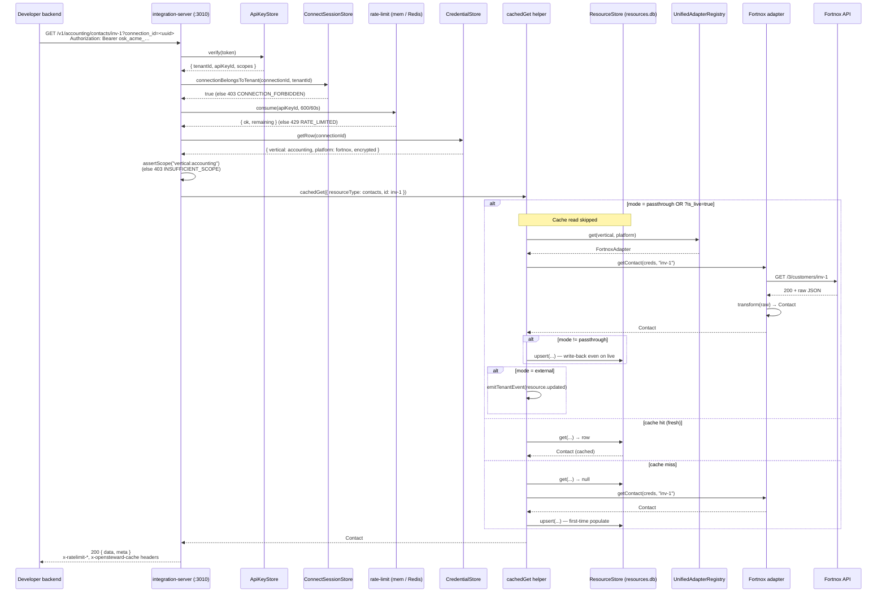
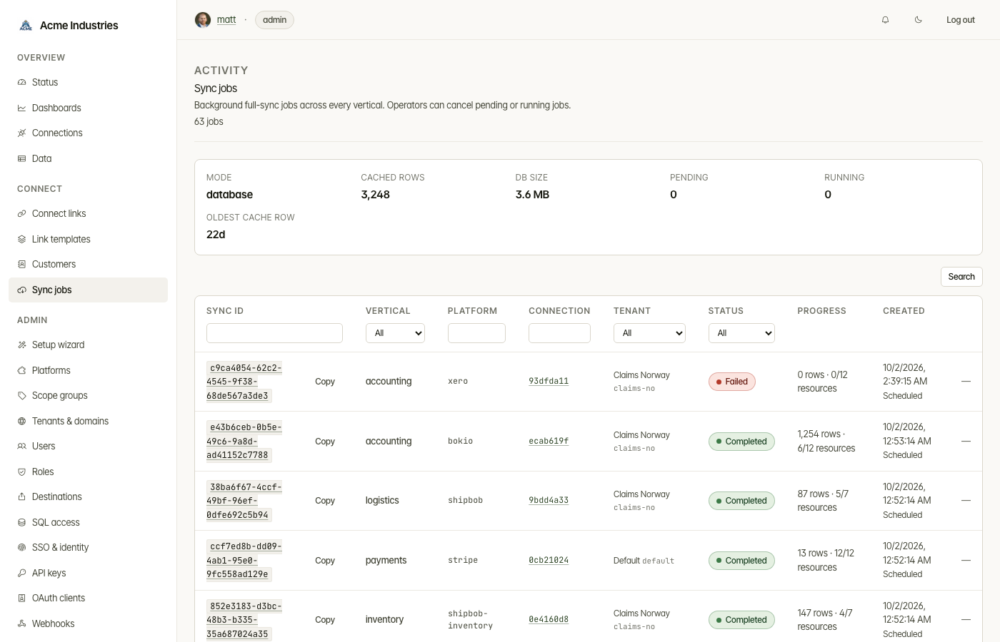
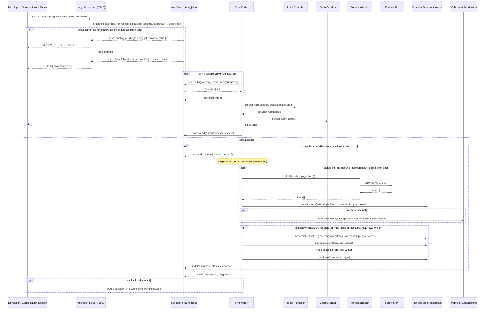
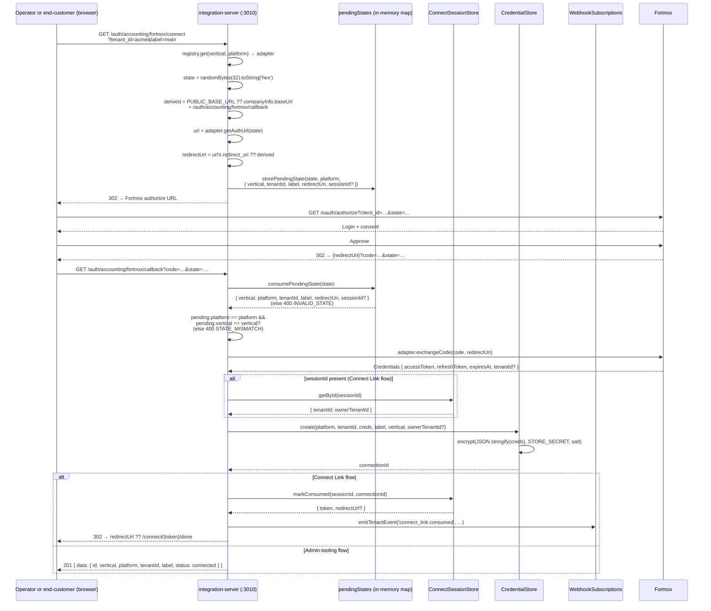
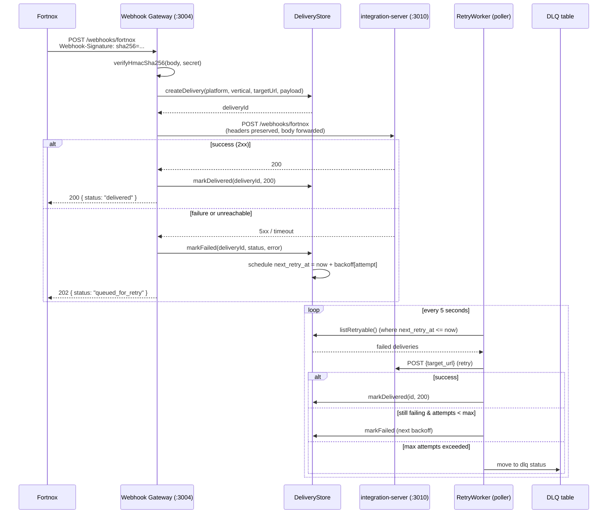

# Runtime data flows

> [← back to overview](./README.md)

Four sequence diagrams covering the main runtime patterns: an API request through the cache, the sync worker job lifecycle, an OAuth connection, and an inbound webhook.

---

## Chart 4a — API consumer GET → cache → upstream → response

A developer calls `GET /v1/accounting/contacts/inv-1?connection_id=<uuid>` directly on `integration-server` with a tenant-scoped Bearer key. The auth middleware resolves the key + scope + tenant; the per-vertical plugin attaches the data-store context; `cachedGet` decides cache-vs-live, fetches/transforms if needed, and writes back. Default mode is `database` (read-through cache).

**Key points:**
- No separate gateway service — `/v1/*` lands directly on `integration-server` and `unifiedAuthMiddleware` runs as a `preHandler`. A second per-vertical `preHandler` decorates `request.cacheMode`/`.resourceStore`/`.vertical` for `cachedGet` / `cachedList` / `writeThrough` / `cachedDelete`.
- `?is_live=true` is **bypass-read, write-back** — fresh upstream data is still written into the cache. A live bypass is visible to the caller too: every cached-route GET returns `X-OpenSteward-Cache: hit|miss|live|passthrough` (absent on mutations), and hits add `X-OpenSteward-Synced-At` with the ISO time the rows were cached — the `data-store: live bypass` INFO log remains for server-side auditing.
- `dataStore.staleAfterSeconds` (optional) treats rows older than the TTL as a miss; `?is_live` is unaffected.
- POST / PATCH / DELETE follow the same shape: live upstream first, then `writeThrough` (or `cachedDelete`) into the cache. Errors after the upstream succeeds log at ERROR but don't fail the response — the operator-visible recovery path is `?is_live=true` or `/admin/connections/:id/cache-clear`.
- Per-key rate limit is 600 req/60s (`DEFAULT_API_KEY_RATE_LIMIT`); in-memory by default, shared across replicas via `REDIS_URL`. A second, global per-IP bucket runs in `createBaseServer` — see [services.md § Rate limiting](./services.md#rate-limiting) for why requests presenting `X-Admin-Secret` skip it.
- Token refresh is automatic when `isTokenExpired(creds)` is true. It runs through `withRefreshLock` + `refreshWithRotationGuard`, which re-encrypts the credential, writes it back, **and records the outcome** on the connection row (`last_refresh_at` / `last_refresh_status` / `last_refresh_error`). A non-`ok` outcome returns 401 `TOKEN_REFRESH_FAILED`.
- The adapter transforms the platform's raw response into the canonical Zod schema; `metadata` preserves the unmodified raw payload.

---

## Chart 4d — SyncWorker job lifecycle

Operators monitor + cancel jobs at `/sync-jobs`, and enqueue one from either connections view (`POST /connections/:vertical/:id/sync` in the admin UI, `operator` role) — that path goes through admin-api's `POST /api/sync-jobs` and surfaces the upstream refusal verbatim, so a 409 `SYNC_IN_PROGRESS` reads as such rather than as a generic 500:

`POST /v1/{vertical}/sync?connection_id=…` enqueues a job, and so, without any client, does the `SyncScheduler` whenever a connection's [sync schedule](../dev-api.md#sync-schedules) says it is due (see [services.md](./services.md#sync-scheduler)). One `SyncWorker` per vertical polls `sync_jobs` for pending rows at `pollIntervalMs` (default 1s). The worker walks the vertical's `LISTABLE_RESOURCES`, paginates through each upstream resource, bulk-upserts into `resources`, and (in `external` mode) emits one `resource.synced` event per page or per row.

**Key points:**
- **`/sync` is a READ-scope endpoint.** It is a `POST` because it enqueues a job, not because it changes anything upstream — the worker only lists upstream, and upserts and removes rows in the local cache. The route declares `config: { readSafe: true }`, which is the one exemption `requiresWriteScope()` honours (and it must be exactly `true`); every other non-GET still needs `vertical:write`. This lets the recommended API-key preset, which omits `vertical:write` by design, refresh the data it can read.
- **`callback_url` still requires `vertical:write`**, and the URL is validated at enqueue (`validateCallbackUrl`): https only, no embedded credentials, no loopback/private/link-local address. `callback.ts` re-resolves the name immediately before the POST, because a name can resolve elsewhere by the time the job runs. Supplying one makes the deployment issue an outbound request from inside the network, which is a different authority from "refresh my cache".
- `POST /sync` has its own cap on top of the per-key bucket: 10 per hour per `(vertical, apiKeyId)`, refused with 429 `SYNC_RATE_LIMITED` and a `Retry-After`.
- Every `/sync` route — including `GET /sync/:id` — needs `?connection_id=`; the auth middleware rejects a request without one with 400 `CONNECTION_ID_REQUIRED`, and a job belonging to another connection reads back as 404 rather than leaking its id.
- Other enqueuers, none with a client involved, each recorded as the job's `origin`: the `SyncScheduler` every 60 s (`schedule` — never-synced connections first, then the most overdue, at most two jobs waiting per vertical per replica), the OAuth callback of a Connect Link (`connect`; skipped for a `trigger_only` link, and a link completed through the credential form leaves the first sync to the scheduler), boot with `DATA_STORE_AUTO_SYNC_ON_BOOT=true` (`boot`; skips `trigger_only` connections), and the admin console's **Sync now** (`manual`). Every one goes through `syncStore.createIfIdle`.
- **At a known end the worker removes cached rows the platform did not return** (`sweepCollection`), then marks the collection complete. A known end is a reported `hasMore`, or a declared `maxPageSize` behind a short page; a guessed end, or a sync that wrote no rows, removes nothing and drops the marker instead. Removal emits no event. So a key with only `vertical:read` can, through `POST /sync`, remove cached rows other consumers of the connection were reading — never anything upstream. The limits, including rows removed that the platform still has, are in [dev-api.md §7](../dev-api.md#rows-deleted-upstream).
- `createIfIdle` refuses a second active job for a connection — a partial unique index on `sync_jobs` enforces it, across replicas too — so a duplicate enqueue gets a 409 rather than racing two workers on the same connection.
- One shared `CircuitBreaker` across all 9 verticals — a flapping upstream stops draining its job queue cleanly.
- `pollIntervalMs` + `maxConcurrency` + `pageSize` are configurable via `dataStore.syncPageSize` env / config; sane defaults (1000ms / 2 / 500).
- Worker shutdown: `SIGTERM` calls `worker.stop()` which clears the timer, aborts in-flight `processJob` calls, waits up to 30s for them to drain, then resets any still-running rows back to `pending` so the next boot picks them up (`resetRunning(vertical)`).
- Jobs older than 30 days are pruned daily by `dataStoreMaintenance` (see `apps/integration-server/src/data-store-maintenance.ts`).

---

## Chart 4b — OAuth connection authorization

Two ways an OAuth dance starts: an admin/operator authorising from the wizard, or an end-customer opening a Connect Link. Both land on the same `/auth/:vertical/:platform/connect` → `/auth/:vertical/:platform/callback` pair; the callback branches on whether the pending state carried a `sessionId`.

**Key points:**
- `clientId`, `clientSecret`, `redirectUri`, `scopes` come from the **AdapterSettingsStore** — operators set them via `/setup/wizard/configure` and they're encrypted at rest.
- The `redirectUri` replayed at exchange is **the one the authorize URL carried** — RFC 6749 §4.1.3 requires the token request to repeat it exactly. It comes from the adapter's own configured Redirect URI, so it may sit on another origin than the deployment's (an https-only provider on an http deployment — see [local HTTPS](../operations/local-https.md)). Only when the authorize URL carries no `redirect_uri` is it derived, in this order: explicit `redirect_uri` query param (validated) → `PUBLIC_BASE_URL` env → `companyInfo.baseUrl` → `request.protocol` + `request.host` (with `trustProxy` honouring `X-Forwarded-*`). Suffix is always `/auth/{vertical}/{platform}/callback`. The host carries its **port** — the code uses `request.host`, not `request.hostname`, which strips the port in Fastify 5 and would derive `redirect_uri` values on :80 for deployments served elsewhere. A tenant's custom domain deliberately does **not** enter this order: OAuth callbacks stay on the canonical domain so a provider needs only one allowlisted URL.
- The **Connect Link** URL handed to a customer uses `resolvePublicBaseUrlOrNull`, which inserts the tenant domain after the env override and returns `null` rather than a base no customer's browser could open. A single-label host (`integration-server`, `admin-api`) is the signature of a compose service alias: the session is still created, but the response carries `url: null` and `urlUnresolved: true` instead of an unreachable address. `docker-compose.yml` defaults `PUBLIC_BASE_URL` to `http://localhost:3010` so links are addressable out of the box.
- Scope requested at OAuth-start follows the link's **scope policy**, resolved by `resolveOverrideScopesFor`: `read_only` sends the platform's curated `readScopes` (falling back to the platform default when the platform has none), `custom` sends the link's own list, `platform_default` sends no override. It is a per-link policy, not a property of the connection.
- `state` is a 256-bit random hex held single-use in an in-process `pendingStates` map; `consumePendingState` deletes it on first read. CSRF protection comes from unguessability + one-time consume, not HMAC.
- Connect Link flows carry a `sessionId` in pending state; the callback marks the `connect_session` consumed, fires `connect_link.consumed`, and 302s to `redirectUrl` (or the hosted thank-you page). Admin-tooling flows return a `201` JSON body and leave `owner_tenant_id` NULL.
- The credential write is encrypted with AES-256-GCM, key derived via scrypt from `STORE_SECRET` + the credential store's salt (`opensteward-v1`). The salt is per-store, not per-vertical — every vertical's connections share one table and one key. See [persistence.md § Encryption](./persistence.md#encryption) for the full salt list.

---

## Chart 4c — Inbound webhook → vertical → DLQ

A provider sends a webhook to the webhook-gateway. The gateway verifies HMAC, persists the delivery, forwards to the vertical, and enqueues retry on failure.

**Key points:**
- Backoff schedule: **1s, 5s, 30s, 5m, 30m** — 5 retries total before DLQ.
- The webhook-gateway always returns `200` or `202` to the provider — never propagates a 5xx upstream, so providers never disable our endpoint for being "broken".
- Failed deliveries go to a `dlq` status where they can be manually replayed via `POST /webhooks/dlq/:id/retry`.
- HMAC secrets are configured per platform in `webhook-gateway/config/config.yml`.

---

## See also

- [webhook-delivery.md](./webhook-delivery.md) — the full delivery state machine including DLQ replay
- [auth-and-tenancy.md](./auth-and-tenancy.md) — what `tenantId` actually is and where it comes from
- [adapter-lifecycle.md](./adapter-lifecycle.md) — how the adapter's `clientId`/`clientSecret` got into the AdapterSettingsStore in the first place
