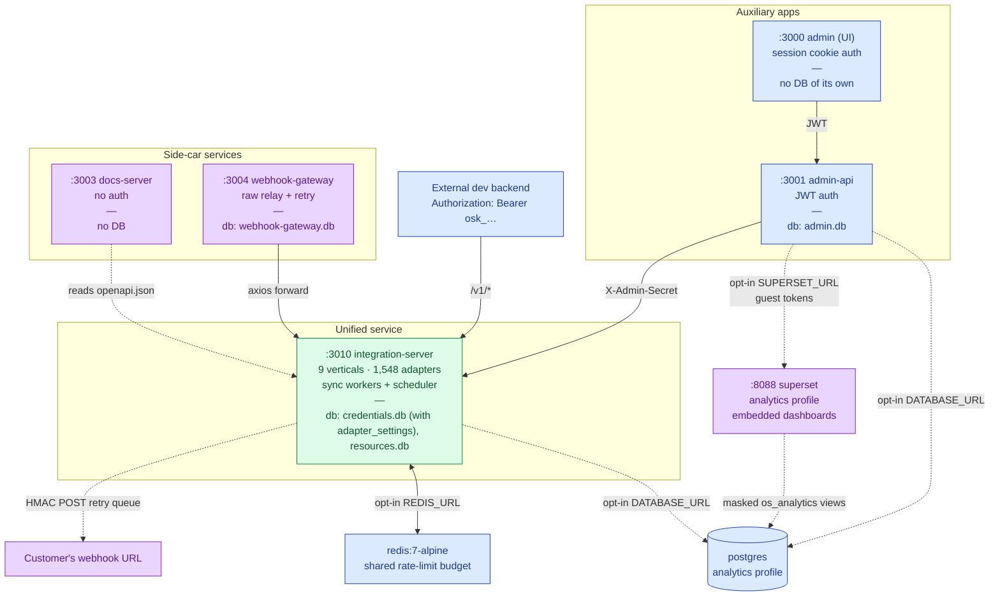

# Service topology

> [← back to overview](./README.md)

All five application services in `docker-compose.yml` (plus the opt-in
profiles: Redis, Postgres and Superset, local HTTPS, and a dev SSO
provider), their ports, dependencies, databases, and the env vars they need
at boot. Every application service exposes `GET /health` and `/version`.
Every published port is bound to `127.0.0.1`; put a reverse proxy in front
for anything else ([custom-domain](../deployment/custom-domain.md)).

---

## Chart 3 — Service topology



---

## Service inventory

| Service | Port | Build arg | Auth | DB | Env vars compose passes |
|---|---|---|---|---|---|
| **admin** | 3000 | `APP=admin` | session cookie (signed) | — | `SESSION_SECRET`, `ADMIN_API_URL`, `DOCS_SERVER_URL`, `SSO_PUBLIC_BASE_URL` |
| **admin-api** | 3001 | `APP=admin-api` | JWT | `admin.db` | `JWT_SECRET`, `STORE_SECRET`, `INTEGRATION_SERVER_URL`, `ADMIN_SECRET`, `SERVICE_SECRET`, `BOOTSTRAP_TOKEN`, `SSO_PUBLIC_BASE_URL`, `ADMIN_UI_URL` |
| **docs-server** | 3003 | `APP=docs-server` | none | — | `INTEGRATION_SERVER_URL` (server-variable overlay), `ADMIN_API_URL` (operator branding) — both optional |
| **webhook-gateway** | 3004 | `APP=webhook-gateway` | none on the receiver (it relays the raw bytes and headers; the vertical verifies the platform signature); `X-Admin-Secret` on `/webhooks/log` + `/webhooks/dlq` | `webhook-gateway.db` | `INTEGRATION_SERVER_URL`, `ADMIN_SECRET` (platform secrets from `webhook-gateway/config/config.yml`) |
| **integration-server** | 3010 | `APP=integration-server` | Bearer `osk_…` key or OIDC bearer JWT on `/v1/*` (OIDC is opt-in: `auth.dev_oauth_enabled` + a registered issuer); test-mode `osk_test_…` keys only on `/test/v1/*` (no OIDC there — the sandbox's no-egress design excludes the issuer verifier); `X-Admin-Secret` on `/admin/*`; `connection_id` query param resolves the connection itself. | `credentials.db` (also `end_users`, `connect_sessions`, `developer_api_keys`, `webhook_subscriptions`, `webhook_deliveries`) | `STORE_SECRET` (≥ 32 chars), `PUBLIC_BASE_URL`, `ADMIN_API_URL`; optional `ADMIN_SECRET`, `SERVICE_SECRET`, `CORS_ORIGIN`, `RATE_LIMIT_MAX` / `RATE_LIMIT_WINDOW_MS`, `REDIS_URL`, `DATA_STORE_*` |
| **redis** *(opt-in via `--profile scale`)* | 6379 | `redis:7-alpine` (pulled, not built) | none (network-isolated) | — | (none) |
| **postgres** *(opt-in via `--profile analytics`)* | 5432 | `postgres:16-alpine` (pulled) | password | databases `opensteward` (OpenSteward, once the overlay sets `DATABASE_URL`) and `superset` (Superset's metadata) | `POSTGRES_PASSWORD`, `SUPERSET_DB_PASSWORD` |
| **superset** *(opt-in via `--profile analytics`)*, with one-shot `superset-init` and `superset-bootstrap` and its own `superset-redis` | 8088 | `deploy/superset` image; `superset-bootstrap` runs the admin-api image | Superset's own sign-in for authors; console viewers get 5-minute guest tokens from admin-api | `superset` on `postgres` | `SUPERSET_SECRET_KEY`, `SUPERSET_GUEST_TOKEN_SECRET`, `SUPERSET_SERVICE_PASSWORD`; admin-api needs `SUPERSET_URL` and `SUPERSET_PUBLIC_URL` (see [superset](../deployment/superset.md)) |
| **caddy** *(opt-in via `--profile https`)* | 443 | `caddy:2.11.4-alpine` (pulled) | — | — (`caddy-data` holds its local CA) | — ([local HTTPS](../operations/local-https.md) for OAuth providers that refuse an `http://` redirect) |
| **sso-dev-idp**, **sso-dev-proxy** *(opt-in via `--profile sso-dev`)* | 9400 | mock OpenID Provider (`scripts/dev-oidc-issuer.ts`) | — | — | dev only ([SSO testing](../operations/sso-testing.md)) |

`ADMIN_SECRET` and `SERVICE_SECRET` authenticate opposite directions and are
deliberately different values: `ADMIN_SECRET` is the inbound credential —
admin-api presents it as `X-Admin-Secret` on integration-server's `/admin/*`,
and the webhook-gateway holds the same value to guard its own `/webhooks/log`
+ `/webhooks/dlq` — while `SERVICE_SECRET` is what integration-server presents
to admin-api as `X-Service-Secret` when polling runtime settings. A secret that `scripts/generate-secrets.sh` mints but
compose never forwards is what `pnpm check:secret-passthrough` fails on — a
dropped `ADMIN_SECRET` passthrough would 403 every admin call, and a dropped
`BOOTSTRAP_TOKEN` would leave first-run setup unauthenticated.

The images set `NODE_ENV=production` in the `Dockerfile`, which makes
`adminGuard` fail **closed** (403 `ADMIN_DISABLED`) when `ADMIN_SECRET` is
unset. Outside a container `NODE_ENV` is normally unset and the same guard
falls through open — that is the local-dev convenience, not the shipped
posture.

## Dependency order

`docker-compose.yml` declares `depends_on` with `condition: service_healthy` so the start order is:

```
integration-server  →  admin-api      →  admin
                    →  webhook-gateway
                    →  docs-server
```

`integration-server` boots first (no dependencies of its own); `admin-api`, `webhook-gateway` and `docs-server` all wait for it to be healthy. `admin` then waits for `admin-api`.

## Volumes

| Volume | Mounted at | Used by |
|---|---|---|
| `admin-data` | `/app/apps/admin-api/data` | admin-api (`admin.db`) |
| `webhook-data` | `/app/apps/webhook-gateway/data` | webhook-gateway (`webhook-gateway.db`) |
| `integration-server-data` | `/app/apps/integration-server/data` | integration-server — connections, adapter settings, end-users, connect sessions, developer API keys, webhook subscriptions + deliveries (all in `credentials.db`), and the resource cache and sync jobs (`resources.db`) |
| `caddy-data` | `/data` | caddy (`https` profile) — its local CA; drop it and the CA must be trusted again |
| `postgres-data` | `/var/lib/postgresql/data` | postgres (`analytics` profile) — OpenSteward's data once `DATABASE_URL` points at it, and Superset's metadata |

With `DATABASE_URL` set, a service keeps its data in Postgres and its SQLite
volume goes unused. To move data between the two, see
[switching databases](../operations/switching-databases.md).

The admin frontend has **no volume** — all its state lives in admin-api.

## CORS

`createBaseServer` registers `@fastify/cors` with `origin: false` by default —
no `Access-Control-*` headers at all, which is what a Bearer-token API wants: a
page the operator does not control must not be able to spend a victim's key and
read the response.

`CORS_ORIGIN` on integration-server opts in. `parseCorsOrigin` (in
`apps/integration-server/src/config.ts`) takes a comma-separated list, strips
trailing slashes, and collapses a list containing `*` to a bare `*`. Blank or
unset stays `false`. There is deliberately no way to reach `@fastify/cors`'s
`origin: true` (reflect whatever arrives) from the environment.

Two details that make the opt-in actually work:

- `methods` is set explicitly to `GET, HEAD, POST, PUT, PATCH, DELETE, OPTIONS`.
  `@fastify/cors` defaults to `GET,HEAD,POST`, and a browser refuses to send
  `PATCH` / `PUT` / `DELETE` unless the preflight response names them.
- `/admin/*` is excluded regardless of `CORS_ORIGIN`, via a per-request
  delegator. Those routes are the operator's own server-to-server surface with
  no browser client at all.

`docker-compose.yml` defaults `CORS_ORIGIN` to `http://localhost:3003` — the
docs-server origin — so the Swagger console at `:3003/unified-api` can issue
its "Try it out" calls against `:3010` out of the box. Set your real docs origin
when deploying behind a domain, and never widen it to `*` on a deployment whose
API keys grant writes.

## Rate limiting

Independent limits apply on integration-server — a global per-IP bucket, an
IP-keyed bucket on the public `/connect` surface, and a per-principal bucket
that differs by which middleware guards the route:

| Limit | Keyed on | Default | Where |
|---|---|---|---|
| Global bucket | `req.ip` | 600 req / 60 s | `createBaseServer` (`@fastify/rate-limit`) |
| Connect-link bucket | `connect:<ip>` | `rate_limit.connect_link.per_minute` runtime setting, else 30 / 60 s (window fixed) | `onRequest` hook on the public `/connect/*` surface (`connect-router.ts`) — unauthenticated, so IP is the only identity; GETs get a branded HTML 429 + `Retry-After`, JSON elsewhere |
| Per-API-key bucket | `apiKeyId` | 600 req / 60 s (`DEFAULT_API_KEY_RATE_LIMIT`) | `unifiedAuthMiddleware` on `/v1/{vertical}/*` — a fixed constant, neither env- nor runtime-tunable |
| Per-API-key bucket (tunable) | `apiKeyId` | `RATE_LIMIT_MAX` / `RATE_LIMIT_WINDOW_MS`, else 600 / 60 s | `requireTenantKey` on `/v1/customers/*`, `/v1/connections`, `/v1/events`; operator-tunable at runtime, with a separate MCP tenant budget |
| Per-end-user bucket | `end_user:<id>` | `RATE_LIMIT_MCP_END_USER_PER_MIN`, else 60 / min | `createUnifiedEndUserAuthMiddleware` on the `/v1/me/*` surface |

`RATE_LIMIT_MAX` and `RATE_LIMIT_WINDOW_MS` set the global bucket, and are
forwarded by `docker-compose.yml`; without that passthrough the mounted
`config.yml` would win unconditionally and raising the limit in `.env` would
have no effect.
For the tunable per-key buckets the env value is the *fallback*: an
operator-tuned runtime setting from admin-api
(`rate_limit.api_key.per_minute`, plus the MCP tenant and end-user
equivalents) wins over it, and the env value is what applies while that cache is
cold or the admin DB is unseeded.
Paths under `/design/`, `/specs/`, `/data/`, `/public/` and `/health` are
exempt from the global bucket — one logo grid can fan out to 50+ asset requests.

The global bucket also exempts any request presenting a matching
`X-Admin-Secret` (`rateLimitAllowSecret`, constant-time compare; an unset secret
exempts nothing). The limiter keys on `req.ip`, and admin-api's axios client
sends no `X-Forwarded-For`, so every operator's every admin page view would
otherwise count against one container IP — one Connect Links render spends
roughly ten requests, so the stack would throttle its own UI long before an
outside caller was affected. Anonymous traffic is still limited.

`REDIS_URL` moves every bucket above into Redis so replicas share one budget;
`docker compose --profile scale up -d` brings up a local `redis:7-alpine` for
that.

## Token refresh keep-alive worker

integration-server runs a `RefreshKeepAliveWorker` (see
`apps/integration-server/src/workers/refresh-keep-alive-worker.ts`) so OAuth
connections stay live while idle. Selection is expiry-driven: a row whose access
token lapses inside the lead window is a candidate however recently it
refreshed, while rows with no recorded expiry keep the slow keep-warm cadence —
there is no token to maintain there, only the refresh grant to exercise so
providers that drop unused grants don't.

| Knob | Default | Meaning |
|---|---|---|
| `REFRESH_WORKER_ENABLED` | on (`=false` disables) | Whether the worker starts |
| `REFRESH_WORKER_INTERVAL_MS` | 900000 (15 min) | Tick cadence |
| `REFRESH_WORKER_EXPIRING_WITHIN_MS` | 1800000 (30 min) | Renew a token lapsing inside this window |
| `REFRESH_WORKER_SKIP_WINDOW_MS` | 300000 (5 min) | Anti-thrash floor — never re-pick a row refreshed this recently |
| `REFRESH_WORKER_KEEP_WARM_MS` | 72000000 (20 h) | Cadence for grants with no access-token expiry |
| `REFRESH_WORKER_DEAD_RETRY_MS` | 7 days | Retry cadence for rows already marked `expired` / `platform_error` |
| `REFRESH_WORKER_BATCH_SIZE` | 50 | Candidates per tick |
| `REFRESH_WORKER_BATCH_DELAY_MS` | 200 | Sleep between connections in a batch |

The cost is roughly one token request per connection per token lifetime — about
24/day for a one-hour token. A hard failure marks the connection
authorization-expired (`connection.authorization_expired`) or, when the
platform's own client credentials were rejected,
`connection.platform_credentials_invalid` — the fix for the second is
operator-side, not customer re-authorization.

## Sync scheduler

In `database` and `external` data-store modes, integration-server runs a
`SyncScheduler` (`apps/integration-server/src/workers/sync-scheduler.ts`)
next to the nine per-vertical `SyncWorker`s. Every connection has a sync
schedule — `default` (the deployment interval), `custom`, `trigger_only` or
`once` ([dev-api.md §7](../dev-api.md#sync-schedules)) — and each tick the
scheduler enqueues the connections that are due, with origin `schedule`:
never-synced connections first, then the most overdue. It only enqueues; the
workers run the jobs.

| Knob | Default | Meaning |
|---|---|---|
| `SYNC_SCHEDULER_INTERVAL_MS` | 60000 (minimum 5000) | Tick cadence |
| `data_store.sync.default_interval_minutes` (runtime setting) | 360 (6 h) | The `default` schedule's interval |
| `data_store.sync.scheduler_enabled` (runtime setting) | on | Kill switch, read every tick. It fails open: until integration-server has reached admin-api it reads as on |

Load is bounded by back-pressure, not a timetable: a vertical that already
has two jobs waiting gets nothing more that tick, so a **Sync now** never
queues behind a backlog, and the first runs after an upgrade drain at the
workers' pace. A failed scheduled sync retries after 15 minutes, doubling,
never later than the interval. Replicas need no coordination: each computes
the same due set, and the one-active-job index on `sync_jobs` lets only one
of them enqueue a connection (the two-waiting limit is per replica).

## Health checks

Every service exposes `GET /health` returning `{"status":"ok"}`. The unified service also reports the live vertical and adapter counts plus the data-store mode:

```json
{
  "status": "ok",
  "verticals": ["accounting", "crm", "ecommerce", "logistics", "payments", "docsign", "projects", "customer-support", "inventory"],
  "adapters": 1548,
  "adaptersByVertical": { "accounting": 281, "crm": 152, "ecommerce": 176, "…": 0 },
  "dataStore": {
    "mode": "database",
    "path": "/app/apps/integration-server/data/resources.db",
    "syncWorkers": 9
  },
  "timestamp": "..."
}
```

`adaptersByVertical` is the per-vertical breakdown.

`dataStore` is `null` when no data-store is wired (test harnesses with the mode unset); in `passthrough` mode it returns `{ "mode": "passthrough", "syncWorkers": 0 }`.

Docker compose health checks use `wget -qO- http://127.0.0.1:<port>/health` (must be `127.0.0.1`, not `localhost` — Alpine resolves localhost to IPv6 `::1` but Node binds IPv4 `0.0.0.0`).

---

## See also

- [runtime-flows.md](./runtime-flows.md) — what actually happens at runtime when an API request comes in
- [persistence.md](./persistence.md) — schema of every table in every DB above
- [build-and-workspace.md](./build-and-workspace.md) — how the images get built from a single shared `Dockerfile` with `ARG APP`
