# Setup wizard state machine

> [← back to overview](./README.md)

The first-run guard plus the eight-step wizard, with all branches and back-references.

---

## Chart 10 — First-run + 8-step wizard

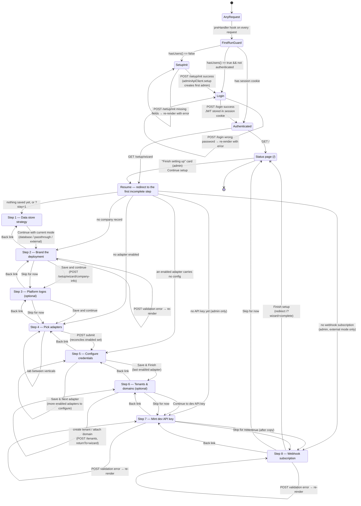

Step 8 is functionally optional outside `external` mode — the rail labels it `(optional)` and Skip-for-now is the prominent action.

The wizard stores no progress of its own. `computeWizardProgress` (`apps/admin/src/core/routes/wizard-progress.ts`) derives each step's done-ness on every wizard GET from what is actually persisted — company record, a deliberate logo choice, enabled adapters, adapters carrying config, API keys, webhook subscriptions — and hands it to the rail through `reply.locals.wizardProgress`. Work done outside the wizard counts (enabling a platform from `/platforms` marks step 4 done), and a wiped record un-marks its step. `GET /setup/wizard` redirects to the first incomplete step; `?stay=1` opts out, and the rail's own link back to step 1 carries it. Steps 7 and 8 are `requireRole('admin')`, so the scan skips them for anyone else rather than resuming an operator into a 403, and step 8 counts as outstanding only in `external` data-store mode. Steps 3, 6 and 8 are never resume targets — an operator content with monogram tiles or uninterested in webhooks would otherwise be sent back to them forever.

### Resuming from the Status page

An admin who leaves the wizard half done sees a **Finish setting up** card at the top of `/` — "Setup is not finished — next: Credentials (step 5 of 8)" — with **Continue setup** (the same target `GET /setup/wizard` would redirect to, or `/setup/wizard?stay=1` when that step is step 1) and **Skip for now**. It is derived by the same scan: `loadWizardProgress` (`apps/admin/src/core/routes/wizard.ts`) is the wizard preHandler's body, exported, and the Status page calls it with `withRailInputs: false` (the logo choice and the tenant count only tick rail items, never decide the next step) and a structural `WizardProgressClient` built from the verticals and platform rows the Status page has already fetched, so the card costs the page three extra reads (`getCompanyInfo`, `listApiKeys`, `listWebhookSubs`) plus the data-store mode. The Status page makes those reads itself, strictly, and hands the scan the resolved values: `computeWizardProgress` swallows a failed read as "not done", which is right for the rail (an unticked item) and wrong for a card that would then name step 2 or 7 on a finished deployment. The step names come from `WIZARD_STEP_LABELS` in `wizard-progress.ts`, which the rail reads too (`reply.locals.wizardSteps`), so the two cannot disagree.

Admins only: the last two steps are `requireRole('admin')` and two of the reads are operator+ on admin-api, so for an operator or viewer the scan is not run at all. The card is hidden — not shown with a wrong step — when the scan cannot run (the platform rows or any of its three reads could not be read, or the scan itself threw), and it disappears once `firstIncomplete === null`. The data-store mode is the one input that cannot be read strictly: the client answers `null` both on an outage and on a passthrough deployment, where there are no metrics to have. The Status page tells the two apart by its sync-jobs read (passthrough has no sync engine and answers 404); with the mode unknown and every other step done the deployment may be external with webhooks outstanding, so the card is hidden and `?wizard=complete` says it could not confirm rather than "Setup complete". While an earlier step is outstanding the mode changes nothing and the card names that step.

**Skip for now** (`POST /dashboard/setup/skip`, admin, CSRF) stores the step in the Status page's task-dismissal table as `wizard:<step>` with the step slug as fingerprint (`dismissDashboardTasks`; see [`persistence.md`](./persistence.md)). It is keyed by the step it skipped, so it invalidates itself: the moment the next step is a different one the card returns. A deployment whose last API key was revoked is the case this exists for — without it the card would come back forever. A skip is a deployment-wide write next to **Continue setup**, so for 15 minutes the Status page shows "Setup reminder hidden" with **Undo** — the panel's `POST /dashboard/tasks/undismiss`, which accepts `wizard:<step>` at the admin floor. The `?wizard=complete` success panel step 8 links to renders only when the scan agrees nothing is outstanding, so "Setup complete" can never sit above "Finish setting up"; on that landing a skip is ignored (the card shows, rather than the page saying nothing at all), and a scan that could not run renders "Couldn't confirm setup is finished — open the Setup wizard to check".

**Every step is one an admin can finish alone.** That is the constraint the shape of this list has to respect: a step gated on another service being up, or on a third party acting (such as a customer authorizing OAuth), would strand people. Connection health therefore lives on `/connections` — status pills, a **Sync now** button, search and filters — not in a wizard step. The wizard is eight steps.

---

## Step-by-step

### First-run guard

A `preHandler` hook on every request (except anything under `/setup`, `/public` or `/design`, and the three unauthenticated endpoints `/health`, `/version`, `/api/version-info`) calls `adminApiClient.hasUsers()`. If no users exist, every request 302s to `/setup/init` so the operator can create the first admin account.

### Setup init (`/setup/init`)

A small form: username, password, password confirmation, and an optional bootstrap token. Posts to `adminApiClient.setup()` which creates the first admin user via the admin-api's `POST /api/auth/setup` endpoint (which itself only works when no users exist — second call returns 409). Rate-limited to 3 attempts per minute.

The bootstrap-token field is the first-run gate. When admin-api is started with `BOOTSTRAP_TOKEN` set, the setup POST must carry the matching value in an `X-Bootstrap-Token` header or it returns 401 — the admin UI forwards whatever the operator typed. Without the env var the field is ignored, so a local dev deployment still sets up with three fields. Set it on any deployment reachable from the internet: `POST /api/auth/setup` is unauthenticated by construction, so on a fresh or wiped volume the first stranger to reach it would otherwise own the admin account. The first admin created here is auto-pinned as the break-glass account (see [`sso-and-identity-providers.md`](./sso-and-identity-providers.md#local-login--break-glass)).

### Login (`/login`)

Standard credentials form. Calls `adminApiClient.login()`. On success, stores the JWT in a signed session cookie alongside the user info. CSRF token + rate-limited to 5 per minute.

### Wizard step 1 — Data store strategy (`/setup/wizard`)

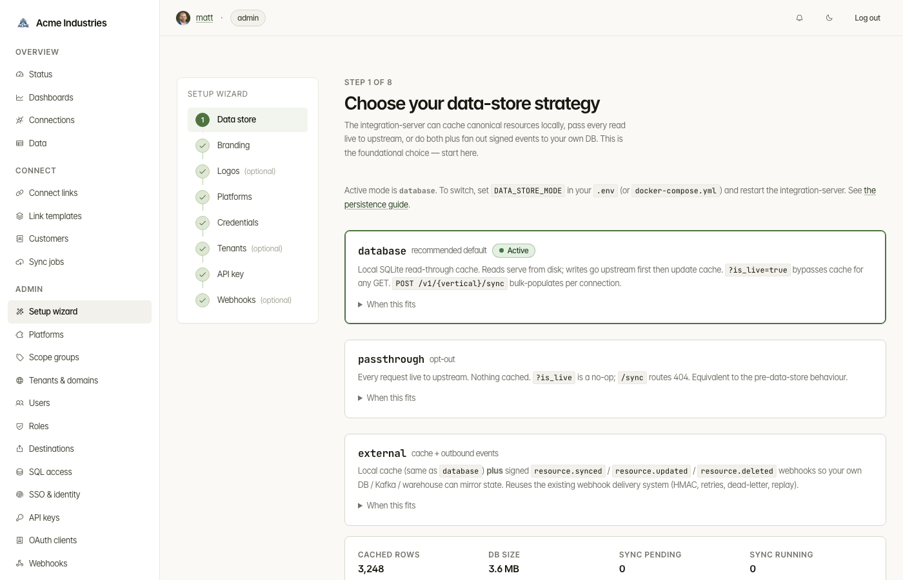

Foundational choice — the data-store mode shapes how every `/v1/*` request behaves and **must be picked before adapters are wired**. Calls `apiClient.getDataStoreMetrics(token)` (proxies `/health/data-store`) to read the active mode.

Three cards explain the trade-offs:

- **`database`** (recommended default) — local SQLite read-through cache. Reads serve from disk; writes write through; `?is_live=true` bypasses cache; `POST /v1/{vertical}/sync` bulk-populates.
- **`passthrough`** — every request live to upstream; nothing cached. Pick when your app already has its own DB or you're running multi-replica without a shared store.
- **`external`** — `database` cache plus signed `resource.synced` / `resource.updated` / `resource.deleted` outbound webhooks. Subscribers mirror state into their own DB / Kafka.

Reaching this step at all means setup has not started, or the operator asked for it: `GET /setup/wizard` redirects to the first incomplete step, and only `?stay=1` (the link the rail itself renders) holds the page. The mode is set via `DATA_STORE_MODE` on the integration-server. The wizard is informational: shows the active mode, explains how to change it (env var + restart), and links to [`dev-api.md §7`](../dev-api.md#7-data-store-is_livetrue-and-sync) for the full request-path semantics and to [`persistence.md`](./persistence.md#operating-the-resources-cache) for the operations runbook.

### Wizard step 2 — Brand the deployment (`/setup/wizard/company-info`)

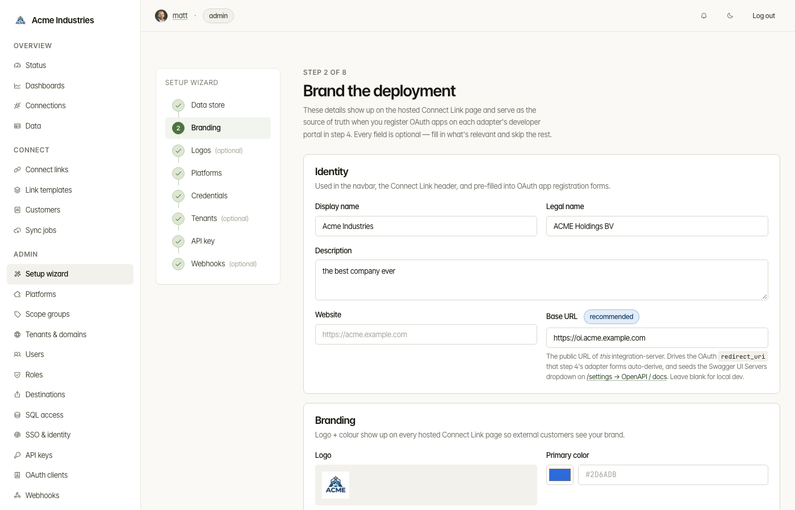

Wraps the same form rendered at `/company-info` with wizard chrome. Captures display name, legal name, description, website, base URL, logo (uploaded as a data URL), primary brand colour, support email, privacy-policy / ToS URLs, and an optional address. The address **Country** field is a single-select dropdown of full country names (backed by the canonical ISO 3166-1 alpha-2 list from `@opensteward/shared`); the stored value remains the two-letter code. Posts to `POST /setup/wizard/company-info` which calls `apiClient.setCompanyInfo(token, patch)`; the patch is built from a fixed `COMPANY_FIELDS` whitelist so unknown form fields are dropped. On validation error the form re-renders with the error banner. A "Skip for now" link advances to step 3 without touching the saved company info.

The captured values feed two downstream surfaces:
- **Connect Link page** — display name, logo, primary colour, privacy / ToS URLs.
- **Step 5 sidebar** — auto-derives the OAuth `redirect_uri` from `baseUrl + /auth/{slug}/callback` and shows copy-to-clipboard rows for the dev-portal registration form.

### Wizard step 3 — Platform logos (`/setup/wizard/logos`)

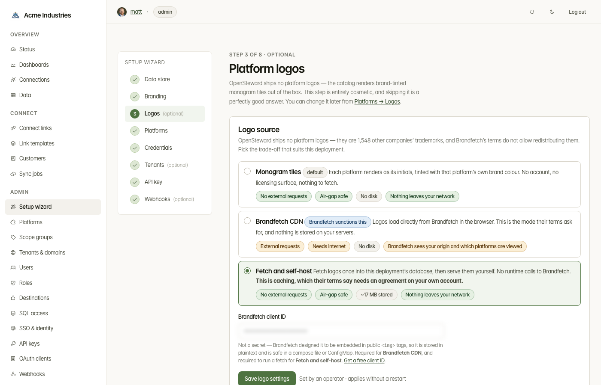

Optional, and cosmetic: it chooses where the catalog's platform logos come from.
Renders the same two partials as Platforms → Logos (`platforms/_logo-settings`
and `platforms/_logo-fetch`) — one implementation, two surfaces — with
`logoHistory` deliberately empty, because run history belongs on the platforms
tab rather than a first-run flow.

Done-ness is `logos.source` being off its seeded default, not the row existing:
the row is seeded on first boot and would otherwise read as done before anyone
had seen the step. It is never a resume target, so an operator happy with
monogram tiles is not sent back to it.

### Wizard step 4 — Pick adapters (`/setup/wizard/platforms?vertical=...`)

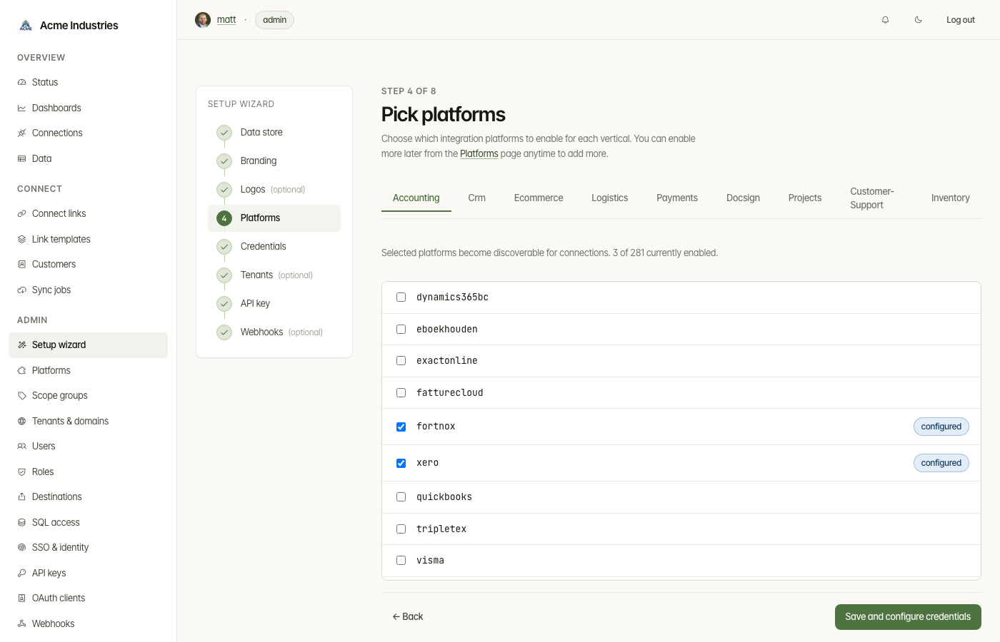

Tab-per-vertical interactive checkbox grid. Lists every known adapter for the selected vertical from `apiClient.listPlatforms(token, vertical)` (which proxies to admin-api `GET /api/verticals/:vertical/platforms`). The form posts to itself; the handler reconciles the checked set:

- For each adapter currently checked but **not enabled** → calls `apiClient.enablePlatform(token, vertical, slug)`
- For each adapter currently unchecked but **enabled** → calls `apiClient.disablePlatform(token, vertical, slug)`
- After reconciliation, redirects to step 5 (configure) with the first enabled adapter as the slug query param

### Wizard step 5 — Configure credentials (`/setup/wizard/configure?vertical=...&slug=...`)

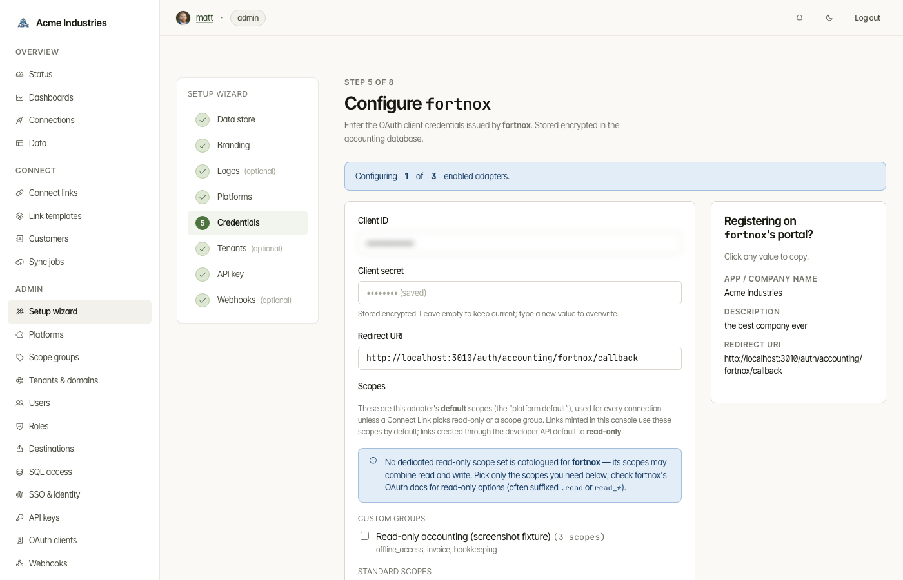

Credentials form with two columns:

- **Left (form):** clientId, clientSecret, redirectUri (auto-derived from `companyInfo.baseUrl + /auth/{slug}/callback`), scopes
- **Right (sidebar):** Developer-portal helper showing copy-to-clipboard rows for company name, website, privacy policy, ToS, support email

Calls `apiClient.setPlatformConfig(token, vertical, slug, config)`. After save, looks at the list of enabled adapters and either:
- Advances to the next one (`?slug=<next>`) if there are more
- Or advances to step 6 (Tenants & domains) if this was the last one

### Wizard step 6 — Tenants & domains (`/setup/wizard/tenants`)

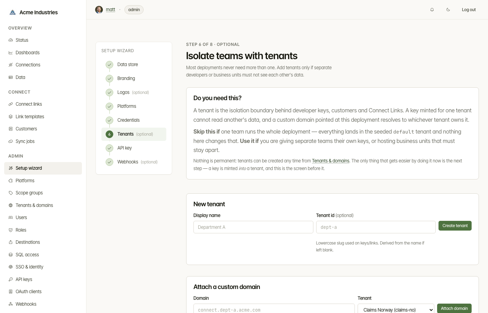

Optional, and skipped by most deployments. A tenant is the isolation boundary
behind developer keys, customers and Connect Links; one team running the whole
deployment never needs a second one, and everything lands in the seeded
`default`.

Renders **the same partial `/tenants` does** — `views/tenants/_manage.ejs`,
holding the create form, the attach-domain form and the tenant/domain table —
from the same two calls (`listTenants` + `listTenantDomains`). There are
deliberately **no wizard copies of the POST routes**: the partial's forms post to
the real `/tenants`, `/tenants/:id/delete`, `/tenant-domains` and
`/tenant-domains/delete`, carrying a hidden `returnTo` so those routes send the
operator back to whichever surface they came from.

`returnTo` is a **token, never a path** — `backTo()` in `routes/tenants.ts` maps
`'wizard'` to the step and anything else to `/tenants`. A redirect target taken
from a form body would be an open redirect; a token cannot be. Same shape as the
`returnTo` in `routes/connections.ts`.

Done-ness is a tenant other than `default` existing — `default` is seeded, so
its presence says nothing about intent. Like logos, it is **never a resume
target**: it can never go done for a single-team deployment, and a step that
can never complete and is not skipped would strand the operator.

It sits immediately before the API key step on purpose: a key is minted *into* a
tenant, and that step offers a picker whenever more than one exists.

### Wizard step 7 — Mint your first dev API key (`/setup/wizard/api-key`)

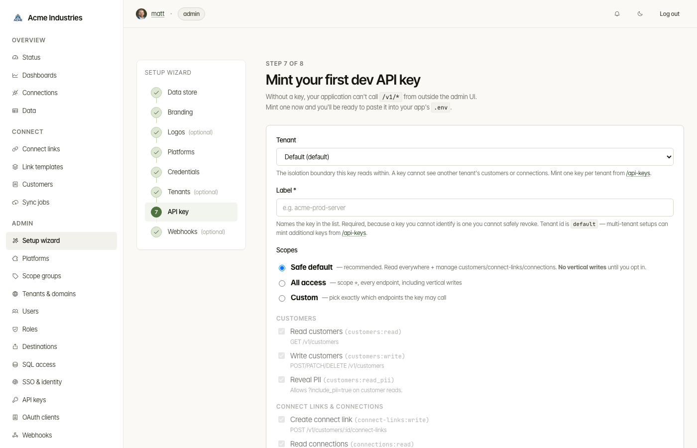

Admin-only (`requireRole('admin')`). A subset of `/api-keys/new`'s scope vocabulary folded into the wizard chrome — that page has six scope groups while the wizard exposes four, so in custom mode the wizard cannot grant webhook or MCP scopes even though safe-default includes the webhook pair (MCP is deliberate: the wizard mints an MCP key via its own dedicated button, described below). Form: a free-form `label` and a scopeMode (`safe-default` / `all` / `custom`) driving the wizard's scope picker, in four groups: Customers, Connect Links & Connections, Verticals (touch axis — one entry per vertical plus `vertical:read`), and Verticals (verb axis — `vertical:write` alone). The label reads `Label *`: a trailing asterisk is the single required-field marker across the admin forms, and the word "required" appears in no label. `safe-default` is preselected and resolves to `SAFE_DEFAULT_SCOPES` (`apps/admin/src/core/routes/api-keys-defaults.ts`), which is every customer / connect-link / connection scope, the two outbound-webhook scopes (`webhooks:read` / `webhooks:write`), plus one `vertical:<name>` per known vertical and `vertical:read` — `vertical:write` is deliberately left out, so the first key an operator mints cannot push data upstream until they opt in. `tenantId` rides along as a hidden field defaulting to `default`; multi-tenant operators mint additional keys later from `/api-keys`.

Calls `apiClient.mintApiKey(token, { tenantId, label, scopes })` and re-renders the same view with `mintedKey` populated, showing the plaintext exactly once with a copy-to-clipboard control and a `.alert--warning` reminder. Skip-for-now advances to step 8 without minting.

A second, optional button on the same page POSTs `/setup/wizard/api-key/mcp` and mints a fixed `['mcp:read', 'customers:read', 'vertical:read']` key labelled "MCP read-only (wizard)". It is a separate key by necessity: `assertMcpScopesCompatible` refuses a mint that pairs `mcp:read` with any write-granting scope (`*`, `<resource>:*`, `<resource>:write`), so an MCP-capable agent needs its own key. See [`../mcp.md`](../mcp.md).

### Wizard step 8 — Register a webhook subscription (`/setup/wizard/webhooks`)

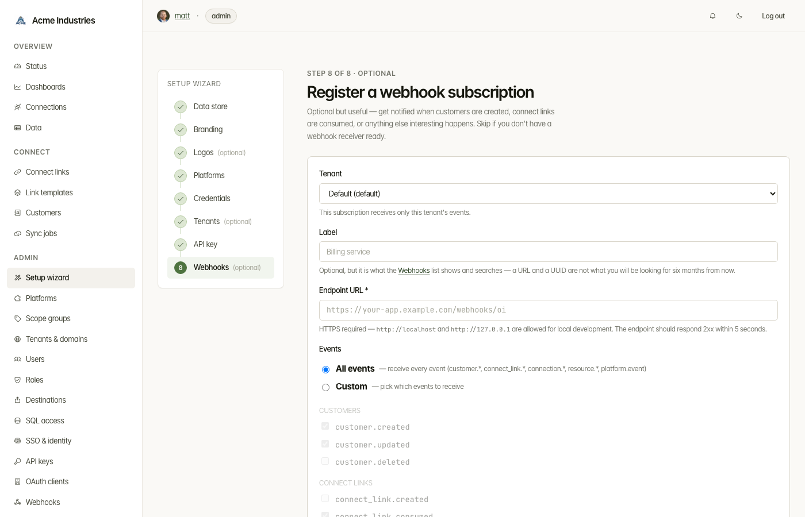

Admin-only. Conditional based on `dataStore.mode`:
- **`external` mode:** the rail label has no `(optional)` suffix and the in-step copy frames the subscription as required to make external mode useful. Pre-checks `resource.synced`/`updated`/`deleted` in custom mode.
- **`database` / `passthrough` mode:** the rail label gets `(optional)`. Pre-checks `customer.created`/`updated`/`deleted` and `connect_link.created`/`consumed` in custom mode.

Form: `url` (`required` in the markup, though the label itself carries no marker), eventMode (`all` / `custom`) with three event groups (Customers, Connect Links, Resources). Calls `apiClient.createWebhookSub(token, { tenantId: 'default', url, events })` and re-renders with `createdSub` populated, showing the plaintext HMAC `secret` once. Skip-for-now or "Finish setup" both redirect to `/?wizard=complete`.

---

## Why a state diagram

The wizard has back-edges (every step has a Back link to the previous step) and conditional transitions (Step 5 loops on itself when there are more adapters to configure, and Step 8 changes label and copy based on `dataStore.mode`). Linear flowcharts can't express these — a state diagram makes the branches explicit.

---

## Operator journey: clone → working integration

Where the state diagram above shows transitions, the chart below scores the **lived experience** of running the wizard end-to-end. Dips in the score mark the friction points of the flow.

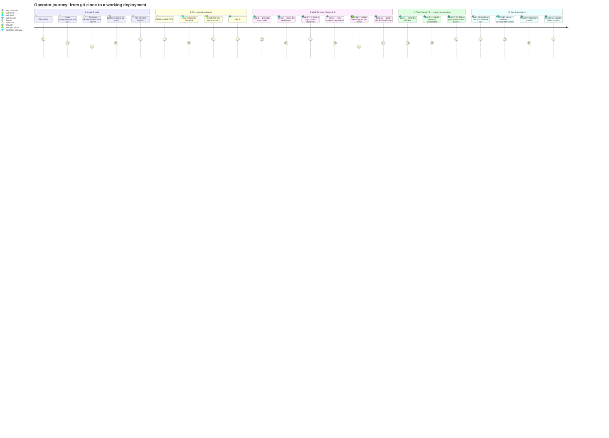

### What the score dips tell us

Three steps land at **3/5** — these are the friction hotspots of the flow:

| Step | Score | Why it dips | Mitigation |
|---|---|---|---|
| Generate SESSION/JWT/STORE secrets | 3 | Operator has to mint one value per secret env var and get each to the service that reads it | `scripts/generate-secrets.sh` prints an `.env`-ready block for every secret the stack needs, and the `check:secret-passthrough` gate fails CI when a minted secret never reaches its service |
| Register OAuth app on dev portal | 3 | Operator leaves the admin UI to fill out a third-party form | Step 5's sidebar shows copy-to-clipboard values + auto-derived redirect URI |
| Paste clientId/clientSecret | 4 | Tedious but unavoidable when the provider issues credentials in their portal | — |

Everything else lands at **4 or 5/5** — the wizard has been built deliberately to minimise friction at every other step.

---

## Troubleshooting decision tree

When something fails on the journey above, walk this checklist top-to-bottom. The first "no" tells you which subsystem to look at.

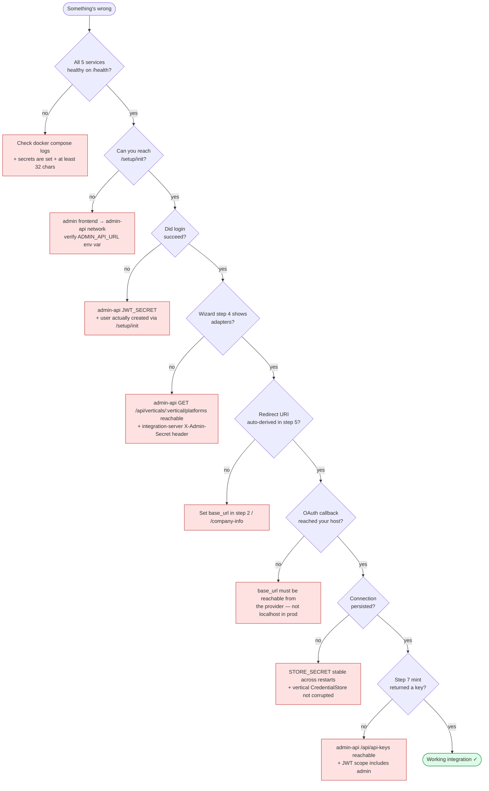

Each branch corresponds to a deeper subsystem document:

- **Service health** → [`services.md`](./services.md) for the topology and dependency graph.
- **Login / first-run** → first-run guard at the top of this page; [`auth-and-tenancy.md`](./auth-and-tenancy.md) for role hierarchy.
- **Adapter discovery** → [`adapter-lifecycle.md`](./adapter-lifecycle.md) for the enable/disable/config flow.
- **OAuth callback** → [`runtime-flows.md`](./runtime-flows.md) Chart 4b for the full state-and-credential dance.
- **Persistence** → [`persistence.md`](./persistence.md) for the `connections`, `company_info`, and `connect_link_sessions` tables.
- **API key + webhook** → [`admin-page-map.md`](./admin-page-map.md) for the admin-api routes that step 7 + 8 proxy through.

---

## See also

- [admin-page-map.md](./admin-page-map.md) — the full admin UI route inventory
- [adapter-lifecycle.md](./adapter-lifecycle.md) — what happens inside the vertical when step 4/5 fire
- [end-user-journey.md](./end-user-journey.md) — what an end-user (a customer of the developer's app) experiences via Connect Links
- [persistence.md — Operating the resources cache](./persistence.md#operating-the-resources-cache) — ops runbook referenced from step 1
