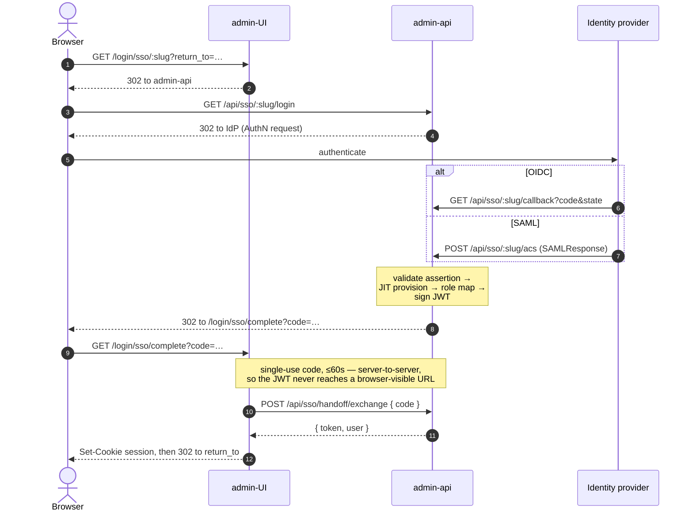

# SSO & corporate identity providers

> [← back to overview](./README.md) · see also [auth-and-tenancy.md](./auth-and-tenancy.md)
> · operator setup walkthrough: [../deployment/sso-setup.md](../deployment/sso-setup.md)

OpenSteward can delegate **admin-user** authentication to a corporate identity
system instead of (or alongside) local username/password accounts. This covers
the *AdminUser* layer only — the DeveloperKey / EndUserCustomer / Connection
layers in [auth-and-tenancy.md](./auth-and-tenancy.md) are unchanged.

Four enterprise protocols are supported under one pluggable **identity
provider** abstraction:

| Protocol | Library | Flow |
|---|---|---|
| OIDC / OAuth2 | `openid-client` | Auth Code + PKCE, browser redirect |
| SAML 2.0 | `@node-saml/node-saml` | SP-initiated redirect, signed assertions |
| LDAP / Active Directory | `ldapts` | Search-then-bind on the login form |
| SCIM 2.0 (provisioning) | hand-rolled Fastify + Zod | IdP pushes users/groups |

## The linchpin

admin-api is the source of truth and issues a JWT `{ id, username, role }`
(`apps/admin-api/src/core/routes/auth.ts`). **Every SSO path converges on
issuing that same JWT**, after which all existing RBAC
(`requireAuth` / `requireRole`) works unchanged. The admin UI wraps the JWT in
its signed `session` cookie exactly as it does for local login.

## Data model

All SSO state lives in the admin DB via `IdentityStore`
(`apps/admin-api/src/core/db/identity-store.ts`), which shares the
`AdminStore` connection:

- `identity_providers` — one row per IdP (protocol, non-secret `config_json`,
  AES-256-GCM-encrypted `secret_enc`, `jit_enabled`, `default_role`, and —
  since `identity_store` v2 — `default_scope_mode` / `default_tenant_ids_json`).
- `identity_links` — external identity (`provider_id`,`external_id`) → local
  `users.id`. The JIT lookup key; `scim_managed` flags SCIM-owned accounts.
- `role_mapping_rules` — group/claim → role rules (priority-ordered). A rule
  grants a built-in `role`, or a custom role through `role_id` (v2); `role`
  then holds that role's base role.
- `scope_mapping_rules` — group/claim → tenant scope rules (v2). Every
  matching rule applies; their tenants are unioned.
- `scim_tokens` — per-provider SCIM bearer tokens (hashed, prefix-indexed).
- `scim_groups` — SCIM-pushed group membership feeding role mapping.
- `sso_transactions` / `saml_replay` / `saml_request_cache` / `sso_handoff` —
  short-lived round-trip + replay-protection state.

Secrets are encrypted with the deployment `STORE_SECRET` and a dedicated salt
(`opensteward-sso-v1`) via the shared `encrypt`/`decrypt`
(`packages/shared/src/auth/crypto.ts`). The API only ever returns a redacted
view (`hasSecret: boolean`).

## Login flow (OIDC / SAML)

The IdP round-trip terminates in **admin-api** (it owns the secrets and the JWT
signer); the UI never parses raw assertions. The issued JWT is handed to the UI
through a **single-use, ≤60s code** so it never appears in a browser-visible
URL. LDAP skips the redirect: the browser posts to the UI's own
`/login/sso/:slug/ldap` (rate-limited to 5/min), which calls admin-api's
`/api/sso/:slug/ldap-login` server-to-server and receives the JWT directly.

Three public UI routes carry this: `GET /login/sso/:slug` (redirect to the
initiation endpoint), `POST /login/sso/:slug/ldap`, and
`GET /login/sso/complete` (exchanges the handoff code). All three sit ahead of
`requireAuth` — there is no session yet.

## JIT provisioning & role mapping

On every successful SSO/LDAP auth (`jit-provisioning.ts`):

1. Look up the `identity_link`; reuse the linked user if present.
2. Otherwise, if `jit_enabled`, create a local user with a **random unusable
   password hash** (so it can never log in locally) and link it.
3. Resolve the role from `role_mapping_rules` (ascending priority, first match
   wins; else `default_role`) and **re-apply on every login** so IdP role drift
   propagates. A rule may name a custom role (`roleId`); the user then holds
   it with its base role in `users.role`. Every login + role change is
   audit-logged.
4. Resolve tenant scope — see [Scope mapping](#scope-mapping).

## Scope mapping

Which tenants an SSO user may see (see
[permissions-and-roles.md](./permissions-and-roles.md) for what a restricted
user can and cannot do). `resolveScope()` in `role-mapping.ts`:

- **Every** matching `scope_mapping_rules` row contributes its tenants — a
  union, not first-match, because group membership is additive. A tenant
  granted `*` verticals by any rule covers every vertical.
- A matching rule whose tenant list is `["*"]` grants every tenant (`all`).
- No match → the provider's default scope: `all` (what every provider created
  before scope rules keeps) or `restricted` to its default tenants (none, when
  that list is empty — the starting point for every newly created provider).

Admins are always unrestricted: a user whose resolved role is `admin` never
gets a scope written, so a group mapped to an admin role means every tenant.
Otherwise the result is written to the user's `user_scopes` only when the
user's `scope_source` is `idp`. JIT- and SCIM-created users start that way; an admin
who sets a user's scope by hand in the console flips it to `manual`, and the
IdP stops overwriting it (it can be handed back with `source: "idp"` on
`PUT /api/users/:id/scope`). Rule routes:
`GET/POST /api/identity-providers/:id/scope-rules`,
`DELETE …/scope-rules/:ruleId`, and `PATCH /api/identity-providers/:id/default-scope`
— admin role plus `users:manage`, and a caller can only grant tenants inside
its own scope.

## Profile: email and picture

At every SSO sign-in (OIDC, SAML, LDAP) and every SCIM create, replace and
patch, `IdpProfileSync` (`auth/idp/profile-sync.ts`) copies what the IdP
asserts onto the console user.

| Source | Email | Picture |
|---|---|---|
| OIDC | `email` — the ID token's claim, else userinfo's. **Ignored when `email_verified` is `false`** — the boolean, or the string `"false"` in any case (`"False"`, `"FALSE"`). **A missing `email_verified` is treated as verified**, as is any other value: most IdPs only send the claim when they track it. | `picture` (userinfo, else the ID token) |
| SAML | The provider's `emailAttribute` (default `email`), then `email`, `mail`, `urn:oid:0.9.2342.19200300.100.1.3`, the Entra/ADFS claim `http://schemas.xmlsoap.org/ws/2005/05/identity/claims/emailaddress`, then a NameID in email form. Multi-valued attributes use the first value. | The provider's `pictureAttribute` if set, else the first of `picture`, `photo`, `photoUrl`, `photoURL`, `avatar` |
| LDAP | The provider's `emailAttribute` (default `mail`) | — (directory photos are binary, not URLs) |
| SCIM | `emails`: the `primary` entry, else the first | `photos`: a `photo` entry (the primary one first), else a `thumbnail`, else the first |

SCIM `PatchOp`s are read in the shapes IdPs send: `path: "emails"` with an
array, Entra ID's filtered path (`emails[type eq "work"].value` with a string),
and a path-less value object holding either. `remove` of `emails` or `photos`
drops only IdP-owned data. A replace (`PUT`) that leaves `emails` or `photos`
out changes nothing, rather than clearing them.

**Precedence** — what a person set in the console wins:

- **Email.** `users.email_source = 'manual'` (typed by an admin at creation or
  on the user page) is never overwritten. Otherwise the IdP's address is
  stored as `idp` and refreshed whenever it changes. The IdP's write is
  conditional in SQL (`… WHERE email_source IS NULL OR email_source = 'idp'`),
  so an admin's edit that lands while a sign-in is being processed is never
  overwritten or flipped back to `idp`; a SCIM `remove` clears only an
  `idp` address the same way. Invalid addresses are ignored; so is an IdP
  that sends none. An admin clearing the email hands it back to the IdP.
- **Picture.** `user_avatars.source = 'upload'` is never replaced. An IdP
  picture is refetched only when the URL changes: the row stores the sha256 of
  the URL it came from, so an unchanged sign-in costs one metadata read. The
  IdP write is a single conditional upsert (`… DO UPDATE … WHERE source =
  'idp'`), so an upload that lands while a fetch is in flight wins. An IdP
  that stops sending a picture leaves the last one in place.

**Timing.** The email is written before the sign-in completes (a local
write). The picture is fetched **fire-and-forget**: the sign-in redirect (or
SCIM response) does not wait for a third-party host, and the picture shows on
the next page load. Concurrent sign-ins of one user share one fetch, and at
most **4 fetches run at once in the whole process**: past that a fetch is
dropped (logged at `debug`) and the user's next sign-in or SCIM update tries
again. A user deprovisioned while their picture was in flight never keeps an
avatar row. Nothing
in the sync can fail a sign-in: every error is caught and logged at `info`
with the user id, the URL's **host** and a coarse reason — never the URL
(query strings carry signatures) and never the email.

### Fetching an IdP picture safely

The picture URL is IdP- (often user-) controlled, and admin-api fetching it is
an SSRF sink. `fetchIdpAvatar` (`auth/idp/avatar-fetch.ts`) applies, in order:

1. **`https:` only**, the default port only, no credentials in the URL.
2. **DNS through c-ares**, not `dns.lookup`: A and AAAA are asked in
   parallel with one try and a timeout of the remaining budget, and
   outstanding queries are cancelled at the deadline. Once one family
   answers, the other gets a 300 ms grace and is then dropped — a nameserver
   that silently discards AAAA must not turn every fetch into a timeout.
   Whatever arrives in time is vetted like the rest. (`dns.lookup` runs on
   the libuv threadpool, which bcrypt shares, and cannot be cancelled — a
   nameserver that never answers would stall sign-ins.) c-ares does not read
   `/etc/hosts`.
3. **Every** resolved A/AAAA record must be public. IPv4: private (10/8,
   172.16/12, 192.168/16), loopback, link-local (incl. 169.254.169.254),
   carrier-grade NAT, unspecified, **multicast** (224/4), reserved (240/4,
   broadcast), benchmarking, documentation and the 6to4 relay 192.88.99.0/24
   are refused. IPv6 is an **allow-list**: global unicast `2000::/3` only —
   which already excludes `::1`, `fc00::/7`, link-local, multicast
   `ff00::/8`, IPv4-mapped `::ffff:0:0/96`, SIIT and local-use NAT64
   `64:ff9b:1::/48` — with one exception: DNS64's `64:ff9b::/96` (what an
   IPv6-only network synthesises for IPv4-only hosts) is decoded and allowed
   exactly when the IPv4 it carries passes the IPv4 rules. Within
   2000::/3, `2001::/23` (including Teredo `2001::/32`), `2001:db8::/32`,
   6to4 `2002::/16` and `3fff::/20` are refused: a tunnel's far end can be
   any IPv4 address. `isPrivateIp` from
   `@opensteward/shared` is consulted first; `OST_ALLOW_PRIVATE_HOSTS` is
   deliberately **not** honoured here.
4. The socket is **pinned to the vetted address** (the request's `lookup` is
   overridden), so DNS rebinding between check and connect cannot redirect
   it; SNI and certificate verification still use the hostname. The request
   uses **no agent** (`agent: false`): the global agent honours
   `NODE_USE_ENV_PROXY` + `HTTPS_PROXY` and would send `CONNECT host:443`
   to a proxy without ever calling the pinned `lookup`.
5. **No redirects** — any 3xx is a failure, and any non-200 response is hung
   up on at once, never drained.
6. **5 s** for the whole attempt (DNS included) and **512 KB**, enforced while
   streaming. On every exit — success, refusal or deadline — the request is
   aborted and outstanding DNS cancelled.
7. The bytes must **sniff** as PNG, JPEG or WebP; the response's
   `Content-Type` is ignored.

## SCIM 2.0 provisioning

`/scim/v2/{ServiceProviderConfig,Users,Groups}` authenticated by a per-provider
bearer token (constant-time compare, scoped to one provider). User
create/replace/patch/delete maps to `users` + `identity_links`
(`scim_managed=1`); `active:false` and `DELETE` deprovision (break-glass
guarded). Group membership feeds the same role and scope engine: every group
change re-derives each affected member's role and (IdP-owned) scope. `emails`
and `photos` feed the [profile](#profile-email-and-picture); a SCIM `GET`
returns the stored email.

## Local login & break-glass

Two runtime settings: `auth.local_login_enabled` and `auth.break_glass_user_id`
(auto-pinned to the first-run admin). When local login is disabled, only the
break-glass admin may sign in with a password. The invariant — **at least one
password-usable local admin always exists** — is enforced by
`assertBreakGlassPreserved` (`break-glass.ts`) on: disabling local login,
deleting/deactivating a user, and demoting via role mapping. A "local admin" is
a **built-in** `admin` (no custom role — one on an admin base may lack the
permissions needed to repair anything) with no SSO link (SSO/SCIM users carry a
link + unusable password).

## Security checklist

- **SAML:** signed assertions/response; audience/recipient/NotOnOrAfter +
  InResponseTo (DB-backed cache) validation; assertion-ID replay table.
- **OIDC:** Auth Code + PKCE(S256); state + nonce + ID-token signature/iss/aud/exp.
- **Open-redirect:** `return_to` restricted to same-origin relative paths.
- **Handoff:** single-use, ≤60s, server-to-server.
- **SCIM:** hashed tokens, constant-time compare, per-provider scope, revocable;
  SCIM-shaped errors; pagination caps; deactivate respects break-glass.
- **LDAP:** RFC-4515 filter escaping; TLS required in production; search-then-bind.
- **Secrets at rest:** AES-256-GCM; redacted API views only.
- **Profile pictures:** server-side fetch behind the SSRF guard above
  (https, public addresses only, pinned socket, no redirects, 5 s, 512 KB,
  magic-byte sniff); a failure never fails the sign-in.
- **Email:** PII — never in audit details, redacted from logs.
- **Audit + rate limits** on every SSO/SCIM/LDAP route.

## Configuration

- `STORE_SECRET` (env, required) — encrypts provider secrets.
- `JWT_SECRET` (env, admin-api) — signs the JWT every SSO path converges on.
- `SESSION_SECRET` (env, admin UI) — signs the cookie that carries that JWT.
- `SSO_PUBLIC_BASE_URL` — public admin-api base (IdP callbacks, SCIM).
- `ADMIN_UI_URL` — admin-api → UI handoff target.
- admin UI `SSO_PUBLIC_BASE_URL` — browser-facing admin-api base for login links.

**Env beats YAML for all of these.** `config/config.yml` ships placeholder
`jwt.secret` / `session.secret` values and docker-compose mounts that file into
the container; `JWT_SECRET` and `SESSION_SECRET` resolve env-first, so the
committed placeholders can never outrank correctly-set secrets — an unconditional
YAML merge would leave sessions signed with a key published in a public repo.
Both go through `assertSecret`, which rejects short, placeholder-marked, or
low-entropy values: a hard error in production, a loud warning in development so
`pnpm dev` still boots off the YAML fallback. The same rule applies per-field to
`SSO_PUBLIC_BASE_URL` / `ADMIN_UI_URL`, where a committed `sso:` block would
otherwise point SAML ACS and OIDC callbacks at whatever the file said.

See `apps/admin-api/config/config.example.yml`, `apps/admin/config/config.example.yml`,
and the `admin` / `admin-api` services in `docker-compose.yml`.
