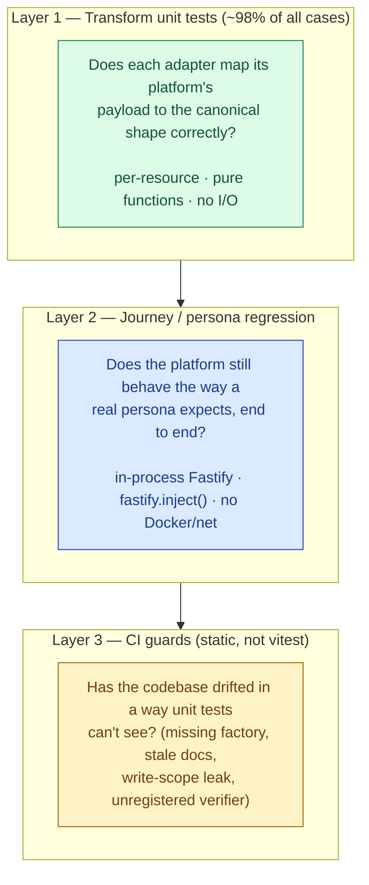

# Testing strategy

> [← back to overview](./README.md)

How the automated checks in this repo are organised, what each layer is _for_, and how to run them. The guiding rule: **every layer answers a different question, and a red run should name the thing that broke.**

For the step-by-step convention on writing a transform test (the factory pattern, the `metadata` passthrough rule), see [CONTRIBUTING §6](../../CONTRIBUTING.md#6-writing-tests). This page is the map; CONTRIBUTING is the how-to.

---

## The three layers



| Layer | Question it answers | Mechanism | Lives in |
|---|---|---|---|
| **1 · Transform unit** | Does `transform<Resource>` map a raw payload to the canonical Zod shape? | Pure-function calls + `Schema.parse()`; no I/O | `apps/integration-server/tests/verticals/<v>/unit/adapters/**` |
| **2 · Journey regression** | Does a real persona's flow still work end-to-end? | Boots a throwaway Fastify server, drives it with `fastify.inject()` | `apps/<app>/tests/journeys/**` |
| **3 · CI guards** | Did structure drift outside what a test would catch? | Static `tsx` scripts that read source/docs | `scripts/check-*.ts` |

---

## Layer 1 — Adapter transform unit tests

The overwhelming bulk of the suite. The entire value proposition is "1,548 platforms map to one canonical shape," so the test that matters most is: *given a representative raw payload, does the transform produce the right canonical object?*

- **Shape.** One test file per transform: `tests/verticals/<v>/unit/adapters/<slug>/transform/<resource>.test.ts` mirrors `src/.../transform/<resource>.ts`. (A handful of adapters use a single flat `<slug>.test.ts`.)
- **What each asserts.** ≥2 verified field mappings (id, amount, status, dates…), the `metadata` passthrough rule, and `expect(() => <Resource>Schema.parse(result)).not.toThrow()` — so the output is provably schema-valid, not just shaped by eyeball.
- **Money / enums / dates.** Amounts must be integer minor-units (`Amount = z.number().int()`); status/type fields must be in the canonical enum; datetimes go through `toIsoDatetime`. A transform that emits a decimal, an out-of-enum string, or an empty `z.email()` is a **bug**, and these tests catch it.
- **Coverage is enforced at 100%.** Every adapter that ships a `transform/` directory has a test. See the ratchet guard below.
- **The schema assertion is the one that finds real bugs.** Every transform test should include:

  ```ts
  it('produces canonical output that satisfies the schema', () => {
    const result = transformInvoice(raw)
    expect(() => InvoiceSchema.parse(result)).not.toThrow()
  })
  ```

  This is enforced by `pnpm check:transform-schema-assertions`, ratcheted the same way as the coverage guard above. The defect classes that actually occur in transforms — decimal amounts where minor-unit integers are required, out-of-enum status strings, empty `z.email()` values — are caught by `Schema.parse()`, and not by the ~75k single-field `toBe` assertions surrounding it. Those are still worth keeping (a field sourced from the wrong raw key is caught by nothing else, and they cost ~3% of suite wall-clock), but the schema assertion is the one that finds real defects.

  The baseline (`scripts/transform-schema-assertion-baseline.json`) grandfathers **337** files. `scripts/backfill-schema-assertions.ts` adds the missing assertion to a nested-layout test file mechanically; note it parses test files with the TypeScript compiler API, so it is pinned to the TypeScript 6 side of the two-compiler setup described in [Build & workspace](./build-and-workspace.md#two-typescript-compilers-on-purpose) and cannot run on TypeScript 7 until 7.1 ships an API. The guard's discovery rule excludes transform-directory test files for pure helper modules (basenames `shared`/`helpers`/`utils`/`common`, e.g. paytm's `transform/shared.ts` date/currency helpers, podio's `transform/helpers.ts` field accessors) — no `<Resource>Schema` can exist for them, so the guard's schema-resolution convention could never be satisfied by construction. The baseline's composition is exactly:

  | Segment | Count | Why it stays baselined |
  |---|---|---|
  | Flat-layout files (`unit/adapters/<slug>-transform.test.ts`, many resources per file) | 290 | Adding assertions here needs a per-resource codemod, because each flat file covers many resources — one assertion per file is not enough. |
  | Stub adapters whose transform unconditionally `throw`s (no output to assert against) | 28 | Legitimately unfixable — e.g. Yuki has no purchase-invoice API, Financio has no orders endpoint. |
  | Resources with no standalone top-level canonical schema for the codemod to target (e.g. `address` in logistics, `variant` in ecommerce) | 19 | Structural, not a defect — nothing to assert against at that granularity. |

  **The genuine-bug segment is empty — treat that as a floor, not a finish line.** One entry sits at "mitigated" rather than "fixed" and is worth knowing: NetSuite's invoice transform emits `raw.currency.refName` only when it genuinely matches `/^[A-Z]{3}$/` and drops it otherwise, because Oracle's own docs show `id` is the currency *record's internal ID* (`"1"`) and `refName` is the display name — neither is dependably an ISO code. A renamed or localised currency record therefore loses its currency instead of emitting an invalid one, and resolving id→code via `record/v1/currency/{id}` remains open. Because every baseline entry is structural, **any growth in the nested (non-flat) segment is a real regression**. The full set of related, deliberately-carried conformance caveats (under-detection in the guard itself, inconsistent sibling files, etc.) is at `docs/architecture/transform-conformance.md`.

  **A small baseline is not proportional defect-detection power, though.** Of the 2,438 nested-layout schema assertions, 1,835 (75.3%) target one of 13 **accounting** schemas (`Account`, `Organization`, `Contact`, `Invoice`, `Bill`, `Journal`, `CreditMemo`, `TaxRate`, `Order`, `PurchaseOrder`, `Transaction`, `SalesOrder`, `Expense`) whose every field is `.optional()`/`nullish()`. Those can't fail on a missing field, and Zod strips unknown keys by default so they can't fail on an extra one either — the only thing they catch is a *present* field with the wrong shape (a decimal where an int is required, an out-of-enum string), which is exactly the class real transform bugs fall into, so they're not ceremony. The remaining 603 (24.7% — `Contact`, `Company`, `Note`, `Deal`, `Activity`, `Pipeline` in **crm**, `Fulfillment` in ecommerce) assert against a schema that requires `id` and `metadata` on every one of them, plus one more field depending on the resource — `name` (`Company`, `Pipeline`), `title` (`Deal`), `content` (`Note`), or `orderId` (`Fulfillment`) — except `Contact` and `Activity`, which require nothing beyond `id`/`metadata`. Those can catch a field silently going missing, not just malformed. (crm has its own `Contact`/`ContactSchema`, distinct from — and, unlike — accounting's `Contact`; resolve which schema a test actually imports before trusting a count like this one, not just the schema's name.) The sharp edge is the smaller, required-field slice.

**The ratchet is file-granular, not function-granular.** A file counts as covered once it has *one* passing schema assertion, even when its transforms import two or more resource-transform functions. 21 files sit in that gap — each contains a schema assertion for only one of the transform functions it imports, while a sibling function in the same file has no schema coverage at all. `accounting/adapters/frontaccounting/transform/contact.test.ts` is the example: `transformDebtor` has a schema assertion, `transformSupplier` does not, and the guard has no way to notice because it only checks "does this file contain a `Schema.parse()` call anywhere," not "does every transform function this file imports get parsed." Treat this as a known gap, not a latent surprise, when auditing coverage by function rather than by file.

```bash
pnpm --filter integration-server test                 # all unit tests (7,790 files)
pnpm --filter integration-server test <slug>          # filter to one adapter while iterating
```

**Adjacent unit tests** (same `_unit_` spirit, different target):

| Dir | Covers |
|---|---|
| `tests/verticals/<v>/unit/*.test.ts` | the canonical Zod schemas themselves |
| `tests/adapters/` | cross-adapter parity — e.g. every OAuth adapter honours a scope override |
| `tests/webhooks/` | the webhook-triggered resource-refresh pipeline |
| `tests/workers/` | the token keep-alive / sync worker state machine |
| `tests/core/` | server-construction concerns that aren't vertical-specific (currently the opt-in CORS origin policy) |
| `packages/shared/tests/` | the cross-cutting layer every app depends on (auth, data-store, control-plane routers, event-emitter, schemas) |

---

## Layer 2 — Journey / persona regression tests

Each app has a `tests/journeys/` suite. A `describe('Journey: …')` is a story told from one persona's point of view (an operator, a developer holding an API key, an end-customer following a Connect Link); each `it` is a step that asserts a promise the platform makes. **If a change quietly removes a behaviour, the named journey goes red and says which promise broke.**

- **In-process, hermetic.** A throwaway Fastify server is booted per test (`buildTestServer()` / `buildAdminApiTestServer()` / `buildGatewayTestServer()`), backed by throwaway SQLite, and driven with `fastify.inject()`. No Docker, no network. Upstream calls are stubbed (`vi.spyOn` on the registry adapter, or `global.fetch`); the SSRF-guarded outbound delivery path is asserted at the durable-queue layer instead of over the wire.
- **What lives where.**

  | App | Journeys cover |
  |---|---|
  | `integration-server` | OAuth connect **and** callback (token exchange, CSRF/state guard), API-key scope + tenant isolation, Connect Link mint/open/revoke, read-only scope policy, connection-ref validation, data-store mode wiring + cache read-through, inbound webhook fail-closed, outbound signed webhook on consume, API-key rate limiting |
  | `admin-api` | first-run setup + sign-in, login lockout (429), RBAC (admin / operator / viewer, including a viewer that can look but not touch), user CRUD, audit trail, Connect-Link template create, SSO provider registration, SCIM provisioning, login-options surface |
  | `webhook-gateway` | deliver to vertical, durable-on-failure (queue + retry), dead-letter inspect + replay |
  | `admin` | local sign-in, bad-password rejection, sign-out, fresh-deployment wizard redirect, wizard resume + upstream-rejected credentials step, SSO/user management, Connect Link mint (including the pinned-link form), connection search + sync + repeated-refresh-failure surfacing, platform pages, API-key mint/label rules, upstream-error rendering, and the viewer role (reads everything, changes nothing) |
  | `docs-server` | the docs site responds (landing, Swagger UI, specs, platform catalog, search index, health) |

- **mcp-server** has no `journeys/` dir but an equivalent **stdio e2e** pair (`tests/e2e-stdio-*.test.ts`): it spawns the real binary, does the MCP handshake, and asserts the read-only tool surface and tenant-vs-end-user tool segregation. `tests/e2e-protocol-eras.test.ts` sits alongside them and pins the two things the MCP 2026-07-28 migration is for: that both protocol eras are served (a 2025-era client still opens with `initialize` while a modern client carries protocol and identity per request in `_meta`), and that unknown query params still reach the REST API through the `list_*` tools' loose object schemas.

```bash
pnpm --filter integration-server exec vitest run tests/journeys/integration-server.journeys.test.ts
pnpm --filter admin-api exec vitest run tests/journeys/admin-api.journeys.test.ts
```

---

## Layer 3 — CI guards (static checks)

These are `tsx` scripts, not vitest. They fail the build on classes of drift a unit test can't see. Most have a `:soft` variant (warn-only) for local use — `check:{webhook-verifiers,adapter-parity,read-scopes,transform-tests,transform-schema-assertions,adapter-declarations,clone-signatures,paging-contract,secret-passthrough,server-logging,warning-gates,published-packages,license-keys,no-license-bypass}`; `check:guides`, `check:openapi-examples` and `check:docs` do not. `check:paging-contract:soft` is warn-only for verdicts but still exits 1 when its harness is broken (a request escaped the recorder, nothing was measured, a full sweep fell under its coverage floor, or shared/axios would not load), because then none of its verdicts can be trusted. The guards have their own unit tests: `pnpm test:guard-scripts` runs `tsx --test` over the 29 `scripts/*.test.ts` files `package.json` lists, as its own CI step, so a guard cannot quietly stop detecting what it was written for. Among them is `scripts/license-test-matrix.test.ts`, the licensing coverage manifest: every licensing requirement it lists must be pinned by a `[L7:<ID>]`-tagged, non-skipped test title, and a tagged guard test must be in that list.

| Command | Fails when… |
|---|---|
| `check:transform-tests` | an adapter ships a `transform/` without a matching test — a **one-way ratchet** (the `transform-test-baseline.json` allowlist only shrinks; an empty baseline, the current state, means **100% is enforced**) |
| `check:transform-schema-assertions` | a transform test doesn't assert its output against the canonical schema — same one-way-ratchet shape (`transform-schema-assertion-baseline.json`); currently 337 grandfathered files: 290 flat-layout + 28 stub-throw + 19 no-schema (see Layer 1 above) |
| `check:adapter-declarations` | an adapter's `adapters/<slug>/metadata.ts` declares a resource in `unavailableResources` while its `index.ts` defines an interface method for it (the case it was built for: ShipBob gained `listCarriers` while `carrier` stayed declared unavailable — nothing reads the declaration at runtime, so nothing else notices). Static parsing only: the resource ↔ method map is derived from each vertical's `adapter/interface.ts`, and "implemented" is a member of `index.ts` whose name is on that interface, so stubs count. Same one-way-ratchet shape (`adapter-declaration-baseline.json`, 7 grandfathered logistics `rate` contradictions, each needing a method deleted or a live check). `availableResources` means the *platform* has it, not that we implemented it — available-but-unimplemented is reported as backlog (`--report` lists it), never as failure, so a declaration flip and its implementation merge in either order. Not the same file as `check:adapter-parity`'s `platforms/metadata.ts`. **Coverage is partial and the script says so on every run**: it can only evaluate an adapter that has a `metadata.ts`, and 737 of 1,548 do not (742 when the ratchet was added) — including `shopify`, `bigcommerce`, `vtex` and `commercetools`, the reference adapters others are copied from. Those were silently skipped until they were given their own ratchet (`adapter-metadata-missing-baseline.json`): adding a new adapter without a `metadata.ts` now fails the gate, and that count may only go down. Read "811 adapters, 0 contradictions" alongside the coverage line beneath it, never on its own |
| `check:adapter-parity` | a platform in `metadata.ts` has no factory in `factories.ts` (would list-but-not-connect). Deliberately directional: the reverse — a factory with no metadata entry, connectable but invisible in the catalog — only **warns**, and a non-fatal warning can be ignored indefinitely, leaving adapters connectable but invisible in the catalog |
| `check:money-scaling` | money scaled by a literal `* 100` / `/ 100` instead of `majorToMinor`/`minorToMajor` from `@opensteward/shared`. Correct for the ~95% of ISO-4217 currencies with two fractional digits, silently wrong for the rest: JPY and KRW have none, so ¥1000 is reported as ¥100,000; BHD, KWD and OMR have three, so the amount comes out a tenth of its real value. `Iso4217Currency` is regex-based, so nothing stops those codes reaching any adapter, and accounting already maps JPY in invoice-ninja's currency table. Anchored on a money-ish identifier so percentages and rate limits do not trip it; `* 1000` is deliberately not flagged, since a bare 1000 is more often milliseconds. Same one-way-ratchet shape (`money-scaling-baseline.json`, 548 grandfathered across six verticals — 220 accounting, 104 ecommerce, 93 logistics, 58 payments, 51 inventory, 22 crm), because threading the currency to each call site is per-adapter work, not a codemod. Hits inside an `untransform*` body are labelled `[WRITE]` and listed first: a bad read reports a wrong number, a bad write persists one on the customer's own records |
| `check:clone-signatures` | a non-reference adapter's `adapters/<slug>/{index,client,constants}.ts` carries one of a reference adapter's vendor-specific request paths — projects/Asana's `/tasks/{id}/stories` or `/stories/{id}`, customer-support/Zendesk's `/tickets.json` or `/users.json`, inventory/Cin7-Core's `/productList` or `/ref/stockonhand` (the adapter was scaffolded from the reference adapter and never rewired to its own vendor's real API — its transform tests mock the response shape, not the request, so nothing else catches it). Static parsing only, reference adapters (`asana`, `zendesk`, `cin7-core`) excluded from their own rule. Same one-way-ratchet shape as `check:adapter-declarations` (`clone-signature-baseline.json`, 88 grandfathered offenders: 39 projects + 25 customer-support + 24 inventory). Signatures are anchored to the literal path's start and end (not a bare substring) specifically to exclude real vendor endpoints that share a word with the reference adapter — e.g. Kantata's real `` /stories/${id}.json `` contains `/stories/${id}` but isn't Asana's bare path, and Taiga's real `/userstories` is one word, never nested under `/tasks/{id}`. payments' `/charges` is a **sweep, not a signature** — real processors (Affirm, Fiserv, Unzer, …) legitimately expose a `/charges`-suffixed endpoint of their own, so it's collected under `--report` only and never fails the build or feeds the baseline |
| `check:published-packages` | a package `publish-npm.yml` puts on npm (`@opensteward/mcp-server`, `@opensteward/sdk`, `@opensteward/license-token`) has a `workspace:`, local-path (`file:`, `link:`, `portal:`, a bare path) or `@opensteward/*` dependency in any dependency field, an npm alias to one included — `pnpm publish` turns `workspace:*` into a version the public registry cannot resolve — or carries the wrong `license` (Apache-2.0 for mcp-server and sdk, Elastic-2.0 for license-token), or its `name` differs; or the workflow's `for dir in …` publish loop or its "Build packages" `--filter`s drift from that list |
| `check:field-classification` | a stored resource type has no field classification, or a field named like personal data is classified `public`/`internal`. The admin data viewer and exports mask records by these sidecars (`verticals/<v>/schema/classification.ts`); an unclassified type is served fully masked and a mis-classified PII field in clear. Business-facility addresses are allow-listed in the script with a reason, and a stale allow-list entry fails too. See [data classification](../security/data-classification.md) |
| `check:route-access` | an admin-api route has no authentication guard and is not on the reasoned `PUBLIC_ROUTES` allow-list; a route on a data-access surface (`/api/data`, `/api/dashboards`, `/api/destinations`, `/api/sql-access`, `/api/analytics/superset`, `/api/roles`, role and scope assignment) checks no permission, or not the one [permissions-and-roles.md](./permissions-and-roles.md) documents for it; or a route that fails closed for tenant-restricted callers (`denyRestrictedScope`) does not declare its `403` in OpenAPI. A vitest (`apps/admin-api/tests/unit/route-access.test.ts`, also part of admin-api's suite) rather than a `tsx` script: it boots the real server with a recorder (`core/auth/route-access.ts`) and reads the tag each guard function carries, so it sees plugin-level `addHook` guards as well as route-level ones. Stale allow-list entries fail too |
| `check:paging-contract` | a list method stops paging by the caller's limit and position. Unlike the static guards it **runs the adapters**: every vertical's `ADAPTER_FACTORIES` is loaded against `@opensteward/shared`'s built `dist`, and every `list*` method its `adapter/interface.ts` declares is called for page 1, page 2 and page 1 again through the real `parseListQuery` (`limit=10`), then for page 1 at `limit=7` and at `limit=500` (the router's ceiling, where a method's own clamp shows), with axios (both its CJS and ESM builds) and `fetch` replaced by an in-process recorder; a socket or DNS lookup that gets past the recorder is refused and fails the gate. The recorded requests are classified by **value, not parameter name** (a name-based predecessor misread OData's `$skip` and counted Exact Online as ignoring `page`), and a size must **follow** the limit — equal 10 at `limit=10` and 7 at `limit=7` — since about twenty adapters default to 10 anyway. Failing verdicts: `page-ignored` (page 2 repeats a page-1 request carrying the limit once values that differ between the two page-1 calls — timestamps, nonces, signatures — are masked), `page-ignored-unsized` (the same, with no size anywhere: an unpaginated fetch returned on every page, or only a lookup that found nothing — it fails but is not counted as coverage), `page1-skips` (page 1 already starts one page in: `offset = page × limit`, or a page number sent as `page + 1`), `page-stride` (the position moves by neither 1 nor the limit), `first-page-only` (page 2 answers empty without asking after page 1 asked for only `limit` rows), `over-asks` (limit + 1 — zero since the router stopped probing) and `fixed-size` (a page size that does not follow the limit: a constant, or a whitelist). Passing: `ok`, `single-page` (page 1 asks for no size and page 2 answers empty without a request — right for an unpaginated upstream only while the collection fits the caller's page; `pageLocally` pages it at any size), and `local-page` (page 1 and page 2 both report `pagedLocally` through the page sink and neither threw, the requests alone are not `ok`, page 1 neither skips rows nor over-asks, no position moves by more than the limit or strides beside a size that follows it, and page 2 does not repeat a request whose size follows the limit — that last is `page-ignored`, the shape of `pageLocally` over one sized page). `refused` passes too: every probe call threw `statusCode: 501, code: 'NOT_SUPPORTED'` before sending any request — what an adapter throws for a list the platform cannot serve, and what the sync worker skips — so it is in no baseline, never a declared-max violation, and left out of the coverage share on both sides (measured ÷ (total − refused), the refused count printed apart); a refusal that sent a request first, or that any other probe call does not repeat, is judged as before. `pagedLocally` (`UpstreamPageMeta`, set through `reportUpstreamPage`) says a page was cut from rows the adapter had already fetched: `pageLocally` and `pageByRows` set it themselves, and a hand-rolled window may (Epos Now's V4 window and Lumin Sign's templates do); a window that pages at less than `limit` (a direct call past its maximum) reports that `pageSize` too. Such a page repeats its request for every caller page inside one upstream page by design, so the report stands in for the requests the gate would otherwise compare; it is honest-only, the unit tests of the helpers and of each window are what prove every row is served once, and `local-page` is therefore not counted as coverage (the coverage line prints it apart). **A declared maximum is a promise with no ratchet:** on an adapter that declares `capabilities.maxPageSize`, a list method whose verdict is `fixed-size`, `page1-skips`, `page-stride`, `first-page-only` or `over-asks` fails the gate even with a baseline entry, because the sync worker pages such an adapter at `min(500, maxPageSize)` and takes a shorter page as the end of the collection. There are two ways past it, each listed with its evidence: `DECLARED_MAX_ALLOWLIST` in the script (one method per entry, with the reason it is a gate false positive; empty today), and `local-page`, which is never a violation and whose hand-rolled reporters are listed in `LOCAL_PAGE_REPORTERS` with the test that proves each window (a full sweep fails on an unlisted reporter, an entry that no longer reports, or a test that never checks `pagedLocally`). `page-ignored(-unsized)` methods on those adapters are listed by `--report` rather than failed — unless the method sends the same plausible size on every call (`per_page=25` beside a constant `page=1`), which a paginated upstream would answer with 25 rows, so it fails as `fixed-size`. Three strict baselines: `paging-contract-baseline.json` (every failing method with its verdict), `paging-contract-unmeasured-baseline.json` (methods the stub credentials cannot drive to a measurable request — including `unmeasured-error` calls that threw on the stub body before their requests moved or carried a size — plus constructors that throw on the stub config) and `paging-contract-clamp-baseline.json` (`<method> serves <n> of <asked>`: a method that sends fewer rows at the ceiling than the router asks it for, and does not report that `pageSize`); `--report` prints the current counts by vertical and verdict. A new identity fails, **and so does a baseline entry that is no longer produced** until `--update` banks it; the verdict is part of the identity, so a change of class surfaces, and identities are keyed by slug, so **an adapter scaffolded from its vertical's reference adapter inherits that adapter's verdicts under a new identity and fails its first run** (easypost, stripe, docusign, asana and zendesk all carry failing entries): fix its paging, and bank with `--update` only as a last resort. **Read the coverage line**: a `Coverage: <measured> of <total> list methods measured (<percent>)` line is printed on every run, with the `page-ignored-unsized` rows counted apart, and the gate refuses to pass at all — `--soft` included — when nothing is measured or paged locally, when shared's `dist` is stale (a required export is missing, or its pagers do not report `pagedLocally`), when a full sweep measures under 75% or finds no adapter declaring `maxPageSize` (the invariant would have judged nothing), or when a request escaped the recorder. Blind spots: a cursor walk through the shared pager is judged on page 1 only (the stub page carries no cursor); a page number used as a row skip (`skip=1 → 2`) and a 0-based API sent `page` unchanged are, by value, correct 1-based page numbers; a lookup that finds nothing reads as `page-ignored-unsized`, or as `single-page` once page 2 returns early, without its list request ever being seen; a call that throws on the stub body is `unmeasured-error` even when what it sent was the list request; a page 1 that walks the whole upstream itself reads as `first-page-only`; an adapter that pages locally inside a fixed-size upstream page (Epos Now's 200-row V4 pages, which take no size) repeats its request for every caller page inside one upstream page, and a size snapped to a documented whitelist (Lumin Sign's 10/25/50) does not follow the limit: without a `pagedLocally` report they would read as `page-ignored-unsized` and `fixed-size` though both serve every row once, so both report it; a `local-page` verdict rests on the adapter's own report, so the gate checks only the requests' shape for it, and `pageLocally` over one page of a constant size (`?per_page=100`) truncates yet reads as `local-page`, its requests being exactly those of a correct window over fixed 100-row pages; and an over-return (a method returning more rows than asked, such as two collections concatenated) is invisible, because the stub pages are empty. `--report` prints the vertical × verdict table, `--json=<path>` dumps every probed request, `--only=<vertical>[/<slug>]` probes a subset. Measured: ~7s on a warm tsx cache, ~15s cold |
| `check:webhook-verifiers` | an adapter shipping a `webhook.ts` isn't registered in its vertical's `WEBHOOK_HANDLERS` (would accept unsigned bodies) |
| `check:no-license-bypass` | application source has a license off switch or side door. It fails on: an env read named like `LICEN[CS]E`/`ENTITLE` (only integration-server's `config.ts` may read `OPENSTEWARD_LICENSE(_FILE)`); a name shaped like a bypass, in any case and with `_`, `-`, `.` or camelCase between its words, so identifiers, settings keys and CLI flags alike (`SKIP_LICENSE`, `licenseDisabled`, `'skip_license'`, `--no-license-check`, `licenseEnabled`, `enforceLicense`, `unlicensedMode`, …); any use of the process environment in `packages/shared/src/licensing` or `packages/license-token/src`, destructuring and `process?.env` included (whether dev keys are trusted depends only on the build); `getKeyring(`, `verifyLicense(` or `keys.dev` outside licensing; a quoted dev kid outside `keys.dev.ts`; a static `keys.dev` import, which would crash every production image; a comparison, `switch`, `includes()`, lookup (`TABLE[s.tier]`) or method call on `tier` (`s.tier`, `s['tier']`, a renamed destructure `{ tier: t }`, or a plain alias `const t = s.tier`) in code that touches licensing, by package or relative import or through `LicenseStatus`/`LicenseStatusDTO`, outside the display code (licensing never branches on the plan); a licensing import other than node crypto/fs/path, zod, the token package, type-only `../db` and its own files, with relative paths resolved (so `'./../x'` is not its own) and `import()`, `require()` and `process.getBuiltinModule()` held to the same list, a computed or interpolated specifier refused; or a global network call in licensing (`fetch`, `WebSocket`, `EventSource`, `XMLHttpRequest`, `WebTransport`, `sendBeacon`), directly, through the global object (`globalThis`, `global`, `self`, `window`), destructured or aliased from it first (a parameter default `g = globalThis` included), or taken uncalled (`const f = fetch`), which needs no import (licensing makes no network call and reads no runtime settings), while a method named `fetch` and text in a string are not calls. It also fails, `--soft` included, when the scan did not reach integration-server's `config.ts` and both licensing directories, so a broken walk or pre-filter cannot print success; the success line counts the files read and scanned. Aimed at accidents and convenience flags, not obfuscation |
| `check:read-scopes` | a `readScopes` entry isn't in that platform's `recommendedScopes` catalog (the net against a **write** scope leaking into a "read-only" Connect Link) |
| `check:secret-passthrough` | a secret `scripts/generate-secrets.sh` mints never reaches the service that reads it — the join between generator, `.env.example`'s `read by:` annotations and `docker-compose.yml`. The failure class: a secret minted, documented and set but never forwarded silently disables the control it guards (403'd admin calls, unauthenticated first-run setup), with every file correct on its own. A second rule covers operator knobs read from a service's own `config.ts` (`RATE_LIMIT_MAX`). A third rule (`REQUIRED_PASSTHROUGH`) pins variables that must reach exactly the named services, whatever `.env.example` says: `OPENSTEWARD_LICENSE` and `OPENSTEWARD_LICENSE_FILE` reach integration-server and no other service, not even through another service's `env_file:`, in `docker-compose.yml` or any root overlay (integration-server is the only service that reads the license) |
| `check:server-logging` | a service builds a `Fastify({ … })` instance whose logger doesn't come from `buildLoggerConfig` — that factory is what applies `LOG_REDACT_PATHS`, so bypassing it silently drops redaction for auth headers, cookies and credential-bearing upstream errors |
| `check:license-keys` | the trusted license key set is not exactly `k2026a k2026b k2026c r2026a r2026b`; a key is malformed, duplicated or reused as a dev key; `DEV_KEYS.dev1` differs from the dev fixture; or `keys.dev` is reached any way but keyring.ts's one guarded `require('./keys.dev')`. `--artifact <dir>` (the Dockerfile builder, production profile) fails on a `keys.dev.*` file, a quoted dev kid or dev public-key bytes in compiled output, or a compiled keyring that trusts anything but the five. `--release` (`release.ts`, the images.yml prepare job) also fails on a placeholder key, and on a revocation list that is missing, does not verify under a production kid with the revocations assertion, is dated ahead, or is older than the one the previous `platform/v*` release shipped (a git error reading that release fails closed); older than 90 days only warns. `scripts/image-license-probe.cjs` checks a built image the same way (compose-smoke, images.yml build job), plus the dev keypair fixture and any baked-in private key |
| `check:docs` | any generated artifact (OpenAPI / Postman / SDK / CLI) is stale vs its source |
| `check:guides` / `check:openapi-examples` | a guide references a missing anchor/asset; an OpenAPI component field lacks an example |

---

## Live integration tests (opt-in)

`tests/integration/` exercises the full server stack against **real** upstreams and **skips without credentials**:

- `multi-vertical.test.ts`, `data-store-modes.test.ts`, `openapi-server-variables.test.ts` — real Fastify instance, connection lifecycle, cache modes, the compiled-defaults < config.yml < admin-DB resolution behind `GET /openapi/server-variables` (always run).
- `fortnox/` — live Fortnox sandbox; skipped unless a `.tokens.json` is present.
- `easypost.test.ts` — live EasyPost test mode; skipped unless `EASYPOST_TEST_API_KEY` is set.

---

## Browser E2E (opt-in)

`e2e/` (`@opensteward/e2e`) is a Playwright workspace that drives a real browser against an **already-running** stack — docker compose or the dev servers; it starts nothing itself. It answers a question no layer above does: the `tests/journeys/` suites drive Fastify in-process and assert on HTML strings, so they never execute a page's client-side `<script>` — purely client-side behaviour (e.g. a credential form's redirect handling) is invisible to them. Every spec **skips** rather than fails when no stack is listening, and the workspace's script is `test:e2e` — deliberately not `test` — so `pnpm -r test` never drives a browser:

```bash
pnpm test:e2e     # root script → pnpm --filter @opensteward/e2e run test:e2e
```

Coverage is tiered:

| Tier | Needs | Covers |
|---|---|---|
| 1 | a running stack, zero config | the public surface (branded error pages, landing-page script, health, docs portal rendering) |
| 2 | admin login — `OS_E2E_ADMIN_USER` / `OS_E2E_ADMIN_PASSWORD`, falling back to the root `.env`'s `ADMIN_USER` / `ADMIN_USER_PASSWORD` on a compose deployment | login, test-mode API-key mint/revoke (verified live against the sandbox), connect-link mint + open from the customer's seat |
| 3 | platform credentials + a real end-user sandbox login | the full OAuth consent click-through — no specs exist at this tier |

See `e2e/README.md` for the env vars and the never-against-production warning (tier-2 journeys create and clean up real rows). This suite is not in any CI test job today.

---

## How CI runs it

`.github/workflows/test.yml` is the **regression gate**, with four jobs. Every job pins `TZ: UTC` at the workflow `env:` level. This isn't cosmetic: the shared `toIsoDatetime` pins offset-less datetimes (e.g. MySQL-style `'2019-11-27 11:40:36'`, which several platform APIs return) to UTC, but many adapter-local datetime helpers bypass it and hand such strings to a bare `new Date()`, which resolves them in the *host's local zone* (see `docs/architecture/transform-conformance.md`) — so on an unpinned runner, the same fixture yields a different instant depending on which machine ran it, and any assertion against that instant becomes host-dependent. `apps/integration-server/vitest.config.ts` pins the same `env: { TZ: 'UTC' }` again at the vitest-config level, belt-and-braces with the workflow pin, and gives the workspace the same `{ globals: true, environment: 'node', include: [...] }` shape as every other workspace's config (`include: ['tests/**/*.test.ts']`, matching `packages/{cli,sdk,shared}` and `apps/mcp-server`; the remaining apps split `tests/unit/**` from `tests/journeys/**`).

- **`test` (guards + app suites)** — `pnpm build`, then the guards in the table above that CI runs — static parsers that take seconds, plus `check:paging-contract`, which executes every adapter against a request recorder (~7s on a warm tsx cache, ~15s and ~1.3 GB peak RSS cold) — then two guard-self-test steps (`test:warning-gates`, `test:guard-scripts`), then three **ratcheted** gates (test-file typecheck, lint, prettier — see below), then the 12 non-integration-server workspaces via `turbo run test --filter='!integration-server'` (e2e is in the sweep but exposes only `test:e2e`, no `test` script, so nothing runs there by design), then `check:docs` last because it mutates the working tree. Measured: ~135s for the build-plus-guards half; the full job lands around 5–6 min.
- **`test-adapters` (adapter suites, 6-way matrix)** — integration-server only, split with `vitest --shard=i/6`. Sharding is by file: ~1,300 files and ~14,000 tests per shard. The suite is 7,790 files, and vitest spends ~1,258s loading modules against ~42s executing assertions, so wall-clock tracks file count and parallelism is the lever. `fail-fast: false` so one red shard still reveals the others. The partition is inventory-identical to a full run — see [The coverage invariant](#the-coverage-invariant). Measured: ~10–11 min per shard.
- **`test-postgres` (dual-backend)** — `bash scripts/test-pg.sh` against a Postgres service container (`TEST_PG_URL`): the same script as `pnpm test:pg` locally, which starts its own throwaway container instead (data on a tmpfs, removed with `docker rm -f -v` on every exit path). It re-runs the store-backed suites (`@opensteward/shared`, `@opensteward/destinations`, `admin-api`, `webhook-gateway`) against Postgres, serially (`turbo run test --concurrency=1`). `shared`, `destinations` and `admin-api` reset per file with `DROP SCHEMA public CASCADE` and additionally gate `fileParallelism: false` (on `TEST_DATABASE_URL`) so their own files can't collide on the one shared database. `webhook-gateway` is different: it resets via targeted `DROP TABLE IF EXISTS deliveries; DROP TABLE IF EXISTS _schema_migrations`, not a schema-wide drop, and its `vitest.config.ts` has no `fileParallelism` gate at all — isolation there rests entirely on turbo's job-level `--concurrency=1`. Then the integration-server files that read `TEST_DATABASE_URL` (found by grep — SQL access, metrics, db-copy), never its adapter suite, run with `--no-file-parallelism` because the metrics suite drops `public` per test. The db-copy suites put each Postgres side in a schema or database of their own. Because every suite drops `public`, `TEST_PG_URL` refuses a database named `opensteward` or one whose `public._schema_migrations` has rows unless `TEST_PG_FORCE=1`.

- **`compose-smoke` (compose stack smoke)** — the only job that ever starts `docker-compose.yml`, and the only one that tests the *deployment artifact* rather than the source, so it sits outside the three layers above. It builds all five published images, brings the stack up with `docker compose up -d --wait` (one flag that asserts the entire `condition: service_healthy` chain), curls `/health` on every published port **from the runner** rather than trusting the healthcheck running inside the container, and then mutation-tests every healthcheck: it reads the command back from `docker inspect --format '{{json .Config.Healthcheck.Test}}'` — never hardcoded, so it keeps testing whatever the command becomes — and runs it twice, verbatim (must exit 0) and with the service's port swapped for one nothing is listening on (must exit non-zero). Both directive forms are handled and they are not interchangeable: `["CMD", …]` is execed as argv, `["CMD-SHELL", "…"]` is a single string run under `/bin/sh -c`; `["NONE"]` is a hard failure, because a service with no healthcheck turns every `service_healthy` gate pointing at it into "container started". That last assertion is the whole point — `up --wait` passes identically against a healthcheck that always returns success, and node one-liners that swallow their connection error are a real form — so a **second step re-runs the same script with `scripts/compose-smoke-fail-open.yml` overlaid and requires it to go red**, once per fail-open shape. The negative control cannot quietly stop asserting. Vitest sees none of this: the entire suite stays green against an image whose healthcheck binary does not exist, which is exactly what a base-image change (distroless, `node:*-slim`, anything without `wget`) produces. **Scoped, unlike the three jobs above**: it runs in full on pushes to `main` and on `workflow_dispatch`, and on a PR only when the diff touches `Dockerfile`, `.dockerignore`, `docker-compose.yml`, `pnpm-lock.yaml`, `.github/workflows/**`, `scripts/compose-smoke*`, `scripts/generate-secrets.sh` or what its licence section checks (`scripts/image-license-probe.cjs`, `scripts/check-license-keys*`, `packages/shared/src/licensing/`, `packages/license-token/src/`) — the accepted gap being that an app-source change that breaks container boot is caught post-merge rather than on the PR. Measured on a 2-CPU/8GB Docker VM (arm64), so indicative rather than a runner figure: cold build of all five images 141s (`--no-cache`; longest single step 46s, integration-server's `tsc`), warm build ~13s, `up --wait` 93s (the chain is integration-server → {admin-api, docs-server, webhook-gateway} → admin at `interval: 30s`), whole script ~4.5 min cold, meta-test ~100s on top. Run it locally with `pnpm smoke:compose` — stop your own stack first, it binds the same host ports.

`check:adapter-parity` and `check:webhook-verifiers` run in `security-audit.yml`.

### Branch protection and required checks

For a maintainer configuring required status checks, the split that matters is which checks report on *every* PR:

- **Safe to require:** `guards + app suites`, the six `adapter suites (shard N/6)` entries (a matrix job reports one check per shard — all six must be added individually; the workflow name alone covers none of them), `dual-backend (postgres)`, `compose stack smoke`, and `CLA signed` from `cla.yml`. `compose stack smoke` is safe to require *despite* being path-scoped, because the scoping happens **inside** the job — a first step computes a `run` output and the expensive steps are conditional on it — rather than with a workflow-level `paths:` filter. The job therefore always starts and always reports a conclusion, which is the property the path-filtered checks below lack. Both expensive steps gate on `!= 'false'` rather than `== 'true'`, so if the scope step's output ever goes missing the job **runs** rather than silently skipping everything and reporting green — a required check that asserts nothing is worse than no check at all. The CLA check in particular **must** be required to do its job: an unrequired failing check does not block merge, so without branch protection the CLA gate is advisory.
- **Do not require:** `audit` and `webhook-verifiers` (`security-audit.yml`) and the `helm.yml` jobs are **path-filtered** — on a PR that touches none of their trigger paths they never report at all, and a required check that never runs never satisfies branch protection, permanently blocking the merge. Requiring them means first removing the path filters or wrapping them in an always-runs job.
- **CodeQL** (`analyze (javascript-typescript)`, `codeql.yml`) runs only when the repository is public — free CodeQL scanning is public-repo-only, so the job is gated on `github.event.repository.visibility == 'public'` and reports `skipped` otherwise. Require it only after observing it complete with a real conclusion, since a `skipped` conclusion is not guaranteed to satisfy branch protection.

Fork PRs run cleanly: no `pull_request`-triggered workflow references repository secrets. The workflows that do touch real secrets (`images.yml`, `publish-npm.yml`, `marketplace-mirror.yml`) trigger on tag-push or manual dispatch only, so a fork cannot reach them. A fork PR's `test` job can *restore* the base repo's `.turbo` cache via the `turbo-${{ runner.os }}-` restore-key but cannot save one back — its cache-save step logs a non-fatal warning and the job runs slightly slower; that is expected, not a failure.

### Test-file typechecking

Test files are typechecked in two workspaces, integration-server and license-token. In integration-server, `apps/integration-server/tsconfig.test.json` (extending the app's own `tsconfig.json`, `include: ["src/**/*", "tests/**/*"]`) plus a `typecheck:tests` script cover its ~7,790 test files, run as `tsc --noEmit -p tsconfig.test.json`. In `packages/license-token`, its own `tsconfig.test.json` and `typecheck:tests` cover the token contract tests, which vitest would otherwise run with type errors in them. In every other workspace, `tests/**` sits outside `tsconfig.json`'s `include`, so test files there are not typechecked. `scripts/check-warning-gates.ts` lists both workspaces in `TYPECHECK_TESTS_WORKSPACES`, and `scripts/check-warning-gates.test.ts` fails when another workspace adds a `typecheck:tests` script without being listed. `tsc` here is the native TypeScript 7 Go binary — no V8, so `NODE_OPTIONS` heap flags are ignored entirely. The program is large: `tsc --extendedDiagnostics` reports ~27,400 files (`src/**/*` + `tests/**/*` plus transitively-pulled `node_modules` type declarations) and the compiler peaks around 4.2GB RSS. Because a Go binary killed by the OOM killer prints nothing at all (Node would print `FATAL ERROR:`), `CRASH_SIGNATURES` in `scripts/check-warning-gates.ts` also matches signal-shaped deaths, so an OOM-killed run fails loudly rather than being miscounted.

### The typecheck / lint / prettier gates are ratcheted — read this before trusting green

`scripts/check-warning-gates.ts` (one script, one gate name per invocation — `typecheck-tests` | `lint` | `prettier`) runs the gate's real command, extracts the same count a human would read off the raw output, and compares it against the matching entry in `scripts/warning-gate-baseline.json`. The count must land exactly on the baseline or the build fails: an increase fails with the delta (new problems were introduced), and — same as `check:transform-tests` — a *decrease* fails too, because that means real cleanup landed without banking it via `--update`, and an un-banked improvement is slack the count can silently grow back into before anyone notices. `pnpm check:warning-gates <gate>` (and the `:soft` variant, report-only) work the same way locally. A green `test` job means these three gates held their line.

| Gate | Command | Baseline in `scripts/warning-gate-baseline.json` | Scope |
|---|---|---|---|
| Test-file typecheck | `pnpm check:warning-gates typecheck-tests` (wraps `pnpm --filter integration-server --filter @opensteward/license-token --no-bail run typecheck:tests`) | **0 errors** | integration-server and license-token |
| Lint | `pnpm check:warning-gates lint` (wraps `pnpm -r run lint`) | **0 errors** — warnings are neither counted nor gated | **Only 5 of the repo's 13 workspaces have a `lint` script at all**: `packages/{shared,cli,platforms-ui,sdk}` and `apps/integration-server`. `pnpm -r run lint` silently skips the other 8 — `admin`, `admin-api`, `docs-server`, `mcp-server`, `webhook-gateway`, `codegen`, `design-system`, `e2e` — pnpm treats "no script" as nothing to run, not a failure. Those 8 have **zero lint coverage in CI**, ratcheted or otherwise (e2e's specs are Playwright tests, but they are still unlinted); a green gate is not a repo-wide statement. |
| Prettier `--check` | `pnpm check:warning-gates prettier` (wraps `pnpm exec prettier --check "scripts/**/*.ts" "packages/**/src/**/*.ts"`) | **0 files** | `scripts/` + `packages/*/src` TypeScript only. Markdown is deliberately excluded — bulk-reformatting markdown would bury real diffs. The codegen emits prettier-clean output for `packages/cli/src/generated` and `packages/sdk/src/generated` directly, so a `docs:all` run does not introduce failures. |

The lint and prettier baselines sit at zero, so with the floor already at 0 the
only way those two fail is an increase: a red `lint` or `prettier` step is
unambiguously a new problem introduced by the branch under test, not a stale
baseline.

### Known gap: no surfaced summary

These three gates ratchet the same way `check:transform-tests` / `check:transform-schema-assertions` do (the "Layer 3 — CI guards" table above): `scripts/check-warning-gates.ts` compares the measured count against `scripts/warning-gate-baseline.json` and fails the build on any change, up or down (see the ratchet section above for why a decrease fails too). What the gates lack is a **surfaced summary**: the counts live only in this doc, in `test.yml`'s inline comments, and in the ratchet script's own stdout — nothing writes "0 lint errors / 0 prettier files / 0 typecheck errors" anywhere a PR author or reviewer would see on the Checks tab without opening step logs. The step names and per-step pass/fail are visible in the Checks UI; the *counts* are not, until someone opens the log.

Full local pre-PR check:

```bash
pnpm -r run typecheck && pnpm -r run lint && pnpm -r test && pnpm run check:docs
```

`pnpm -r test` runs the full suite unsharded, across every workspace — that is the intended local behaviour. Sharding is a CI-only concern to fit the runner's wall-clock budget; it has no equivalent, and needs none, locally. Note that `pnpm -r run lint` above has the same 5-of-13-workspace scope locally as it does in CI — running it pre-PR does not lint `admin`, `admin-api`, `docs-server`, `mcp-server`, `webhook-gateway`, `codegen`, `design-system`, or `e2e`.

---

## The coverage invariant

Test files may be reorganised; the set of assertions that runs may not shrink.

Restructuring work — sharding, merging files, moving suites between packages —
is judged against the **test inventory**: every fully-qualified `file::describe >
it` name that actually executes. Counts of files, and even counts of tests, may
legitimately fall. The inventory may not.

Prove it rather than assert it:

```bash
pnpm test:inventory --out=/tmp/before.txt     # on main
# ...restructure...
pnpm test:inventory --out=/tmp/after.txt
pnpm test:inventory --compare /tmp/before.txt /tmp/after.txt
```

`--compare` exits non-zero if any test present before is absent after. A PR that
restructures tests without including that diff should be sent back.

Identity is `<file>::<fullName>` — the file path is part of the key, not just
`fullName` alone. That's deliberate: a `fullName` colliding across two
different adapters (a real risk at 1,548 platforms) must not let deleting one
masquerade as merely "moving" the other — the tool would have no way to tell
those apart if it only looked at `fullName`. The cost is that a test
genuinely *moved* between files shows up as a matched `lost` + `gained` pair,
not a silent pass. When a reorganisation intentionally relocates tests
between files, add `--ignore-file-paths` to `--compare` to diff on `fullName`
alone:

```bash
pnpm test:inventory --compare /tmp/before.txt /tmp/after.txt --ignore-file-paths
```

---

## Adding tests

- **New adapter / transform** → follow [CONTRIBUTING §6](../../CONTRIBUTING.md#6-writing-tests). The `check:transform-tests` ratchet will fail the build if you forget the test.
- **New user-facing behaviour** (a route, an auth rule, a webhook event) → add a `describe('Journey: …')` step in the relevant app's `tests/journeys/` suite, so the promise is pinned by name.
- **New structural invariant** ("every X must have a Y") → add a `scripts/check-*.ts` guard rather than relying on a reviewer to notice.
