# Inside one vertical

> [← back to overview](./README.md)

A flowchart of one vertical's internal structure. Logistics is the canonical example (320 adapters), but the architecture is identical across all nine verticals (accounting, crm, ecommerce, logistics, payments, docsign, projects, customer-support, inventory).

---

## Chart 8 — Logistics service boot + request lifecycle

```mermaid
flowchart TD
  classDef entry fill:#dbeafe,stroke:#1e40af
  classDef store fill:#fef3c7,stroke:#a16207
  classDef registry fill:#dcfce7,stroke:#15803d
  classDef router fill:#e9d5ff,stroke:#7e22ce

  Start([process start])
  Index[index.ts<br/>loadConfig + buildServer]
  Build[buildServer config]:::entry

  Start --> Index --> Build

  Build --> CreateBase[createBaseServer<br/>helmet + cors + rate-limit]:::entry
  Build --> CredStore[CredentialStore<br/>encrypted — credentials table]:::store
  Build --> SettingsStore[AdapterSettingsStore<br/>encrypted — adapter_settings table]:::store

  Build --> Registry[AdapterRegistry<br/>vertical=logistics,<br/>factories=ADAPTER_FACTORIES,<br/>settingsStore=SettingsStore]:::registry
  Registry --> Hydrate[registry.hydrate<br/>load adapters enabled in DB]
  Hydrate --> RegUnified[unifiedRegistry.register<br/>keyed by vertical]

  Build --> Health[/health endpoint<br/>returns enabled adapter list/]:::router
  Build --> AuthRouter[/auth/&#58;vertical/&#58;platform/connect<br/>+ /callback — OAuth flow/]:::router
  Build --> ConnRouter[/connections — operator, admin-guarded<br/>+ /v1/connections — dev key, tenant-scoped/]:::router
  Build --> ProvRouter[/v1/platforms<br/>list enabled adapters/]:::router
  Build --> AdminRouter[/admin/platforms/*<br/>enable/disable/configure<br/>X-Admin-Secret guard/]:::router
  Build --> WebhookRouter[/webhooks/&#58;vertical/&#58;platform<br/>HMAC verify/]:::router
  Build --> ResourceRouters[/v1/logistics/shipments,<br/>/orders, /rates, /labels,<br/>/manifests, /trackingevents,<br/>/carriers, /warehouses/]:::router

  ResourceRouters -.->|preHandler| AuthMiddleware[authMiddleware<br/>extractTenantId + resolveConnection]
  AuthMiddleware -.-> Registry
  AuthMiddleware -.-> CredStore
```



---

## Resource request middleware chain

When a request hits a resource route like `GET /v1/logistics/shipments?connection_id=…`, this is the chain it walks:

```mermaid
flowchart LR
  Req([GET /v1/logistics/shipments<br/>?connection_id=uuid])
  Auth[unifiedAuthMiddleware<br/>load connection by id<br/>→ resolve vertical + platform]
  AttachCtx[attachDataStoreContext<br/>cacheMode + resourceStore<br/>+ dataStoreEvents]
  Refresh{token<br/>expiring soon?}
  RefreshDo[adapter.refreshCredentials<br/>+ store.updateById]
  Cached[cachedList helper<br/>read cacheMode + is_live]
  CacheHit{cache<br/>hit?}
  Serve[serve from resources.db]
  GetAdapter[registry.get vertical, platform]
  Dispatch[adapter.listShipments<br/>creds, query]
  Transform[transform raw → Shipment]
  WriteBack[ResourceStore.upsertMany<br/>+ resource.* event in external mode]
  Resp([200 data: Shipment array])

  Req --> Auth --> AttachCtx --> Refresh
  Refresh -->|yes| RefreshDo --> Cached
  Refresh -->|no| Cached
  Cached --> CacheHit
  CacheHit -->|hit and not is_live| Serve --> Resp
  CacheHit -->|miss or is_live| GetAdapter --> Dispatch --> Transform --> WriteBack --> Resp
```



`cachedList` and `cachedGet` are short-circuited to live-only when `request.cacheMode === 'passthrough'` (set per-plugin from `dataStore.mode`). POST / PATCH / DELETE skip the cache-read decision but call `writeThrough` / `cachedDelete` after the upstream succeeds.

---

## File map (logistics vertical)

Each vertical lives under `apps/integration-server/src/verticals/<name>/`.
Auth, connections, health, platforms, and admin/adapters routes are
shared (control plane in `@opensteward/shared`); only the
resource routers + adapter implementations are per-vertical.

```
apps/integration-server/
├── src/
│   ├── index.ts                                   # entry — loadConfig + buildServer + listen
│   ├── config.ts                                  # YAML loader, defaults, env overrides
│   ├── server.ts                                  # buildServer — wires control plane + every vertical
│   └── verticals/
│       └── logistics/
│           ├── index.ts                           # buildLogisticsRegistry + createLogisticsPlugin
│           ├── adapter/
│           │   ├── interface.ts                   # LogisticsAdapter type
│           │   ├── registry.ts                    # shared AdapterRegistry, typed for LogisticsAdapter
│           │   └── factories.ts                   # ADAPTER_FACTORIES — 320 entries
│           ├── router/
│           │   ├── shipments.ts                   # /v1/logistics/shipments
│           │   ├── orders.ts                      # /v1/logistics/orders
│           │   ├── rates.ts                       # /v1/logistics/rates
│           │   ├── labels.ts                      # /v1/logistics/labels
│           │   ├── manifests.ts                   # /v1/logistics/manifests
│           │   ├── trackingevents.ts              # /v1/logistics/trackingevents
│           │   ├── carriers.ts                    # /v1/logistics/carriers
│           │   └── warehouses.ts                  # /v1/logistics/warehouses
│           ├── schema/                            # canonical Zod schemas (vertical-wide)
│           ├── platforms/metadata.ts              # platform catalog (320 entries)
│           ├── sync/                              # listable-resources.ts + token-refresher.ts
│           ├── webhook.ts                         # re-exports the shared HMAC verify helpers
│           ├── webhooks.ts                        # WEBHOOK_HANDLERS map — generated, 17 for logistics
│           ├── openapi.ts                         # buildSpec() — vertical's slice of the unified spec
│           └── adapters/                          # 320 adapter implementations + a shared/ helpers dir
│               ├── easypost/
│               │   ├── index.ts                   # EasyPostAdapter implements LogisticsAdapter
│               │   ├── auth.ts                    # buildAuthUrl, exchangeCode, refreshCredentials
│               │   ├── client.ts                  # axios wrapper for upstream calls
│               │   └── transform/                 # raw response → canonical schema
│               ├── fedex/ …                       # 318 more in the same shape
│               └── …
└── tests/verticals/logistics/                     # ~770 unit-test files
```

The other eight verticals follow the same shape under `src/verticals/<name>/`. Differences:
- **Adapter counts**: accounting 281, crm 152, ecommerce 176, logistics 320, payments 159, docsign 116, projects 116, customer-support 105, inventory 123 — 1,548 in total.
- **Sync worker**: `buildServer` constructs one `SyncWorker<TAdapter>` per vertical (imported from `@opensteward/shared`) when `dataStore.mode != passthrough`; in `passthrough` none are built and the vertical plugins are a thin live proxy. The vertical-specific bits are `sync/listable-resources.ts` (which adapter methods to walk) + `sync/token-refresher.ts` (per-vertical adapter type). The shared worker drives polling, pagination, progress tracking, and `resource.synced` event emission. See [`runtime-flows.md` §4d](./runtime-flows.md#chart-4d--syncworker-job-lifecycle) for the lifecycle.
- **Webhook handlers**: every vertical's `WEBHOOK_HANDLERS` map is populated, but coverage is uneven — crm and payments wire 122 each, ecommerce 86, docsign 71, projects 53, customer-support 49, inventory 41, and accounting and logistics 17 each. `check:webhook-verifiers` fails when an adapter ships a `webhook.ts` that isn't in its vertical's map — but it only scans five of the nine verticals (accounting, crm, ecommerce, logistics, payments), so docsign, projects, customer-support and inventory are unguarded.
- **Resource routers** vary per vertical — see each vertical's `router/` directory.

---

## See also

- [services.md](./services.md) — how this vertical fits into the wider topology
- [adapter-lifecycle.md](./adapter-lifecycle.md) — the enable/disable flow into this registry
- [runtime-flows.md](./runtime-flows.md) — sequence diagrams for an actual request walking through this stack
