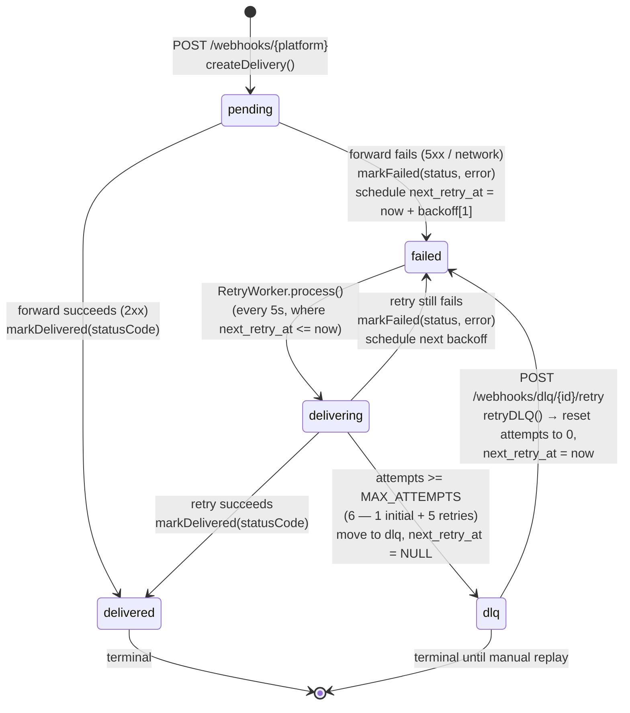
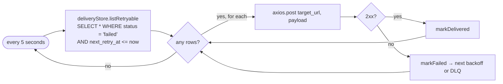

# Webhook delivery state machine

> [← back to overview](./README.md)

A delivery's lifecycle inside the **inbound** webhook-gateway: how it transitions between states, when it gets retried, when it lands in the DLQ, and how the RetryWorker processes the failure queue.

> **Two different webhook systems exist:**
>
> - **Inbound (this doc):** the `webhook-gateway` service receives webhooks from external providers (Stripe, Fortnox, Shopify, …) and relays the raw request bytes, with every header except a deny-list (hop-by-hop headers, `host`, `content-length`, `cookie`, the internal `x-admin-secret` / `x-service-secret`, and client-supplied `x-forwarded-*`; `apps/webhook-gateway/src/core/forward-headers.ts`), to integration-server at `/webhooks/{vertical}/{platform}` — the vertical's `WEBHOOK_HANDLERS` entry is what verifies the signature and normalises the event. Retries replay the stored bytes and headers (`payload_b64`, `headers_json`), so a signature over the raw body still verifies, although providers with a signature timestamp window reject a retry that lands outside it. Providers that sign the request URL must post straight to the connect host, because the gateway changes the path (see [custom-domain](../deployment/custom-domain.md)). The gateway's job is durability: record, retry, dead-letter. Lives in `apps/webhook-gateway`.
> - **Outbound:** the `integration-server` fires `customer.*`, `connect_link.*`, `connection.*`, `resource.*` and `platform.event` events to per-tenant subscriber URLs with HMAC-SHA256 signing, exponential backoff, and a manual replay UI. State lives in `webhook_subscriptions` + `webhook_deliveries` next to the credentials store. See [../dev-api.md §8](../dev-api.md#8-outbound-webhooks) and the **Webhooks → Deliveries** admin page.
>
> Both use the same "exponential backoff, dead-letter, replay" shape but are independent code paths and data stores.
>
> Three outbound behaviours that do **not** apply to the inbound gateway documented here: an outbound
> subscription chooses a payload `format` (`opensteward` / `slack` / `teams` / `flat`) and may carry
> encrypted custom headers, and an outbound delivery that receives a non-retryable 4xx (`400`, `401`,
> `403`, `404`, `405`, `406`, `410`, `413`, `414`, `415`, `422`, `501`) dies on attempt 1 rather than
> walking the whole ladder; and outbound delivery rows can be pruned by an opt-in retention sweep
> (the `webhooks.delivery_retention_days` runtime setting, default 0 = keep forever, checked at most
> every 6h by the outbound retry worker) — the gateway's own `deliveries` table has no equivalent.

---

## Chart 13 — Delivery state machine



`delivering` is an in-flight state only — it is never written to the row. The
persisted `status` values are `pending`, `delivered`, `failed` and `dlq`.

---

## Backoff schedule

```
attempt 1 (initial POST):  immediate
attempt 2:  +1s
attempt 3:  +5s
attempt 4:  +30s
attempt 5:  +5min
attempt 6:  +30min
→ DLQ
```

Defined as `RETRY_DELAYS = [1000, 5000, 30_000, 300_000, 1_800_000]` in `apps/webhook-gateway/src/core/db/delivery-store.ts`. `MAX_ATTEMPTS = RETRY_DELAYS.length + 1 = 6`.

After a successful initial delivery, the row stays at `delivered` forever — no cleanup job. The `deliveries` table grows monotonically; in production you'd want a periodic prune for delivered rows older than N days. (The outbound side has exactly that — the opt-in `webhooks.delivery_retention_days` sweep — but nothing prunes the gateway's table.)

## RetryWorker (background poller)



The worker is a single in-process `setInterval` loop, started in `apps/webhook-gateway/src/index.ts`. There's no leader election — running multiple webhook-gateway replicas would double-process retries. The gateway assumes a single replica; run exactly one instance.

## Why the gateway always returns 200/202

Looking at `apps/webhook-gateway/src/core/server.ts`:

```ts
if (response.status >= 200 && response.status < 300) {
  return reply.status(200).send({ status: 'delivered', deliveryId })
} else {
  return reply.status(202).send({ status: 'queued_for_retry', deliveryId })
}
```

We return `200` on success and `202` on queued-for-retry. We **never** return a 5xx to the upstream provider. This matters because most webhook providers (Stripe, Fortnox, Shopify…) will disable a webhook endpoint after N consecutive 5xx responses. Returning `202` means "I've accepted responsibility for delivering this, even though I haven't yet" — and we honour that contract via the RetryWorker + DLQ.

## Manual DLQ replay

When a delivery sits in `dlq`, an operator can replay it via:

```bash
curl -X POST http://127.0.0.1:3004/webhooks/dlq/<deliveryId>/retry \
  -H "X-Admin-Secret: $ADMIN_SECRET"
```

The handler calls `deliveryStore.retryDLQ(id)` which sets `status='failed'`, `attempts=0`, `next_retry_at=now`, and 404s if the row is not in the DLQ. The next RetryWorker tick will pick it up. This is a CLI-only operation; there is no UI for it.

## Inspection endpoints

| Endpoint | Returns |
|---|---|
| `GET /webhooks/log` | Last 50 deliveries (any status) |
| `GET /webhooks/dlq` | Most recent 50 rows where `status='dlq'` |
| `POST /webhooks/dlq/:id/retry` | Replay one DLQ row |

The two `GET` routes return an explicit column list (`DeliverySummary` in `apps/webhook-gateway/src/core/db/delivery-store.ts`), not whole rows. They leave out `payload_b64`, the byte-exact replay copy of the body, and `headers_json`, the stored request headers. Those headers are what the platform sent, so they can include an `authorization` credential and signature values. In their place, `headerNames` lists the stored header names, sorted, without values. The UTF-8 `payload` text is still returned. The retry worker reads full rows through `listRetryable()`, so a replay still sends the original bytes and headers.

All three are behind the shared `adminGuard`, so they need a matching `X-Admin-Secret` header — the same guard `/admin/*` uses on integration-server, including its fail-closed behaviour when `ADMIN_SECRET` is unset in production. They expose captured webhook bodies and can re-trigger arbitrary outbound deliveries, which is why they are gated. The receiver `POST /webhooks/:platform` is deliberately left unauthenticated: the calling provider cannot know the operator's admin secret, and the downstream vertical verifies the platform's HMAC signature.

---

## See also

- [runtime-flows.md](./runtime-flows.md) — sequence diagram for the initial inbound webhook
- [persistence.md](./persistence.md) — `deliveries` table schema
- [services.md](./services.md) — where webhook-gateway sits in the topology
