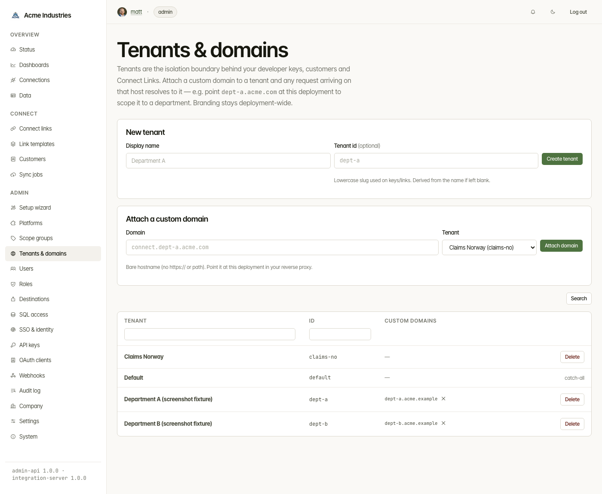

# Custom domain deployment

When you send Connect Links over email, the URL should read like
`https://connect.acme.com/connect/...`, not the raw Docker hostname.
This page covers how to put every public OpenSteward entry point behind a
custom domain with TLS, keep the internal services private, and leave the
application stateless about cert lifecycle.

## What OpenSteward does

- Honours `X-Forwarded-Proto` / `X-Forwarded-Host` when `TRUST_PROXY` is
  set, so the resolved canonical URL reflects what the customer actually
  used. It is **off by default** (`apps/integration-server/src/server.ts`):
  trusting the header unconditionally would let any client spoof
  `request.ip` and dodge IP-keyed rate limits. Behind a proxy, pin
  `PUBLIC_BASE_URL` and set `TRUST_PROXY` too (a CIDR list is safer than
  `true`) — see [Env summary](#env-summary) for why pinning alone is not enough.
- Resolves the canonical public URL by precedence — `PUBLIC_BASE_URL` env,
  then the tenant's own domain (see "Custom domains per tenant" below), then
  `companyInfo.baseUrl` (admin form), then the inbound request's own
  protocol + host (`packages/shared/src/control-plane/public-base-url.ts`) —
  and uses it when emitting:
  - the Connect Link URL returned to the admin on session creation
  - the default OAuth `redirect_uri` — used when an adapter's authorize URL
    carries none; otherwise the adapter's own configured Redirect URI is what
    the provider sees and what the token exchange replays
  - any absolute URL in the hosted Connect HTML

  The tenant-domain step applies **only to the Connect Link URL**. The two
  link-minting routes are the only callers that pass a tenant domain; the
  `redirect_uri` and the hosted-page URLs are resolved without it, deliberately,
  so an upstream provider needs just one allow-listed callback however many
  tenant domains you add.
- **Withholds a Connect Link URL rather than emitting an unreachable one.**
  An admin-minted link reaches integration-server from admin-api over the
  compose network, so the last fallback above would see
  `Host: integration-server:3010` and hand back
  `http://integration-server:3010/connect/<token>` — an address no customer's
  browser can resolve. A bare single-label hostname is treated as not
  browser-addressable: both link-minting routes return `url: null` with
  `urlUnresolved: true`, and the session is still created. Set
  `PUBLIC_BASE_URL` or Company Info → Base URL to get a URL back.
- Returns a fast 404 (no logging, no body) for `/.well-known/acme-challenge/*`
  so misrouted ACME traffic doesn't pollute logs. **The application never
  participates in cert issuance.**

## What OpenSteward does NOT do

- Terminate TLS in-app
- Run an ACME / Let's Encrypt client
- Auto-renew certificates
- Manage DNS records or DNS-01 challenges

All of that lives in your reverse proxy. Pick whichever proxy your team
already runs.

## Which services face the internet

The proxy is the only thing that should listen publicly. The examples below
use one hostname per public service:

| Hostname | Upstream | Public? | What it serves |
|---|---|---|---|
| `connect.acme.com` | `integration-server:3010` | yes | The developer API (`/v1/*`), hosted Connect Links (`/connect/*`), OAuth callbacks (`/auth/{vertical}/{platform}/callback`) **and provider webhooks** (`POST /webhooks/{vertical}/{platform}`) |
| `admin.acme.com` | `admin:3000` | yes (consider an IP allow-list) | The operator console |
| `docs.acme.com` | `docs-server:3003` | yes, read-only | Guides, the OpenAPI spec and the Swagger console |
| `hooks.acme.com` | `webhook-gateway:3004` | optional, receiver route only | `POST /webhooks/{platform}` — see below |
| `sso.acme.com` | `admin-api:3001` | only with SSO/SCIM, four path prefixes only | See [Admin SSO and SCIM](#admin-sso-and-scim) |
| — | `admin-api:3001` (everything else), `redis:6379`, the SQLite volumes | **never** | Internal |

**Where provider webhooks land.** integration-server receives and verifies
them itself: `POST /webhooks/{vertical}/{platform}` looks up that vertical's
handler, checks the signature over the raw body, and answers `501` when no
verifier is wired (`packages/shared/src/control-plane/webhooks-router.ts`).
When an adapter registers its webhook with the provider programmatically, it
registers `<canonical public URL>/webhooks/{vertical}/{platform}` — the
integration-server host (`packages/shared/src/control-plane/auth-router.ts`).
So `connect.acme.com` already covers webhooks; nothing else is required.

`webhook-gateway` is an optional durability buffer in front of that route. It
answers `POST /webhooks/{platform}` (one path segment, no vertical), records the
delivery, and forwards it to integration-server's
`/webhooks/{vertical}/{platform}`, retrying and dead-lettering on failure. It
only knows the platforms listed in `apps/webhook-gateway/config/config.yml` and
404s any other. Publish `hooks.acme.com` only if you point a provider's webhook
at it by hand, and publish only the receiver: its `/webhooks/log`,
`/webhooks/dlq` and `/webhooks/dlq/{id}/retry` routes expose captured webhook
bodies and replay, and are operator routes (guarded by `ADMIN_SECRET`,
`apps/webhook-gateway/src/core/server.ts`).

> The gateway relays the raw request bytes and all headers except hop-by-hop
> headers, cookies, the internal `x-admin-secret`/`x-service-secret`, and client
> `x-forwarded-*`. Retries replay both unchanged, but providers with a signature
> timestamp window (Stripe about 300 s, Svix/Standard Webhooks about 5 min)
> reject retries that land outside it. Providers whose signature covers the
> request URL (e.g. HubSpot, Square, Salt Edge, CoinPayments) must post straight
> to the connect host, because the gateway changes the path from
> `/webhooks/{platform}` to `/webhooks/{vertical}/{platform}`. Pointing
> providers at `connect.acme.com` is still the simpler default.

**Put the proxy on the compose network.** The recipes below address upstreams
by compose service name (`integration-server:3010`), which resolves only for a
container on the stack's network. The proxy is then the one container
published on the public interface (`80`/`443`). The `caddy` service in
`docker-compose.yml` is not that proxy: it belongs to the `https` profile,
binds `127.0.0.1:443` and serves `localhost` from a local CA
(`deploy/local-https/Caddyfile`), for local OAuth testing only.

**Keep the host ports closed.** `docker-compose.yml` publishes every service
port on `127.0.0.1` only, so a stock local stack works in a browser on the
same machine and nothing is reachable from the network. Do not widen those
mappings to `0.0.0.0` to "make it public" — the services speak plain HTTP; the
proxy is the way in. `docker-compose.hardening.yml` removes admin-api's mapping
altogether (`ports: !reset []`); you can drop the others the same way in your
`docker-compose.override.yml` once the proxy is in front. Redis (`scale`
profile) has no password and must never be published beyond loopback. The
SQLite named volumes (`admin-data`, `webhook-data`,
`integration-server-data`) hold encrypted credentials, operator accounts and
captured webhook bodies, and must never be served or mounted anywhere
reachable.

> **On Kubernetes?** The Helm chart does this with an Ingress instead of a
> reverse proxy: set `ingress.hosts[].service` per host and terminate TLS via
> `ingress.tls.certManager` (per-host certs from a ClusterIssuer) or
> `ingress.tls.existingSecret` (BYO). The original `Host` is preserved for
> custom-domain-per-tenant routing — one Ingress host per domain is the
> equivalent of one reverse-proxy vhost below. The chart refuses to route
> `admin-api` as a whole; to publish only the SSO/SCIM prefixes below, enable
> `ingress.sso`. See the "Ingress & admin-api" section of
> [`deploy/helm/opensteward/README.md`](../../deploy/helm/opensteward/README.md).

## Recipe: Caddy (recommended for simplicity)

Caddy ships an ACME client built-in and is the smallest config:

```caddy
connect.acme.com {
  reverse_proxy integration-server:3010
}

admin.acme.com {
  reverse_proxy admin:3000
}

docs.acme.com {
  reverse_proxy docs-server:3003
}

# Optional — only if a provider is pointed at the gateway by hand.
hooks.acme.com {
  @operator path /webhooks/log /webhooks/dlq /webhooks/dlq/*
  handle @operator {
    respond 404
  }
  handle {
    reverse_proxy webhook-gateway:3004
  }
}

# Only with admin SSO or SCIM. Everything else on admin-api stays private.
sso.acme.com {
  @sso path /api/sso/*/login /api/sso/*/callback /api/sso/*/acs /scim/v2/*
  handle @sso {
    reverse_proxy admin-api:3001
  }
  handle {
    respond 404
  }
}
```

That's it. Caddy handles HTTP-01 / TLS-ALPN-01 itself on :80/:443,
fetches and renews the cert, and proxies HTTP to the container. Then
in admin → Company info, set `baseUrl` to `https://connect.acme.com`
(or set `PUBLIC_BASE_URL=https://connect.acme.com` in the
integration-server env), and set the other URLs in
[Env summary](#env-summary).

Only the first matching `handle` block runs, and one without a matcher is the
fallback ([Caddy `handle`](https://caddyserver.com/docs/caddyfile/directives/handle)).
A `*` in the middle of a `path` pattern is a globular match, a trailing `*` a
prefix match, and multiple paths are OR'ed
([Caddy matchers](https://caddyserver.com/docs/caddyfile/matchers)).

## Recipe: Traefik

```yaml
services:
  integration-server:
    # ... existing definition ...
    labels:
      - "traefik.enable=true"
      - "traefik.http.routers.connect.rule=Host(`connect.acme.com`)"
      - "traefik.http.routers.connect.entrypoints=websecure"
      - "traefik.http.routers.connect.tls.certresolver=letsencrypt"
      - "traefik.http.services.connect.loadbalancer.server.port=3010"
  admin:
    labels:
      - "traefik.enable=true"
      - "traefik.http.routers.admin.rule=Host(`admin.acme.com`)"
      - "traefik.http.routers.admin.entrypoints=websecure"
      - "traefik.http.routers.admin.tls.certresolver=letsencrypt"
      - "traefik.http.services.admin.loadbalancer.server.port=3000"
  docs-server:
    labels:
      - "traefik.enable=true"
      - "traefik.http.routers.docs.rule=Host(`docs.acme.com`)"
      - "traefik.http.routers.docs.entrypoints=websecure"
      - "traefik.http.routers.docs.tls.certresolver=letsencrypt"
      - "traefik.http.services.docs.loadbalancer.server.port=3003"
  webhook-gateway: # optional — receiver route only
    labels:
      - "traefik.enable=true"
      - "traefik.http.routers.hooks.rule=Host(`hooks.acme.com`) && Method(`POST`) && PathRegexp(`^/webhooks/[^/]+$`)"
      - "traefik.http.routers.hooks.entrypoints=websecure"
      - "traefik.http.routers.hooks.tls.certresolver=letsencrypt"
      - "traefik.http.services.hooks.loadbalancer.server.port=3004"
  admin-api: # only with SSO/SCIM — four prefixes, never the whole service
    labels:
      - "traefik.enable=true"
      - "traefik.http.routers.sso.rule=Host(`sso.acme.com`) && (PathRegexp(`^/api/sso/[^/]+/(login|callback|acs)$`) || PathPrefix(`/scim/v2/`))"
      - "traefik.http.routers.sso.entrypoints=websecure"
      - "traefik.http.routers.sso.tls.certresolver=letsencrypt"
      - "traefik.http.services.sso.loadbalancer.server.port=3001"
```

Traefik handles ACME on its own; the services see plain HTTP. `Method`,
`PathRegexp` (Go regexp syntax), `&&`, `||` and parentheses are standard rule
syntax ([Traefik rules](https://doc.traefik.io/traefik/reference/routing-configuration/http/routing/rules-and-priority/)).
The `hooks` rule admits only `POST` to a single segment under `/webhooks/`, which
keeps the gateway's `GET /webhooks/log`, `GET /webhooks/dlq` and
`POST /webhooks/dlq/{id}/retry` off the internet.

## Recipe: nginx + certbot (webroot)

```nginx
server {
  listen 443 ssl http2;
  server_name connect.acme.com;
  ssl_certificate     /etc/letsencrypt/live/connect.acme.com/fullchain.pem;
  ssl_certificate_key /etc/letsencrypt/live/connect.acme.com/privkey.pem;

  location /.well-known/acme-challenge/ {
    root /var/www/certbot;
  }

  location / {
    proxy_pass         http://integration-server:3010;
    proxy_http_version 1.1;
    proxy_set_header   Host              $host;
    proxy_set_header   X-Forwarded-Proto $scheme;
    proxy_set_header   X-Forwarded-Host  $host;
    proxy_set_header   X-Forwarded-For   $proxy_add_x_forwarded_for;
  }
}
```

Run certbot in webroot mode against `/var/www/certbot` and configure a
cron / systemd timer to renew. integration-server never sees ACME
traffic.

The other hosts repeat that `server` block — same `listen`, certificate and
ACME-webroot lines with their own `server_name` — changing only the
`location` blocks. Every proxied `location` also carries the
`proxy_http_version` and four `proxy_set_header` lines above (a shared
`include` keeps them in one place):

```nginx
# admin.acme.com / docs.acme.com — whole service
location / { proxy_pass http://admin:3000; }        # docs: http://docs-server:3003

# hooks.acme.com (optional) — receiver only
location = /webhooks/log  { return 404; }
location = /webhooks/dlq  { return 404; }
location /webhooks/dlq/   { return 404; }
location /                { proxy_pass http://webhook-gateway:3004; }

# sso.acme.com (only with SSO/SCIM) — four prefixes, nothing else
location ~ ^/api/sso/[^/]+/(login|callback|acs)$ { proxy_pass http://admin-api:3001; }
location /scim/v2/ { proxy_pass http://admin-api:3001; }
location /         { return 404; }
```

An `=` location is an exact match; otherwise nginx picks the longest matching
prefix `location`, then lets a matching regex `location` override it
([`location`](https://nginx.org/en/docs/http/ngx_http_core_module.html#location)).
So `/webhooks/dlq/{id}/retry` falls under `/webhooks/dlq/`, a platform slug that
merely starts with `log` is still proxied, and the SSO regex wins over `/`. `proxy_pass` inside a regex `location` must carry no URI
([`proxy_pass`](https://nginx.org/en/docs/http/ngx_http_proxy_module.html#proxy_pass)).

## OAuth provider redirect URIs

When you switch to a custom domain, every OAuth provider you've
registered with needs the new callback URL added to their allowlist:

```
https://connect.acme.com/auth/{vertical}/{platform}/callback
```

For each enabled adapter, log into the provider's developer console
(Xero, QuickBooks, HubSpot, …) and add the URL above. Pre-existing
callbacks pointing at `localhost` or the Docker hostname can stay
during transition; remove them once the new domain is verified.

The same goes for webhooks you configure by hand in a provider's console:
point them at `https://connect.acme.com/webhooks/{vertical}/{platform}` (or,
if you run the gateway publicly, `https://hooks.acme.com/webhooks/{platform}`).
Webhooks an adapter registers programmatically are registered once, at connect
time, against the public URL in force then; nothing re-registers them when the
URL changes, so connections made before the switch keep the old URL until they
are reconnected or edited in the provider's console.

## Admin SSO and SCIM

admin-api is internal, with one exception: if you configure SSO or SCIM, the
IdP and the operator's browser must reach `/api/sso/{slug}/login`,
`/api/sso/{slug}/callback`, `/api/sso/{slug}/acs` and `/scim/v2/*` on
`SSO_PUBLIC_BASE_URL` (`apps/admin-api/src/core/routes/sso.ts`,
`apps/admin-api/src/core/routes/scim.ts`). The `sso.acme.com` blocks above
publish those and nothing else. The admin UI's LDAP form, the login-options
lookup and the post-login code exchange go from `admin` to admin-api over the
compose network and need no public route. Proxy the paths unchanged: the OIDC
callback rebuilds its URL as `SSO_PUBLIC_BASE_URL` + the request path, so
stripping or rewriting a prefix breaks the token exchange. Provider setup is in
[`sso-setup.md`](./sso-setup.md).

## Env summary

Everything below is a browser- or provider-facing URL, so it must be the
`https://` hostname, never a compose service name.

```
# integration-server
PUBLIC_BASE_URL=https://connect.acme.com    # overrides tenant domain + company-info baseUrl
CORS_ORIGIN=https://docs.acme.com           # lets the Swagger console on docs call the API
TRUST_PROXY=<proxy IP or CIDR list>         # not a URL: real client IP for rate limits; see below

# admin
PUBLIC_BASE_URL=https://connect.acme.com    # printed into the MCP agent-config snippet
DOCS_SERVER_URL=https://docs.acme.com       # cross-app "Guide" links
SSO_PUBLIC_BASE_URL=https://sso.acme.com    # "Sign in with <IdP>" links (SSO only)
# SESSION_COOKIE_SECURE — leave unset: cookies are Secure because the image sets NODE_ENV=production

# admin-api
SSO_PUBLIC_BASE_URL=https://sso.acme.com    # OIDC redirect URI, SAML ACS, SCIM base (SSO only)
ADMIN_UI_URL=https://admin.acme.com         # where the post-login handoff lands
```

Where each is read: `PUBLIC_BASE_URL` in
`packages/shared/src/control-plane/public-base-url.ts` (and, for the admin's
snippet, `apps/admin/src/core/routes/customers.ts`); `CORS_ORIGIN` and
`TRUST_PROXY` in `apps/integration-server/src/config.ts`; `DOCS_SERVER_URL` and
`SSO_PUBLIC_BASE_URL` in `apps/admin/src/config.ts`; `SSO_PUBLIC_BASE_URL` and
`ADMIN_UI_URL` in `apps/admin-api/src/config.ts`; the cookie flag in
`apps/admin/src/core/auth/session-cookie.ts`. docs-server needs no URL of its
own; the server its Swagger console targets comes from admin → **Settings** →
**OpenAPI / docs** (`openapi.servers.*`, see [`../dev-api.md`](../dev-api.md)),
so set its host to `connect.acme.com`, scheme `https`, port `443`.

`docker-compose.yml` defaults `PUBLIC_BASE_URL` to `http://localhost:3010` —
the port it publishes — so a stock local stack emits working Connect Links
with no configuration. Set it to your real origin as soon as the deployment
is reachable from anywhere but the machine running it. Its other defaults
(`CORS_ORIGIN=http://localhost:3003`, `DOCS_SERVER_URL`, `SSO_PUBLIC_BASE_URL`,
`ADMIN_UI_URL`) are likewise localhost values that stop being right the moment
the proxy is in front.

Trust-proxy is **off** by default. With `PUBLIC_BASE_URL` pinned, URLs no
longer depend on it, but integration-server's per-IP rate limits (the global
bucket and the `/connect` bucket) still key on `request.ip`, which behind a
proxy is the proxy's own address — so every caller shares one budget. Set
`TRUST_PROXY` to your proxy's address or CIDR list (`true` works but trusts any
peer; a bare hop count is refused at boot). Only integration-server reads
`TRUST_PROXY`: `admin`, `admin-api`, `docs-server` and `webhook-gateway` always
see the proxy's address, so their per-IP limits — the admin login, and on the
SSO host the 10/min SSO login/callback/ACS limit
(`apps/admin-api/src/core/routes/sso.ts`) — are shared by everyone behind the
proxy.

## Custom domains per tenant

A single deployment can map several custom domains to different **tenants** —
the isolation boundary already behind your developer keys, customers and
Connect Links. This is useful when, say, each department of an organisation
should reach its own data on its own hostname (`dept-a.acme.com`,
`dept-b.acme.com`).

Branding stays **deployment-wide** (one `company_info` record) — this is
custom-domain-per-tenant routing, not per-tenant white-label. The admin console
stays operator-wide: you manage every tenant from one login.



### How to set it up

1. In **admin → Tenants & domains**, create a tenant (e.g. `dept-a`) and attach
   one or more domains to it (e.g. `dept-a.acme.com`).
2. In your reverse proxy, point each domain at the **same** integration-server
   (one Caddy/Traefik/nginx vhost per domain, all proxying `integration-server:3010`).
   TLS is still terminated at the proxy exactly as above — nothing changes about
   cert handling, and the app never issues certs.
3. Mint Connect Links / developer keys for that tenant. A Connect Link minted
   for `dept-a` is issued on `dept-a`'s domain automatically.

### How resolution works

integration-server reads the public domain→tenant map and resolves the incoming
`Host` header to a tenant. A request on a tenant's domain is scoped to that
tenant: a developer key from another tenant used on the wrong domain is rejected
(`TENANT_MISMATCH`), and a connection is only reachable on the domain of the
tenant that owns it. A host that isn't mapped (or when no domains are
configured) resolves to the `default` tenant, so existing single-domain
deployments are unaffected.

### OAuth callbacks stay on the canonical domain

The OAuth `redirect_uri` is the adapter's configured Redirect URI, falling back
to the canonical `PUBLIC_BASE_URL` / `companyInfo.baseUrl` — never a tenant
domain, **even when the Connect picker is served from a per-tenant domain**. This means you still register exactly **one** callback URL per provider
(`https://<canonical>/auth/{vertical}/{platform}/callback`) — you do not have to
allowlist every tenant domain at every provider. Tenant binding is preserved by
the signed OAuth state, not by the callback's hostname.

`PUBLIC_BASE_URL` (when set) remains a global override that wins over per-tenant
domains — use it to pin a single canonical host for the whole deployment.
