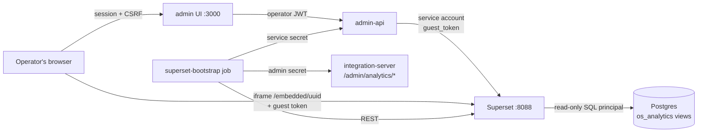

# Embedded Apache Superset dashboards

This page is for operators. It explains how to run
[Apache Superset](https://superset.apache.org/) beside OpenSteward so the admin
console can show dashboards the [native dashboards](../architecture/data-access.md#native-dashboards)
can't express, what each piece trusts, and how to run it on Docker Compose or
Kubernetes.

It's optional, and it needs the **Postgres backend** (`DATABASE_URL`) with
[read-only SQL access](./postgres-analytics.md) provisioned: Superset reads the
same masked `os_analytics` views a BI tool would. SQLite deployments keep the
native dashboards, the data viewer and [destinations](../integrate/destinations.md).

---

## What operators see

The **Dashboards** page gets a **Custom dashboards (Superset)** section. Opening
one shows the Superset dashboard inside the console, filtered to the tenants
the operator may see. Operators never sign in to Superset, and nothing they
do there can reach data outside their scope or unmask personal data.

Who sees each dashboard is chosen in the console by a holder of
`dashboards:share_all`: **Change** on the dashboard page opens
`/dashboards/superset/:id/sharing`. A dashboard is shared with everyone (the
default) or with the people who have access to chosen tenants, and can be
pinned to tenants so its charts show only their data.

People who **build** dashboards sign in to Superset itself, with your IdP
(OIDC) or a local account. A dashboard appears in the console once its slug
starts with `opensteward-` and the bootstrap job has run.

---

## Architecture



| Piece                            | Runs as                   | Does                                                                                                                                    |
| -------------------------------- | ------------------------- | --------------------------------------------------------------------------------------------------------------------------------------- |
| `superset`                       | Superset web (gunicorn)   | Serves dashboards and the embedded page. Config: `deploy/superset/superset_config.py`.                                                  |
| `superset-init` / chart init job | one-shot                  | `superset db upgrade`, `superset init`, then `deploy/superset/bootstrap-roles.py`: the `OpenStewardGuest` role and the service account. |
| `superset-bootstrap`             | one-shot, admin-api image | `apps/admin-api/src/scripts/superset-bootstrap.ts`. Idempotent; details below.                                                          |
| admin-api                        | always                    | Lists registered dashboards and mints guest tokens (`/api/analytics/superset/*`). Off unless `SUPERSET_URL` is set.                     |
| admin UI                         | always                    | `/dashboards/superset/:id`, the vendored `@superset-ui/embedded-sdk`, and the CSRF-protected token proxy.                               |

### The bootstrap job

Re-running it keeps each dashboard's sharing: it never writes the audience or
pinned tenants.

On every run it:

1. waits for Superset's `/health` and for integration-server to report the
   analytics views as provisioned;
2. gets Superset a Postgres login: the SQL principal labelled `superset`
   (masked, all tenants, 10 connections). It creates the principal the first
   time and **rotates** it on every later run, because a password is only ever
   returned on create or rotate; the new password goes straight into
   Superset's connection. Set `SUPERSET_DB_URI` to supply your own connection
   instead;
3. creates or updates the **OpenSteward analytics** database connection:
   hidden from SQL Lab, no DML, no CTAS/CVAS, no uploads;
4. creates one dataset per `os_analytics` view that has `owner_tenant_id` and
   `vertical` columns (matched by table name, columns refreshed on re-runs),
   plus `opensteward_records`, a virtual dataset with one row per stored
   record. The `tenants` view is skipped: it has no tenant column to filter;
5. imports dashboard bundles (`*.zip` exported from Superset) from
   `SUPERSET_ASSETS_DIR` (compose: `deploy/superset/assets/dashboards/`), and
   creates the default **Connection data overview** dashboard
   (`opensteward-overview`: connection and record counts, connections by
   vertical, records per resource and platform, and a table of connections)
   when it doesn't exist. An existing one is never overwritten;
6. enables embedding on every dashboard whose slug starts with `opensteward-`,
   allowing only the admin UI origin, and registers them with admin-api
   (`PUT /api/internal/superset/dashboards`, service secret). Dashboards no
   longer found are removed from the registry.

A slug of the form `opensteward-<vertical>-…` (for example
`opensteward-crm-pipeline`) lists the dashboard only for operators whose scope
reaches that vertical.

---

## Security model

- **Guest tokens, not logins.** admin-api logs in to Superset as a service
  account and calls `POST /api/v1/security/guest_token/` for the signed-in
  operator. Tokens last **5 minutes** (`GUEST_TOKEN_JWT_EXP_SECONDS = 300`);
  the SDK asks for a new one before each expires. The browser gets tokens only
  from the admin UI's `POST /dashboards/superset/:id/guest-token`, which needs
  the session and its CSRF token, and the user must hold `dashboards:view`
  (plus the dashboard's extra permission, if registered with one).
- **Row-level security from the operator's scope.** Each token carries one RLS
  clause that Superset adds to every query of the dashboard. A dashboard pinned
  to tenants narrows it to the operator's scope ∩ the pins (an operator who
  sees every tenant gets `owner_tenant_id IN (<pins>)`, not no clause), and a
  dashboard shared with chosen tenants is listed, and a token minted, only for
  operators whose access includes one of them (`404` otherwise):

  | Operator's scope                           | Clause                                                                                            |
  | ------------------------------------------ | ------------------------------------------------------------------------------------------------- |
  | All tenants                                | none                                                                                              |
  | Tenants `acme`, `beta`                     | `owner_tenant_id IN ('acme', 'beta')`                                                             |
  | `acme` whole, `beta` only `crm`/`payments` | `(owner_tenant_id IN ('acme') OR (owner_tenant_id = 'beta' AND vertical IN ('crm', 'payments')))` |
  | Restricted to nothing                      | no token (`403 SCOPE_EMPTY`)                                                                      |

  Tenant ids must match `^[A-Za-z0-9._:-]+$` and verticals `^[a-z][a-z0-9_-]*$`;
  single quotes are doubled regardless. A value that fails validation is left
  out, which only narrows what the token shows. Rows with no owner tenant are
  visible only to all-tenant operators, as everywhere else in the console.

- **Masked views only.** Superset's database login is a masked, read-only SQL
  principal. Personal data is masked in `os_analytics` exactly as for
  [SQL access](../integrate/sql-access.md#masking), and Postgres applies the
  principal's own scope underneath the RLS clause. Superset never sees
  `os_analytics_pii` or the base tables.
- **No SQL Lab for guests.** `OpenStewardGuest` holds Superset's minimal
  embedded-viewer permissions minus every SQL Lab, dataset and database
  permission (`bootstrap-roles.py` replaces the role's permissions on every
  init, undoing drift). Guests reach a dataset only through a chart on the
  dashboard their token names. The analytics connection is hidden from SQL Lab
  for authors too; Jinja templating in SQL is off.
- **Framing.** Superset's CSP `frame-ancestors` lists only
  `OPENSTEWARD_ADMIN_ORIGIN`; each embedded dashboard's allowed domains are
  the same origin; CORS is limited to it. The admin UI allows exactly the
  Superset origin in `frame-src`, and only on the embedded page.
- **No anonymous access.** `PUBLIC_ROLE_LIKE = None`; unsafe connection types
  (SQLite and the like) are refused (`PREVENT_UNSAFE_DB_CONNECTIONS`).
- **Guest-token secret.** Superset's default guest-token signing secret is a
  public placeholder. The config always replaces it: with
  `SUPERSET_GUEST_TOKEN_SECRET`, or a key derived from `SUPERSET_SECRET_KEY`.
- **The service account is a Superset Admin.** It needs to grant guest tokens
  and create the database, datasets, charts and embedded configurations. Its
  password lives only in your secret store; treat it like `ADMIN_SECRET`.
- **Audit.** `superset.guest_token` (at most once per user and dashboard every
  10 minutes, with `{title, restricted}`) and `superset.registry_sync`.

---

## Docker Compose

The `analytics` profile adds `postgres` (with databases `opensteward` and
`superset`), `superset-redis`, `superset-init`, `superset` and
`superset-bootstrap`. A plain `docker compose up` is unchanged: none of them
start without the profile. The profile's Postgres isn't used by OpenSteward
until you point the services at it, which
[`docker-compose.analytics.example.yml`](../../docker-compose.analytics.example.yml)
does.

1. Add secrets to `.env`. `scripts/generate-secrets.sh` prints
   `SUPERSET_SECRET_KEY` and `SUPERSET_SERVICE_PASSWORD` with the others. The
   two database passwords are spliced into URLs, so make them URL-safe:

   ```bash
   echo "POSTGRES_PASSWORD=$(openssl rand -hex 32)" >> .env
   echo "SUPERSET_DB_PASSWORD=$(openssl rand -hex 32)" >> .env
   ```

   `ADMIN_SECRET` and `SERVICE_SECRET` must be set too; the bootstrap job
   uses both.

2. Start everything:

   ```bash
   docker compose -f docker-compose.yml -f docker-compose.analytics.example.yml \
     --profile analytics up -d
   ```

   The overlay sets `DATABASE_URL` and `ANALYTICS_ADMIN_DATABASE_URL` on
   integration-server, `DATABASE_URL` and `SUPERSET_URL` on admin-api. On its
   own this starts a **fresh** database: nothing is copied from an existing
   SQLite deployment. To bring your SQLite data along (users, tenants,
   connections, synced records), switch with
   `scripts/switch-db.sh postgres --copy` instead, which stops the stack,
   copies each service database into Postgres and starts it with this overlay
   and profile — see
   [Switching databases](../operations/switching-databases.md).
   `scripts/switch-db.sh sqlite` goes back.

3. Watch the bootstrap: `docker compose logs -f superset-bootstrap`. Re-run it
   after upgrades or after adding dashboards:

   ```bash
   docker compose -f docker-compose.yml -f docker-compose.analytics.example.yml \
     --profile analytics run --rm superset-bootstrap
   ```

Superset is published on `127.0.0.1:8088`. To build dashboards, sign in there
as the service account (`SUPERSET_SERVICE_USERNAME`, default
`opensteward-service`), or create a personal account:
`docker compose exec superset superset fab create-admin`.

### Plain HTTP and cookies

An embedded dashboard is a third-party frame, and browsers send its cookies
only with `SameSite=None; Secure`, which requires HTTPS. The compose profile
defaults to `SUPERSET_SESSION_COOKIE_SECURE=false` (then `SameSite=Lax`), which
works on `localhost` only, because `localhost:3000` and `localhost:8088` are
the same site. Anywhere else, serve both the admin UI and Superset over HTTPS
(see [custom-domain.md](./custom-domain.md)) and set:

```bash
SUPERSET_SESSION_COOKIE_SECURE=true
SUPERSET_ENABLE_PROXY_FIX=true
SUPERSET_PUBLIC_URL=https://bi.example.com
ADMIN_UI_URL=https://admin.example.com   # becomes OPENSTEWARD_ADMIN_ORIGIN
```

---

## Kubernetes (Helm)

The chart carries the official Superset chart as a dependency (vendored under
`deploy/helm/opensteward/charts/`, enabled by `superset.enabled`). Rendering
fails unless `database.mode=postgres` and `analytics.sqlAccess.enabled=true`.

1. Create the Superset secret, `<release>-opensteward-superset` by default
   (`analytics.superset.existingSecret`):

   ```bash
   kubectl create secret generic os-opensteward-superset \
     --from-literal=SUPERSET_SERVICE_USERNAME=opensteward-service \
     --from-literal=SUPERSET_SERVICE_PASSWORD="$(openssl rand -hex 32)" \
     --from-literal=SUPERSET_SECRET_KEY="$(openssl rand -base64 48)" \
     --from-literal=SUPERSET_METADATA_DB_URI='postgresql+psycopg2://superset:…@db:5432/superset'
   ```

   The main OpenSteward secret must hold `ADMIN_SECRET` and `SERVICE_SECRET`.
   For managed provisioning, put `ANALYTICS_ADMIN_DATABASE_URL` in a secret and
   name it in `analytics.sqlAccess.adminDatabaseUrl.existingSecret`.

2. Values (see `ci/ci-superset-values.yaml` for a complete example):

   ```yaml
   database: { mode: postgres, external: { existingSecret: opensteward-db } }
   publicUrls: { adminUi: https://admin.example.com }
   analytics:
     sqlAccess:
       enabled: true
       adminDatabaseUrl: { existingSecret: opensteward-analytics-admin }
     superset:
       publicUrl: https://bi.example.com
       networkPolicy:
         allowFrom:
           - namespaceSelector: { matchLabels: { kubernetes.io/metadata.name: ingress-nginx } }
   superset:
     enabled: true
     extraEnv:
       OPENSTEWARD_ADMIN_ORIGIN: https://admin.example.com
     database: { host: db.example.internal }
     ingress: { enabled: true, ingressClassName: nginx, hosts: [bi.example.com] }
   ```

3. `helm upgrade --install`. Post-install/upgrade hooks run in order: the
   Superset chart's init job (with `bootstrap-roles.py`), the analytics
   provisioning job (weight 5), then the Superset bootstrap job (weight 10).

What the chart wires:

- admin-api gets `SUPERSET_URL` (the Superset Service), `SUPERSET_PUBLIC_URL`
  and the service account from the secret. The admin UI needs nothing: it
  reads the public URL from admin-api.
- integration-server gets `ANALYTICS_ADMIN_DATABASE_URL`, `ANALYTICS_READ_HOST`
  and `ANALYTICS_ROLE_PREFIX` when `analytics.sqlAccess` sets them.
- Superset pods mount `superset_config.py` and `bootstrap-roles.py` from a
  ConfigMap at `/app/opensteward` and exec the config after the chart's
  generated one (`superset.configOverrides.opensteward`).
- NetworkPolicy: the Superset pods carry the release's instance label, so the
  default-deny and allow-internal policies cover them (admin-api and the
  bootstrap job reach them); `allow-superset-ingress` admits only
  `analytics.superset.networkPolicy.allowFrom` on port 8088. Egress stays
  unrestricted, as for the other pods, so Superset reaches your Postgres.

The official image ships no Postgres driver. `superset.bootstrapScript`
installs `psycopg2-binary` at container start, which needs PyPI egress and
root (the chart's default `runAsUser: 0`). In production, build
`deploy/superset/Dockerfile` into your registry, point `superset.image` at it,
and empty the bootstrap script.

---

## Configuration reference

| Variable                                                                                                             | Where                               | Meaning                                                                                          |
| -------------------------------------------------------------------------------------------------------------------- | ----------------------------------- | ------------------------------------------------------------------------------------------------ |
| `SUPERSET_URL`                                                                                                       | admin-api, bootstrap                | Internal Superset URL. admin-api's feature switch: empty = off.                                  |
| `SUPERSET_PUBLIC_URL`                                                                                                | admin-api                           | Browser-facing Superset URL: iframe `src`, admin UI `frame-src`. Defaults to `SUPERSET_URL`.     |
| `SUPERSET_SERVICE_USERNAME` / `_PASSWORD`                                                                            | admin-api, bootstrap, Superset init | The service account. Password at least 16 characters.                                            |
| `SUPERSET_SECRET_KEY`                                                                                                | Superset                            | Superset's `SECRET_KEY`. Never change it after first boot without `superset re-encrypt-secrets`. |
| `SUPERSET_GUEST_TOKEN_SECRET`                                                                                        | Superset                            | Optional guest-token signing key; derived from `SUPERSET_SECRET_KEY` when unset.                 |
| `SUPERSET_METADATA_DB_URI`                                                                                           | Superset                            | Superset's own metadata database.                                                                |
| `SUPERSET_REDIS_URL`                                                                                                 | Superset                            | Caches and Celery (compose). The Helm chart configures Redis itself.                             |
| `OPENSTEWARD_ADMIN_ORIGIN`                                                                                           | Superset, bootstrap                 | Admin UI origin(s), comma-separated: `frame-ancestors`, CORS, embedding allowed domains.         |
| `SUPERSET_SESSION_COOKIE_SECURE`                                                                                     | Superset                            | Default `true` (`SameSite=None; Secure`). `false` only for plain-HTTP localhost.                 |
| `SUPERSET_ENABLE_PROXY_FIX`                                                                                          | Superset                            | `true` behind a TLS-terminating proxy.                                                           |
| `SUPERSET_DB_URI`                                                                                                    | bootstrap                           | Use this connection instead of the managed `superset` principal.                                 |
| `SUPERSET_ANALYTICS_DB_HOST` / `_PORT` / `_NAME` / `_SSLMODE`                                                        | bootstrap                           | Where Superset reaches the views. Default: from `DATABASE_URL`.                                  |
| `SUPERSET_ASSETS_DIR`                                                                                                | bootstrap                           | Dashboard bundles to import.                                                                     |
| `SUPERSET_BOOTSTRAP_TIMEOUT_MS`                                                                                      | bootstrap                           | Wait for Superset and provisioning. Default 10 minutes.                                          |
| `SUPERSET_OIDC_ISSUER`, `_CLIENT_ID`, `_CLIENT_SECRET`, `_SCOPE`, `_GROUPS_CLAIM`, `_ROLES_MAPPING`, `_DEFAULT_ROLE` | Superset                            | Optional OIDC sign-in for authors, below.                                                        |

---

## Sign-in for dashboard authors (OIDC)

Set `SUPERSET_OIDC_ISSUER` and Superset switches to `AUTH_OAUTH` with one
generic OpenID Connect provider (discovery from
`<issuer>/.well-known/openid-configuration`). Register a client with the
redirect URI `https://<superset>/oauth-authorized/oidc`. Groups from
`SUPERSET_OIDC_GROUPS_CLAIM` (default `groups`) map to Superset roles through
`SUPERSET_OIDC_ROLES_MAPPING`, synced at every sign-in:

```bash
SUPERSET_OIDC_ROLES_MAPPING='{"bi-authors": ["Alpha"], "bi-admins": ["Admin"]}'
SUPERSET_OIDC_DEFAULT_ROLE=Gamma   # first sign-in with no mapped group
```

Superset roles are separate from OpenSteward's: an author's Superset role
decides what they may build, and the embedded view is still governed by the
viewer's OpenSteward permissions and scope. The service account keeps working
with OIDC on (it signs in through the API, not the login page).

---

## Resources

| Component                | Requests         | Notes                                            |
| ------------------------ | ---------------- | ------------------------------------------------ |
| Superset web             | 1 CPU, 2 GiB     | Plus ~250 MiB per extra gunicorn worker.         |
| Superset worker (Celery) | 0.5 CPU, 1 GiB   | Only needed for async queries and cache warm-up. |
| Redis                    | 0.1 CPU, 128 MiB |                                                  |
| Metadata database        | small            | A separate database in your Postgres is fine.    |

Superset's queries run against the OpenSteward database. Point
`SUPERSET_ANALYTICS_DB_HOST` at a read replica to keep them off the primary;
the principal's 60-second statement timeout applies to them.

---

## Upgrades and pinning

Everything is pinned: `apache/superset:6.1.0` in `deploy/superset/Dockerfile`,
`docker-compose.yml` and the Helm values; the Superset chart `0.22.7` in
`Chart.yaml`/`Chart.lock`; `@superset-ui/embedded-sdk` `0.4.0` in the admin UI.
A test (`apps/admin-api/tests/unit/superset-deploy-config.test.ts`) keeps the
image tags in step. To upgrade:

1. Read Superset's `UPDATING.md` for the versions in between.
2. Bump the image tag in all three places (and `psycopg2-binary` if needed),
   then `helm dependency update deploy/helm/opensteward` for a new chart.
3. Check the embedded SDK against the new Superset release notes.
4. Re-run the init (`superset db upgrade` migrates the metadata database) and
   the bootstrap job. Both are idempotent.

Back up the Superset metadata database with the rest (see
[backup-restore.md](./backup-restore.md)): it holds the dashboards authors
built. The bootstrap can recreate the connection, datasets, default dashboard
and registry, but not their work.

---

## Troubleshooting

| Symptom                                                                                            | Cause and fix                                                                                                                                                                                                                                                                                                              |
| -------------------------------------------------------------------------------------------------- | -------------------------------------------------------------------------------------------------------------------------------------------------------------------------------------------------------------------------------------------------------------------------------------------------------------------------- |
| No **Custom dashboards (Superset)** section                                                        | admin-api has no `SUPERSET_URL`, or the registry is empty: check the bootstrap job's log. Dashboards about verticals outside your scope are hidden.                                                                                                                                                                        |
| `409 SUPERSET_DISABLED`                                                                            | `SUPERSET_URL` is unset on admin-api.                                                                                                                                                                                                                                                                                      |
| "The dashboard could not be authorised" / `502 SUPERSET_UNAVAILABLE`                               | admin-api can't log in to Superset or reach it: check `SUPERSET_URL` from inside admin-api and the service account password (the init step resets it to the configured value).                                                                                                                                             |
| `403 SCOPE_EMPTY`                                                                                  | The operator's access is restricted to no tenants (or only to ids that can't be expressed safely).                                                                                                                                                                                                                         |
| Blank frame; browser console mentions `frame-ancestors`                                            | `OPENSTEWARD_ADMIN_ORIGIN` doesn't match the admin UI origin exactly (scheme, host and port). Re-run the bootstrap after fixing it, so the embedded allowed domains follow.                                                                                                                                                |
| Frame shows Superset's 403 page                                                                    | Superset admits `/embedded/<uuid>` only when the frame's `Referer` origin is one of the dashboard's allowed domains. The console sends its origin (only) for the frame; check that `OPENSTEWARD_ADMIN_ORIGIN` matches it and re-run the bootstrap. An HTTPS console framing plain-HTTP Superset sends no `Referer` at all. |
| Frame loads, then "Forbidden" or loops to Superset's login                                         | Third-party cookies: serve both over HTTPS with `SUPERSET_SESSION_COOKIE_SECURE=true`, or use localhost for plain-HTTP trials.                                                                                                                                                                                             |
| Charts error with "column owner_tenant_id does not exist"                                          | A dataset without the RLS columns is on an embedded dashboard. Use only `os_analytics` views that have `owner_tenant_id` and `vertical`.                                                                                                                                                                                   |
| Bootstrap: "runs on SQLite"                                                                        | integration-server has no `DATABASE_URL`.                                                                                                                                                                                                                                                                                  |
| Bootstrap: "not provisioned"                                                                       | Set `ANALYTICS_ADMIN_DATABASE_URL` (managed mode), or run the provisioning script (manual mode); see [postgres-analytics.md](./postgres-analytics.md).                                                                                                                                                                     |
| Superset fails to start: "SUPERSET_SECRET_KEY must be set" / "OPENSTEWARD_ADMIN_ORIGIN must name…" | Missing settings; the config fails closed on purpose.                                                                                                                                                                                                                                                                      |
| `ModuleNotFoundError: psycopg2`                                                                    | You run the stock image without the bootstrap script: build `deploy/superset/Dockerfile`.                                                                                                                                                                                                                                  |

---

## See also

- [architecture/data-access.md](../architecture/data-access.md#embedded-superset-optional-postgres-only) — how embedding fits the console's hops
- [architecture/permissions-and-roles.md](../architecture/permissions-and-roles.md) — `dashboards:view` covers embedded dashboards
- [postgres-analytics.md](./postgres-analytics.md) — the views and SQL logins Superset reads through
- [integrate/sql-access.md](../integrate/sql-access.md) — views, columns and masking
