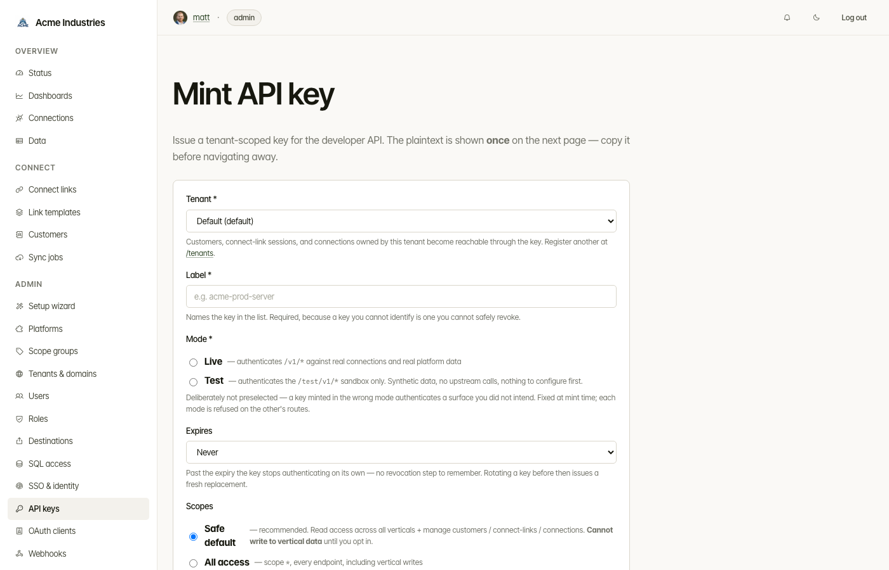
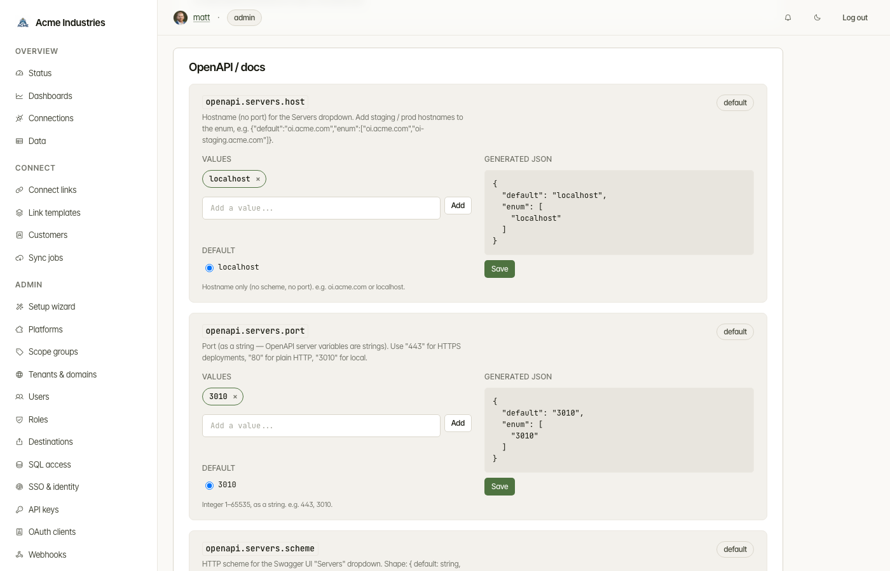

# Developer Guide

OpenSteward ships a single tenant-scoped REST surface for developers building on top of a self-hosted deployment. One credential authenticates everything: customer management, hosted Connect Link creation, and the per-vertical resource APIs (`/v1/accounting/*`, `/v1/crm/*`, etc.). Two kinds of credential are supported, and both carry the same [scopes](#3-scopes). The default is an **API key**, which every new deployment accepts. The other is an **OAuth token** from the operator's own identity provider, which stays off until the operator registers an issuer and turns it on. The operator chooses which of the two a deployment accepts, and which scopes each developer gets, to fit the company's needs. Ask them which applies to you. Operators set this up in the Admin UI under **API keys**, **OAuth clients** and **Settings → Authentication**, and [§2](#2-authentication) has the details.

This doc covers the developer-facing pieces. Everything is also in the unified OpenAPI spec at `docs/openapi/openapi.yaml` and rendered as the Unified API reference at `http://localhost:3003/unified-api` when docs-server is running.

## 1. Mint an API key

Two ways. Pick one.

### Admin UI (recommended)



1. Open the admin app at `http://localhost:3000`, log in.
2. Sidebar → **Admin** → **API keys** → **Mint key**.
3. Pick a tenant id (default: `default`), an optional label, and either "All access" or a custom set of scopes.
4. Copy the plaintext from the green banner. **It is shown exactly once.**

### CLI

```sh
pnpm --filter integration-server mint-api-key --tenant <tenantId> --label "<label>"
```

Prints:

```
  id:      <uuid>
  tenant:  <tenantId>
  label:   <label>
  key:     osk_<tenant-suffix>_<random>
```

Save the key. The store retains a one-way hash; the plaintext is unrecoverable.

The CLI takes no scope flag and mints an all-access (`*`) key. When you want the
read-only-by-default preset described in [§3](#3-scopes), mint from the admin UI.
`--list` shows existing keys (optionally `--tenant <id>`) and `--revoke <key-id>`
revokes one.

### Self-serve sandbox keys (when the operator has enabled it)

Some deployments let you skip the admin entirely for a **sandbox** key:

```sh
curl -X POST "$B/test/v1/keys"
# 201 → { "data": { "plaintext": "osk_test_sandbox-8f3a2b9c_…", "expiresAt": …, … } }
```

No authentication — the key lands in a throwaway tenant of its own, works only on
the synthetic `/test/v1/*` sandbox, and expires after 7 days. Off by default
(`403 SANDBOX_SELF_SERVE_DISABLED`); the operator opts in with
`auth.sandbox_self_serve_enabled`. Going live still goes through the admin.

## 1b. Key modes: `live` and `test`

Every key carries a **mode**, fixed at mint time and visible on the key record:

| Mode             | Plaintext shape              | Authenticates                                       |
| ---------------- | ---------------------------- | --------------------------------------------------- |
| `live` (default) | `osk_<tenant>_<random>`      | `/v1/*` — real connections, real upstream platforms |
| `test`           | `osk_test_<tenant>_<random>` | `/test/v1/*` — the sandbox                          |

Mint a test key with `--test`:

```sh
pnpm --filter integration-server mint-api-key --tenant <tenantId> --test --label "sandbox"
```

or `"mode": "test"` in the admin mint body. `--list` accepts `--test` / `--live` to filter.

**Crossing the two is refused in both directions** with `403 KEY_MODE_MISMATCH`, on every
route that takes a Bearer key — the vertical resource APIs, `/v1/customers*`,
`/v1/connections*` and `/v1/events` alike. Anything that is not explicitly a test surface is
live-only, so a sandbox key can never read production data by being pointed at the wrong path.

The mode is stored on the key record and is never inferred from the plaintext. The `test_`
marker is there so a key is recognisable at a glance; it is not what the server trusts. (A
tenant literally named `test` mints a _live_ key whose plaintext also begins `osk_test_` —
which is precisely why the string is not authoritative.)

### The sandbox

A test key addresses `/test/v1/*`, which mirrors the live surface and serves synthetic data:

```sh
# 1. Mint a test key.
pnpm --filter integration-server mint-api-key --tenant default --test --label sandbox

# 2. Find your sandbox connections. No OAuth, no setup — they always exist.
curl -H "Authorization: Bearer $TEST_KEY" http://localhost:3010/test/v1/connections

# 3. Call it.
curl -H "Authorization: Bearer $TEST_KEY" \
  "http://localhost:3010/test/v1/accounting/invoices?connection_id=$CONN"
```

**It works on a fresh clone with no adapters enabled.** The sandbox never resolves a real
adapter, so nothing has to be configured first — that is the point of it.

**Connection ids are derived, not created.** There is one per tenant per vertical, computed
from your tenant id, so they are the same after a restart and there is no provisioning step.
`GET /test/v1/connections` lists yours. Any other id — including a real connection's — is
rejected with `403 CONNECTION_FORBIDDEN`.

**Data is per tenant, and writes persist.** Records are seeded on first read from the same
examples the Unified API reference shows, so `GET /test/v1/accounting/invoices/inv_1042` returns the
invoice in the docs. `POST` / `PATCH` / `DELETE` behave normally and read back. Fields the
schema does not declare are dropped, so a response is always shaped like the real thing.
`DELETE /test/v1/reset` clears your sandbox; the next read reseeds it.

**Nothing reaches an upstream platform.** No credential is decrypted and no adapter is
constructed on this path, so a sandbox request cannot make an outbound call. Even
`POST /test/v1/{vertical}/sync` respects this: the job lifecycle is simulated —
pending → running → completed over about two seconds (`?fast=true` completes before
the response returns), completion seeds a couple of fresh fixture rows per resource
type so a re-poll genuinely sees new data, and a `callback_url` is validated and
stored but **never dialed**; poll `GET /test/v1/{vertical}/sync/{jobId}` instead.
Rehearse the whole sync flow here before your first live one.

Scopes, rate limits and the MCP guards apply exactly as they do on `/v1/*`. Errors match too,
plus `403 SANDBOX_QUOTA_EXCEEDED` when a tenant's sandbox hits its storage cap.

Mounted for **all nine verticals** — `accounting`, `crm`, `customer-support`,
`docsign`, `ecommerce`, `inventory`, `logistics`, `payments` and `projects`.

Logistics keeps two shapes worth knowing about, because the sandbox mirrors the
live routes rather than tidying them: rate shopping is `POST /test/v1/logistics/rates`
with the query in the body, and `GET /test/v1/logistics/tracking-events/{trackingNumber}`
returns a parcel's whole event list rather than a single record — an unknown
number is `200` and an empty list, not a `404`.

Child resources are addressed exactly as the live routes address them. Docsign's
signers, documents and audit-trail entries take `?envelope_id=` and each envelope
has its own; payments nests instead, so line items are at
`GET /test/v1/payments/invoices/{id}/line_items`. Parents can themselves have
parents — a projects comment belongs to a task and a task to a project, so
`GET /test/v1/projects/comments?task_id=…` needs a task id you got from
`?project_id=…`, and each level answers `400 MISSING_PARAM` without it.

Most action verbs hang off a record, but ecommerce's stock writes name their
target in the body instead — `POST /test/v1/ecommerce/inventory_levels/adjust`
with `{ variantId, locationId, delta }` moves that level's `available` and
answers `404` for a pair the sandbox has never seeded.

Action verbs work and mean something: `POST /test/v1/docsign/envelopes/{id}/void`
reads back voided, and payments' `capture`, `cancel`, `void`, `pay` and
`evidence` all transition the record and persist. `DELETE
/test/v1/payments/payment_methods/{id}` detaches, and the id stops resolving.

The sandbox's own three control routes are documented under the **Sandbox** tag:
`POST /test/v1/keys` (self-serve sandbox keys — see [§1](#1-mint-an-api-key)),
`GET /test/v1/connections` (start here — every other sandbox resource request
needs one of these ids) and `DELETE /test/v1/reset` (drops this tenant's
records; the next read reseeds them).

The **control-plane** endpoints are sandboxed too, so a test key can exercise the
_whole_ developer API — not just the vertical resource routes. `/test/v1/customers*`,
`/test/v1/connections/{id}`, `/test/v1/webhook-subscriptions*` and `/test/v1/events`
serve **deterministic pre-seeded mock data**: reads return a small, stable synthetic
set (two customers, one webhook subscription, the derived connections, a couple of
events), and writes (`POST`/`PATCH`/`DELETE`, the webhook `/test` send) return a
schema-valid canned response without persisting or dialing anything. This is mock
data, not a live store — the `/test/v1/customers` list is always the same two seeded
customers regardless of what you `POST`.

**The OAuth/connect journey is sandboxed too — as a mock ceremony.** The live
`/auth/{vertical}/{platform}/connect` dance needs a real provider and real OAuth
client config, which the no-egress sandbox can never have; instead the sandbox
simulates the whole flow against its one synthetic platform:

```bash
# Programmatic: skip the browser page with ?outcome=…
curl -i "$BASE/test/v1/auth/accounting/sandbox/connect?tenant_id=default&outcome=granted"
# → 302 → follow it:
#   GET /test/v1/auth/accounting/sandbox/callback?code=sbx_granted&state=…
# → 201 { "data": { "id": "<the derived sandbox connection id>", … } }
```

| `?outcome=` | The callback answers                                                                       |
| ----------- | ------------------------------------------------------------------------------------------ |
| _(omitted)_ | 302 to the hosted **mock authorize page** (Approve / Deny buttons) — the browser journey   |
| `granted`   | `201` with the derived connection id (`= GET /test/v1/connections`'s id for that vertical) |
| `denied`    | `400 OAUTH_ACCESS_DENIED`, no id                                                           |
| `error`     | `400 OAUTH_PROVIDER_ERROR`, no id                                                          |
| `expired`   | `400 INVALID_STATE` (the state was never stored — what a lapsed live state looks like)     |

The `state` is one-time, exactly like live: replaying a callback answers
`400 INVALID_STATE`, and a state started for another vertical answers
`400 STATE_MISMATCH`. The ceremony never mints ids — the only id it can grant
is the derived `sandboxConnectionId(tenant, vertical)`, so nothing it does can
disturb real connections.

**Sandbox Connect Links open.** `POST /test/v1/customers/{id}/connect-links`
returns a URL under `/test/v1/connect/{token}` served by this deployment: a
hosted mock picker (one entry per vertical) → the mock authorize page → a done
page showing the granted connection id. The three HTML pages are deliberately
unpublished in the OpenAPI spec (the live `/connect/*` pages aren't published
either); the two JSON ceremony routes are, under the **Sandbox** tag
(`sandbox.auth-connect` / `sandbox.auth-callback`). The link token is
deterministic and expiry is not enforced.

**The platform catalog is curated in test mode.** `GET /test/v1/platforms`
returns exactly one synthetic `sandbox` platform per vertical (always
`enabled: true`) — the platforms the sandbox connections actually use — rather
than mirroring the ~1,500-platform live catalog. `GET
/test/v1/platforms/{vertical}/sandbox` resolves; any real slug 404s there.
(The live `GET /v1/platforms` now requires a credential — a Bearer dev key or
`X-Admin-Secret` — matching what the spec always declared.)

In the **Unified API** reference (`/unified-api`) these tenant surfaces —
`customers`, `connections`, `events`, `webhook-subscriptions` — carry both
servers, so you switch to test mode with the **Servers dropdown** at the top
(pick the `…/test/{version}` entry) and _Try it out_ hits `/test/v1/*`. The
typed **SDK** does the same via `mode: 'test'`. The operator connection surface
is separate: it lives at `/admin/connections*` (`X-Admin-Secret`, live only) and
has no sandbox variant — the tenant `GET /test/v1/connections` is how you list
connections with a test key.

Operators can turn the whole surface off with the runtime setting
`features.test_mode_enabled` — every `/test/v1/*` route then returns `503 TEST_MODE_DISABLED`
within one settings poll, with no restart, and `/v1/*` untouched.

**The sandbox takes test credentials only: `osk_test_` keys, or tokens from the
deployment's own test issuer.** A token from a real identity provider is refused on
`/test/v1/*` — verifying one means fetching the issuer's keys over the network, and the
sandbox's no-egress guarantee does not bend for auth. The test issuer needs no fetch: its
signing key is held in memory, and its tokens are the OIDC counterpart of test keys —
minted by the deployment, accepted here, refused on `/v1/*` with `KEY_MODE_MISMATCH`.
This cuts the other way too — the `auth.dev_api_keys_enabled` kill switch gates only
`/v1/*`, so a deployment that has gone OIDC-only for production still onboards developers
through test-mode keys.

**Rehearsing the OIDC flow against the sandbox.** The operator registers the test issuer on
`/oauth-clients/new` with the "OpenSteward test issuer" preset (issuer URL
`<integration-server public base>/test/oidc`, audience of their choosing), enables
`auth.dev_oauth_enabled`, and registers your subject as a service account with a tenant and
scopes — the same steps a production IdP takes. You then trade a test key for a token:

```
POST /test/oidc/token
grant_type=client_credentials&client_id=<your subject>&client_secret=<osk_test_… key>
```

and send the `access_token` where the key would go. Whether it is admitted is the issuer's
configuration — registry, intersect or token-decides — exactly as on `/v1/*`. The tenant
claim is always the key's tenant; the token can never reach another.

### Going to production

The switch from sandbox to live is deliberately small. In order:

1. **Swap the credential** — a `live`-mode key from the operator (or an OIDC token,
   where enabled). The test key will answer `403 KEY_MODE_MISMATCH` on `/v1/*`.
2. **Drop the path prefix** — `/test/v1/*` → `/v1/*`. SDK users change one option:
   remove `mode: 'test'` ([SDK guide](./sdk/getting-started.md)).
3. **Get a real `connection_id`** — sandbox connections are synthetic and do not exist
   on the live surface. Mint a [Connect Link](#5-connect-link) for your customer, or
   list `/v1/connections` for tenant-wide connections ([§5b](#5b-tenant-wide-connection-management)).
4. **Run your first `/sync`** — bulk-populate the cache ([§7](#7-data-store-is_livetrue-and-sync)).
   You have already rehearsed the mechanics against `/test/v1/{vertical}/sync`;
   the live one has its own budget (10/hour per key per vertical), really
   dials your `callback_url`, and is where upstream rate limits first become
   real.
5. **Re-check error handling** — live adds failure modes the sandbox cannot produce:
   upstream 5xx, expired grants (`connection.authorization_expired` webhook), and the
   per-key/per-IP budgets in [§2](#bearer-key-failures). Capture `X-Request-Id` from
   responses now — it is what the operator will ask for.

## 2. Authentication

The API exposes **three security schemes**. Two are interchangeable developer
credentials for the same routes; the third is the operator path.

| Scheme                            | How to send                                   | Used on                                                                                                                                                                                                                           |
| --------------------------------- | --------------------------------------------- | --------------------------------------------------------------------------------------------------------------------------------------------------------------------------------------------------------------------------------- |
| **`ApiKeyAuth`** (Bearer dev key) | `Authorization: Bearer osk_<tenant>_<random>` | `/v1/*` — the public developer surface                                                                                                                                                                                            |
| **`OAuth2Bearer`** (OIDC token)   | `Authorization: Bearer eyJhbGciOiJSUzI1NiI…`  | `/v1/*` — the same surface, when the operator has enabled it                                                                                                                                                                      |
| **`AdminSecret`** (header)        | `X-Admin-Secret: <value>`                     | `/admin/*` and the operator `/connections*` routes (`GET` / `PATCH` / `DELETE /connections/{id}`) — operator-only and inter-service routes. The developer equivalents live at `/v1/connections*` and take the Bearer key instead. |

If you're integrating from your own app, you almost certainly want one of the
first two — ask the operator which they accept. The admin secret is for the
operator running the deployment and for inter-service calls between admin-api
and integration-server; **never share it with external integrators**.

### `OAuth2Bearer` — a token from the operator's own IdP

Where a deployment's service accounts already live in Keycloak, Auth0, Okta or
Entra ID, the operator can register that issuer and let you authenticate with a
short-lived token from it instead of a static key. Get the token however that
IdP issues one — for a service account, usually `client_credentials` — and send
it exactly where the key would go.

OpenSteward is only a **resource server** here. It verifies your token against
the issuer's published public keys; it never mints tokens and holds no client
secret of yours.

The token resolves to the **same scopes** described in [§3](#3-scopes) — the
two-axis vertical model and all of it — so nothing else about this document
changes. Which scopes you get is the operator's choice per issuer: from a
client they registered for you, from your token's own scope claim, or from the
registered set narrowed by your claim. Ask them which.

Two failures are worth recognising:

| Code                | Status | Meaning                                                                                  |
| ------------------- | ------ | ---------------------------------------------------------------------------------------- |
| `OAUTH_DISABLED`    | 403    | The deployment does not accept OIDC tokens. Use a key, or ask the operator to enable it. |
| `API_KEYS_DISABLED` | 403    | The deployment no longer accepts `osk_` keys. Get a token from their IdP.                |

Every _verification_ failure — bad signature, wrong audience, expired token, a
client the operator never registered — answers the same `401 UNAUTHENTICATED`.
That is deliberate: a more specific error would let anyone holding a junk token
enumerate the operator's service accounts. If you are stuck, the reason is in
the deployment's logs and the operator can read it.

Operators: the setup walkthrough is
[`deployment/oauth-clients-setup.md`](./deployment/oauth-clients-setup.md).
Both credentials have a kill switch in **Admin → Settings**
(`auth.dev_api_keys_enabled`, `auth.dev_oauth_enabled`), read per request, so a
flip applies within a minute without a redeploy. Turning keys off is refused
unless an issuer is enabled, can admit somebody, and has already verified a
real token — otherwise it locks every developer out. `X-Admin-Secret` is never
gated by either, and is the way back in.

The hosted `/connect/*` routes are neither. They are opened by your customer's browser and carry no header at all — the opaque link token in the path _is_ the credential. It expires, and it stops working once the session it names is consumed or revoked.

### Why a separate `AdminSecret` scheme?

`ADMIN_SECRET` solves the bootstrap problem. The very first API call to a fresh deployment happens _before any user, JWT, or developer key exists_ — admin-api needs a way to call the integration-server's `/admin/*` routes during boot to seed platforms, mint the first dev key, etc. A single env-var is the simplest possible mechanism for that. Day-2 operator actions on tenant data should already be done with a Bearer dev key (`connections:write`, `vertical:write` scopes).

### Bearer-key failures

```
Authorization: Bearer osk_<tenant-suffix>_<random>
```

| Code                   | Status | Meaning                                                                                                  |
| ---------------------- | ------ | -------------------------------------------------------------------------------------------------------- |
| `UNAUTHENTICATED`      | 401    | Header missing or key invalid/revoked                                                                    |
| `KEY_MODE_MISMATCH`    | 403    | A test key was used on `/v1/*`, or a live key on `/test/v1/*`. See [§1b](#1b-key-modes-live-and-test)    |
| `INSUFFICIENT_SCOPE`   | 403    | Key is valid but lacks the scope this endpoint requires                                                  |
| `RATE_LIMITED`         | 429    | 600 req/60s per key exceeded; `Retry-After` header set                                                   |
| `CUSTOMER_NOT_FOUND`   | 404    | Resource id does not belong to your tenant (also returned for cross-tenant lookups to avoid leaking ids) |
| `CONNECTION_FORBIDDEN` | 403    | The `connection_id` is not owned by your tenant                                                          |

All success responses carry `X-RateLimit-Limit` + `X-RateLimit-Remaining`. A 429 sets
those two headers plus `Retry-After` (whole seconds) and returns the standard error
envelope:

```json
{ "error": { "code": "RATE_LIMITED", "message": "Rate limit exceeded — retry in 37s." } }
```

There are two independent budgets, and a request has to pass both:

| Budget                       | Keyed on   | Default        | Tuned by                                                                                                                                                                                                                                                                                                                                                                                           |
| ---------------------------- | ---------- | -------------- | -------------------------------------------------------------------------------------------------------------------------------------------------------------------------------------------------------------------------------------------------------------------------------------------------------------------------------------------------------------------------------------------------- |
| Per-API-key                  | `apiKeyId` | 600 req / 60 s | Fixed at the default on the vertical resource routes (`/v1/{vertical}/*`). Tunable only on `/v1/customers/*`, `/v1/connections*` and the inbound-events routes, where `RATE_LIMIT_MAX` / `RATE_LIMIT_WINDOW_MS` set the boot value and the live runtime settings `rate_limit.api_key.per_minute` / `rate_limit.api_key.window_ms` override it (admin → **Settings** → **Rate limits**, no restart) |
| Per-source-IP (whole server) | `req.ip`   | 600 req / 60 s | `RATE_LIMIT_MAX` / `RATE_LIMIT_WINDOW_MS`, or `rateLimitMax` / `rateLimitWindowMs` in `config.yml`                                                                                                                                                                                                                                                                                                 |

The per-IP budget skips static prefixes (`/design/`, `/specs/`, `/data/`, `/public/`,
`/health`) so one page of logos doesn't spend a caller's budget, and it exempts requests
presenting a matching `X-Admin-Secret` — sibling services all arrive from one container
IP with no `X-Forwarded-For`, so without the exemption the deployment throttles its own
admin UI long before any outside caller notices. An unset `ADMIN_SECRET` exempts nothing.

The default backend is an in-process token bucket — fine for single-instance deployments and resets on container restart. For horizontally-scaled deployments, set `REDIS_URL` (or use the `scale` docker-compose profile: `docker compose --profile scale up -d`) and the budget is shared across replicas via a Redis counter. Redis outages fail open — a transient blip won't 429 every request.

### License refusals

A deployment runs on a license or, without one, in community mode. When the license does not allow a request, the answer is a 403 with the standard error envelope and one of these codes:

| Code                           | Status | Meaning                                                                                                                                                                                                                                                                                          |
| ------------------------------ | ------ | ------------------------------------------------------------------------------------------------------------------------------------------------------------------------------------------------------------------------------------------------------------------------------------------------ |
| `LICENSE_FEATURE_NOT_ENTITLED` | 403    | The deployment's license does not include this vertical, or MCP for an `mcp:read` credential. `GET /v1/capabilities` lists what answers.                                                                                                                                                         |
| `LICENSE_LIMIT_EXCEEDED`       | 403    | Creating a connection would exceed the license's connection limit, or (on a write) this connection is beyond the limit and is read-only. Reads and `POST /{vertical}/sync` still work, and nothing is deleted. To replace a connection at the limit: export its data, delete it, then reconnect. |
| `LICENSE_EXPIRED`              | 403    | The license expired more than 30 days ago and the feature is outside community mode. The message is `Renew at https://opensteward.dev/license`. Not returned by this release: community mode includes every current vertical.                                                                    |

```json
{
  "error": {
    "code": "LICENSE_FEATURE_NOT_ENTITLED",
    "message": "This deployment's license does not include 'vertical:accounting'. See https://opensteward.dev/license",
    "feature": "vertical:accounting"
  }
}
```

These are never refused for license reasons:

- `/health` and `/version`;
- connection management (rename, schedule, delete);
- data export.

A connection or tenant limit never refuses reads (`GET`), `POST /{vertical}/sync` or `GET /v1/capabilities`: a connection beyond the limit stays readable and keeps syncing. Two license checks still apply to them:

- a vertical the license does not include is refused as a whole, reads and syncs included (`LICENSE_FEATURE_NOT_ENTITLED` above);
- an `mcp:read` credential is refused on every authenticated route, `GET /v1/capabilities` included, when the license does not include MCP.

`GET /auth/{vertical}/{platform}/connect` is unauthenticated, so its refusal carries only `code` and a generic `message`. A Connect Link customer is sent back to their link page instead.

#### `GET /v1/capabilities`

This lists the verticals the deployment serves to your credential, as `{ "data": { "verticals": [...] } }`: every vertical it runs that its license includes.

- Any Bearer dev key works, with no particular scope. An `mcp:read` key is also subject to the MCP checks: it is refused here when `features.mcp_enabled` is off or the license does not include MCP.
- End-user tokens use `GET /v1/me/capabilities`, which lists the verticals mounted under `/v1/me` that the license includes.
- In test mode, call `GET /test/v1/capabilities` with a test key.
- No license details are ever returned.

### `X-Request-Id`

Every response carries an `X-Request-Id` header. Send one on the request and it is
echoed back; omit it and the server generates one. Log it alongside your own request
records — it is the correlation id the operator's logs are keyed by, so quoting it turns
"a request failed yesterday" into a one-line lookup. This is the id to include in any
support report, especially for the uniform `401 UNAUTHENTICATED` responses, which are
deliberately unspecific on the wire ([§2](#bearer-key-failures)) and specific only in
the server logs.

### CORS

Off by default: with no configuration the API sends no `Access-Control-*` headers at
all, which is what a Bearer-token API wants — a page the operator does not control must
not be able to spend a victim's key from the victim's browser and read the response.

Set `CORS_ORIGIN` to a comma-separated list of origins to opt in. `*` is honoured and
means every origin; trailing slashes are stripped, because a browser sends `Origin:
https://host` with no path and the comparison is exact. There is deliberately no way to
reach "reflect whatever `Origin` arrives" from an env var.

`/admin/*` stays outside the boundary whatever `CORS_ORIGIN` says — those routes are the
operator's own server-to-server surface. Preflights answer for `GET`, `HEAD`, `POST`,
`PUT`, `PATCH`, `DELETE`, `OPTIONS`; `credentials` stays off, so no cookie ever rides
along. docker-compose defaults `CORS_ORIGIN` to `http://localhost:3003` so docs-server's
Swagger console can "Try it out" out of the box.

### Idempotency-Key

Every `POST` / `PATCH` / `PUT` / `DELETE` honours an optional `Idempotency-Key`
request header so a retry after a timeout doesn't double-process. The value is
opaque to the server — send a UUIDv4 — and is capped at 255 characters. `GET`,
`HEAD` and `OPTIONS` bypass it entirely; so do streaming responses, whose body
the server never holds.

The cache is keyed on `(tenant, method, route, Idempotency-Key)` with a 24 h TTL.
The key is looked at only once authentication, scopes and the license checks
have let the request through, so the tenant is the one your credential belongs
to:

| Situation                                                                               | Response                                                                                                                    |
| --------------------------------------------------------------------------------------- | --------------------------------------------------------------------------------------------------------------------------- |
| First request                                                                           | Processed normally; status, headers and body stored under the key                                                           |
| First request refused: `401`, `403`, `409`, `429`, or any `LICENSE_*` error             | Nothing stored. A retry with the same key is checked again, so a freed connection slot or a renewed license applies at once |
| Retry, same key, same URL and body                                                      | The stored response replayed verbatim, plus `Idempotency-Replayed: true`                                                    |
| Retry, same key, **different** URL (query included, so another `connection_id`) or body | `422` with `Idempotency-Key-Conflict: true`; the stored response is kept                                                    |
| Retry while the first is still in flight                                                | `409` with `Retry-After: 1`                                                                                                 |

A replay is still checked against authentication and the license first: a
write that was stored before a license lapsed is refused like any other until
writes are allowed again, and then replays.

Storage follows the rate limiter: Redis when `REDIS_URL` is set, so replicas
share one cache; an in-process LRU otherwise.

## 3. Scopes

Every key carries a list of scope tokens. Available scopes:

| Token                 | Endpoints unlocked                                                                                                                                                                                                               |
| --------------------- | -------------------------------------------------------------------------------------------------------------------------------------------------------------------------------------------------------------------------------- |
| `*`                   | Everything                                                                                                                                                                                                                       |
| `customers:read`      | `GET /v1/customers`, `GET /v1/customers/{id}`                                                                                                                                                                                    |
| `customers:write`     | `POST /v1/customers`, `PATCH /v1/customers/{id}`, `DELETE /v1/customers/{id}`                                                                                                                                                    |
| `customers:*`         | `customers:read` + `customers:write`                                                                                                                                                                                             |
| `customers:read_pii`  | Allows `?include_pii=true` on customer reads to decrypt PII (`firstName`, `lastName`, `phone`, `address`, `personalIdNumber`). Each reveal writes a `pii_reveal` structured log line — visible in container logs.                |
| `connections:read`    | `GET /v1/customers/{id}/connections`, `GET /v1/connections`, `GET /v1/connections/{id}`                                                                                                                                          |
| `connections:write`   | `PATCH /v1/connections/{id}`, `DELETE /v1/connections/{id}`                                                                                                                                                                      |
| `connect-links:write` | `POST /v1/customers/{id}/connect-links`                                                                                                                                                                                          |
| `webhooks:read`       | `GET /v1/webhook-subscriptions[/{id}]`, `GET /v1/webhook-subscriptions/{id}/deliveries`                                                                                                                                          |
| `webhooks:write`      | `POST`/`PATCH`/`DELETE /v1/webhook-subscriptions*` plus the `/test`, `/paused` and `/rotate-secret` actions — register and manage your own outbound webhook endpoints (see [§8](#8-outbound-webhooks))                           |
| `mcp:read`            | Marks the key read-only at the auth layer: any non-`GET`/`HEAD` request is rejected with `403 MCP_READ_ONLY`. Cannot be minted alongside a write-granting scope (`*`, `<resource>:*`, or anything ending `:write`).              |
| `vertical:<v>`        | **Touch axis**, one per vertical. GETs on `/v1/<v>/*`. Writes need `vertical:write` in addition. The nine are `accounting`, `crm`, `ecommerce`, `logistics`, `payments`, `docsign`, `projects`, `customer-support`, `inventory`. |
| `vertical:read`       | **Touch axis convenience.** GETs on every `/v1/{vertical}/*` without per-vertical scopes.                                                                                                                                        |
| `vertical:write`      | **Verb axis.** Required for `POST` / `PATCH` / `PUT` / `DELETE` on any `/v1/{vertical}/*` — with one exception, `POST /v1/{vertical}/sync` (see below). Independent of which vertical the key can touch.                         |

Wildcards: `<resource>:*` covers any action on that resource. `*` covers anything.

**Sync is a read.** `POST /v1/{vertical}/sync` needs only the touch axis
(`vertical:{v}` or `vertical:read`). It is a POST because it enqueues a job, not
because it changes anything: the worker lists upstream resources and upserts
them into OpenSteward's own store, never writing back to the platform. Requiring
`vertical:write` would mean a key minted with the recommended preset — which
omits that scope deliberately — could read a vertical's data but never refresh
it.

The one part of sync that does need `vertical:write` is `callback_url`. Supplying
one makes the deployment issue an outbound POST from inside its own network,
which is a different authority from refreshing a cache. That URL must be `https`
and must not resolve to a loopback, private or link-local address; it is checked
when the job is enqueued and again immediately before the request is sent.

### Two-axis vertical access

`/v1/{vertical}/*` requires **both** axes to pass:

| Axis                                             | Scopes that satisfy it                                       |
| ------------------------------------------------ | ------------------------------------------------------------ |
| Touch (can the key see this vertical at all?)    | `*` OR `vertical:<v>` OR `vertical:read` OR `vertical:write` |
| Verb=read (`GET`)                                | Touch alone is sufficient                                    |
| Verb=write (`POST` / `PATCH` / `PUT` / `DELETE`) | Touch + (`*` OR `vertical:write`)                            |

Examples:

| Key scopes                              | Read accounting | Write accounting | Read CRM | Write CRM |
| --------------------------------------- | --------------- | ---------------- | -------- | --------- |
| `*`                                     | ✅              | ✅               | ✅       | ✅        |
| `vertical:accounting`                   | ✅              | ❌               | ❌       | ❌        |
| `vertical:accounting`, `vertical:write` | ✅              | ✅               | ❌       | ❌        |
| `vertical:read`                         | ✅              | ❌               | ✅       | ❌        |
| `vertical:read`, `vertical:write`       | ✅              | ✅               | ✅       | ✅        |

### Default scope set on mint

The recommended preset for new keys (the **Safe default** option in the admin UI) pre-selects:

```
customers:read, customers:write, customers:read_pii,
connect-links:write, connections:read, connections:write,
vertical:accounting, vertical:crm, vertical:ecommerce, vertical:logistics,
vertical:payments, vertical:docsign, vertical:projects,
vertical:customer-support, vertical:inventory, vertical:read
```

The vertical entries are derived from the same list the admin's vertical pickers
render, so a new vertical joins the preset the day it ships rather than the day
someone remembers to copy it in.

`vertical:write` is **deliberately omitted** so a key minted with the recommended preset can read every vertical and manage customers / connect-links / connections, but cannot push writes back to the upstream systems. This default exists because operators of a self-hosted deployment are liable for what gets written upstream — defaulting to read-only across verticals avoids surprise mutations bypassing regulatory controls.

To grant writes, mint with **All access** (`*`) or pick **Custom** and check `vertical:write`.

### Scope rejection

A request to a route requiring `customers:read` with a key carrying `connections:read` returns:

```
HTTP/1.1 403 Forbidden
{
  "error": {
    "code": "INSUFFICIENT_SCOPE",
    "message": "This API key is missing required scope 'customers:read'.",
    "requiredScope": "customers:read"
  }
}
```

A `POST /v1/accounting/contacts` with a key that has `vertical:accounting` but no `vertical:write` returns:

```
HTTP/1.1 403 Forbidden
{
  "error": {
    "code": "INSUFFICIENT_SCOPE",
    "message": "'vertical:write' scope required to mutate /v1/accounting/* data.",
    "requiredScope": "vertical:write"
  }
}
```

### Boot-time scope normalization

On boot, any key whose scopes contain `vertical:<v>` but neither `*` nor `vertical:write` has `vertical:write` added. The boot log shows `api-keys: added missing 'vertical:write' scope to N key(s)`. The pass is idempotent — subsequent boots are no-ops.

## 4. Customers

```sh
B=http://localhost:3010
KEY=osk_default_…
```

Create / upsert (idempotent on `(tenantId, lower(email))`):

```sh
curl -H "Authorization: Bearer $KEY" -H "Content-Type: application/json" \
  -d '{"email":"jane@acme.com","displayName":"Jane (Acme)","externalReference":"crm-123"}' \
  $B/v1/customers
```

List / search:

```sh
curl -H "Authorization: Bearer $KEY" "$B/v1/customers?q=acme&limit=20"
```

Get by id, update, delete:

```sh
curl -H "Authorization: Bearer $KEY" $B/v1/customers/<id>
curl -X PATCH -H "Authorization: Bearer $KEY" -H "Content-Type: application/json" \
  -d '{"displayName":"Jane Doe"}' $B/v1/customers/<id>
curl -X DELETE -H "Authorization: Bearer $KEY" $B/v1/customers/<id>
```

By default, deleting a customer leaves their connections (and synced data)
intact. Add `?cascade=connections` to also delete every connection the
customer's links produced — the standard connection-delete cascade drops cached
resources, sync jobs and external-account links. The response is `204` either
way; the `customer.deleted` webhook event then carries a `deleted_connections`
count. See [`operations/data-erasure.md`](./operations/data-erasure.md) for the
full erasure runbook.

PII (firstName, lastName, phone, address, personalIdNumber) is encrypted at rest. By default, customer reads strip the `pii` field. To retrieve it, the key must carry the `customers:read_pii` scope and the request must opt in:

```sh
curl -H "Authorization: Bearer $KEY" "$B/v1/customers/<id>?include_pii=true"
```

Every reveal writes a structured log line:

```json
{
  "event": "pii_reveal",
  "endUserId": "<uuid>",
  "tenantId": "default",
  "apiKeyId": "<uuid>",
  "msg": "PII revealed via developer API"
}
```

Inspect via `docker logs OpenSteward-integration-server-1 | grep pii_reveal` (or your log aggregator).

## 5. Connect Link

Spawn a hosted link for a customer. The customer opens the URL, picks an integration (or uses the one you pinned), authorises, and a connection lands tagged back to that customer.

The link's behaviour depends on which fields you set, mapping to one of two modes on
the developer surface:

| Mode                       | What you send                                                          | Customer experience                                                                                                                         |
| -------------------------- | ---------------------------------------------------------------------- | ------------------------------------------------------------------------------------------------------------------------------------------- |
| **Pinned**                 | `customer-id` in the path + `vertical`+`platform` in the body          | Skips the picker, lands in OAuth for the chosen adapter. Both fields are required — a link with only one of them is not pinned to anything. |
| **Customer picks adapter** | `customer-id` in the path; omit `platform` (and optionally `vertical`) | Picker appears with whatever adapters you allowed.                                                                                          |

A third mode, **self-register** — no customer bound at mint time, the landing page
captures the email and the public `POST /connect/:token/customer` route creates the
end-user and binds it before the picker appears — exists on the connect session but is
reachable only from the operator surface: `POST /admin/connect-sessions` with
`allowSelfRegister: true` (`X-Admin-Secret`), or the **Connect links** page in the admin
UI. The developer route always mints against a customer in the path, and its body
schema is strict, so sending `allowSelfRegister` there is a `400 VALIDATION`.

```sh
# Pinned (most common)
curl -H "Authorization: Bearer $KEY" -H "Content-Type: application/json" \
  -d '{"vertical":"accounting","platform":"xero","label":"Q2 reconciliation"}' \
  $B/v1/customers/<customer-id>/connect-links
```

Returns:

```json
{
  "data": {
    "id": "<session-uuid>",
    "token": "<opaque hex>",
    "url": "https://your-deployment.example.com/connect/<token>",
    "status": "active",
    "expiresAt": 1777734104240,
    "endUserId": "<customer-id>",
    "allowedVerticals": ["accounting"],
    "allowedPlatforms": [{ "vertical": "accounting", "slug": "xero" }],
    "redirectUrl": null
  }
}
```

Email the `url`. After the customer completes OAuth, listing connections reveals the new row:

```sh
curl -H "Authorization: Bearer $KEY" $B/v1/customers/<customer-id>/connections
```

Body shape:

| Field              | Type     | Notes                                                                                                                                                                                                                                                                                                                           |
| ------------------ | -------- | ------------------------------------------------------------------------------------------------------------------------------------------------------------------------------------------------------------------------------------------------------------------------------------------------------------------------------- |
| `vertical`         | string   | optional — one of the nine vertical names. Restricts the picker to this vertical.                                                                                                                                                                                                                                               |
| `platform`         | string   | optional — pin to a specific adapter. Only takes effect together with `vertical`.                                                                                                                                                                                                                                               |
| `label`            | string   | optional, free-form, internal-only. Defaults to `Connect link for <customer email>`.                                                                                                                                                                                                                                            |
| `redirectUrl`      | URL      | optional, where the customer lands after success.                                                                                                                                                                                                                                                                               |
| `expiresInSeconds` | int      | optional, max 90d. When omitted, expiry comes from the operator's `connect_link.default_expiry_hours` runtime setting (72h out of the box; an operator setting it to 0 mints links with no expiry).                                                                                                                             |
| `allowedVerticals` | string[] | optional. Explicit allow-list; overrides the single `vertical`.                                                                                                                                                                                                                                                                 |
| `allowedPlatforms` | object[] | optional. `[{ "vertical": "...", "slug": "..." }]`; overrides the single `platform`.                                                                                                                                                                                                                                            |
| `oneTimeOnly`      | bool     | optional. Auto-deletes the connection after the first sync; pair with a read-only scope group. When omitted, defaults to the operator's `connect_link.one_time_default` runtime setting (off out of the box) — pass `false` explicitly if the link must not be one-time.                                                        |
| `scopes`           | string[] | optional. Explicit OAuth scope list. Setting it implies `scopePolicy: "custom"`. Some adapters configure scopes at the OAuth-app level and ignore per-call overrides — see the platform's configure page.                                                                                                                       |
| `scopePolicy`      | enum     | optional, **default `read_only`**. `read_only` requests the platform's curated read-only scopes (falling back to the platform default where none are catalogued), `platform_default` sends no override, `custom` uses the `scopes` array. Resolved per-platform at OAuth-start, so a multi-platform link still means read-only. |

Any other key is rejected: the body schema is strict, and an unknown field returns
`400 VALIDATION` with the Zod issues attached.

**`url` can come back `null`.** The link is opened by a customer's browser, so it must
never carry the compose network's own hostname. When the request arrives from inside
that network (`Host: integration-server:3010`) and neither `PUBLIC_BASE_URL` nor the
operator's company base URL is set, the response withholds the URL and adds
`"urlUnresolved": true`. The session itself is created and usable — set a public base
URL and build the link from the returned `token`.

## 5b. Tenant-wide connection management

After connections land via Connect Link, you can manage all of them at the tenant level:

```sh
# List every connection your tenant owns
curl -H "Authorization: Bearer $KEY" $B/v1/connections

# Filter
curl -H "Authorization: Bearer $KEY" "$B/v1/connections?vertical=accounting&platform=xero"

# Rename
curl -X PATCH -H "Authorization: Bearer $KEY" -H "Content-Type: application/json" \
  -d '{"label":"Acme prod"}' $B/v1/connections/<id>

# Revoke (does NOT call the upstream platform — issue a platform-side revoke separately)
curl -X DELETE -H "Authorization: Bearer $KEY" $B/v1/connections/<id>
```

A connection's `ownerTenantId` is set at OAuth-callback time from the Connect Link session that produced it. Connections created out-of-band via admin tooling have `ownerTenantId = null` and are not visible here — use the operator `/admin/connections` surface (`X-Admin-Secret`) for those.

### Connecting a platform that has no OAuth

Not every platform has an authorization endpoint to redirect to. Carriers in
particular (and a handful of CRM platforms) issue a static key you paste in.
Those adapters declare a `credentialFields()` form, and there are two ways to
submit it:

- **Connect Link** — the hosted page, scoped by a one-time session token. This
  is the flow for your _customers_: they never see an admin credential.
- **`POST /auth/{vertical}/{platform}/connect`** — headless, for your own
  tooling and bulk provisioning. Takes **either** credential, and they are not
  equivalent:
  - `X-Admin-Secret` — `tenant_id` comes from the body, so an operator can
    provision for any tenant or for none.
  - A tenant Bearer key with `connections:write` — works too, but `tenant_id`
    comes from the **key** and the body's value is ignored. That is what makes
    it safe to hand out: you can provision your own carriers headlessly and
    cannot reach another tenant's. A sandbox (`osk_test_…`) key is refused —
    this writes a real credential.

```sh
# As a tenant — your own key, your own tenant.
curl -X POST -H "Authorization: Bearer $KEY" -H 'content-type: application/json' \
  -d '{"fields":{"apiKey":"shippo_live_…"},"label":"Shippo prod"}' \
  $B/auth/logistics/shippo/connect

# As an operator — any tenant, or none.
curl -X POST -H "X-Admin-Secret: $ADMIN_SECRET" -H 'content-type: application/json' \
  -d '{"fields":{"apiKey":"shippo_live_…"},"tenant_id":"acme","label":"Shippo prod"}' \
  $B/auth/logistics/shippo/connect
```

Send the adapter's own field names — `GET /v1/platforms/{vertical}/{slug}`
lists them, and some adapters want a client id and secret rather than one key.
`api_key` is accepted as shorthand only where the adapter declares exactly one
field; anything else answers `400` and names what it needs. An adapter with no
static-credential flow answers `404` — use the OAuth `GET` instead.

Cross-tenant lookups return **404** (not 403) so the API does not leak the existence of other tenants' connection ids.

### Telling a dead grant from an idle one

Each row carries `expiresAt` plus the outcome of the last token refresh:

| Field               | Meaning                                                                                                                                                                                                                                                                                                                              |
| ------------------- | ------------------------------------------------------------------------------------------------------------------------------------------------------------------------------------------------------------------------------------------------------------------------------------------------------------------------------------ |
| `lastRefreshAt`     | epoch ms of the last refresh attempt, or `null` if there has never been one                                                                                                                                                                                                                                                          |
| `lastRefreshStatus` | `ok`, `failed` (transient — network / 5xx / rate limit), `expired` (the grant itself is dead; the customer must re-authorize), or `platform_error` (the operator's OAuth client credentials were rejected — affects every connection for that platform)                                                                              |
| `lastRefreshError`  | short reason from the last failure: the OAuth code, its description and the HTTP status, truncated — or, when the failure has no OAuth shape (a network timeout, say), the bare error message. Never the raw request or response: the underlying error object holds the client secret and the refresh token. `null` after a success. |

A lapsed `expiresAt` on its own is not a fault. Access tokens are short (an hour on
several platforms) and renewed automatically, both ahead of expiry by the keep-alive
worker and on demand by the request path, so a healthy idle connection spends much of
its life with a dead access token and a working grant behind it. Read `expiresAt` in the
past together with `lastRefreshStatus: "ok"` as healthy; treat `expired` and
`platform_error` as needing a human.

## 6. Vertical resource APIs

After a connection lands you call the per-vertical APIs with the same key plus the `connection_id`:

```sh
curl -H "Authorization: Bearer $KEY" \
  "$B/v1/accounting/contacts?connection_id=<connection-uuid>"
```

The middleware verifies your key's tenant owns the connection (cross-tenant access returns `403 CONNECTION_FORBIDDEN`) and also enforces the `vertical:<vertical>` scope.

Browse the per-vertical paths in the unified spec at `docs/openapi/openapi.yaml` or via Swagger UI on docs-server.

### List responses and paging

Every list route answers `{ data, meta }`, where `meta` is `{ platform, totalCount, page, limit, hasMore, fetchedAt }`.

- **`limit`** defaults to 100. The server clamps it to 1–500, and to the platform's page maximum where the adapter declares one. Commerce Layer's maximum is 25, so a request without `limit` against Commerce Layer returns up to 25 rows.
- **`meta.limit` is the page size the server asked the platform for**: your `limit` after both clamps, or a smaller size when one endpoint of a platform takes fewer rows than the rest (JD.com's promotions take 10). `data` never holds more rows than `meta.limit`.
- **Page with `meta.hasMore`, not with `data.length`.** `hasMore` is `true` or `false` whenever the server can tell: from a total the platform reports, from the platform's own next-page signal, or from a page shorter than `meta.limit`. A page can be shorter than `meta.limit` and still not be the last, when the platform says more rows remain, so trust a boolean `hasMore` over the row count. `hasMore` is `null` only when the page is full and nothing else is known, because that page cannot be told apart from a collection that ends exactly on a page boundary. Request the next page to find out: an empty page is the end.
- **Page _N_ starts after (_N_ − 1) × `meta.limit` rows** on platforms that honour the paging contract, so walking `page=1, 2, 3…` reaches every row once. Some platform endpoints ignore the page number, and there page 2 repeats page 1: stop when a page repeats ids you have already seen. `pnpm check:paging-contract` tracks those endpoints.
- **Not every platform's page maximum is declared yet.** About 390 platforms cap some list pages between 100 and 499 rows without saying so, and the same check tracks them. A `limit` above such a cap comes back short, with `meta.limit` still reporting your `limit` and `hasMore` possibly `false` too early. At the default `limit` of 100 or below, every measured endpoint serves the full page or reports `hasMore` itself.
- **`page` is 1-based.** A missing `page`, or one that is not a decimal number of at least 1, is the first page, and `meta.page` reports `1`. So `0`, `-3`, `abc`, `2abc` and `1e3` all read as page 1, and so does a page too large to be an exact integer. A fractional page is rounded down: `2.7` is page 2.

## 7. Data store, `?is_live=true`, and `/sync`

The integration-server runs in one of three data-store modes (`DATA_STORE_MODE` env / `dataStore.mode` in YAML). The mode is **`database` by default**.

| Mode | What happens on a `GET /v1/{vertical}/...` |
|---|---|
| `database` (default) | Read-through SQLite cache. Cache hit → DB. Cache miss → upstream + write back. Writes (`POST` / `PATCH` / `DELETE`) call upstream first, then update the cache. |
| `passthrough` | Every request live to upstream. No cache writes. Pick this when your app already has its own persistence layer. |
| `external` | Same as `database` for reads + writes, **plus** every cache write fires a signed outbound `resource.synced` / `resource.updated` / `resource.deleted` webhook event so your app can mirror the data into its own store. Reuses the existing webhook subscription system (HMAC signing, retry, dead-letter, replay UI). |

### `?is_live=true` — bypass-read, write-through

Append `?is_live=true` (or `?live=true`) to any `GET` to skip the cache and fetch fresh data from the upstream platform. The fresh result is **still written back to the cache** — `is_live` skips reads, not writes.

```sh
# Cached read (fast, may be stale)
curl -H "Authorization: Bearer $KEY" \
  "$B/v1/accounting/invoices/inv-42?connection_id=<conn>"

# Force fresh fetch from upstream; cache is updated as a side-effect
curl -H "Authorization: Bearer $KEY" \
  "$B/v1/accounting/invoices/inv-42?connection_id=<conn>&is_live=true"
```

In `passthrough` mode `?is_live=true` is a no-op (every read is already live). The reserved query keys are `is_live` and `live`; both are stripped before the request reaches the adapter.

### Cache-status headers — telling fresh from stale

Every vertical `GET` answers with a cache-status header, so you never have to call
`?is_live=true` speculatively just to find out:

| Header                    | Values        | Meaning                                                                                                                                                                   |
| ------------------------- | ------------- | ------------------------------------------------------------------------------------------------------------------------------------------------------------------------- |
| `X-OpenSteward-Cache`     | `hit`         | Served from the cache. `X-OpenSteward-Synced-At` says when it was written.                                                                                                |
|                           | `miss`        | Fetched upstream just now and cached on the way out.                                                                                                                      |
|                           | `live`        | You sent `?is_live=true`; the cache was bypassed.                                                                                                                         |
|                           | `passthrough` | This deployment caches nothing — every read is live.                                                                                                                      |
| `X-OpenSteward-Synced-At` | ISO 8601      | Present on `hit` only: when the served rows were last written. On a list it is the **newest** row's write time. Absent = the body left the upstream platform moments ago. |

So the client-side staleness rule is one comparison: on a `hit`, if
`X-OpenSteward-Synced-At` is older than your tolerance, repeat the call with
`?is_live=true`. Mutations (`POST`/`PATCH`/`DELETE`) carry neither header — a
write is always upstream-first.

### `POST /v1/{vertical}/sync` — bulk-populate the cache

Each vertical exposes a `/sync` route that walks the vertical's listable resources (`invoices`, `contacts`, `bills`, …) and bulk-upserts them into the cache. Useful after a fresh connection or to reconcile drift.

```sh
# Enqueue a sync (returns 202 with the job)
curl -X POST -H "Authorization: Bearer $KEY" \
  "$B/v1/accounting/sync?connection_id=<conn>" \
  -H "Content-Type: application/json" \
  -d '{"callback_url":"https://your-app.example/hooks/sync-done"}'   # needs vertical:write

# Poll status
curl -H "Authorization: Bearer $KEY" \
  "$B/v1/accounting/sync/<job-id>?connection_id=<conn>"

# List recent jobs for one connection
curl -H "Authorization: Bearer $KEY" \
  "$B/v1/accounting/sync?connection_id=<conn>&limit=10"
```

**Why polling needs `connection_id` too.** A job id identifies the job on its
own, so the query param looks redundant on `GET /v1/{vertical}/sync/{jobId}`.
It is not: every `/v1/{vertical}/*` route is gated by the unified auth
middleware, whose first action — before routing, before scope checks — is to
resolve `?connection_id=` so it can pick the platform adapter and verify the
connection belongs to your tenant. Without it you get
`400 CONNECTION_ID_REQUIRED` from the middleware, not the handler. The handler
then scopes the lookup as well, returning `404 SYNC_NOT_FOUND` for a job that
belongs to a different connection, so job ids cannot be probed across tenants.

Job status progresses `pending` → `running` → `completed` (or `failed`). Each resource type carries its own progress entry under `progress.<resource>.{synced,status}`. Jobs older than 30 days are gc'd by a daily cleanup pass — except each connection's latest successful sync and any failures since it, which a sync schedule still reads.

#### Sync schedules

Besides the syncs you request, every connection has a **sync schedule** (`syncMode` on `GET /v1/connections/{id}`):

| `syncMode` | What syncs it automatically |
|---|---|
| `default` | Every deployment interval — `data_store.sync.default_interval_minutes`, 6 hours unless your operator changed it. |
| `custom` | Every `syncIntervalMinutes` (15 – 43 200). |
| `trigger_only` | Nothing. Not even the sync after connecting: only `POST /v1/{vertical}/sync` (or the operator's Sync now). |
| `once` | One sync, when the connection is made. |

A failed scheduled sync is retried after 15 minutes, doubling per consecutive failure, never later than the interval. A connection whose authorization has expired is not scheduled until it is re-authorized. Each job carries `origin` — `api`, `manual`, `connect`, `boot` or `schedule` — so you can tell your syncs from scheduled ones. Only one sync per connection is queued at a time; `POST /sync` answers `409 SYNC_IN_PROGRESS` while one is. The schedule is set by the operator (admin console, or on the Connect Link that created the connection); it is read-only on this API.

In `external` mode every sync, scheduled or not, sends a `resource.synced` event for **every** record it reads — changed or not — to the tenant's webhook subscriptions, and each delivery is stored (see [`external` mode events](#external-mode-events)). On the `default` schedule that is a full re-delivery of each connection's data about four times a day; a `custom` interval repeats it at that interval. If your consumer cannot take full periodic re-deliveries, ask the operator to set your connections to `once` or `trigger_only`, or to turn the scheduler off (`data_store.sync.scheduler_enabled`). `batchEvents` (below) cuts the number of deliveries, not the volume of data.

`POST /sync` returns:

- `202` with the job envelope on success
- `400 CONNECTION_ID_REQUIRED` when the query param is missing, `400 CONNECTION_ID_INVALID` when it is not a UUID
- `400 INVALID_BODY` when the body fails validation, `400 INVALID_CALLBACK_URL` with the reason when `callback_url` fails the checks above
- `403 INSUFFICIENT_SCOPE` (`requiredScope: "vertical:write"`) when a `callback_url` is supplied by a key without that scope
- `403 CONNECTION_FORBIDDEN` from the auth middleware on cross-tenant connection ids
- `409 SYNC_IN_PROGRESS` when a pending or running job already exists for that connection
- `429 SYNC_RATE_LIMITED` — see below

`POST /sync` carries a second, much tighter budget than the 600/60 s read bucket:
**10 enqueues per hour**, keyed per API key _per vertical_, so syncing CRM does not
spend the accounting allowance. Exceeding it returns `429 SYNC_RATE_LIMITED` with
`Retry-After`. Periodic warm-ups fit comfortably inside it; an accidental loop does not.

In `passthrough` mode the `/sync` routes are not mounted (`404`).

#### Rows deleted upstream

A sync that reaches a **known end** for a resource type, having written at least one row of it, also removes the cached rows of that type the platform did not return. Without this, a record deleted upstream would stay in the cache indefinitely.

The end is known when the adapter reports whether more rows remain, or declares the page size its platform fills, which makes a short page the last one. Every sync is a full sync, and it rewrites each row it gets back, refreshing the write time even when nothing changed. So once it reaches a known end, a cached row for that connection and resource type that was written before the sync started is one the platform's list no longer returns, and it is removed. Rows that a cache miss or a write-through stores while the sync runs are newer than that, and they are kept.

The sync removes nothing, and does not mark the collection complete, when:

- **The end was only guessed.** Most adapters give no stop signal, so the sync stops at the first short page. On a platform that caps pages below the requested size, the first page looks like the last, and a missing row may just be on a page the sync never asked for. The next queryless list goes upstream.
- **The sync returned 0 rows** for that resource type. Some adapters turn a `403` or `404` from the platform into an empty list. Taking that to mean "the collection is now empty" would wipe the cache on a permissions error, and marking the collection complete would serve the kept rows as whole and fresh. So queryless lists go upstream, and the kept rows are only reachable by id. A collection really emptied upstream keeps them until `POST /admin/connections/<conn>/cache-clear` removes them.

A sync that fails or is cancelled before a resource type reaches its end removes nothing of that type.

The 0-row rule only covers a sync that got nothing at all. Suppose an adapter reports its end or declares its page size, and turns an error on a _later_ page into an empty or short page. That still reads as a known end, and every cached row past that page is removed. No such adapter is known today.

Removal is cache housekeeping, not news from the platform, so it emits **no** event (see [`external` mode events](#external-mode-events)). In `external` mode, your own mirror is never told that a sync found a record gone.

A sync also removes a row the platform **still has** when:

- **Paging skipped it.** On a list paged by page number or offset, a record can move to an earlier page while the sync runs: a deletion, an update on a list sorted by modification time, or a record leaving the list's default filter. Every later record then shifts back, and the one that crosses a page boundary is never returned. Cursor paging avoids this only when each cursor is a stable position. Shopify inventory levels page through batches of locations and re-read the location list on every page. An adapter that reaches page N by walking again from page 1 is exposed like an offset; the shared cursor pager does that after 60 s idle between pages, or for a page requested out of order. The skipped row is missing from queryless lists until the next sync, and a by-id read fetches it again.
- **It is outside the list's scope.** Some list endpoints return only part of a collection by default: a time window, or active or open records only. Every row outside that scope looks deleted, including rows an earlier sync wrote while they were still in scope. For example, Shopify returns only the last 60 days of orders to an app without the `read_all_orders` scope, which OpenSteward does not request. So each Shopify sync removes cached orders older than that, together with the refunds, fulfillments and transactions read from them. Shopify documents the same limit for its Order resource as a whole, so a by-id read is unlikely to bring such an order back (not verified live). Rows cached under an id the list does not use go the same way. Shopify and Haravan address a refund or transaction by id as `orderId:refundId`, but their lists return the bare id, so each sync removes the by-id copy and the next by-id read fetches it again.
- **Its write time came from another clock.** Every writer stamps a row with its own process clock, taken before its write lands. With a single integration-server that is sound. Suppose instead that several replicas share a Postgres store. A replica whose clock runs behind can stamp a row it writes during a sync with a time before the sync started, and so can a write that waited on the connection pool across that start. Either row is removed until the next read or sync fetches it again. Keep replica clocks synchronised.
- **A declared page size claimed an end that was not there.** Declaring a page size makes a short page the end for _every_ list method of that adapter. Some methods do not return one upstream page of their own rows: they flatten rows from a page of parents (refunds from a page of orders), or drop rows client-side. Such a method must report where it ends itself (see `maxPageSize` in `AdapterCapabilities`). Otherwise its first short page counts as the end, and every cached row past it is removed.

#### Pagination + filter quirk

Cached lists are only served when the request has **no** query params other than `connection_id` and `is_live`. Any of `page`, `limit`, `search`, `updated_after`, or adapter-specific filter params bypass the cache and go straight upstream.

This is intentional: the cache stores all rows for `(connection, resource_type)` but doesn't reproduce per-platform pagination semantics. Two implications:

- **Use `/sync` to populate the cache, then queryless `GET /v1/{vertical}/<resource>` calls hit the cache.** This is the fast path for "give me all my contacts."
- **Pagination requests (`?page=2&limit=50`) always go upstream.** They're useful when you want platform-native ordering, but they don't benefit from the cache.

The rule is: queryless = cached, paginated = live.

#### Stale-cache TTL

By default cached rows live forever (until manually invalidated via `?is_live=true`, sync, write-through, connection delete, or `/admin/connections/:id/cache-clear`). For frequently-changing data, set `DATA_STORE_STALE_AFTER_SECONDS=N` so rows older than `N` seconds are treated as a miss and re-fetched. Reasonable starting points:

- `300` (5 min) — fast-moving data like orders, shipments, deals
- `3600` (1 hr) — slow-moving data like products, customers, contacts
- `86400` (1 day) — barely-changing data like tax rates, accounts

Unset = no TTL. The TTL applies to all verticals uniformly; if you need per-resource granularity, file an issue or use `?is_live=true` per-call.

#### Cold-start warm-up

A fresh deployment with N connections × M resource types serves every first request as a cache miss. If your downstream app hits all of them shortly after boot, every miss goes upstream — some adapters rate-limit aggressively, and you can spike from zero to thousands of upstream requests per minute.

Mitigations, in order of preference:

1. **`DATA_STORE_AUTO_SYNC_ON_BOOT=true` on the first restart.** The integration-server enqueues one sync job per active connection on boot; SyncWorkers drain them in the background at the configured concurrency (default 2 per vertical). Unset the flag after the first warm boot — leaving it on is harmless but wastes one round-trip per connection on every subsequent restart.
2. **Warm specific connections manually.** For each active connection, enqueue + poll the `/sync` endpoint:
   ```sh
   curl -X POST -H "Authorization: Bearer $KEY" \
     "$B/v1/{vertical}/sync?connection_id=<conn>"
   # then poll GET /v1/{vertical}/sync/<job-id> until 'completed'
   ```
3. **Lower per-key rate limits temporarily** with `RATE_LIMIT_MAX` and `RATE_LIMIT_WINDOW_MS` so the downstream app self-paces during the warm-up window.

### `external` mode events

In `external` mode every cache write fires a signed event:

| Event              | Fires on                                                    |
| ------------------ | ----------------------------------------------------------- |
| `resource.synced`  | Bulk upsert from the SyncWorker                             |
| `resource.updated` | GET miss → upstream → cache write, OR successful POST/PATCH |
| `resource.deleted` | Successful DELETE, OR connection-delete cascade             |

A sync that removes cached rows the platform no longer returns (see [Rows deleted upstream](#rows-deleted-upstream)) emits **no** event: no `resource.deleted`, and no webhook of any kind.

Event body shape (snake_case for parity with the other webhook payloads):

```json
{
  "id": "<uuid>",
  "type": "resource.updated",
  "created_at": 1777000000000,
  "data": {
    "vertical": "accounting",
    "platform": "fortnox",
    "connection_id": "<uuid>",
    "resource_type": "invoices",
    "resource_id": "inv-42",
    "data": { "id": "inv-42", "amount": 100, "...": "..." },
    "fetched_at": 1777000000000,
    "op": "upsert"
  }
}
```

Set `dataStore.external.batchEvents: true` (or `DATA_STORE_EXTERNAL_BATCH_EVENTS=true`) to coalesce sync upserts into one event per page (`data.items[]`) instead of one event per resource. Trades replay granularity for a smaller delivery volume.

Subscribe to `resource.*` (or specific event types) via the admin UI's **Webhooks → Add subscription** panel — same UI used for `customer.*` / `connect_link.*` events.

### Admin: clear a connection's cache

If you suspect cache drift on one connection, an operator can drop its cached rows without revoking the connection itself:

```sh
curl -X POST \
  -H "X-Admin-Secret: $ADMIN_SECRET" \
  "$B/admin/connections/<conn>/cache-clear"
```

Returns `{ ok: true }`. Subsequent reads re-fetch from upstream and re-populate. The connection's completeness markers are dropped with its rows, so queryless lists go upstream until a sync or a full list marks each collection complete again.

## 8. Outbound webhooks

Receive HTTPS POSTs when interesting things happen. Two ways to subscribe:

**Self-service, with your API key** (scope `webhooks:write`) — no operator needed:

```sh
curl -X POST -H "Authorization: Bearer $KEY" -H 'content-type: application/json' \
  "$B/v1/webhook-subscriptions" \
  -d '{ "url": "https://your-app.example/hooks/opensteward", "events": ["customer.*"] }'
```

The response carries the signing `secret` **once**. The subscription is pinned to
your tenant (taken from the key, never from the body), and the same routes let you
list, patch (format/headers/label), pause, delete, rotate the secret, send a
synthetic `/test` delivery, and read the per-subscription delivery log — see the
**Webhook subscriptions** tag in the Unified API reference. Destination URLs get the same
SSRF guard as operator-created ones (public `https` hosts only), and one tenant
may hold at most 20 subscriptions this way.

**Or via the admin UI** (the operator's surface — it sees dev-created subscriptions too):

1. Sidebar → **Admin** → **Webhooks** → **Add subscription**.
2. Pick a tenant, paste a URL, choose "All events" or a custom set, pick a payload format, save.
3. Copy the plaintext shared secret (shown once).

Each delivery includes:

```
POST <your-url> HTTP/1.1
Content-Type: application/json
X-OI-Event: customer.created
X-OI-Event-Id: <uuid>
X-OI-Signature: sha256=<hex>
User-Agent: opensteward-webhooks/1

{ "id": "<uuid>", "type": "customer.created", "created_at": 1777, "data": { … } }
```

Verify the signature — receiver must HMAC-SHA256 the raw body with the shared secret and compare hex against `X-OI-Signature` (after the `sha256=` prefix).

```js
import { createHmac, timingSafeEqual } from 'crypto'

function verify(body, signatureHeader, secret) {
  const provided = signatureHeader.replace(/^sha256=/, '')
  const expected = createHmac('sha256', secret).update(body).digest('hex')
  const a = Buffer.from(provided, 'hex')
  const b = Buffer.from(expected, 'hex')
  return a.length === b.length && timingSafeEqual(a, b)
}
```

Available events:

| Event                                     | Fires when                                                                                                                                                                                                                                                                  |
| ----------------------------------------- | --------------------------------------------------------------------------------------------------------------------------------------------------------------------------------------------------------------------------------------------------------------------------- |
| `customer.created`                        | `POST /v1/customers` succeeds                                                                                                                                                                                                                                               |
| `customer.updated`                        | `PATCH /v1/customers/{id}` succeeds                                                                                                                                                                                                                                         |
| `customer.deleted`                        | `DELETE /v1/customers/{id}` succeeds                                                                                                                                                                                                                                        |
| `connect_link.created`                    | `POST /v1/customers/{id}/connect-links` returns 201                                                                                                                                                                                                                         |
| `connect_link.consumed`                   | Customer completes OAuth on a hosted link                                                                                                                                                                                                                                   |
| `connection.authorization_expired`        | A token refresh hard-failed with `invalid_grant` — the **customer** must re-authorize this connection                                                                                                                                                                       |
| `connection.platform_credentials_invalid` | A token refresh failed with `invalid_client` — the platform's OAuth **client** credentials (the operator's client id/secret) were rejected. Affects every connection for that platform; the **operator** must fix the credentials (customer re-authorization will not help) |
| `resource.synced`                         | Sync worker bulk-upserted a resource (only when `dataStore.mode: external`)                                                                                                                                                                                                 |
| `resource.updated`                        | Cache write from a GET miss or successful POST/PATCH (only when `dataStore.mode: external`)                                                                                                                                                                                 |
| `resource.deleted`                        | Cache invalidation from DELETE or connection-delete cascade (only when `dataStore.mode: external`)                                                                                                                                                                          |
| `connect_link.disposed`                   | A one-time link's post-OAuth sync completed and the resulting connection was auto-deleted — the snapshot is final                                                                                                                                                           |
| `platform.event`                          | A **verified** inbound webhook from the platform (Stripe `charge.succeeded`, Shopify `orders/create`) was routed to its owning connection                                                                                                                                   |

Filtering:

- `*` matches every event
- exact name (`customer.created`)
- prefix wildcard (`customer.*`)

Delivery is **at-least-once with retry**:

1. The integration-server signs the body and tries one immediate POST so the happy path is fast.
2. Every attempt is enqueued in `webhook_deliveries` (sqlite). On a 5xx, a network failure, or a `408`/`425`/`429`, the row stays `pending` and the worker retries with backoff: `0s, 5s, 30s, 2m, 10m, 30m, 2h`. After 8 attempts the row moves to `dead`.
3. A response that will never succeed on a later attempt kills the delivery immediately, on attempt 1: `400`, `401`, `403`, `404`, `405`, `406`, `410`, `413`, `414`, `415`, `422`, `501`. These say "this request is wrong", not "try later" — a receiver that rejects the payload shape or the credential answers identically two hours from now, and retrying only delays your seeing it. `last_error` says so on the row.
4. Retries reuse the same `X-OI-Event-Id` so receivers can dedupe.

The admin UI exposes per-subscription deliveries — sidebar **Webhooks → Deliveries** on each row. Dead rows can be replayed manually (button next to the row); replay resets `attempts` to 0 and the worker picks it up on the next tick.

### Payload formats

The body above is the default (`opensteward`). A subscription can instead render each
event in the shape its destination demands — set `format` at create time, or change it
later with `PATCH /v1/webhook-subscriptions/{id}` (your own key, scope
`webhooks:write`) or `PATCH /admin/webhook-subscriptions/{id}` (operator):

| `format`      | Body                                                                | Use for                                                                           |
| ------------- | ------------------------------------------------------------------- | --------------------------------------------------------------------------------- |
| `opensteward` | The signed event envelope shown above                               | An endpoint you control                                                           |
| `slack`       | `{ text, blocks }`                                                  | A Slack incoming-webhook URL                                                      |
| `teams`       | An Adaptive Card (schema 1.5) inside a `message` attachment         | A Teams **Workflows** (Power Automate) URL                                        |
| `flat`        | One level of dotted keys — `data.connection_id`, `data.items.count` | Tools that only map top-level fields (Slack Workflow Builder, Zapier, some SIEMs) |

Three things worth knowing before you pick one:

- **The signature always covers the bytes actually sent.** `X-OI-Signature` is computed over
  the rendered body, so a `slack` delivery is just as verifiable as the default — Slack simply
  will not check it.
- **The format is resolved when the event fires, not when it is retried.** The rendered body is
  stored on the delivery row, so changing a subscription's format does not re-shape deliveries
  already queued.
- **Teams means Workflows, not the retired connector.** Microsoft retired Office 365 connectors
  in Teams, so the legacy `MessageCard` shape is not a target for new work. Create a Workflows
  URL in the channel and paste that.

Slack and Teams need no credential beyond the URL itself — the URL _is_ the secret, so keep it
out of shared documents.

### Checking a destination works

Rather than creating real data to trigger a real event, send a synthetic one:

```bash
curl -X POST "$BASE/admin/webhook-subscriptions/$ID/test" -H "X-Admin-Secret: $ADMIN_SECRET"
# → {"data":{"id":"…","ok":true,"status":200,"format":"slack","sentBody":"{\"text\":\"Test event…"}}
```

It renders an `opensteward.test` event in the subscription's own format, signs it with its own
secret and sends its custom headers — the same delivery path a real event takes — and returns what
the receiver said. The admin UI exposes it as **Send test** on each row.

Three deliberate properties:

- **Nothing is queued and no delivery row is written.** A diagnostic must not pollute the record of
  real deliveries, and a failed test must never be picked up and retried by the worker.
- **A rejection is a result, not an error.** A receiver answering `400` comes back as `ok: false`
  with the status; that is the answer to "does this work?".
- **It works on a paused subscription** — you are checking configuration, not resuming delivery.

The payload says plainly that it is a test, so nobody reading the channel mistakes it for an
incident.

### Custom headers

For a receiver that authenticates by header rather than by signature (`Authorization: Bearer …`,
`DD-API-KEY`), a subscription can carry up to 10 custom headers:

```bash
curl -X POST "$BASE/admin/webhook-subscriptions" \
  -H "X-Admin-Secret: $ADMIN_SECRET" -H 'content-type: application/json' \
  -d '{"tenantId":"default","url":"https://metrics.example.com/hook",
       "format":"flat","headers":{"DD-API-KEY":"…"}}'
```

- Values are **stored encrypted and never returned** — not by the API, not in the admin UI, which
  shows header names only. Changing one means replacing the whole set (`PATCH` with the full map);
  an empty map removes them.
- Reserved names are rejected: `x-oi-*` (they carry the signature and the event id), `host`,
  `content-*`, `user-agent`, `proxy-*`, and the hop-by-hop headers. A custom header can never
  displace the signature we compute.
- CR, LF, NUL and non-ASCII characters are rejected rather than stripped — a silently mangled
  credential fails later, at the receiver, where it is much harder to diagnose.
- Caps: 10 headers, 64 characters per name, 2048 per value, 4096 bytes in total.

Endpoint receivers should:

- Respond 2xx within 5 seconds.
- Verify the HMAC signature (snippet above) — never trust the body without it.
- Be idempotent on `X-OI-Event-Id`.
- Answer a payload they cannot parse with a `400`, so the delivery dies at once rather than
  retrying for two hours.

## 9. Tenant isolation

A key minted for tenant `A` cannot:

- list / read / mutate customers owned by tenant `B` (404, not 403, to avoid existence leaks)
- spawn a connect-link for tenant `B`'s customer (404)
- call `/v1/{vertical}/*` with a `connection_id` that belongs to tenant `B` (403 `CONNECTION_FORBIDDEN`)
- receive webhook events for tenant `B`

## 9b. End-user mode (`/v1/me/*`)

A short-form `eut_*` token mints per-end-user (an admin-side action on the customer detail page). Auth flow mirrors the tenant key but scoped to one customer:

- `GET /v1/me` — the bearer's own end-user record. PII suppressed unless the token carries `mcp:read_pii` and `?include_pii=true`.
- `GET /v1/me/connections` — connections linked to the bearer via `connect_sessions.end_user_id`.
- `GET /v1/me/{vertical}/{resource}?connection_id=<conn>` — same shape as `/v1/{vertical}/{resource}`, but the connection-resolution middleware rejects any `connection_id` not owned by the bearer (403 `CONNECTION_FORBIDDEN`). Mounted for five verticals: `accounting`, `crm`, `ecommerce`, `logistics`, `payments`. The other four are tenant-key only.

Rate limit is keyed on `end_user:<id>` (admin-tunable via `rate_limit.mcp_end_user.per_minute`, default 60/min). Two AI-agent installs for the same customer share the bucket.

The end-user mount is gated on the runtime setting `features.end_user_mode_enabled`. It is read **once at boot**, wrapping the route registration — so when false the `/v1/me/*` routes are never mounted and return **404**, and flipping it needs a restart to take effect. The rest of the API is untouched either way.

See [`docs/mcp.md`](./mcp.md) for the install flow.

## 10. Rotation and revocation

**Rotate** — `POST /admin/api-keys/{id}/rotate` mints a same-shape replacement
(same tenant, label, scopes and mode) whose plaintext is returned **once**,
while the old key keeps verifying through a grace window before revoking
itself. `overlapSeconds` sets the window: default 24h, `0` cuts over
immediately, max 30d. Rotating a key already inside its grace window is
refused (`404`) — rotate the replacement instead. Two surfaces:

- Admin UI → API keys → **Rotate** on the row (rows show **Rotating out** /
  **Expired** badges).
- CLI: `os api-keys rotate` (the local `mint-api-key` script has no rotate
  flag).

**Expire** — mint with a hard expiry (the admin mint form's expiry select, or
`expiresAt` in the mint body) and the key stops verifying past it, with no
revocation step.

**Revoke** — the immediate-cutoff path. Either:

- Admin UI → API keys → **Revoke** on the row. Confirms first.
- CLI: `pnpm --filter integration-server mint-api-key --revoke <key-id>`

The next request from a revoked key returns `401 UNAUTHENTICATED` immediately.

## 11. OpenAPI server variables (Swagger UI "Servers" dropdown)

The served spec exposes one templated root server entry:

```
{scheme}://{host}:{port}/{version}
```

…with four variables (`scheme`, `host`, `port`, `version`). The dropdown
above the operation list in `/unified-api` reads its options from the
variables' `enum` fields and pre-selects the `default` for each. Out of the
box the spec resolves to `http://localhost:3010/v1` — the fresh-clone path
needs no configuration.

### Two namespaces, one Servers dropdown

Spec paths live in two namespaces:

- `/{vertical}/{resource}` — vertical resources (162 paths). These inherit
  the **root** server URL, so the full request is
  `{scheme}://{host}:{port}/{version}/{vertical}/{resource}` →
  `http://localhost:3010/v1/accounting/invoices` out of the box. The
  generator strips the `/v1/` prefix from path keys; integration-server's
  actual routes stay mounted at `/v1/*`.
- `/admin/*`, `/auth/*`, `/connections*`, `/v1/connections*`, `/health`,
  `/webhooks/*`, and the three `/test/v1/*` sandbox control routes
  (`/test/v1/keys`, `/test/v1/connections`, `/test/v1/reset`) — these carry a
  **per-path-item `servers` override** of `{scheme}://{host}:{port}` (no
  `/{version}` suffix). They sit outside the versioned namespace — the sandbox
  control routes spell their full `/test/v1/...` path in the path key — and
  the override keeps Swagger UI's "Try it out" from prepending a spurious
  `/v1`.

Both server objects share scheme/host/port enums + defaults, kept in sync
by the docs-server overlay so admin-DB edits propagate to both.

### Two entries in the dropdown: live and sandbox

The root `servers` array carries **two** entries, so Swagger UI's dropdown
flips the whole vertical-resource surface between them:

|                                     | URL template                              |                                   |
| ----------------------------------- | ----------------------------------------- | --------------------------------- |
| **OpenSteward deployment**          | `{scheme}://{host}:{port}/{version}`      | the live API                      |
| **OpenSteward sandbox (test mode)** | `{scheme}://{host}:{port}/test/{version}` | synthetic data, no upstream calls |

The sandbox entry carries the same four variables rather than a hardcoded
`/test/v1`, so an operator who points `host` at their deployment moves both,
and a future `/v2` appears under both at once.

Every versioned path — `/{vertical}/sync` included, whose sandbox variant
simulates the job lifecycle (see §1b) — is served by both entries.

Each override records which block it was built from in
`x-opensteward-servers` (`unversioned` or `live-only`; the live-only set is
currently empty). That marker is what
lets docs-server rebuild the right block when an operator edits host or port,
and what tells `generate-postman` which paths are genuinely absolute — the
presence of a `servers` key alone does not mean "absolute", since versioned
paths can carry overrides of their own.

### Resolution order

Three sources merged per-variable, per-field (default and enum independently):

| Priority | Source                                                          | Propagation                                  |
| -------- | --------------------------------------------------------------- | -------------------------------------------- |
| Highest  | Admin DB (admin UI `/settings` → category **OpenAPI / docs**)   | 60 s — `RuntimeSettingsClient` cache TTL     |
| Middle   | `apps/integration-server/config/config.yml` → `openapi.servers` | Restart `integration-server` + `docs-server` |
| Lowest   | Compiled defaults (`localhost` / `3010` / `http`)               | Always available, no config                  |

### Static config (`config.yml`)

```yaml
openapi:
  servers:
    scheme: { default: https, enum: [https, http] }
    host:
      default: oi.acme.com
      enum: [oi.acme.com, oi-staging.acme.com, localhost]
    port: { default: '443', enum: ['443', '3010'] } # quoted — server variables are strings
    version: { default: v1, enum: [v1] } # add 'v2' here when a versioned route ships
```

`config.example.yml` ships the section commented out. Validation fires at
boot: `default` must be in `enum`; duplicate enum values are rejected.

### Dynamic config (admin UI)



Admin → **Settings** → **OpenAPI / docs**. Four rows
(`openapi.servers.scheme`, `openapi.servers.host`, `openapi.servers.port`,
`openapi.servers.version`), each a JSON value of shape
`{"default":"<value>","enum":["<value>",...]}`. Click **Save** — the admin-api
notifies `integration-server` to invalidate its 60 s cache; the `docs-server`
picks up the new spec on its next 60 s refresh. **Total propagation up to
120 s** (admin-DB refresh + docs-server cache). Hard-refresh the
`/unified-api` page to see the new dropdown.

The same validation applies on PATCH: `default ∉ enum` returns
`400 VALIDATION` with a descriptive error — operators see the typo
immediately, not later in a confusing Swagger UI.

### Postman bundle

The bundle has two parts with different propagation behaviour:

- **Collection** (`openapi.postman_collection.json`) — pure structure
  (paths, schemas, the `{{baseUrl}}` Postman variable). Build-time artifact
  generated by `pnpm docs:all`. Regenerated only on deploy (the docker
  build runs the generator). Adding adapters / verticals → rebuild → push.
- **Production environment** (`openapi-production.postman_environment.json`)
  — served by an explicit handler on docs-server that overlays the
  admin-DB-merged `baseUrl` onto the cached env file. Every download
  reflects current `/settings → OpenAPI` state. The port is omitted when
  it's the scheme's default (`:443` for https, `:80` for http) for
  readability in the Postman environment editor.
- **Local environment** (`openapi-local.postman_environment.json`) — stays
  static; always `http://localhost:3010`. For developer-on-laptop use.
- **Sandbox environment** (`openapi-test.postman_environment.json`) — the
  same collection with `basePath` set to `/test/v1` instead of `/v1`. Also
  static. Pair it with an `osk_test_…` key and every versioned request in the
  collection hits the sandbox instead of the live API.

  There is no second collection: the versioned requests are built as
  `{{baseUrl}}{{basePath}}<path>` precisely so one variable switches surface.
  The 45 absolute requests (`/admin/*`, `/auth/*`, `/health`, `/webhooks/*`,
  `/connections*`, `/v1/connections*`, and the three `/test/v1/*` sandbox
  control routes) do not carry `{{basePath}}`. The admin/auth/health set still
  points at the live API under this environment — correct, since none of them
  is mounted under `/test/v1` — while the sandbox control routes spell
  `/test/v1` in full and hit the sandbox under every environment.

**Postman client snapshot caveat**: Postman imports a collection once and
caches it locally. Updating `baseUrl` on `/settings` makes the _next
download_ correct, but already-imported collections in users' Postman
workspaces are snapshots. Re-import to pick up changes.
